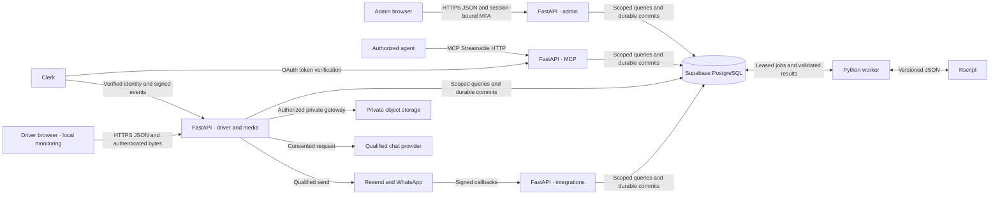

# RAFIQ API specification

**Status.** Implementation contract proposed for review. Product requirements, operating limits, and release gates are inherited from the PRD and TRD. Route names, schemas, and the provisional choices in §18 are introduced here. This repository contains planning documents. Runtime, scale, and provider qualification depend on the evidence in TRD §8.

## 1. Overview and Scope

RAFIQ supports private controlled driving sessions, incident review, analysis, reports, and a limited internal administration surface. The [PRD](PRD.md) governs product behavior. The [TRD](TRD.md) governs technical guarantees and release targets. [ARCHITECTURE](ARCHITECTURE.md) governs module ownership and deployment boundaries. [EXPERIENCE](EXPERIENCE.md) governs screen flows and state presentation. [DESIGN](DESIGN.md) supplies visual references, with RAFIQ-specific warning, chart, and focus design tracked in EXPERIENCE.

Consumers include the Next.js driver and admin applications, a compatible authorized MCP client, the Python worker and R process, identity services, and qualified alert and optional chat providers. Supervisors use delegated controls in the already configured session on the driver’s device. Contacts receive messages directly through eligible channels.

## 2. API Architecture Decision

**ADR API-01.** Adopt HTTPS REST/JSON for product operations, HTTP binary transfer for authenticated private files, bounded polling for durable job status, Streamable HTTP for MCP, and provider webhooks for delivery and identity events. Use in-process interfaces within FastAPI, transactional PostgreSQL job claims across the worker boundary, and versioned JSON across the Python-to-R process boundary. The browser owns live camera processing, warnings, the monitoring clock, and immediate safety-related controls.

This design follows the module and deployment model in ARCHITECTURE §§3 and 8, preserves offline operation under PRD FR-08 and TRD §2, and supports the pending, ready, and unavailable views in EXPERIENCE. Browser clients fetch bounded projections for known views. SQL-backed jobs carry immutable inputs and status across restarts without operating a second messaging service. FastAPI retains control of file authorization at the expense of gateway bandwidth. Polls add some latency and request volume, which must fit measured load and zero-cost quotas.

| Alternative | Assessment for RAFIQ and revisit condition |
| --- | --- |
| GraphQL | Flexible ad hoc queries add resolver authorization and query-cost controls for views with known fields. Revisit if measured read composition costs persist across multiple independently evolving consumers. |
| gRPC | A typed binary protocol fits independent high-volume services. In-process calls and the versioned R process boundary cover the current deployment. Revisit after a measured reason to split services. |
| tRPC | Shared TypeScript types are useful within a TypeScript deployment. The API here is Python and also serves protocol-neutral consumers. Generate HTTP client types from OpenAPI. |
| WebSockets | Bidirectional push brings reconnect, authorization refresh, and connection capacity work. Warning and session controls are on-device and hosted jobs tolerate periodic status reads. Revisit with a measured need for bidirectional hosted interaction. |
| Standalone SSE | One-way push could improve progress latency at higher scale. Polling has a simpler authorization and recovery path. Revisit if measured poll load or delay exceeds a qualified operating budget. MCP may use request-scoped SSE under its own protocol. |
| WebRTC | A peer media channel has no required consumer. Capture is local and replay uses consented, retained objects. Revisit only with an approved live media requirement. |
| Webhooks | Appropriate for asynchronous provider events after signature verification, durable recording, and deduplication. Apply provider retry and acknowledgment rules. |
| External queue or event broker | PostgreSQL supports durable claims and atomic job insertion with source writes. Revisit if contention, backlog, or isolation goals cannot be met by measured tuning within the deployment constraints. |

## 3. Communication Architecture



An HTTPS request returns a committed result or a durable status reference. Private data is fetched from FastAPI. Authorization and object resolution happen before private bytes leave the gateway. The browser keeps the configured offline session, status, and encrypted queue locally. Browser pause, cancellation, and recovery take effect immediately. Fresh online emergency confirmation is a separate, time-sensitive boundary.

## 4. API Design Principles

- Use `/api/v1` for product REST, with `/api/v1/admin` for administration, `/webhooks/...` for provider-attributed callbacks, and `/mcp` for the independent MCP protocol. Stable operation IDs are used in this document’s traceability tables. Use JSON `camelCase`. Success responses are typed resources, projections, or items-and-cursor pages. Binary and redirect responses use their documented media type.
- Use UUIDs for client-created device, session, sync-event, and clip IDs and for other RAFIQ UUID resources. Provider identifiers and MCP job IDs are opaque to clients. Absolute timestamps are RFC 3339 UTC in responses. Elapsed timestamps are integer milliseconds relative to the session clock. Calendar date bounds use the supplied IANA zone. Units, denominator, and precision travel with R results. Preserve unrounded values for eligibility checks.
- Reject unrecognized product input fields and enforce bounded lists, valid identifiers, parent relationships, and release-specific catalog values. Provider envelope fields follow provider schemas. Obtain the caller and owner from verified authority. Use body payloads for secrets, exact email lookup, and rich private filters. Avoid sensitive values in URLs and logs.
- Require `Idempotency-Key` for job starts, export requests, and support messages. Bind it to effective caller, operation, and the canonical request. An identical authorized retry yields the original logical outcome, and changed input under the same key gives `409`. The scope remains bounded by the resource’s lifetime and the supported retry horizon. Persist device, session, clip, and sync replay identities in their own contracts. Recheck authority on replays.
- Return an opaque `X-Request-Id` on hosted responses. Honor `Retry-After` for throttling, unavailable dependencies where a retry hint is available, and asynchronous polling. See §§10–13 for response and lifecycle rules.

## 5. Authentication and Authorization

| Caller | Authority | Release boundary |
| --- | --- | --- |
| Public visitor | Clerk signup, verification, sign-in and recovery | Only qualified providers are advertised. Private RAFIQ operations require verified authority. |
| Driver | Verified Clerk browser session presented as a bearer token to REST and the private gateway | Resolve subject to the driver, check current eligibility, action, owners and parents, consent, source, and lifecycle. Set transaction-local PostgreSQL RLS context under the restricted runtime role. |
| Supervisor | Explicit session-local delegation on the same device | Pause, acknowledge regular warnings, and cancel pending alerts. The stationary driver alone starts, resumes, ends, authorizes or revokes delegation, and uses private review and settings. Delegation ends at revocation or session end. |
| Compatible MCP client | Clerk OAuth CIMD, S256 PKCE, explicit per-scope consent and current access token | Validate issuer, audience/resource, status, expiry, client, driver, and current grant. Use distinct `driving:read` and `reports:author` scopes for the two product grants. Bind report work to its initiating driver, client, and authoring grant. |
| Admin | Verified Clerk identity, active separate admin principal, and FastAPI TOTP verification bound to the Clerk session | Apply current Owner or Staff grants on each request. Support plus suspension permission is required for suspension and reinstatement. Require fresh verification for sensitive changes. |
| Provider or worker | Verified callback signature or restricted workload identity | Verify the provider/account and match the expected event or destination. Workers receive only authorized job inputs and publish under a current lease. |

The browser clears decrypted views and active keys across tabs on sign-out, account change, or known suspension. An already configured offline session retains local warnings within its supported limit. Reinstatement requires fresh sign-in and fresh MCP consent, with normal queue eligibility checks. TOTP enrollment and recovery outputs are private, single-use where applicable, and excluded from logs. Keep driver, staff, and OAuth authority distinct even if the same verified person uses multiple surfaces.

## 6. API Contract Catalog

| Module | Operations and local or internal responsibilities |
| --- | --- |
| M01 Accounts and Access | Account status and onboarding, profile and preferences, account deletion, Clerk identity events, and narrow authorized support bridge to M09. |
| M02 On-device Monitoring | Local readiness, asset verification, camera preview and inference, warn, pause, manually resume, acknowledge, and delegated controls. Emit versioned observation records to M03. No hosted live-control interface. |
| M03 Session Records and Sync | Register and unwrap device keys, start, sync, finalize, list, inspect timeline and incident detail, delete. Own durable records and receipts. |
| M04 Clips and Media | Read and update consent, register clip metadata, upload, list and inspect private clips, stream ranges, delete. Capture and unused buffer remain local. |
| M05 Emergency Mode | Read and edit ordered contacts, show fixed preview and channel status, prepare and confirm an eligible attempt, read recorded sequence, receive signed delivery events. Local qualification and cancellation feed the live dispatch guard. |
| M06 Analytics and Evaluation | Dashboard landing and ready session result, overview, What-If sources and runs, Studio datasets and runs, eligible aggregate exports, approved benchmark. R computes results internally. |
| M07 MCP and Reports | Protected resource metadata, scoped MCP read and report tools, browser connection discovery and revocation, driver report status, review, export and retrieval. |
| M08 Optional Chat | Provider status, initiate and complete link, consent, send or close temporary chat, disconnect. |
| M09 Administration | Admin entry, invitations, TOTP, recovery, grants, health, readiness, adoption, support lookup and actions, and Owner audit. |
| M10 Platform Operations | Internal job claim and completion, telemetry, purge and restore coordination. Interface to M09 through bounded authorized projections. |

## 7. Detailed Endpoint / Operation Specifications

<details>
<summary>HTTP operation index</summary>

| Module | Method and path | Operation ID |
| --- | --- | --- |
| M01 | `GET /api/v1/account` | `getAccount` |
| M01 | `PUT /api/v1/account/controlled-use` | `acceptControlledUse` |
| M01 | `PATCH /api/v1/account` | `updateAccount` |
| M01 | `GET /api/v1/account/preferences` | `getPreferences` |
| M01 | `PUT /api/v1/account/preferences` | `putPreferences` |
| M01 | `DELETE /api/v1/account` | `deleteAccount` |
| M01 | `POST /webhooks/clerk` | `receiveClerkEvent` |
| M03 | `PUT /api/v1/devices/{deviceId}/key` | `registerDeviceKey` |
| M03 | `POST /api/v1/devices/{deviceId}/key/unwrap` | `unwrapDeviceKey` |
| M03 | `PUT /api/v1/sessions/{sessionId}` | `startSession` |
| M03 | `POST /api/v1/sessions/{sessionId}/sync` | `syncSession` |
| M03 | `PUT /api/v1/sessions/{sessionId}/finalization` | `finalizeSession` |
| M03 | `GET /api/v1/sessions` | `listSessions` |
| M03 | `GET /api/v1/sessions/{sessionId}` | `getSession` |
| M03 | `GET /api/v1/sessions/{sessionId}/timeline` | `getTimeline` |
| M03 | `GET /api/v1/sessions/{sessionId}/incidents/{incidentId}` | `getIncident` |
| M03 | `DELETE /api/v1/sessions/{sessionId}` | `deleteSession` |
| M04 | `GET /api/v1/recording-consent` | `getRecordingConsent` |
| M04 | `PUT /api/v1/recording-consent` | `putRecordingConsent` |
| M04 | `PUT /api/v1/clips/{clipId}` | `registerClip` |
| M04 | `PUT /api/v1/clips/{clipId}/content` | `uploadClip` |
| M04 | `GET /api/v1/clips` | `listClips` |
| M04 | `GET /api/v1/clips/{clipId}` | `getClip` |
| M04 | `GET /api/v1/clips/{clipId}/content` | `playClip` |
| M04 | `DELETE /api/v1/clips/{clipId}` | `deleteClip` |
| M05 | `GET /api/v1/emergency/settings` | `getEmergencySettings` |
| M05 | `PUT /api/v1/emergency/contacts/{contactId}` | `putEmergencyContact` |
| M05 | `DELETE /api/v1/emergency/contacts/{contactId}` | `deleteEmergencyContact` |
| M05 | `PUT /api/v1/emergency/contact-order` | `putEmergencyContactOrder` |
| M05 | `PUT /api/v1/emergency/location-consent` | `putLocationConsent` |
| M05 | `POST /api/v1/sessions/{sessionId}/emergency/confirmation` | `prepareEmergencyAttempt` |
| M05 | `POST /api/v1/sessions/{sessionId}/emergency/attempts` | `confirmEmergencyAttempt` |
| M05 | `PUT /api/v1/sessions/{sessionId}/emergency/sequences/{sequenceId}/invalidation` | `invalidateEmergencySequence` |
| M05 | `GET /api/v1/sessions/{sessionId}/emergency/sequences/{sequenceId}` | `getEmergencySequence` |
| M05 | `POST /webhooks/resend` | `receiveResendEvent` |
| M05 | `GET /webhooks/whatsapp` | `verifyWhatsAppWebhook` |
| M05 | `POST /webhooks/whatsapp` | `receiveWhatsAppEvent` |
| M06 | `GET /api/v1/dashboard` | `getDashboard` |
| M06 | `GET /api/v1/sessions/{sessionId}/analytics` | `getSessionAnalytics` |
| M06 | `POST /api/v1/analysis/personal-overview` | `resolvePersonalOverview` |
| M06 | `GET /api/v1/analysis/what-if/sources` | `listReplaySources` |
| M06 | `POST /api/v1/analysis/what-if/runs` | `startSimulation` |
| M06 | `GET /api/v1/analysis/what-if/runs` | `listSimulations` |
| M06 | `GET /api/v1/analysis/what-if/runs/{jobId}` | `getSimulation` |
| M06 | `GET /api/v1/analysis/studio/datasets` | `listStudyDatasets` |
| M06 | `POST /api/v1/analysis/studio/runs` | `startStudy` |
| M06 | `GET /api/v1/analysis/studio/runs` | `listStudies` |
| M06 | `GET /api/v1/analysis/studio/runs/{jobId}` | `getStudy` |
| M06 | `GET /api/v1/analysis/studio/runs/{jobId}/export` | `downloadStudyAggregate` |
| M06 | `GET /api/v1/analysis/benchmark` | `getBenchmark` |
| M07 | `GET /.well-known/oauth-protected-resource/mcp` | `getMcpResourceMetadata` |
| M07 | `POST /mcp` | `handleMcp` |
| M07 | `GET /api/v1/connections/mcp` | `getMcpConnections` |
| M07 | `DELETE /api/v1/connections/mcp/grants/{grantId}` | `revokeMcpGrant` |
| M07 | `GET /api/v1/reports` | `listReports` |
| M07 | `GET /api/v1/report-jobs/{jobId}` | `getReportStatus` |
| M07 | `GET /api/v1/reports/{reportId}` | `getReport` |
| M07 | `POST /api/v1/reports/{reportId}/exports` | `createReportExport` |
| M07 | `GET /api/v1/reports/{reportId}/exports/{exportId}` | `getReportExport` |
| M07 | `GET /api/v1/reports/{reportId}/exports/{exportId}/downloads/{downloadId}` | `downloadReportExport` |
| M08 | `GET /api/v1/connections/chat` | `getChatConnections` |
| M08 | `POST /api/v1/connections/chat/{provider}/link` | `startChatLink` |
| M08 | `POST /api/v1/connections/chat/{provider}/link/completion` | `completeChatLink` |
| M08 | `PUT /api/v1/connections/chat/{provider}/consent` | `putChatConsent` |
| M08 | `POST /api/v1/connections/chat/{provider}/messages` | `sendChatMessage` |
| M08 | `DELETE /api/v1/connections/chat/{provider}/conversations/{conversationId}` | `closeChat` |
| M08 | `DELETE /api/v1/connections/chat/{provider}` | `disconnectChat` |
| M09 | `GET /api/v1/admin/entry` | `getAdminEntry` |
| M09 | `POST /api/v1/admin/invitations` | `createAdminInvite` |
| M09 | `POST /api/v1/admin/invitations/redemption` | `redeemAdminInvite` |
| M09 | `POST /api/v1/admin/mfa/enrollment` | `startAdminEnrollment` |
| M09 | `POST /api/v1/admin/mfa/enrollment/verification` | `verifyAdminEnrollment` |
| M09 | `POST /api/v1/admin/mfa/verification` | `verifyAdminTotp` |
| M09 | `POST /api/v1/admin/mfa/recovery` | `recoverAdminMfa` |
| M09 | `GET /api/v1/admin/staff` | `listStaff` |
| M09 | `PUT /api/v1/admin/staff/{adminId}/access` | `putStaffAccess` |
| M09 | `POST /api/v1/admin/staff/{adminId}/mfa/reset` | `resetStaffMfa` |
| M09 | `GET /api/v1/admin/health` | `getServiceHealth` |
| M09 | `GET /api/v1/admin/release-readiness` | `getReleaseReadiness` |
| M09 | `POST /api/v1/admin/adoption` | `resolveAdoption` |
| M09 | `POST /api/v1/admin/support/accounts/lookup` | `lookupSupportedAccount` |
| M09 | `POST /api/v1/admin/support/accounts/{accountId}/messages` | `sendSupportMessage` |
| M09 | `PUT /api/v1/admin/support/accounts/{accountId}/status` | `changeAccountLifecycle` |
| M09 | `GET /api/v1/admin/audit` | `listAdminAudit` |

</details>


The OpenAPI block below is the HTTP wire contract. Its operation descriptions, reusable parameters, response examples, and schemas apply together with §§8–14. Each operation with no request-body declaration accepts no product body. Each operation with no parameter declaration has no operation-specific parameters. The global security requirement is a verified driver bearer session unless overridden. The MCP transport uses the linked MCP binding and tool contracts in §9.

### Binary transfer example

A request with `Authorization: Bearer <driver-session>` and `Range: bytes=0-1023` to `GET /api/v1/clips/8e3a6200-4d85-4abd-a790-000000000007/content` returns `206 Partial Content`, `Content-Type: video/webm`, `Accept-Ranges: bytes`, `Content-Range: bytes 0-1023/128000`, and `Content-Length: 1024` followed by the selected bytes. A full upload uses `PUT` on the same content path with the registered 128000-byte video-only WebM and `Content-Type: video/webm`. Downloaded reports use the PDF or DOCX media type and `Content-Disposition: attachment`.

<details>
<summary>OpenAPI 3.1 contract</summary>

```yaml
openapi: "3.1.2"
info:
  title: "RAFIQ API"
  version: "1.0.0-proposed"
  description: "Product REST, private bytes, provider callbacks and the MCP HTTP binding. Operation authority is detailed by x-authority and section 5."
servers: [{"url":"https://api.rafiq.example","description":"Illustrative host. Deploy each surface only to its approved origin."}]
security: [{"driverSession":[]}]
tags: [{"name":"M01","description":"Accounts and Access"},{"name":"M02","description":"On-device Monitoring"},{"name":"M03","description":"Session Records and Sync"},{"name":"M04","description":"Clips and Media"},{"name":"M05","description":"Emergency Mode"},{"name":"M06","description":"Analytics and Evaluation"},{"name":"M07","description":"MCP and Reports"},{"name":"M08","description":"Optional Chat"},{"name":"M09","description":"Administration"},{"name":"M10","description":"Platform Operations"}]
paths:
  "/api/v1/account":
    get:
      operationId: "getAccount"
      tags: ["M01"]
      description: "Return the current eligibility gate after checking the Clerk session and its verified primary email. First resolution creates a stable driver account for the Clerk subject. Unverified sessions receive a verification-required problem without account fields. Restricted accounts receive the standard restricted problem with the published support contact."
      x-authority: "Clerk session · account status only"
      responses:
        "200":
          description: "Successful response."
          headers:
            X-Request-Id: {"$ref":"#/components/headers/RequestId"}
            Cache-Control: {"$ref":"#/components/headers/CachePrivate"}
          content:
            "application/json":
              schema: {"$ref":"#/components/schemas/Account"}
              example: {"accountId":"8e3a6200-4d85-4abd-a790-000000000001","status":"active","displayName":"Nour Ahmed","registeredEmail":"nour@example.net","verified":true,"acceptedVersion":"controlled-use-1","requiredVersion":"controlled-use-1","supportContact":null}
        "401": {"$ref":"#/components/responses/Http401"}
        "403": {"$ref":"#/components/responses/Http403"}
        "500": {"$ref":"#/components/responses/Http500"}
        "503": {"$ref":"#/components/responses/Http503"}
    patch:
      operationId: "updateAccount"
      tags: ["M01"]
      description: "Update the owned display name. Reject an empty patch and identity, lifecycle, or verification fields."
      x-authority: "Verified eligible driver · current owner and action"
      requestBody:
        required: true
        content:
          "application/json":
            schema: {"$ref":"#/components/schemas/AccountPatch"}
            example: {"displayName":"Nour Ahmed"}
      responses:
        "200":
          description: "Successful response."
          headers:
            X-Request-Id: {"$ref":"#/components/headers/RequestId"}
            Cache-Control: {"$ref":"#/components/headers/CachePrivate"}
          content:
            "application/json":
              schema: {"$ref":"#/components/schemas/Account"}
              example: {"accountId":"8e3a6200-4d85-4abd-a790-000000000001","status":"active","displayName":"Nour Ahmed","registeredEmail":"nour@example.net","verified":true,"acceptedVersion":"controlled-use-1","requiredVersion":"controlled-use-1","supportContact":null}
        "400": {"$ref":"#/components/responses/Http400"}
        "401": {"$ref":"#/components/responses/Http401"}
        "403": {"$ref":"#/components/responses/Http403"}
        "422": {"$ref":"#/components/responses/Http422"}
        "500": {"$ref":"#/components/responses/Http500"}
    delete:
      operationId: "deleteAccount"
      tags: ["M01"]
      description: "Confirm account deletion in the driver experience, revoke access immediately, and commit lifecycle and purge intent. Clear local private state after acknowledgment. Administrative support cannot call this operation for another account."
      x-authority: "Verified eligible driver · current owner and action"
      responses:
        "202":
          description: "Durably accepted for processing."
          headers:
            X-Request-Id: {"$ref":"#/components/headers/RequestId"}
            Cache-Control: {"$ref":"#/components/headers/CachePrivate"}
          content:
            "application/json":
              schema: {"$ref":"#/components/schemas/AccountDeletion"}
              example: {"state":"accessRevoked"}
        "401": {"$ref":"#/components/responses/Http401"}
        "403": {"$ref":"#/components/responses/Http403"}
        "409": {"$ref":"#/components/responses/Http409"}
        "500": {"$ref":"#/components/responses/Http500"}
  "/api/v1/account/controlled-use":
    put:
      operationId: "acceptControlledUse"
      tags: ["M01"]
      description: "Record acceptance for the currently published controlled-use version. Retry the same version safely. Return a conflict if the version changed."
      x-authority: "Verified eligible driver · onboarding access"
      requestBody:
        required: true
        content:
          "application/json":
            schema: {"$ref":"#/components/schemas/Acceptance"}
            example: {"version":"controlled-use-1","accepted":true}
      responses:
        "200":
          description: "Successful response."
          headers:
            X-Request-Id: {"$ref":"#/components/headers/RequestId"}
            Cache-Control: {"$ref":"#/components/headers/CachePrivate"}
          content:
            "application/json":
              schema: {"$ref":"#/components/schemas/Account"}
              example: {"accountId":"8e3a6200-4d85-4abd-a790-000000000001","status":"active","displayName":"Nour Ahmed","registeredEmail":"nour@example.net","verified":true,"acceptedVersion":"controlled-use-1","requiredVersion":"controlled-use-1","supportContact":null}
        "400": {"$ref":"#/components/responses/Http400"}
        "401": {"$ref":"#/components/responses/Http401"}
        "403": {"$ref":"#/components/responses/Http403"}
        "409": {"$ref":"#/components/responses/Http409"}
        "422": {"$ref":"#/components/responses/Http422"}
        "500": {"$ref":"#/components/responses/Http500"}
  "/api/v1/account/preferences":
    get:
      operationId: "getPreferences"
      tags: ["M01"]
      description: "Return general monitoring preferences. The browser tests whether a preferred built-in camera is available locally."
      x-authority: "Verified eligible driver · current owner and action"
      responses:
        "200":
          description: "Successful response."
          headers:
            X-Request-Id: {"$ref":"#/components/headers/RequestId"}
            Cache-Control: {"$ref":"#/components/headers/CachePrivate"}
          content:
            "application/json":
              schema: {"$ref":"#/components/schemas/Preferences"}
              example: {"cameraDeviceId":null,"warningAudio":false,"warningVisibility":"enhanced"}
        "401": {"$ref":"#/components/responses/Http401"}
        "403": {"$ref":"#/components/responses/Http403"}
        "500": {"$ref":"#/components/responses/Http500"}
    put:
      operationId: "putPreferences"
      tags: ["M01"]
      description: "Replace general preferences for subsequent sessions. Validate camera preference and warning presentation; live thresholds and policy are configured by release."
      x-authority: "Verified eligible driver · current owner and action"
      requestBody:
        required: true
        content:
          "application/json":
            schema: {"$ref":"#/components/schemas/Preferences"}
            example: {"cameraDeviceId":null,"warningAudio":false,"warningVisibility":"enhanced"}
      responses:
        "200":
          description: "Successful response."
          headers:
            X-Request-Id: {"$ref":"#/components/headers/RequestId"}
            Cache-Control: {"$ref":"#/components/headers/CachePrivate"}
          content:
            "application/json":
              schema: {"$ref":"#/components/schemas/Preferences"}
              example: {"cameraDeviceId":null,"warningAudio":false,"warningVisibility":"enhanced"}
        "400": {"$ref":"#/components/responses/Http400"}
        "401": {"$ref":"#/components/responses/Http401"}
        "403": {"$ref":"#/components/responses/Http403"}
        "422": {"$ref":"#/components/responses/Http422"}
        "500": {"$ref":"#/components/responses/Http500"}
  "/webhooks/clerk":
    post:
      operationId: "receiveClerkEvent"
      tags: ["M01"]
      description: "Verify Svix headers against the raw body. Deduplicate and reconcile the authoritative Clerk identity lifecycle and timestamps for verified access and adoption. Reject stale projections and apply current deletion and suspension state. Ignore authenticated unrelated events after validation."
      x-authority: "Verified clerk callback"
      security: [{"clerkSignature":[]}]
      parameters: [{"$ref":"#/components/parameters/SvixId"},{"$ref":"#/components/parameters/SvixTimestamp"},{"$ref":"#/components/parameters/SvixSignature"}]
      requestBody:
        required: true
        content:
          "application/json":
            schema: {"$ref":"#/components/schemas/ProviderIdentityEnvelope"}
            example: {"type":"user.updated","data":{"id":"user_example_y5z8"}}
      responses:
        "200":
          description: "Authenticated callback was applied durably, already recorded, or safe to ignore. Empty body."
          headers:
            X-Request-Id: {"$ref":"#/components/headers/RequestId"}
            Cache-Control: {"$ref":"#/components/headers/CachePrivate"}
        "400": {"$ref":"#/components/responses/Http400"}
        "401": {"$ref":"#/components/responses/Http401"}
        "500": {"$ref":"#/components/responses/Http500"}
        "503": {"$ref":"#/components/responses/Http503"}
  "/api/v1/devices/{deviceId}/key":
    put:
      operationId: "registerDeviceKey"
      tags: ["M03"]
      description: "Bind a browser-generated random 256-bit key to the verified driver/device and return its authenticated encrypted wrap. Identical key registration is replay-safe. Reject rebinding to a different key or owner. The browser persists only the wrapped form."
      x-authority: "Verified eligible driver · current owner and action"
      parameters: [{"$ref":"#/components/parameters/PathDevice"}]
      requestBody:
        required: true
        content:
          "application/json":
            schema: {"$ref":"#/components/schemas/DeviceKeyInput"}
            example: {"dataKey":"c2FtcGxlLWtleS1mb3ItZG9jcy1vbmx5LTAwMDAwMDA=","keyVersion":"wrap-1"}
      responses:
        "200":
          description: "Successful response."
          headers:
            X-Request-Id: {"$ref":"#/components/headers/RequestId"}
            Cache-Control: {"$ref":"#/components/headers/CachePrivate"}
          content:
            "application/json":
              schema: {"$ref":"#/components/schemas/DeviceKey"}
              example: {"deviceId":"8e3a6200-4d85-4abd-a790-000000000002","keyVersion":"wrap-1","wrappedKey":"wrap_example_Gf23v33"}
        "201":
          description: "Resource created."
          headers:
            X-Request-Id: {"$ref":"#/components/headers/RequestId"}
            Cache-Control: {"$ref":"#/components/headers/CachePrivate"}
          content:
            "application/json":
              schema: {"$ref":"#/components/schemas/DeviceKey"}
              example: {"deviceId":"8e3a6200-4d85-4abd-a790-000000000002","keyVersion":"wrap-1","wrappedKey":"wrap_example_Gf23v33"}
        "400": {"$ref":"#/components/responses/Http400"}
        "401": {"$ref":"#/components/responses/Http401"}
        "403": {"$ref":"#/components/responses/Http403"}
        "404": {"$ref":"#/components/responses/Http404"}
        "409": {"$ref":"#/components/responses/Http409"}
        "422": {"$ref":"#/components/responses/Http422"}
        "429": {"$ref":"#/components/responses/Http429"}
        "500": {"$ref":"#/components/responses/Http500"}
  "/api/v1/devices/{deviceId}/key/unwrap":
    post:
      operationId: "unwrapDeviceKey"
      tags: ["M03"]
      description: "After same-driver eligible online reauthentication, validate the registered device and the exact wrap/version bound to it. Return the usable key to memory over TLS. Apply a no-store response and redact key input, output, and errors."
      x-authority: "Verified eligible driver · current owner and action"
      parameters: [{"$ref":"#/components/parameters/PathDevice"}]
      requestBody:
        required: true
        content:
          "application/json":
            schema: {"$ref":"#/components/schemas/KeyUnwrapRequest"}
            example: {"keyVersion":"wrap-1","wrappedKey":"wrap_example_Gf23v33"}
      responses:
        "200":
          description: "Successful response."
          headers:
            X-Request-Id: {"$ref":"#/components/headers/RequestId"}
            Cache-Control: {"$ref":"#/components/headers/CachePrivate"}
          content:
            "application/json":
              schema: {"$ref":"#/components/schemas/UnwrappedKey"}
              example: {"deviceId":"8e3a6200-4d85-4abd-a790-000000000002","keyVersion":"wrap-1","dataKey":"c2FtcGxlLWtleS1mb3ItZG9jcy1vbmx5LTAwMDAwMDA="}
        "400": {"$ref":"#/components/responses/Http400"}
        "401": {"$ref":"#/components/responses/Http401"}
        "403": {"$ref":"#/components/responses/Http403"}
        "404": {"$ref":"#/components/responses/Http404"}
        "409": {"$ref":"#/components/responses/Http409"}
        "422": {"$ref":"#/components/responses/Http422"}
        "429": {"$ref":"#/components/responses/Http429"}
        "500": {"$ref":"#/components/responses/Http500"}
  "/api/v1/sessions/{sessionId}":
    put:
      operationId: "startSession"
      tags: ["M03"]
      description: "Admit the client-generated session UUID after current controlled-use acceptance, active account, device binding, stationary readiness, recording decision and revision, and approved asset/policy checks. Supervised mode requires independent eligibility. Replay identical admission without re-creating an ended session."
      x-authority: "Verified eligible driver · current owner and action"
      parameters: [{"$ref":"#/components/parameters/PathSession"}]
      requestBody:
        required: true
        content:
          "application/json":
            schema: {"$ref":"#/components/schemas/StartSession"}
            example:
              deviceId: "8e3a6200-4d85-4abd-a790-000000000002"
              startedAt: "2026-11-10T09:00:00Z"
              versions:
                catalog: "baseline-1"
                model: "fixture-1"
                policy: "stationary-1"
              readiness:
                cameraReady: true
                assetsReady: true
                stationary: true
                recordingDecision: "granted"
                operatingMode: "stationary"
                supervisorDelegated: false
              consentRevision: "consent-2"
              monitoringTabId: "8e3a6200-4d85-4abd-a790-000000000018"
      responses:
        "200":
          description: "Successful response."
          headers:
            X-Request-Id: {"$ref":"#/components/headers/RequestId"}
            Cache-Control: {"$ref":"#/components/headers/CachePrivate"}
          content:
            "application/json":
              schema: {"$ref":"#/components/schemas/Session"}
              example:
                sessionId: "8e3a6200-4d85-4abd-a790-000000000003"
                startedAt: "2026-11-10T09:00:00Z"
                endedAt: null
                state: "active"
                analyticsState: "pending"
                lastDurableObservationMs: null
                versions:
                  catalog: "baseline-1"
                  model: "fixture-1"
                  policy: "stationary-1"
        "201":
          description: "Resource created."
          headers:
            X-Request-Id: {"$ref":"#/components/headers/RequestId"}
            Cache-Control: {"$ref":"#/components/headers/CachePrivate"}
          content:
            "application/json":
              schema: {"$ref":"#/components/schemas/Session"}
              example:
                sessionId: "8e3a6200-4d85-4abd-a790-000000000003"
                startedAt: "2026-11-10T09:00:00Z"
                endedAt: null
                state: "active"
                analyticsState: "pending"
                lastDurableObservationMs: null
                versions:
                  catalog: "baseline-1"
                  model: "fixture-1"
                  policy: "stationary-1"
        "400": {"$ref":"#/components/responses/Http400"}
        "401": {"$ref":"#/components/responses/Http401"}
        "403": {"$ref":"#/components/responses/Http403"}
        "404": {"$ref":"#/components/responses/Http404"}
        "409": {"$ref":"#/components/responses/Http409"}
        "422": {"$ref":"#/components/responses/Http422"}
        "429": {"$ref":"#/components/responses/Http429"}
        "500": {"$ref":"#/components/responses/Http500"}
    get:
      operationId: "getSession"
      tags: ["M03"]
      description: "Return current owned session details and sync/analytics state for refresh. Expires with session metadata."
      x-authority: "Verified eligible driver · current owner and action"
      parameters: [{"$ref":"#/components/parameters/PathSession"}]
      responses:
        "200":
          description: "Successful response."
          headers:
            X-Request-Id: {"$ref":"#/components/headers/RequestId"}
            Cache-Control: {"$ref":"#/components/headers/CachePrivate"}
          content:
            "application/json":
              schema: {"$ref":"#/components/schemas/Session"}
              example:
                sessionId: "8e3a6200-4d85-4abd-a790-000000000003"
                startedAt: "2026-11-10T09:00:00Z"
                endedAt: "2026-11-10T09:20:00Z"
                state: "ended"
                analyticsState: "ready"
                lastDurableObservationMs: 1200000
                versions:
                  catalog: "baseline-1"
                  model: "fixture-1"
                  policy: "stationary-1"
        "401": {"$ref":"#/components/responses/Http401"}
        "403": {"$ref":"#/components/responses/Http403"}
        "404": {"$ref":"#/components/responses/Http404"}
        "429": {"$ref":"#/components/responses/Http429"}
        "500": {"$ref":"#/components/responses/Http500"}
    delete:
      operationId: "deleteSession"
      tags: ["M03"]
      description: "Commit immediate denial for the session and its dependent resources, preserve deletion precedence on replay, and enqueue purge. An already acknowledged owner-scoped deletion remains idempotent while its deletion receipt exists."
      x-authority: "Verified eligible driver · current owner and action"
      parameters: [{"$ref":"#/components/parameters/PathSession"}]
      responses:
        "204":
          description: "Successful response with no body."
          headers:
            X-Request-Id: {"$ref":"#/components/headers/RequestId"}
            Cache-Control: {"$ref":"#/components/headers/CachePrivate"}
        "401": {"$ref":"#/components/responses/Http401"}
        "403": {"$ref":"#/components/responses/Http403"}
        "404": {"$ref":"#/components/responses/Http404"}
        "409": {"$ref":"#/components/responses/Http409"}
        "429": {"$ref":"#/components/responses/Http429"}
        "500": {"$ref":"#/components/responses/Http500"}
  "/api/v1/sessions/{sessionId}/sync":
    post:
      operationId: "syncSession"
      tags: ["M03"]
      description: "Check the session/device/version envelope, then validate, durably commit, and acknowledge each item in request order. An invalid envelope yields no item outcomes. An accepted envelope reports item-level retry, invalid, conflict, or permanent ineligibility without rolling back other committed items. Verify parent identifiers, relative and capture times, versions, and lifecycle."
      x-authority: "Verified eligible driver · current owner and action"
      parameters: [{"$ref":"#/components/parameters/PathSession"}]
      requestBody:
        required: true
        content:
          "application/json":
            schema: {"$ref":"#/components/schemas/SyncBatch"}
            example:
              schemaVersion: 1
              deviceId: "8e3a6200-4d85-4abd-a790-000000000002"
              versions:
                catalog: "baseline-1"
                model: "fixture-1"
                policy: "stationary-1"
              items: [{"itemId":"8e3a6200-4d85-4abd-a790-000000000019","capturedAt":"2026-11-10T09:05:15Z","kind":"observationInterval","payload":{"startMs":295000,"endMs":315000,"state":"usable","reason":null,"observableBehaviors":["drowsiness"]}}]
      responses:
        "200":
          description: "Successful response."
          headers:
            X-Request-Id: {"$ref":"#/components/headers/RequestId"}
            Cache-Control: {"$ref":"#/components/headers/CachePrivate"}
          content:
            "application/json":
              schema: {"$ref":"#/components/schemas/SyncResult"}
              example:
                receipts: [{"itemId":"8e3a6200-4d85-4abd-a790-000000000019","outcome":"committed"}]
                session:
                  sessionId: "8e3a6200-4d85-4abd-a790-000000000003"
                  startedAt: "2026-11-10T09:00:00Z"
                  endedAt: null
                  state: "active"
                  analyticsState: "pending"
                  lastDurableObservationMs: 315000
                  versions:
                    catalog: "baseline-1"
                    model: "fixture-1"
                    policy: "stationary-1"
        "400": {"$ref":"#/components/responses/Http400"}
        "401": {"$ref":"#/components/responses/Http401"}
        "403": {"$ref":"#/components/responses/Http403"}
        "404": {"$ref":"#/components/responses/Http404"}
        "409": {"$ref":"#/components/responses/Http409"}
        "413": {"$ref":"#/components/responses/Http413"}
        "422": {"$ref":"#/components/responses/Http422"}
        "429": {"$ref":"#/components/responses/Http429"}
        "500": {"$ref":"#/components/responses/Http500"}
        "503": {"$ref":"#/components/responses/Http503"}
  "/api/v1/sessions/{sessionId}/finalization":
    put:
      operationId: "finalizeSession"
      tags: ["M03"]
      description: "Submit after flushing eligible required records and identify those items in the finalization manifest. The server verifies owned committed receipts for the supplied IDs and resolves observation and event references before marking the session ended. Normal end records the stationary driver end marker. Interruption recovery uses the last durable observation. Replay identical finalization safely."
      x-authority: "Verified eligible driver · current owner and action"
      parameters: [{"$ref":"#/components/parameters/PathSession"}]
      requestBody:
        required: true
        content:
          "application/json":
            schema: {"$ref":"#/components/schemas/Finalization"}
            example: {"kind":"normal","endedAt":"2026-11-10T09:20:00Z","elapsedMs":1200000,"requiredItemIds":["8e3a6200-4d85-4abd-a790-000000000019"]}
      responses:
        "200":
          description: "Successful response."
          headers:
            X-Request-Id: {"$ref":"#/components/headers/RequestId"}
            Cache-Control: {"$ref":"#/components/headers/CachePrivate"}
          content:
            "application/json":
              schema: {"$ref":"#/components/schemas/Session"}
              example:
                sessionId: "8e3a6200-4d85-4abd-a790-000000000003"
                startedAt: "2026-11-10T09:00:00Z"
                endedAt: "2026-11-10T09:20:00Z"
                state: "ended"
                analyticsState: "ready"
                lastDurableObservationMs: 1200000
                versions:
                  catalog: "baseline-1"
                  model: "fixture-1"
                  policy: "stationary-1"
        "400": {"$ref":"#/components/responses/Http400"}
        "401": {"$ref":"#/components/responses/Http401"}
        "403": {"$ref":"#/components/responses/Http403"}
        "404": {"$ref":"#/components/responses/Http404"}
        "409": {"$ref":"#/components/responses/Http409"}
        "422": {"$ref":"#/components/responses/Http422"}
        "429": {"$ref":"#/components/responses/Http429"}
        "500": {"$ref":"#/components/responses/Http500"}
        "503": {"$ref":"#/components/responses/Http503"}
  "/api/v1/sessions":
    get:
      operationId: "listSessions"
      tags: ["M03"]
      description: "List eligible owned sessions and processing states, newest start first. Return an empty page if there are no matches."
      x-authority: "Verified eligible driver · current owner and action"
      parameters: [{"$ref":"#/components/parameters/Cursor"},{"$ref":"#/components/parameters/Limit"},{"$ref":"#/components/parameters/FromUtc"},{"$ref":"#/components/parameters/BeforeUtc"},{"$ref":"#/components/parameters/SessionState"}]
      responses:
        "200":
          description: "Successful response."
          headers:
            X-Request-Id: {"$ref":"#/components/headers/RequestId"}
            Cache-Control: {"$ref":"#/components/headers/CachePrivate"}
          content:
            "application/json":
              schema: {"$ref":"#/components/schemas/SessionPage"}
              example:
                items: [{"sessionId":"8e3a6200-4d85-4abd-a790-000000000003","startedAt":"2026-11-10T09:00:00Z","endedAt":"2026-11-10T09:20:00Z","state":"ended","analyticsState":"ready","lastDurableObservationMs":1200000,"versions":{"catalog":"baseline-1","model":"fixture-1","policy":"stationary-1"}}]
                nextCursor: null
        "401": {"$ref":"#/components/responses/Http401"}
        "403": {"$ref":"#/components/responses/Http403"}
        "422": {"$ref":"#/components/responses/Http422"}
        "429": {"$ref":"#/components/responses/Http429"}
        "500": {"$ref":"#/components/responses/Http500"}
  "/api/v1/sessions/{sessionId}/timeline":
    get:
      operationId: "getTimeline"
      tags: ["M03"]
      description: "Read the requested half-open elapsed interval and intersecting authorized incident, warning, observation and emergency markers. Preserve original event bounds and groupings. Zoom changes this window only."
      x-authority: "Verified eligible driver · current owner and action"
      parameters: [{"$ref":"#/components/parameters/PathSession"},{"$ref":"#/components/parameters/StartMs"},{"$ref":"#/components/parameters/BeforeMs"}]
      responses:
        "200":
          description: "Successful response."
          headers:
            X-Request-Id: {"$ref":"#/components/headers/RequestId"}
            Cache-Control: {"$ref":"#/components/headers/CachePrivate"}
          content:
            "application/json":
              schema: {"$ref":"#/components/schemas/Timeline"}
              example:
                window:
                  startMs: 295000
                  endMs: 315000
                intervals: [{"startMs":295000,"endMs":315000,"state":"usable","reason":null,"observableBehaviors":["drowsiness"]}]
                detections: [{"detectionId":"8e3a6200-4d85-4abd-a790-000000000005","behavior":"drowsiness","startMs":300000,"endMs":304000,"confidence":0.91,"measurements":[]}]
                incidents: [{"incidentId":"8e3a6200-4d85-4abd-a790-000000000004","startMs":300000,"endMs":304000,"detectionIds":["8e3a6200-4d85-4abd-a790-000000000005"]}]
                warnings: [{"warningId":"8e3a6200-4d85-4abd-a790-000000000006","incidentId":"8e3a6200-4d85-4abd-a790-000000000004","detectionIds":["8e3a6200-4d85-4abd-a790-000000000005"],"severity":"initial","elapsedMs":302000,"acknowledgedAtMs":304000}]
                emergencies: []
        "401": {"$ref":"#/components/responses/Http401"}
        "403": {"$ref":"#/components/responses/Http403"}
        "404": {"$ref":"#/components/responses/Http404"}
        "422": {"$ref":"#/components/responses/Http422"}
        "429": {"$ref":"#/components/responses/Http429"}
        "500": {"$ref":"#/components/responses/Http500"}
  "/api/v1/sessions/{sessionId}/incidents/{incidentId}":
    get:
      operationId: "getIncident"
      tags: ["M03"]
      description: "Return original owned incident evidence and an authorized clip reference or missing-media state. Validate both parent and incident and keep independent metadata after clip deletion."
      x-authority: "Verified eligible driver · current owner and action"
      parameters: [{"$ref":"#/components/parameters/PathSession"},{"$ref":"#/components/parameters/PathIncident"}]
      responses:
        "200":
          description: "Successful response."
          headers:
            X-Request-Id: {"$ref":"#/components/headers/RequestId"}
            Cache-Control: {"$ref":"#/components/headers/CachePrivate"}
          content:
            "application/json":
              schema: {"$ref":"#/components/schemas/IncidentDetail"}
              example:
                incident:
                  incidentId: "8e3a6200-4d85-4abd-a790-000000000004"
                  startMs: 300000
                  endMs: 304000
                  detectionIds: ["8e3a6200-4d85-4abd-a790-000000000005"]
                detections: [{"detectionId":"8e3a6200-4d85-4abd-a790-000000000005","behavior":"drowsiness","startMs":300000,"endMs":304000,"confidence":0.91,"measurements":[]}]
                warnings: [{"warningId":"8e3a6200-4d85-4abd-a790-000000000006","incidentId":"8e3a6200-4d85-4abd-a790-000000000004","detectionIds":["8e3a6200-4d85-4abd-a790-000000000005"],"severity":"initial","elapsedMs":302000,"acknowledgedAtMs":304000}]
                clipId: "8e3a6200-4d85-4abd-a790-000000000007"
                clipState: "available"
        "401": {"$ref":"#/components/responses/Http401"}
        "403": {"$ref":"#/components/responses/Http403"}
        "404": {"$ref":"#/components/responses/Http404"}
        "429": {"$ref":"#/components/responses/Http429"}
        "500": {"$ref":"#/components/responses/Http500"}
  "/api/v1/recording-consent":
    get:
      operationId: "getRecordingConsent"
      tags: ["M04"]
      description: "Return the driver’s effective recording decision and clip preferences. Declining completes the readiness decision."
      x-authority: "Verified eligible driver · current owner and action"
      responses:
        "200":
          description: "Successful response."
          headers:
            X-Request-Id: {"$ref":"#/components/headers/RequestId"}
            Cache-Control: {"$ref":"#/components/headers/CachePrivate"}
          content:
            "application/json":
              schema: {"$ref":"#/components/schemas/RecordingConsent"}
              example: {"revision":"consent-1","settings":{"enabled":true,"behaviors":["drowsiness"],"preSeconds":3,"postSeconds":3}}
        "401": {"$ref":"#/components/responses/Http401"}
        "403": {"$ref":"#/components/responses/Http403"}
        "500": {"$ref":"#/components/responses/Http500"}
    put:
      operationId: "putRecordingConsent"
      tags: ["M04"]
      description: "Compare current revision, recording categories, and requested bounds. Consent revocation discards unsent items and invalidates pending publication. Retry an identical accepted change safely."
      x-authority: "Verified eligible driver · current owner and action"
      requestBody:
        required: true
        content:
          "application/json":
            schema: {"$ref":"#/components/schemas/RecordingChange"}
            example: {"expectedRevision":"consent-1","settings":{"enabled":true,"behaviors":["drowsiness"],"preSeconds":3,"postSeconds":3}}
      responses:
        "200":
          description: "Successful response."
          headers:
            X-Request-Id: {"$ref":"#/components/headers/RequestId"}
            Cache-Control: {"$ref":"#/components/headers/CachePrivate"}
          content:
            "application/json":
              schema: {"$ref":"#/components/schemas/RecordingConsent"}
              example: {"revision":"consent-1","settings":{"enabled":true,"behaviors":["drowsiness"],"preSeconds":3,"postSeconds":3}}
        "400": {"$ref":"#/components/responses/Http400"}
        "401": {"$ref":"#/components/responses/Http401"}
        "403": {"$ref":"#/components/responses/Http403"}
        "409": {"$ref":"#/components/responses/Http409"}
        "422": {"$ref":"#/components/responses/Http422"}
        "500": {"$ref":"#/components/responses/Http500"}
  "/api/v1/clips/{clipId}":
    put:
      operationId: "registerClip"
      tags: ["M04"]
      description: "Reserve metadata for a consented matching incident using the stable clip UUID. Validate incident ownership, current capture consent, age, quota, and duration/size. Identical retry returns its current state."
      x-authority: "Verified eligible driver · current owner and action"
      parameters: [{"$ref":"#/components/parameters/PathClip"}]
      requestBody:
        required: true
        content:
          "application/json":
            schema: {"$ref":"#/components/schemas/ClipRegister"}
            example: {"incidentId":"8e3a6200-4d85-4abd-a790-000000000004","consentRevision":"consent-2","capturedAt":"2026-11-10T09:04:58Z","durationMs":10000,"byteLength":128000,"truncated":false}
      responses:
        "200":
          description: "Successful response."
          headers:
            X-Request-Id: {"$ref":"#/components/headers/RequestId"}
            Cache-Control: {"$ref":"#/components/headers/CachePrivate"}
          content:
            "application/json":
              schema: {"$ref":"#/components/schemas/Clip"}
              example:
                clipId: "8e3a6200-4d85-4abd-a790-000000000007"
                sessionId: "8e3a6200-4d85-4abd-a790-000000000003"
                incidentId: "8e3a6200-4d85-4abd-a790-000000000004"
                capturedAt: "2026-11-10T09:04:58Z"
                expiresAt: "2026-11-17T09:04:58Z"
                durationMs: 10000
                byteLength: 128000
                truncated: false
                state: "available"
                unavailableReason: null
        "201":
          description: "Resource created."
          headers:
            X-Request-Id: {"$ref":"#/components/headers/RequestId"}
            Cache-Control: {"$ref":"#/components/headers/CachePrivate"}
          content:
            "application/json":
              schema: {"$ref":"#/components/schemas/Clip"}
              example:
                clipId: "8e3a6200-4d85-4abd-a790-000000000007"
                sessionId: "8e3a6200-4d85-4abd-a790-000000000003"
                incidentId: "8e3a6200-4d85-4abd-a790-000000000004"
                capturedAt: "2026-11-10T09:04:58Z"
                expiresAt: "2026-11-17T09:04:58Z"
                durationMs: 10000
                byteLength: 128000
                truncated: false
                state: "pending"
                unavailableReason: null
        "400": {"$ref":"#/components/responses/Http400"}
        "401": {"$ref":"#/components/responses/Http401"}
        "403": {"$ref":"#/components/responses/Http403"}
        "404": {"$ref":"#/components/responses/Http404"}
        "409": {"$ref":"#/components/responses/Http409"}
        "413": {"$ref":"#/components/responses/Http413"}
        "422": {"$ref":"#/components/responses/Http422"}
        "429": {"$ref":"#/components/responses/Http429"}
        "500": {"$ref":"#/components/responses/Http500"}
        "503": {"$ref":"#/components/responses/Http503"}
    get:
      operationId: "getClip"
      tags: ["M04"]
      description: "Return pending, ready, or permitted unavailable metadata with expiry. Hide expired/deleted resources and remove authorized playback links when eligibility ends."
      x-authority: "Verified eligible driver · current owner and action"
      parameters: [{"$ref":"#/components/parameters/PathClip"}]
      responses:
        "200":
          description: "Successful response."
          headers:
            X-Request-Id: {"$ref":"#/components/headers/RequestId"}
            Cache-Control: {"$ref":"#/components/headers/CachePrivate"}
          content:
            "application/json":
              schema: {"$ref":"#/components/schemas/Clip"}
              example:
                clipId: "8e3a6200-4d85-4abd-a790-000000000007"
                sessionId: "8e3a6200-4d85-4abd-a790-000000000003"
                incidentId: "8e3a6200-4d85-4abd-a790-000000000004"
                capturedAt: "2026-11-10T09:04:58Z"
                expiresAt: "2026-11-17T09:04:58Z"
                durationMs: 10000
                byteLength: 128000
                truncated: false
                state: "available"
                unavailableReason: null
        "401": {"$ref":"#/components/responses/Http401"}
        "403": {"$ref":"#/components/responses/Http403"}
        "404": {"$ref":"#/components/responses/Http404"}
        "429": {"$ref":"#/components/responses/Http429"}
        "500": {"$ref":"#/components/responses/Http500"}
    delete:
      operationId: "deleteClip"
      tags: ["M04"]
      description: "Commit immediate gateway denial and revoke clip references while preserving independent incident metadata. Purge old and orphaned bytes under the lifecycle rule. Repeated authorized deletion is safe while its receipt exists."
      x-authority: "Verified eligible driver · current owner and action"
      parameters: [{"$ref":"#/components/parameters/PathClip"}]
      responses:
        "204":
          description: "Successful response with no body."
          headers:
            X-Request-Id: {"$ref":"#/components/headers/RequestId"}
            Cache-Control: {"$ref":"#/components/headers/CachePrivate"}
        "401": {"$ref":"#/components/responses/Http401"}
        "403": {"$ref":"#/components/responses/Http403"}
        "404": {"$ref":"#/components/responses/Http404"}
        "429": {"$ref":"#/components/responses/Http429"}
        "500": {"$ref":"#/components/responses/Http500"}
  "/api/v1/clips/{clipId}/content":
    put:
      operationId: "uploadClip"
      tags: ["M04"]
      description: "Transfer full video-only WebM bytes. Enforce registered length and media limits, verify the container, and recheck source, consent, lifecycle and quota before publication. Keep partial bytes private. Retry full bytes with the same ID; conflicting bytes are rejected."
      x-authority: "Verified eligible driver · current owner and action"
      parameters: [{"$ref":"#/components/parameters/PathClip"},{"$ref":"#/components/parameters/ContentLength"}]
      requestBody:
        required: true
        content:
          "video/webm":
            schema: {}
            x-binary-note: "Raw bytes. See the binary transfer example in section 7."
      responses:
        "200":
          description: "Successful response."
          headers:
            X-Request-Id: {"$ref":"#/components/headers/RequestId"}
            Cache-Control: {"$ref":"#/components/headers/CachePrivate"}
          content:
            "application/json":
              schema: {"$ref":"#/components/schemas/Clip"}
              example:
                clipId: "8e3a6200-4d85-4abd-a790-000000000007"
                sessionId: "8e3a6200-4d85-4abd-a790-000000000003"
                incidentId: "8e3a6200-4d85-4abd-a790-000000000004"
                capturedAt: "2026-11-10T09:04:58Z"
                expiresAt: "2026-11-17T09:04:58Z"
                durationMs: 10000
                byteLength: 128000
                truncated: false
                state: "available"
                unavailableReason: null
        "400": {"$ref":"#/components/responses/Http400"}
        "401": {"$ref":"#/components/responses/Http401"}
        "403": {"$ref":"#/components/responses/Http403"}
        "404": {"$ref":"#/components/responses/Http404"}
        "409": {"$ref":"#/components/responses/Http409"}
        "413": {"$ref":"#/components/responses/Http413"}
        "415": {"$ref":"#/components/responses/Http415"}
        "422": {"$ref":"#/components/responses/Http422"}
        "429": {"$ref":"#/components/responses/Http429"}
        "500": {"$ref":"#/components/responses/Http500"}
        "503": {"$ref":"#/components/responses/Http503"}
    get:
      operationId: "playClip"
      tags: ["M04"]
      description: "Authenticate browser fetch before resolving bytes and enforce lifecycle on every range. Return full WebM or a satisfiable single bytes range. Pending or unavailable media returns a safe state error."
      x-authority: "Verified eligible driver · current owner and action"
      parameters: [{"$ref":"#/components/parameters/PathClip"},{"$ref":"#/components/parameters/Range"}]
      responses:
        "200":
          description: "Successful response."
          headers:
            X-Request-Id: {"$ref":"#/components/headers/RequestId"}
            Cache-Control: {"$ref":"#/components/headers/CachePrivate"}
            Accept-Ranges: {"$ref":"#/components/headers/AcceptRanges"}
            Content-Length: {"$ref":"#/components/headers/ContentLength"}
          content:
            "video/webm":
              schema: {}
        "206":
          description: "Satisfiable single byte range."
          headers:
            X-Request-Id: {"$ref":"#/components/headers/RequestId"}
            Cache-Control: {"$ref":"#/components/headers/CachePrivate"}
            Accept-Ranges: {"$ref":"#/components/headers/AcceptRanges"}
            Content-Length:
              description: "Length of the selected byte range."
              schema: {"type":"integer","minimum":1}
              example: 1024
            Content-Range: {"$ref":"#/components/headers/ContentRange"}
          content:
            "video/webm":
              schema: {}
        "401": {"$ref":"#/components/responses/Http401"}
        "403": {"$ref":"#/components/responses/Http403"}
        "404": {"$ref":"#/components/responses/Http404"}
        "409": {"$ref":"#/components/responses/Http409"}
        "416": {"$ref":"#/components/responses/Http416"}
        "429": {"$ref":"#/components/responses/Http429"}
        "500": {"$ref":"#/components/responses/Http500"}
        "503": {"$ref":"#/components/responses/Http503"}
  "/api/v1/clips":
    get:
      operationId: "listClips"
      tags: ["M04"]
      description: "List owner-visible clip metadata with newest-capture ordering. Search combines optional owned session, capture bounds and one behavior filter. A missing result is an empty page."
      x-authority: "Verified eligible driver · current owner and action"
      parameters: [{"$ref":"#/components/parameters/Cursor"},{"$ref":"#/components/parameters/Limit"},{"$ref":"#/components/parameters/FromUtc"},{"$ref":"#/components/parameters/BeforeUtc"},{"$ref":"#/components/parameters/Behavior"},{"$ref":"#/components/parameters/SessionId"}]
      responses:
        "200":
          description: "Successful response."
          headers:
            X-Request-Id: {"$ref":"#/components/headers/RequestId"}
            Cache-Control: {"$ref":"#/components/headers/CachePrivate"}
          content:
            "application/json":
              schema: {"$ref":"#/components/schemas/ClipPage"}
              example:
                items: [{"clipId":"8e3a6200-4d85-4abd-a790-000000000007","sessionId":"8e3a6200-4d85-4abd-a790-000000000003","incidentId":"8e3a6200-4d85-4abd-a790-000000000004","capturedAt":"2026-11-10T09:04:58Z","expiresAt":"2026-11-17T09:04:58Z","durationMs":10000,"byteLength":128000,"truncated":false,"state":"available","unavailableReason":null}]
                nextCursor: null
        "401": {"$ref":"#/components/responses/Http401"}
        "403": {"$ref":"#/components/responses/Http403"}
        "404": {"$ref":"#/components/responses/Http404"}
        "422": {"$ref":"#/components/responses/Http422"}
        "429": {"$ref":"#/components/responses/Http429"}
        "500": {"$ref":"#/components/responses/Http500"}
  "/api/v1/emergency/settings":
    get:
      operationId: "getEmergencySettings"
      tags: ["M05"]
      description: "Return ordered registered contacts, current channel eligibility, location sharing and the fixed message preview. Qualification and opt-out are server-owned."
      x-authority: "Verified eligible driver · current owner and action"
      responses:
        "200":
          description: "Successful response."
          headers:
            X-Request-Id: {"$ref":"#/components/headers/RequestId"}
            Cache-Control: {"$ref":"#/components/headers/CachePrivate"}
          content:
            "application/json":
              schema: {"$ref":"#/components/schemas/EmergencySettings"}
              example:
                contacts: [{"contactId":"8e3a6200-4d85-4abd-a790-000000000008","name":"Leila Ahmed","email":"leila@example.net","whatsappNumber":null,"destinationVersion":"dest-1","channels":[{"channel":"email","status":"eligible"}]}]
                messageTemplate: "RAFIQ observed sustained signs of drowsiness for [driver name] at [time]. Please call [driver name] to check on them."
                availableChannels: [{"channel":"email","status":"eligible"},{"channel":"whatsapp","status":"notQualified"}]
                sharePreciseLocation: false
        "401": {"$ref":"#/components/responses/Http401"}
        "403": {"$ref":"#/components/responses/Http403"}
        "500": {"$ref":"#/components/responses/Http500"}
  "/api/v1/emergency/contacts/{contactId}":
    put:
      operationId: "putEmergencyContact"
      tags: ["M05"]
      description: "Create or replace one of at most two owned contacts with at least one valid destination. Deduplicate identical writes. Rotate destination version on changes, recheck WhatsApp eligibility, and invalidate pending authority for old destinations."
      x-authority: "Verified eligible driver · current owner and action"
      parameters: [{"$ref":"#/components/parameters/PathContact"}]
      requestBody:
        required: true
        content:
          "application/json":
            schema: {"$ref":"#/components/schemas/ContactInput"}
            example: {"name":"Leila Ahmed","email":"leila@example.net","whatsappNumber":null}
      responses:
        "200":
          description: "Successful response."
          headers:
            X-Request-Id: {"$ref":"#/components/headers/RequestId"}
            Cache-Control: {"$ref":"#/components/headers/CachePrivate"}
          content:
            "application/json":
              schema: {"$ref":"#/components/schemas/Contact"}
              example: {"contactId":"8e3a6200-4d85-4abd-a790-000000000008","name":"Leila Ahmed","email":"leila@example.net","whatsappNumber":null,"destinationVersion":"dest-1","channels":[{"channel":"email","status":"eligible"}]}
        "201":
          description: "Resource created."
          headers:
            X-Request-Id: {"$ref":"#/components/headers/RequestId"}
            Cache-Control: {"$ref":"#/components/headers/CachePrivate"}
          content:
            "application/json":
              schema: {"$ref":"#/components/schemas/Contact"}
              example: {"contactId":"8e3a6200-4d85-4abd-a790-000000000008","name":"Leila Ahmed","email":"leila@example.net","whatsappNumber":null,"destinationVersion":"dest-1","channels":[{"channel":"email","status":"eligible"}]}
        "400": {"$ref":"#/components/responses/Http400"}
        "401": {"$ref":"#/components/responses/Http401"}
        "403": {"$ref":"#/components/responses/Http403"}
        "404": {"$ref":"#/components/responses/Http404"}
        "409": {"$ref":"#/components/responses/Http409"}
        "422": {"$ref":"#/components/responses/Http422"}
        "429": {"$ref":"#/components/responses/Http429"}
        "500": {"$ref":"#/components/responses/Http500"}
    delete:
      operationId: "deleteEmergencyContact"
      tags: ["M05"]
      description: "Remove a contact and revoke unconsumed authorization for its destinations. Keep existing attempt evidence under its lifecycle."
      x-authority: "Verified eligible driver · current owner and action"
      parameters: [{"$ref":"#/components/parameters/PathContact"}]
      responses:
        "204":
          description: "Successful response with no body."
          headers:
            X-Request-Id: {"$ref":"#/components/headers/RequestId"}
            Cache-Control: {"$ref":"#/components/headers/CachePrivate"}
        "401": {"$ref":"#/components/responses/Http401"}
        "403": {"$ref":"#/components/responses/Http403"}
        "404": {"$ref":"#/components/responses/Http404"}
        "429": {"$ref":"#/components/responses/Http429"}
        "500": {"$ref":"#/components/responses/Http500"}
  "/api/v1/emergency/contact-order":
    put:
      operationId: "putEmergencyContactOrder"
      tags: ["M05"]
      description: "Replace order with a permutation of the current owned contact set. Check the set transactionally before commit."
      x-authority: "Verified eligible driver · current owner and action"
      requestBody:
        required: true
        content:
          "application/json":
            schema: {"$ref":"#/components/schemas/OrderContacts"}
            example: {"contactIds":["8e3a6200-4d85-4abd-a790-000000000008"]}
      responses:
        "200":
          description: "Successful response."
          headers:
            X-Request-Id: {"$ref":"#/components/headers/RequestId"}
            Cache-Control: {"$ref":"#/components/headers/CachePrivate"}
          content:
            "application/json":
              schema: {"$ref":"#/components/schemas/EmergencySettings"}
              example:
                contacts: [{"contactId":"8e3a6200-4d85-4abd-a790-000000000008","name":"Leila Ahmed","email":"leila@example.net","whatsappNumber":null,"destinationVersion":"dest-1","channels":[{"channel":"email","status":"eligible"}]}]
                messageTemplate: "RAFIQ observed sustained signs of drowsiness for [driver name] at [time]. Please call [driver name] to check on them."
                availableChannels: [{"channel":"email","status":"eligible"},{"channel":"whatsapp","status":"notQualified"}]
                sharePreciseLocation: false
        "400": {"$ref":"#/components/responses/Http400"}
        "401": {"$ref":"#/components/responses/Http401"}
        "403": {"$ref":"#/components/responses/Http403"}
        "409": {"$ref":"#/components/responses/Http409"}
        "422": {"$ref":"#/components/responses/Http422"}
        "429": {"$ref":"#/components/responses/Http429"}
        "500": {"$ref":"#/components/responses/Http500"}
  "/api/v1/emergency/location-consent":
    put:
      operationId: "putLocationConsent"
      tags: ["M05"]
      description: "Record separate sharing consent. Recheck immediately before attempting delivery and omit coordinates when permission or usable location is absent."
      x-authority: "Verified eligible driver · current owner and action"
      requestBody:
        required: true
        content:
          "application/json":
            schema: {"$ref":"#/components/schemas/LocationConsent"}
            example: {"sharePreciseLocation":false}
      responses:
        "200":
          description: "Successful response."
          headers:
            X-Request-Id: {"$ref":"#/components/headers/RequestId"}
            Cache-Control: {"$ref":"#/components/headers/CachePrivate"}
          content:
            "application/json":
              schema: {"$ref":"#/components/schemas/LocationConsent"}
              example: {"sharePreciseLocation":false}
        "400": {"$ref":"#/components/responses/Http400"}
        "401": {"$ref":"#/components/responses/Http401"}
        "403": {"$ref":"#/components/responses/Http403"}
        "422": {"$ref":"#/components/responses/Http422"}
        "500": {"$ref":"#/components/responses/Http500"}
  "/api/v1/sessions/{sessionId}/emergency/confirmation":
    post:
      operationId: "prepareEmergencyAttempt"
      tags: ["M05"]
      description: "Prepare a short-lived single-use challenge for the current active supervised tab and exact target. Verify the sequence, current channel and destination, contact order, and valid countdown and deadline. Preparation alone cannot dispatch."
      x-authority: "Verified eligible driver · current owner and action"
      parameters: [{"$ref":"#/components/parameters/PathSession"}]
      requestBody:
        required: true
        content:
          "application/json":
            schema: {"$ref":"#/components/schemas/EmergencyTarget"}
            example:
              sequenceId: "8e3a6200-4d85-4abd-a790-000000000009"
              contactId: "8e3a6200-4d85-4abd-a790-000000000008"
              destinationVersion: "dest-1"
              channel: "email"
              countdownStartedAt: "2026-11-10T09:10:10Z"
              monitoringTabId: "8e3a6200-4d85-4abd-a790-000000000018"
      responses:
        "200":
          description: "Successful response."
          headers:
            X-Request-Id: {"$ref":"#/components/headers/RequestId"}
            Cache-Control: {"$ref":"#/components/headers/CachePrivate"}
          content:
            "application/json":
              schema: {"$ref":"#/components/schemas/ConfirmationNonce"}
              example: {"challenge":"confirm_fixture_6d2e","expiresAt":"2026-11-10T09:10:31Z"}
        "400": {"$ref":"#/components/responses/Http400"}
        "401": {"$ref":"#/components/responses/Http401"}
        "403": {"$ref":"#/components/responses/Http403"}
        "404": {"$ref":"#/components/responses/Http404"}
        "409": {"$ref":"#/components/responses/Http409"}
        "422": {"$ref":"#/components/responses/Http422"}
        "429": {"$ref":"#/components/responses/Http429"}
        "500": {"$ref":"#/components/responses/Http500"}
        "503": {"$ref":"#/components/responses/Http503"}
  "/api/v1/sessions/{sessionId}/emergency/attempts":
    post:
      operationId: "confirmEmergencyAttempt"
      tags: ["M05"]
      description: "Validate fresh live evidence and challenge against the current active tab and exact sequence/contact/destination version/channel, before deadline. Check current eligibility, camera, recovery, cancellation and consent, consume challenge and claim attempt atomically, then dispatch in this live request. Never redrive a claimed attempt after interruption."
      x-authority: "Verified eligible driver · current owner and action"
      parameters: [{"$ref":"#/components/parameters/PathSession"}]
      requestBody:
        required: true
        content:
          "application/json":
            schema: {"$ref":"#/components/schemas/EmergencyConfirmation"}
            example:
              challenge: "example-1"
              target:
                sequenceId: "8e3a6200-4d85-4abd-a790-000000000009"
                contactId: "8e3a6200-4d85-4abd-a790-000000000008"
                destinationVersion: "dest-1"
                channel: "email"
                countdownStartedAt: "2026-11-10T09:10:10Z"
                monitoringTabId: "8e3a6200-4d85-4abd-a790-000000000018"
              usableCamera: true
              qualifyingDrowsiness: true
              uncanceled: true
              location: null
      responses:
        "202":
          description: "Durably accepted for processing."
          headers:
            X-Request-Id: {"$ref":"#/components/headers/RequestId"}
            Cache-Control: {"$ref":"#/components/headers/CachePrivate"}
          content:
            "application/json":
              schema: {"$ref":"#/components/schemas/EmergencyAttempt"}
              example: {"attemptId":"8e3a6200-4d85-4abd-a790-000000000010","channel":"email","state":"pending","contactOrder":1,"updatedAt":"2026-11-10T09:10:26Z"}
        "400": {"$ref":"#/components/responses/Http400"}
        "401": {"$ref":"#/components/responses/Http401"}
        "403": {"$ref":"#/components/responses/Http403"}
        "404": {"$ref":"#/components/responses/Http404"}
        "409": {"$ref":"#/components/responses/Http409"}
        "422": {"$ref":"#/components/responses/Http422"}
        "429": {"$ref":"#/components/responses/Http429"}
        "500": {"$ref":"#/components/responses/Http500"}
        "503": {"$ref":"#/components/responses/Http503"}
  "/api/v1/sessions/{sessionId}/emergency/sequences/{sequenceId}/invalidation":
    put:
      operationId: "invalidateEmergencySequence"
      tags: ["M05"]
      description: "Persist known cancellation, recovery, pause, session end, or delegated access revocation. Invalidate outstanding confirmation and guard unsent attempts. Safe to repeat. This operation cannot create dispatch authority."
      x-authority: "Verified eligible driver · current owner and action"
      parameters: [{"$ref":"#/components/parameters/PathSession"},{"$ref":"#/components/parameters/PathSequence"}]
      requestBody:
        required: true
        content:
          "application/json":
            schema: {"$ref":"#/components/schemas/EmergencyInvalidation"}
            example: {"reason":"canceled"}
      responses:
        "204":
          description: "Successful response with no body."
          headers:
            X-Request-Id: {"$ref":"#/components/headers/RequestId"}
            Cache-Control: {"$ref":"#/components/headers/CachePrivate"}
        "400": {"$ref":"#/components/responses/Http400"}
        "401": {"$ref":"#/components/responses/Http401"}
        "403": {"$ref":"#/components/responses/Http403"}
        "404": {"$ref":"#/components/responses/Http404"}
        "409": {"$ref":"#/components/responses/Http409"}
        "422": {"$ref":"#/components/responses/Http422"}
        "500": {"$ref":"#/components/responses/Http500"}
  "/api/v1/sessions/{sessionId}/emergency/sequences/{sequenceId}":
    get:
      operationId: "getEmergencySequence"
      tags: ["M05"]
      description: "Return owned recorded delivery status and attempts. Exclude destination addresses and coordinates. Provide the status reference for the timeline and active UI."
      x-authority: "Verified eligible driver · current owner and action"
      parameters: [{"$ref":"#/components/parameters/PathSession"},{"$ref":"#/components/parameters/PathSequence"}]
      responses:
        "200":
          description: "Successful response."
          headers:
            X-Request-Id: {"$ref":"#/components/headers/RequestId"}
            Cache-Control: {"$ref":"#/components/headers/CachePrivate"}
          content:
            "application/json":
              schema: {"$ref":"#/components/schemas/EmergencySequence"}
              example:
                sequenceId: "8e3a6200-4d85-4abd-a790-000000000009"
                countdownStartedAt: "2026-11-10T09:10:10Z"
                deadline: "2026-11-10T09:12:10Z"
                state: "active"
                attempts: [{"attemptId":"8e3a6200-4d85-4abd-a790-000000000010","channel":"email","state":"pending","contactOrder":1,"updatedAt":"2026-11-10T09:10:26Z"}]
        "401": {"$ref":"#/components/responses/Http401"}
        "403": {"$ref":"#/components/responses/Http403"}
        "404": {"$ref":"#/components/responses/Http404"}
        "429": {"$ref":"#/components/responses/Http429"}
        "500": {"$ref":"#/components/responses/Http500"}
  "/webhooks/resend":
    post:
      operationId: "receiveResendEvent"
      tags: ["M05"]
      description: "Verify Svix headers on exact raw bytes. Match the tracked provider message and event ID; durably apply a new event or acknowledge an authenticated duplicate or irrelevant event."
      x-authority: "Verified resend callback"
      security: [{"resendSignature":[]}]
      parameters: [{"$ref":"#/components/parameters/SvixId"},{"$ref":"#/components/parameters/SvixTimestamp"},{"$ref":"#/components/parameters/SvixSignature"}]
      requestBody:
        required: true
        content:
          "application/json":
            schema: {"$ref":"#/components/schemas/ResendEnvelope"}
            example: {"type":"email.delivered","created_at":"2026-11-10T09:15:00Z","data":{"email_id":"2aa31ec7-64ca-4e08-8569-65d8aac0be42"}}
      responses:
        "200":
          description: "Authenticated callback was applied durably, already recorded, or safe to ignore. Empty body."
          headers:
            X-Request-Id: {"$ref":"#/components/headers/RequestId"}
            Cache-Control: {"$ref":"#/components/headers/CachePrivate"}
        "400": {"$ref":"#/components/responses/Http400"}
        "401": {"$ref":"#/components/responses/Http401"}
        "500": {"$ref":"#/components/responses/Http500"}
        "503": {"$ref":"#/components/responses/Http503"}
  "/webhooks/whatsapp":
    get:
      operationId: "verifyWhatsAppWebhook"
      tags: ["M05"]
      description: "Verify the provider subscription mode and verification token. Echo the provider challenge as text only for a valid setup request. Protect the token from logs."
      x-authority: "Provider setup token"
      security: []
      parameters: [{"$ref":"#/components/parameters/HubMode"},{"$ref":"#/components/parameters/HubVerifyToken"},{"$ref":"#/components/parameters/HubChallenge"}]
      responses:
        "200":
          description: "Successful response."
          headers:
            X-Request-Id: {"$ref":"#/components/headers/RequestId"}
            Cache-Control: {"$ref":"#/components/headers/CachePrivate"}
          content:
            "text/plain":
              schema: {"type":"string"}
              example: "123456789"
        "400": {"$ref":"#/components/responses/Http400"}
        "403": {"$ref":"#/components/responses/Http403"}
        "500": {"$ref":"#/components/responses/Http500"}
    post:
      operationId: "receiveWhatsAppEvent"
      tags: ["M05"]
      description: "Verify the raw Meta signature first. Check account and expected message identity. Deduplicate and apply each relevant status durably, including batched, repeated, or out-of-order events."
      x-authority: "Verified whatsapp callback"
      security: [{"whatsappSignature":[]}]
      parameters: [{"$ref":"#/components/parameters/MetaSignature"}]
      requestBody:
        required: true
        content:
          "application/json":
            schema: {"$ref":"#/components/schemas/WhatsAppEnvelope"}
            example: {"object":"whatsapp_business_account","entry":[{"id":"1023456789","changes":[{"field":"messages","value":{"statuses":[{"id":"wamid.example_42","status":"delivered","timestamp":"1794302100"}]}}]}]}
      responses:
        "200":
          description: "Authenticated callback was applied durably, already recorded, or safe to ignore. Empty body."
          headers:
            X-Request-Id: {"$ref":"#/components/headers/RequestId"}
            Cache-Control: {"$ref":"#/components/headers/CachePrivate"}
        "400": {"$ref":"#/components/responses/Http400"}
        "401": {"$ref":"#/components/responses/Http401"}
        "500": {"$ref":"#/components/responses/Http500"}
        "503": {"$ref":"#/components/responses/Http503"}
  "/api/v1/dashboard":
    get:
      operationId: "getDashboard"
      tags: ["M06"]
      description: "Return the latest completed session with usable ready analytics and the newest pending session, if any. Keep a ready older result available while a newer one syncs. An account without sessions yields empty state."
      x-authority: "Verified eligible driver · current owner and action"
      responses:
        "200":
          description: "Successful response."
          headers:
            X-Request-Id: {"$ref":"#/components/headers/RequestId"}
            Cache-Control: {"$ref":"#/components/headers/CachePrivate"}
          content:
            "application/json":
              schema: {"$ref":"#/components/schemas/Dashboard"}
              example:
                latestReady:
                  sessionId: "8e3a6200-4d85-4abd-a790-000000000003"
                  startedAt: "2026-11-10T09:00:00Z"
                  endedAt: "2026-11-10T09:20:00Z"
                  state: "ended"
                  analyticsState: "ready"
                  lastDurableObservationMs: 1200000
                  versions:
                    catalog: "baseline-1"
                    model: "fixture-1"
                    policy: "stationary-1"
                newestPending: null
                state: "ready"
        "401": {"$ref":"#/components/responses/Http401"}
        "403": {"$ref":"#/components/responses/Http403"}
        "429": {"$ref":"#/components/responses/Http429"}
        "500": {"$ref":"#/components/responses/Http500"}
        "503": {"$ref":"#/components/responses/Http503"}
  "/api/v1/sessions/{sessionId}/analytics":
    get:
      operationId: "getSessionAnalytics"
      tags: ["M06"]
      description: "Return the current authorized R result for the supplied behavior filters. Query parameters do not change timeline zoom. For an eligible calculation in progress return poll status using this same route and filter."
      x-authority: "Verified eligible driver · current owner and action"
      parameters: [{"$ref":"#/components/parameters/PathSession"},{"$ref":"#/components/parameters/Behaviors"}]
      responses:
        "200":
          description: "Successful response."
          headers:
            X-Request-Id: {"$ref":"#/components/headers/RequestId"}
            Cache-Control: {"$ref":"#/components/headers/CachePrivate"}
          content:
            "application/json":
              schema: {"$ref":"#/components/schemas/AnalyticsStatus"}
              example:
                state: "ready"
                result:
                  sessionId: "8e3a6200-4d85-4abd-a790-000000000003"
                  versions:
                    catalog: "baseline-1"
                    model: "fixture-1"
                    policy: "stationary-1"
                  provenance:
                    inputRevision: "inputs-3"
                    methodVersion: "methods-1"
                    analysisVersion: "analysis-1"
                    observationUnit: "session"
                    seed: null
                  behaviors: ["drowsiness"]
                  kpis:
                    completedSessions: 1
                    monitoredMs: 1200000
                    incidents:
                      status: "available"
                      value: 1
                      unit: "count"
                      denominator: null
                      sampleSize: 1
                      reason: null
                    incidentsPerHour:
                      status: "available"
                      value: 3
                      unit: "incidents/hour"
                      denominator: 0.3333333333333333
                      sampleSize: 1
                      reason: null
                    behaviorDurationMs:
                      status: "available"
                      value: 4000
                      unit: "ms"
                      denominator: null
                      sampleSize: 1
                      reason: null
                    behaviorTimeShare:
                      status: "available"
                      value: 0.0033333333333333335
                      unit: "ratio"
                      denominator: 1200000
                      sampleSize: 1
                      reason: null
                    coverage:
                      overall:
                        status: "available"
                        value: 0.95
                        unit: "ratio"
                        denominator: 1200000
                        sampleSize: 1
                        reason: null
                      belowTarget: false
                      byBehavior: [{"behavior":"drowsiness","coverage":{"status":"available","value":0.95,"unit":"ratio","denominator":1200000,"sampleSize":1,"reason":null}}]
                    warnings:
                      status: "available"
                      value: 1
                      unit: "count"
                      denominator: null
                      sampleSize: 1
                      reason: null
                    warningsPerHour:
                      status: "available"
                      value: 3
                      unit: "warnings/hour"
                      denominator: 0.3333333333333333
                      sampleSize: 1
                      reason: null
                  breakdown: [{"behavior":"drowsiness","detections":{"status":"available","value":1,"unit":"count","denominator":null,"sampleSize":1,"reason":null},"durationMs":{"status":"available","value":4000,"unit":"ms","denominator":null,"sampleSize":1,"reason":null},"sessionShare":{"status":"available","value":1,"unit":"ratio","denominator":1,"sampleSize":1,"reason":null}}]
                  distribution:
                    kind: "individual"
                    sampleSize: 1
                    samples: [{"behavior":"drowsiness","durationMs":4000}]
                  descriptive: [{"statistic":"mean","behavior":"drowsiness","metric":{"status":"available","value":4000,"unit":"ms","denominator":null,"sampleSize":1,"reason":null}}]
        "202":
          description: "Durably accepted for processing."
          headers:
            X-Request-Id: {"$ref":"#/components/headers/RequestId"}
            Cache-Control: {"$ref":"#/components/headers/CachePrivate"}
            Retry-After: {"$ref":"#/components/headers/RetryAfter"}
          content:
            "application/json":
              schema: {"$ref":"#/components/schemas/JobAccepted"}
              example: {"job":{"jobId":"job_example_3d91","state":"queued","reasonCode":null,"updatedAt":"2026-11-10T09:20:05Z"},"statusPath":"/api/v1/sessions/8e3a6200-4d85-4abd-a790-000000000003/analytics?behavior=drowsiness"}
        "401": {"$ref":"#/components/responses/Http401"}
        "403": {"$ref":"#/components/responses/Http403"}
        "404": {"$ref":"#/components/responses/Http404"}
        "422": {"$ref":"#/components/responses/Http422"}
        "429": {"$ref":"#/components/responses/Http429"}
        "500": {"$ref":"#/components/responses/Http500"}
        "503": {"$ref":"#/components/responses/Http503"}
  "/api/v1/analysis/personal-overview":
    post:
      operationId: "resolvePersonalOverview"
      tags: ["M06"]
      description: "Read or durably resolve the authorized result for the requested canonical scope. For a pending calculation poll this same operation with the same body. Reuse one eligible logical computation for matching input revisions. Defaults are the last 30 days, the displayed zone, and all eligible behaviors."
      x-authority: "Verified eligible driver · current owner and action"
      requestBody:
        required: true
        content:
          "application/json":
            schema: {"$ref":"#/components/schemas/OverviewRequest"}
            example: {"scope":{"timeZone":"Africa/Cairo"}}
      responses:
        "200":
          description: "Successful response."
          headers:
            X-Request-Id: {"$ref":"#/components/headers/RequestId"}
            Cache-Control: {"$ref":"#/components/headers/CachePrivate"}
          content:
            "application/json":
              schema: {"$ref":"#/components/schemas/OverviewStatus"}
              example: {"state":"empty","reason":"insufficientData","pendingCount":0,"unavailableCount":0}
        "202":
          description: "Durably accepted for processing."
          headers:
            X-Request-Id: {"$ref":"#/components/headers/RequestId"}
            Cache-Control: {"$ref":"#/components/headers/CachePrivate"}
            Retry-After: {"$ref":"#/components/headers/RetryAfter"}
          content:
            "application/json":
              schema: {"$ref":"#/components/schemas/JobAccepted"}
              example: {"job":{"jobId":"job_example_3d91","state":"queued","reasonCode":null,"updatedAt":"2026-11-10T09:20:05Z"},"statusPath":"/api/v1/analysis/personal-overview"}
        "400": {"$ref":"#/components/responses/Http400"}
        "401": {"$ref":"#/components/responses/Http401"}
        "403": {"$ref":"#/components/responses/Http403"}
        "404": {"$ref":"#/components/responses/Http404"}
        "409": {"$ref":"#/components/responses/Http409"}
        "422": {"$ref":"#/components/responses/Http422"}
        "429": {"$ref":"#/components/responses/Http429"}
        "500": {"$ref":"#/components/responses/Http500"}
        "503": {"$ref":"#/components/responses/Http503"}
  "/api/v1/analysis/what-if/sources":
    get:
      operationId: "listReplaySources"
      tags: ["M06"]
      description: "List owned retained sessions with qualifying measurements, policy compatibility, and supported adjustable thresholds. Show reference-label availability without exposing the series."
      x-authority: "Verified eligible driver · current owner and action"
      parameters: [{"$ref":"#/components/parameters/Cursor"},{"$ref":"#/components/parameters/Limit"}]
      responses:
        "200":
          description: "Successful response."
          headers:
            X-Request-Id: {"$ref":"#/components/headers/RequestId"}
            Cache-Control: {"$ref":"#/components/headers/CachePrivate"}
          content:
            "application/json":
              schema: {"$ref":"#/components/schemas/ReplaySourcePage"}
              example:
                items: [{"sessionId":"8e3a6200-4d85-4abd-a790-000000000003","startedAt":"2026-11-10T09:00:00Z","versions":{"catalog":"baseline-1","model":"fixture-1","policy":"stationary-1"},"seriesVersion":"measurement-1","adjustableBehaviors":["drowsiness"],"hasReferenceLabels":false}]
                nextCursor: null
        "401": {"$ref":"#/components/responses/Http401"}
        "403": {"$ref":"#/components/responses/Http403"}
        "429": {"$ref":"#/components/responses/Http429"}
        "500": {"$ref":"#/components/responses/Http500"}
  "/api/v1/analysis/what-if/runs":
    post:
      operationId: "startSimulation"
      tags: ["M06"]
      description: "Schedule a versioned replay using eligible owned source and supported thresholds with compatible timing and measurement samples. Reject duplicate or unsupported behavior codes. Keep settings separate from live policy and admit accuracy metrics only when compatible labels exist."
      x-authority: "Verified eligible driver · current owner and action"
      parameters: [{"$ref":"#/components/parameters/IdempotencyKey"}]
      requestBody:
        required: true
        content:
          "application/json":
            schema: {"$ref":"#/components/schemas/SimulationCreate"}
            example: {"sessionId":"8e3a6200-4d85-4abd-a790-000000000003","thresholds":[{"behavior":"drowsiness","score":0.82}]}
      responses:
        "202":
          description: "Durably accepted for processing."
          headers:
            X-Request-Id: {"$ref":"#/components/headers/RequestId"}
            Cache-Control: {"$ref":"#/components/headers/CachePrivate"}
            Retry-After: {"$ref":"#/components/headers/RetryAfter"}
          content:
            "application/json":
              schema: {"$ref":"#/components/schemas/JobAccepted"}
              example: {"job":{"jobId":"job_example_3d91","state":"queued","reasonCode":null,"updatedAt":"2026-11-10T09:20:05Z"},"statusPath":"/api/v1/analysis/what-if/runs/job_example_3d91"}
        "400": {"$ref":"#/components/responses/Http400"}
        "401": {"$ref":"#/components/responses/Http401"}
        "403": {"$ref":"#/components/responses/Http403"}
        "404": {"$ref":"#/components/responses/Http404"}
        "409": {"$ref":"#/components/responses/Http409"}
        "422": {"$ref":"#/components/responses/Http422"}
        "429": {"$ref":"#/components/responses/Http429"}
        "500": {"$ref":"#/components/responses/Http500"}
        "503": {"$ref":"#/components/responses/Http503"}
    get:
      operationId: "listSimulations"
      tags: ["M06"]
      description: "Page owned saved runs by creation order. Include status and separately identified eligible baseline comparison."
      x-authority: "Verified eligible driver · current owner and action"
      parameters: [{"$ref":"#/components/parameters/Cursor"},{"$ref":"#/components/parameters/Limit"}]
      responses:
        "200":
          description: "Successful response."
          headers:
            X-Request-Id: {"$ref":"#/components/headers/RequestId"}
            Cache-Control: {"$ref":"#/components/headers/CachePrivate"}
          content:
            "application/json":
              schema: {"$ref":"#/components/schemas/SimulationPage"}
              example: {"items":[{"job":{"jobId":"job_example_3d91","state":"queued","reasonCode":null,"updatedAt":"2026-11-10T09:20:05Z"},"result":null}],"nextCursor":null}
        "401": {"$ref":"#/components/responses/Http401"}
        "403": {"$ref":"#/components/responses/Http403"}
        "429": {"$ref":"#/components/responses/Http429"}
        "500": {"$ref":"#/components/responses/Http500"}
  "/api/v1/analysis/what-if/runs/{jobId}":
    get:
      operationId: "getSimulation"
      tags: ["M06"]
      description: "Read the current job or its eligible saved result. Return no withdrawn source content after lifecycle change."
      x-authority: "Verified eligible driver · current owner and action"
      parameters: [{"$ref":"#/components/parameters/PathJob"}]
      responses:
        "200":
          description: "Successful response."
          headers:
            X-Request-Id: {"$ref":"#/components/headers/RequestId"}
            Cache-Control: {"$ref":"#/components/headers/CachePrivate"}
          content:
            "application/json":
              schema: {"$ref":"#/components/schemas/SimulationRun"}
              example: {"job":{"jobId":"job_example_3d91","state":"queued","reasonCode":null,"updatedAt":"2026-11-10T09:20:05Z"},"result":null}
        "401": {"$ref":"#/components/responses/Http401"}
        "403": {"$ref":"#/components/responses/Http403"}
        "404": {"$ref":"#/components/responses/Http404"}
        "429": {"$ref":"#/components/responses/Http429"}
        "500": {"$ref":"#/components/responses/Http500"}
        "503": {"$ref":"#/components/responses/Http503"}
  "/api/v1/analysis/studio/datasets":
    get:
      operationId: "listStudyDatasets"
      tags: ["M06"]
      description: "List approved synthetic or approved predefined dataset versions and allowed comparisons. Expose approved descriptors and condition handles only."
      x-authority: "Verified eligible driver · current owner and action"
      parameters: [{"$ref":"#/components/parameters/Cursor"},{"$ref":"#/components/parameters/Limit"}]
      responses:
        "200":
          description: "Successful response."
          headers:
            X-Request-Id: {"$ref":"#/components/headers/RequestId"}
            Cache-Control: {"$ref":"#/components/headers/CachePrivate"}
          content:
            "application/json":
              schema: {"$ref":"#/components/schemas/StudyDatasetPage"}
              example: {"items":[{"datasetId":"synthetic-paired","version":"fixture-1","name":"Synthetic controlled paired fixture","design":"paired","conditionIds":["baseline","comparison"],"methods":["pairedPermutation"]}],"nextCursor":null}
        "401": {"$ref":"#/components/responses/Http401"}
        "403": {"$ref":"#/components/responses/Http403"}
        "429": {"$ref":"#/components/responses/Http429"}
        "500": {"$ref":"#/components/responses/Http500"}
  "/api/v1/analysis/studio/runs":
    post:
      operationId: "startStudy"
      tags: ["M06"]
      description: "Schedule computation for an approved dataset revision and a supported pair of conditions with the matching method. Persist immutable references for repeatability and apply disclosure checks before publication."
      x-authority: "Verified eligible driver · current owner and action"
      parameters: [{"$ref":"#/components/parameters/IdempotencyKey"}]
      requestBody:
        required: true
        content:
          "application/json":
            schema: {"$ref":"#/components/schemas/StudyCreate"}
            example: {"datasetId":"synthetic-paired","version":"fixture-1","method":"pairedPermutation","conditionIds":["baseline","comparison"]}
      responses:
        "202":
          description: "Durably accepted for processing."
          headers:
            X-Request-Id: {"$ref":"#/components/headers/RequestId"}
            Cache-Control: {"$ref":"#/components/headers/CachePrivate"}
            Retry-After: {"$ref":"#/components/headers/RetryAfter"}
          content:
            "application/json":
              schema: {"$ref":"#/components/schemas/JobAccepted"}
              example: {"job":{"jobId":"job_example_3d91","state":"queued","reasonCode":null,"updatedAt":"2026-11-10T09:20:05Z"},"statusPath":"/api/v1/analysis/studio/runs/job_example_3d91"}
        "400": {"$ref":"#/components/responses/Http400"}
        "401": {"$ref":"#/components/responses/Http401"}
        "403": {"$ref":"#/components/responses/Http403"}
        "404": {"$ref":"#/components/responses/Http404"}
        "409": {"$ref":"#/components/responses/Http409"}
        "422": {"$ref":"#/components/responses/Http422"}
        "429": {"$ref":"#/components/responses/Http429"}
        "500": {"$ref":"#/components/responses/Http500"}
        "503": {"$ref":"#/components/responses/Http503"}
    get:
      operationId: "listStudies"
      tags: ["M06"]
      description: "List only the caller’s saved run state and disclosure-checked results, ordered by creation."
      x-authority: "Verified eligible driver · current owner and action"
      parameters: [{"$ref":"#/components/parameters/Cursor"},{"$ref":"#/components/parameters/Limit"}]
      responses:
        "200":
          description: "Successful response."
          headers:
            X-Request-Id: {"$ref":"#/components/headers/RequestId"}
            Cache-Control: {"$ref":"#/components/headers/CachePrivate"}
          content:
            "application/json":
              schema: {"$ref":"#/components/schemas/StudyPage"}
              example: {"items":[{"job":{"jobId":"job_example_3d91","state":"queued","reasonCode":null,"updatedAt":"2026-11-10T09:20:05Z"},"result":null}],"nextCursor":null}
        "401": {"$ref":"#/components/responses/Http401"}
        "403": {"$ref":"#/components/responses/Http403"}
        "429": {"$ref":"#/components/responses/Http429"}
        "500": {"$ref":"#/components/responses/Http500"}
  "/api/v1/analysis/studio/runs/{jobId}":
    get:
      operationId: "getStudy"
      tags: ["M06"]
      description: "Return state and approved aggregates for the caller’s run. Keep prerequisites, availability, and disclosure suppression distinct."
      x-authority: "Verified eligible driver · current owner and action"
      parameters: [{"$ref":"#/components/parameters/PathJob"}]
      responses:
        "200":
          description: "Successful response."
          headers:
            X-Request-Id: {"$ref":"#/components/headers/RequestId"}
            Cache-Control: {"$ref":"#/components/headers/CachePrivate"}
          content:
            "application/json":
              schema: {"$ref":"#/components/schemas/StudyRun"}
              example: {"job":{"jobId":"job_example_3d91","state":"queued","reasonCode":null,"updatedAt":"2026-11-10T09:20:05Z"},"result":null}
        "401": {"$ref":"#/components/responses/Http401"}
        "403": {"$ref":"#/components/responses/Http403"}
        "404": {"$ref":"#/components/responses/Http404"}
        "429": {"$ref":"#/components/responses/Http429"}
        "500": {"$ref":"#/components/responses/Http500"}
        "503": {"$ref":"#/components/responses/Http503"}
  "/api/v1/analysis/studio/runs/{jobId}/export":
    get:
      operationId: "downloadStudyAggregate"
      tags: ["M06"]
      description: "Stream only an approved disclosure-checked same-run aggregate. Repeat suppression and source checks immediately before streaming. The export is unavailable until its format is approved."
      x-authority: "Verified eligible driver · current owner and action"
      parameters: [{"$ref":"#/components/parameters/PathJob"}]
      responses:
        "200":
          description: "Successful response."
          headers:
            X-Request-Id: {"$ref":"#/components/headers/RequestId"}
            Cache-Control: {"$ref":"#/components/headers/CachePrivate"}
            Content-Disposition: {"$ref":"#/components/headers/Disposition"}
          content:
            "application/octet-stream":
              schema: {}
              x-format-status: "Pending approval under section 18."
        "401": {"$ref":"#/components/responses/Http401"}
        "403": {"$ref":"#/components/responses/Http403"}
        "404": {"$ref":"#/components/responses/Http404"}
        "409": {"$ref":"#/components/responses/Http409"}
        "429": {"$ref":"#/components/responses/Http429"}
        "500": {"$ref":"#/components/responses/Http500"}
        "503": {"$ref":"#/components/responses/Http503"}
  "/api/v1/analysis/benchmark":
    get:
      operationId: "getBenchmark"
      tags: ["M06"]
      description: "Return the approved aggregate release and versions or the explicit pending state. Evaluation input rows and internal publishing remain private."
      x-authority: "Verified eligible driver · current owner and action"
      responses:
        "200":
          description: "Successful response."
          headers:
            X-Request-Id: {"$ref":"#/components/headers/RequestId"}
            Cache-Control: {"$ref":"#/components/headers/CachePrivate"}
          content:
            "application/json":
              schema: {"$ref":"#/components/schemas/BenchmarkStatus"}
              example: {"state":"pending"}
        "401": {"$ref":"#/components/responses/Http401"}
        "403": {"$ref":"#/components/responses/Http403"}
        "429": {"$ref":"#/components/responses/Http429"}
        "500": {"$ref":"#/components/responses/Http500"}
        "503": {"$ref":"#/components/responses/Http503"}
  "/.well-known/oauth-protected-resource/mcp":
    get:
      operationId: "getMcpResourceMetadata"
      tags: ["M07"]
      description: "Publish the endpoint, issuer discovery and supported scopes without driver data. Return the configured protected resource identity."
      x-authority: "Public OAuth discovery"
      security: []
      responses:
        "200":
          description: "Successful response."
          headers:
            X-Request-Id: {"$ref":"#/components/headers/RequestId"}
            Cache-Control: {"$ref":"#/components/headers/CachePrivate"}
          content:
            "application/json":
              schema: {"$ref":"#/components/schemas/McpResourceMetadata"}
              example: {"resource":"https://api.rafiq.example/mcp","authorization_servers":["https://accounts.rafiq.example"],"scopes_supported":["driving:read","reports:author"],"bearer_methods_supported":["header"]}
        "500": {"$ref":"#/components/responses/Http500"}
        "503": {"$ref":"#/components/responses/Http503"}
  "/mcp":
    post:
      operationId: "handleMcp"
      tags: ["M07"]
      description: "Apply the Streamable HTTP binding for the qualified revision and the JSON-RPC and tool schemas in section 9. Verify OAuth token state and match the protocol headers to body metadata. Use the protocol’s own errors and auth challenges."
      x-authority: "Clerk OAuth · relevant read or report-authoring grant per tool"
      security: [{"mcpAccess":[]}]
      parameters: [{"$ref":"#/components/parameters/McpProtocolVersion"},{"$ref":"#/components/parameters/McpMethod"},{"$ref":"#/components/parameters/McpName"},{"$ref":"#/components/parameters/McpOrigin"}]
      requestBody:
        required: true
        content:
          "application/json":
            schema: {"$ref":"#/components/schemas/McpRequest"}
            example:
              jsonrpc: "2.0"
              id: 7
              method: "tools/call"
              params:
                name: "get_report_status"
                arguments:
                  jobId: "job_example_3d91"
                _meta:
                  "io.modelcontextprotocol/protocolVersion": "2026-07-28"
                  "io.modelcontextprotocol/clientInfo":
                    name: "ReferenceClient"
                    version: "1.0"
                  "io.modelcontextprotocol/clientCapabilities": {}
      responses:
        "200":
          description: "Successful response."
          headers:
            X-Request-Id: {"$ref":"#/components/headers/RequestId"}
            Cache-Control: {"$ref":"#/components/headers/CachePrivate"}
          content:
            "application/json":
              schema: {"$ref":"#/components/schemas/McpReply"}
              example: {"jsonrpc":"2.0","id":7,"result":{"resultType":"complete","content":[{"type":"text","text":"{\"jobId\":\"job_example_3d91\",\"state\":\"queued\"}"}],"structuredContent":{"jobId":"job_example_3d91","state":"queued"},"_meta":{"io.modelcontextprotocol/serverInfo":{"name":"rafiq","version":"1.0.0-proposed"}}}}
            "text/event-stream":
              schema: {"type":"string","description":"Request-scoped SSE per MCP binding."}
        "202":
          description: "Accepted notification under the negotiated binding, if supported. Empty body."
          headers:
            X-Request-Id: {"$ref":"#/components/headers/RequestId"}
            Cache-Control: {"$ref":"#/components/headers/CachePrivate"}
        "400": {"$ref":"#/components/responses/Mcp400"}
        "401": {"$ref":"#/components/responses/Mcp401"}
        "403": {"$ref":"#/components/responses/Mcp403"}
        "404": {"$ref":"#/components/responses/Mcp404"}
        "406": {"$ref":"#/components/responses/Mcp406"}
        "413": {"$ref":"#/components/responses/Mcp413"}
        "429": {"$ref":"#/components/responses/Mcp429"}
        "500": {"$ref":"#/components/responses/Mcp500"}
        "503": {"$ref":"#/components/responses/Mcp503"}
  "/api/v1/connections/mcp":
    get:
      operationId: "getMcpConnections"
      tags: ["M07"]
      description: "Return compatible-client setup endpoint and independently revocable current grants. Exclude tokens and credential material."
      x-authority: "Verified eligible driver · current owner and action"
      responses:
        "200":
          description: "Successful response."
          headers:
            X-Request-Id: {"$ref":"#/components/headers/RequestId"}
            Cache-Control: {"$ref":"#/components/headers/CachePrivate"}
          content:
            "application/json":
              schema: {"$ref":"#/components/schemas/McpConnection"}
              example: {"endpoint":"https://api.rafiq.example/mcp","grants":[],"availableScopes":["driving:read","reports:author"]}
        "401": {"$ref":"#/components/responses/Http401"}
        "403": {"$ref":"#/components/responses/Http403"}
        "429": {"$ref":"#/components/responses/Http429"}
        "500": {"$ref":"#/components/responses/Http500"}
  "/api/v1/connections/mcp/grants/{grantId}":
    delete:
      operationId: "revokeMcpGrant"
      tags: ["M07"]
      description: "Revoke one owned grant immediately while preserving any other independently granted scope. Recheck revocation and current source eligibility for pending release."
      x-authority: "Verified eligible driver · current owner and action"
      parameters: [{"$ref":"#/components/parameters/PathGrant"}]
      responses:
        "204":
          description: "Successful response with no body."
          headers:
            X-Request-Id: {"$ref":"#/components/headers/RequestId"}
            Cache-Control: {"$ref":"#/components/headers/CachePrivate"}
        "401": {"$ref":"#/components/responses/Http401"}
        "403": {"$ref":"#/components/responses/Http403"}
        "404": {"$ref":"#/components/responses/Http404"}
        "429": {"$ref":"#/components/responses/Http429"}
        "500": {"$ref":"#/components/responses/Http500"}
  "/api/v1/reports":
    get:
      operationId: "listReports"
      tags: ["M07"]
      description: "Page owned completed snapshots and safe authoring status. Include withdrawn or expired state only when a currently eligible status record can still be shown. No draft content is returned."
      x-authority: "Verified eligible driver · current owner and action"
      parameters: [{"$ref":"#/components/parameters/Cursor"},{"$ref":"#/components/parameters/Limit"}]
      responses:
        "200":
          description: "Successful response."
          headers:
            X-Request-Id: {"$ref":"#/components/headers/RequestId"}
            Cache-Control: {"$ref":"#/components/headers/CachePrivate"}
          content:
            "application/json":
              schema: {"$ref":"#/components/schemas/ReportPage"}
              example: {"items":[{"job":{"jobId":"job_example_3d91","state":"queued","reasonCode":null,"updatedAt":"2026-11-10T09:20:05Z"},"reportId":null,"kind":"session","createdAt":"2026-11-10T09:20:05Z","expiresAt":null}],"nextCursor":null}
        "401": {"$ref":"#/components/responses/Http401"}
        "403": {"$ref":"#/components/responses/Http403"}
        "429": {"$ref":"#/components/responses/Http429"}
        "500": {"$ref":"#/components/responses/Http500"}
  "/api/v1/report-jobs/{jobId}":
    get:
      operationId: "getReportStatus"
      tags: ["M07"]
      description: "Return owner-visible processing, revision, ready, or blocked status and eligible report reference. The reference is opaque to callers until an eligible snapshot exists."
      x-authority: "Verified eligible driver · current owner and action"
      parameters: [{"$ref":"#/components/parameters/PathJob"}]
      responses:
        "200":
          description: "Successful response."
          headers:
            X-Request-Id: {"$ref":"#/components/headers/RequestId"}
            Cache-Control: {"$ref":"#/components/headers/CachePrivate"}
          content:
            "application/json":
              schema: {"$ref":"#/components/schemas/ReportSummary"}
              example: {"job":{"jobId":"job_example_3d91","state":"queued","reasonCode":null,"updatedAt":"2026-11-10T09:20:05Z"},"reportId":null,"kind":"session","createdAt":"2026-11-10T09:20:05Z","expiresAt":null}
        "401": {"$ref":"#/components/responses/Http401"}
        "403": {"$ref":"#/components/responses/Http403"}
        "404": {"$ref":"#/components/responses/Http404"}
        "429": {"$ref":"#/components/responses/Http429"}
        "500": {"$ref":"#/components/responses/Http500"}
  "/api/v1/reports/{reportId}":
    get:
      operationId: "getReport"
      tags: ["M07"]
      description: "Return the validated frozen snapshot with checked figures, methods, source references, limitations and applicable benchmark. Recheck all required inputs and ownership."
      x-authority: "Verified eligible driver · current owner and action"
      parameters: [{"$ref":"#/components/parameters/PathReport"}]
      responses:
        "200":
          description: "Successful response."
          headers:
            X-Request-Id: {"$ref":"#/components/headers/RequestId"}
            Cache-Control: {"$ref":"#/components/headers/CachePrivate"}
          content:
            "application/json":
              schema: {"$ref":"#/components/schemas/ReportSnapshot"}
              example:
                reportId: "8e3a6200-4d85-4abd-a790-000000000012"
                kind: "session"
                createdAt: "2026-11-10T09:20:05Z"
                expiresAt: "2026-12-10T09:20:05Z"
                title: "Controlled session review"
                findings: [{"claim":"The reviewed session recorded one incident.","evidenceIds":["ev_incidents"],"figures":[{"label":"Recorded incidents","metric":{"status":"available","value":1,"unit":"count","denominator":null,"sampleSize":1,"reason":null},"provenance":{"inputRevision":"inputs-3","methodVersion":"methods-1","analysisVersion":"analysis-1","observationUnit":"session","seed":null}}]}]
                limitations: ["The result describes this controlled session."]
                sources: [{"label":"Controlled session","sessionId":"8e3a6200-4d85-4abd-a790-000000000003","inputRevision":"inputs-3","methodVersion":"methods-1"}]
                benchmark: null
        "401": {"$ref":"#/components/responses/Http401"}
        "403": {"$ref":"#/components/responses/Http403"}
        "404": {"$ref":"#/components/responses/Http404"}
        "429": {"$ref":"#/components/responses/Http429"}
        "500": {"$ref":"#/components/responses/Http500"}
        "503": {"$ref":"#/components/responses/Http503"}
  "/api/v1/reports/{reportId}/exports":
    post:
      operationId: "createReportExport"
      tags: ["M07"]
      description: "Request PDF or DOCX for the eligible reviewed snapshot. Reuse matching eligible bytes or queue rendering. Return a status path and 202 while queued. A new eligible request can obtain another five-minute download after expiry."
      x-authority: "Verified eligible driver · current owner and action"
      parameters: [{"$ref":"#/components/parameters/PathReport"},{"$ref":"#/components/parameters/IdempotencyKey"}]
      requestBody:
        required: true
        content:
          "application/json":
            schema: {"$ref":"#/components/schemas/ExportCreate"}
            example: {"format":"pdf"}
      responses:
        "200":
          description: "Successful response."
          headers:
            X-Request-Id: {"$ref":"#/components/headers/RequestId"}
            Cache-Control: {"$ref":"#/components/headers/CachePrivate"}
          content:
            "application/json":
              schema: {"$ref":"#/components/schemas/ReportExport"}
              example:
                exportId: "8e3a6200-4d85-4abd-a790-000000000013"
                format: "pdf"
                job:
                  jobId: "job_example_3d91"
                  state: "ready"
                  reasonCode: null
                  updatedAt: "2026-11-10T09:20:05Z"
                download:
                  path: "/api/v1/reports/8e3a6200-4d85-4abd-a790-000000000012/exports/8e3a6200-4d85-4abd-a790-000000000013/downloads/dl_example_4f9b"
                  expiresAt: "2026-11-10T09:25:05Z"
        "202":
          description: "Durably accepted for processing."
          headers:
            X-Request-Id: {"$ref":"#/components/headers/RequestId"}
            Cache-Control: {"$ref":"#/components/headers/CachePrivate"}
            Retry-After: {"$ref":"#/components/headers/RetryAfter"}
          content:
            "application/json":
              schema: {"$ref":"#/components/schemas/JobAccepted"}
              example: {"job":{"jobId":"job_example_3d91","state":"queued","reasonCode":null,"updatedAt":"2026-11-10T09:20:05Z"},"statusPath":"/api/v1/reports/8e3a6200-4d85-4abd-a790-000000000012/exports/8e3a6200-4d85-4abd-a790-000000000013"}
        "400": {"$ref":"#/components/responses/Http400"}
        "401": {"$ref":"#/components/responses/Http401"}
        "403": {"$ref":"#/components/responses/Http403"}
        "404": {"$ref":"#/components/responses/Http404"}
        "409": {"$ref":"#/components/responses/Http409"}
        "422": {"$ref":"#/components/responses/Http422"}
        "429": {"$ref":"#/components/responses/Http429"}
        "500": {"$ref":"#/components/responses/Http500"}
        "503": {"$ref":"#/components/responses/Http503"}
  "/api/v1/reports/{reportId}/exports/{exportId}":
    get:
      operationId: "getReportExport"
      tags: ["M07"]
      description: "Read rendering state for the owned export. Return the time-limited download path only while the owner-bound authorization is live. Polling does not extend an existing download grant."
      x-authority: "Verified eligible driver · current owner and action"
      parameters: [{"$ref":"#/components/parameters/PathReport"},{"$ref":"#/components/parameters/PathExport"}]
      responses:
        "200":
          description: "Successful response."
          headers:
            X-Request-Id: {"$ref":"#/components/headers/RequestId"}
            Cache-Control: {"$ref":"#/components/headers/CachePrivate"}
          content:
            "application/json":
              schema: {"$ref":"#/components/schemas/ReportExport"}
              example:
                exportId: "8e3a6200-4d85-4abd-a790-000000000013"
                format: "pdf"
                job:
                  jobId: "job_example_3d91"
                  state: "ready"
                  reasonCode: null
                  updatedAt: "2026-11-10T09:20:05Z"
                download:
                  path: "/api/v1/reports/8e3a6200-4d85-4abd-a790-000000000012/exports/8e3a6200-4d85-4abd-a790-000000000013/downloads/dl_example_4f9b"
                  expiresAt: "2026-11-10T09:25:05Z"
        "401": {"$ref":"#/components/responses/Http401"}
        "403": {"$ref":"#/components/responses/Http403"}
        "404": {"$ref":"#/components/responses/Http404"}
        "429": {"$ref":"#/components/responses/Http429"}
        "500": {"$ref":"#/components/responses/Http500"}
        "503": {"$ref":"#/components/responses/Http503"}
  "/api/v1/reports/{reportId}/exports/{exportId}/downloads/{downloadId}":
    get:
      operationId: "downloadReportExport"
      tags: ["M07"]
      description: "Verify the download grant, current authenticated owner and auth lifecycle, expiry and source eligibility on each request. Stream PDF or Word with attachment disposition. Support an authorized satisfiable single range under the same rules."
      x-authority: "Verified eligible driver · current owner and action"
      parameters: [{"$ref":"#/components/parameters/PathReport"},{"$ref":"#/components/parameters/PathExport"},{"$ref":"#/components/parameters/PathDownload"},{"$ref":"#/components/parameters/Range"}]
      responses:
        "200":
          description: "Successful response."
          headers:
            X-Request-Id: {"$ref":"#/components/headers/RequestId"}
            Cache-Control: {"$ref":"#/components/headers/CachePrivate"}
            Accept-Ranges: {"$ref":"#/components/headers/AcceptRanges"}
            Content-Length: {"$ref":"#/components/headers/ContentLength"}
            Content-Disposition: {"$ref":"#/components/headers/Disposition"}
          content:
            "application/pdf":
              schema: {}
            "application/vnd.openxmlformats-officedocument.wordprocessingml.document":
              schema: {}
        "206":
          description: "Satisfiable single byte range."
          headers:
            X-Request-Id: {"$ref":"#/components/headers/RequestId"}
            Cache-Control: {"$ref":"#/components/headers/CachePrivate"}
            Accept-Ranges: {"$ref":"#/components/headers/AcceptRanges"}
            Content-Length:
              description: "Length of the selected byte range."
              schema: {"type":"integer","minimum":1}
              example: 1024
            Content-Range: {"$ref":"#/components/headers/ContentRange"}
            Content-Disposition: {"$ref":"#/components/headers/Disposition"}
          content:
            "application/pdf":
              schema: {}
            "application/vnd.openxmlformats-officedocument.wordprocessingml.document":
              schema: {}
        "401": {"$ref":"#/components/responses/Http401"}
        "403": {"$ref":"#/components/responses/Http403"}
        "404": {"$ref":"#/components/responses/Http404"}
        "409": {"$ref":"#/components/responses/Http409"}
        "416": {"$ref":"#/components/responses/Http416"}
        "429": {"$ref":"#/components/responses/Http429"}
        "500": {"$ref":"#/components/responses/Http500"}
        "503": {"$ref":"#/components/responses/Http503"}
  "/api/v1/connections/chat":
    get:
      operationId: "getChatConnections"
      tags: ["M08"]
      description: "List independent provider qualification, account connection and sharing consent. Include current disclosure text and version for qualified providers."
      x-authority: "Verified eligible driver · current owner and action"
      responses:
        "200":
          description: "Successful response."
          headers:
            X-Request-Id: {"$ref":"#/components/headers/RequestId"}
            Cache-Control: {"$ref":"#/components/headers/CachePrivate"}
          content:
            "application/json":
              schema: {"$ref":"#/components/schemas/ChatConnections"}
              example:
                providers: [{"provider":"chatgpt","qualification":"notQualified","connection":"unavailable","consent":"required","disclosureVersion":null,"disclosure":null},{"provider":"claude","qualification":"notQualified","connection":"unavailable","consent":"required","disclosureVersion":null,"disclosure":null}]
        "401": {"$ref":"#/components/responses/Http401"}
        "403": {"$ref":"#/components/responses/Http403"}
        "429": {"$ref":"#/components/responses/Http429"}
        "500": {"$ref":"#/components/responses/Http500"}
  "/api/v1/connections/chat/{provider}/link":
    post:
      operationId: "startChatLink"
      tags: ["M08"]
      description: "Return the provider’s official authorization redirect when qualified. Bind ephemeral state to the current owner, provider and session. Show unavailable for each unqualified provider independently."
      x-authority: "Verified eligible driver · current owner and action"
      parameters: [{"$ref":"#/components/parameters/PathProvider"}]
      responses:
        "200":
          description: "Successful response."
          headers:
            X-Request-Id: {"$ref":"#/components/headers/RequestId"}
            Cache-Control: {"$ref":"#/components/headers/CachePrivate"}
          content:
            "application/json":
              schema: {"$ref":"#/components/schemas/LinkStart"}
              example: {"authorizationUrl":"https://provider.example/authorize?state=state_example","expiresAt":"2026-11-10T09:25:00Z"}
        "401": {"$ref":"#/components/responses/Http401"}
        "403": {"$ref":"#/components/responses/Http403"}
        "409": {"$ref":"#/components/responses/Http409"}
        "429": {"$ref":"#/components/responses/Http429"}
        "500": {"$ref":"#/components/responses/Http500"}
        "503": {"$ref":"#/components/responses/Http503"}
  "/api/v1/connections/chat/{provider}/link/completion":
    post:
      operationId: "completeChatLink"
      tags: ["M08"]
      description: "Complete the qualified adapter’s linking flow from the authenticated browser. Validate provider response and single-use state before storing authorized connection credentials. This wire profile is provisional for adapters that return an authorization code."
      x-authority: "Verified eligible driver · current owner and action"
      parameters: [{"$ref":"#/components/parameters/PathProvider"}]
      requestBody:
        required: true
        content:
          "application/json":
            schema: {"$ref":"#/components/schemas/ChatLinkCompletion"}
            example: {"state":"state_example","code":"code_fixture_67"}
      responses:
        "200":
          description: "Successful response."
          headers:
            X-Request-Id: {"$ref":"#/components/headers/RequestId"}
            Cache-Control: {"$ref":"#/components/headers/CachePrivate"}
          content:
            "application/json":
              schema: {"$ref":"#/components/schemas/ChatConnection"}
              example: {"provider":"chatgpt","qualification":"qualified","connection":"connected","consent":"required","disclosureVersion":"chat-disclosure-1","disclosure":"Your messages and relevant approved driving summaries are sent to the connected provider."}
        "400": {"$ref":"#/components/responses/Http400"}
        "401": {"$ref":"#/components/responses/Http401"}
        "403": {"$ref":"#/components/responses/Http403"}
        "409": {"$ref":"#/components/responses/Http409"}
        "422": {"$ref":"#/components/responses/Http422"}
        "429": {"$ref":"#/components/responses/Http429"}
        "500": {"$ref":"#/components/responses/Http500"}
        "503": {"$ref":"#/components/responses/Http503"}
  "/api/v1/connections/chat/{provider}/consent":
    put:
      operationId: "putChatConsent"
      tags: ["M08"]
      description: "Record acceptance of the current disclosure or revoke sharing. Revocation clears conversation state and invalidates in-flight results. A changed disclosure requires consent to its current version before sharing."
      x-authority: "Verified eligible driver · current owner and action"
      parameters: [{"$ref":"#/components/parameters/PathProvider"}]
      requestBody:
        required: true
        content:
          "application/json":
            schema: {"$ref":"#/components/schemas/ChatConsent"}
            example: {"decision":"grant","disclosureVersion":"chat-disclosure-1"}
      responses:
        "200":
          description: "Successful response."
          headers:
            X-Request-Id: {"$ref":"#/components/headers/RequestId"}
            Cache-Control: {"$ref":"#/components/headers/CachePrivate"}
          content:
            "application/json":
              schema: {"$ref":"#/components/schemas/ChatConnection"}
              example: {"provider":"chatgpt","qualification":"qualified","connection":"connected","consent":"required","disclosureVersion":"chat-disclosure-1","disclosure":"Your messages and relevant approved driving summaries are sent to the connected provider."}
        "400": {"$ref":"#/components/responses/Http400"}
        "401": {"$ref":"#/components/responses/Http401"}
        "403": {"$ref":"#/components/responses/Http403"}
        "404": {"$ref":"#/components/responses/Http404"}
        "409": {"$ref":"#/components/responses/Http409"}
        "422": {"$ref":"#/components/responses/Http422"}
        "429": {"$ref":"#/components/responses/Http429"}
        "500": {"$ref":"#/components/responses/Http500"}
  "/api/v1/connections/chat/{provider}/messages":
    post:
      operationId: "sendChatMessage"
      tags: ["M08"]
      description: "Check current connection and first-use consent before assembling eligible owner context. Forward driver messages and PRD section 8.8 driving fields only. Return actionable provider failures and suppress results invalidated in flight."
      x-authority: "Verified eligible driver · current owner and action"
      parameters: [{"$ref":"#/components/parameters/PathProvider"}]
      requestBody:
        required: true
        content:
          "application/json":
            schema: {"$ref":"#/components/schemas/ChatSend"}
            example: {"conversationId":"8e3a6200-4d85-4abd-a790-000000000017","message":"How many incidents were recorded in this session?","sessionIds":["8e3a6200-4d85-4abd-a790-000000000003"]}
      responses:
        "200":
          description: "Successful response."
          headers:
            X-Request-Id: {"$ref":"#/components/headers/RequestId"}
            Cache-Control: {"$ref":"#/components/headers/CachePrivate"}
          content:
            "application/json":
              schema: {"$ref":"#/components/schemas/ChatReply"}
              example: {"conversationId":"8e3a6200-4d85-4abd-a790-000000000017","reply":"The selected session contains one recorded incident.","scope":["8e3a6200-4d85-4abd-a790-000000000003"],"generatedAt":"2026-11-10T09:20:05Z"}
        "400": {"$ref":"#/components/responses/Http400"}
        "401": {"$ref":"#/components/responses/Http401"}
        "403": {"$ref":"#/components/responses/Http403"}
        "404": {"$ref":"#/components/responses/Http404"}
        "409": {"$ref":"#/components/responses/Http409"}
        "422": {"$ref":"#/components/responses/Http422"}
        "429": {"$ref":"#/components/responses/Http429"}
        "500": {"$ref":"#/components/responses/Http500"}
        "502": {"$ref":"#/components/responses/Http502"}
        "503": {"$ref":"#/components/responses/Http503"}
        "504": {"$ref":"#/components/responses/Http504"}
  "/api/v1/connections/chat/{provider}/conversations/{conversationId}":
    delete:
      operationId: "closeChat"
      tags: ["M08"]
      description: "Discard the owned temporary conversation and suppress in-flight responses for it. Closing the UI clears its copy immediately even during an outage."
      x-authority: "Verified eligible driver · current owner and action"
      parameters: [{"$ref":"#/components/parameters/PathProvider"},{"$ref":"#/components/parameters/PathConversation"}]
      responses:
        "204":
          description: "Successful response with no body."
          headers:
            X-Request-Id: {"$ref":"#/components/headers/RequestId"}
            Cache-Control: {"$ref":"#/components/headers/CachePrivate"}
        "401": {"$ref":"#/components/responses/Http401"}
        "403": {"$ref":"#/components/responses/Http403"}
        "404": {"$ref":"#/components/responses/Http404"}
        "429": {"$ref":"#/components/responses/Http429"}
        "500": {"$ref":"#/components/responses/Http500"}
  "/api/v1/connections/chat/{provider}":
    delete:
      operationId: "disconnectChat"
      tags: ["M08"]
      description: "End active chats, revoke local sharing, remove provider credential material, and carry out the official disconnect flow where applicable."
      x-authority: "Verified eligible driver · current owner and action"
      parameters: [{"$ref":"#/components/parameters/PathProvider"}]
      responses:
        "204":
          description: "Successful response with no body."
          headers:
            X-Request-Id: {"$ref":"#/components/headers/RequestId"}
            Cache-Control: {"$ref":"#/components/headers/CachePrivate"}
        "401": {"$ref":"#/components/responses/Http401"}
        "403": {"$ref":"#/components/responses/Http403"}
        "429": {"$ref":"#/components/responses/Http429"}
        "500": {"$ref":"#/components/responses/Http500"}
        "503": {"$ref":"#/components/responses/Http503"}
  "/api/v1/admin/entry":
    get:
      operationId: "getAdminEntry"
      tags: ["M09"]
      description: "Resolve verification and permitted next step for an active principal or eligible invitee. Gate private staff functionality on a current session-bound MFA verification."
      x-authority: "Verified Clerk identity · admin entry only"
      security: [{"adminEntrySession":[]}]
      responses:
        "200":
          description: "Successful response."
          headers:
            X-Request-Id: {"$ref":"#/components/headers/RequestId"}
            Cache-Control: {"$ref":"#/components/headers/CachePrivate"}
          content:
            "application/json":
              schema: {"$ref":"#/components/schemas/AdminEntry"}
              example: {"state":"active","adminId":"8e3a6200-4d85-4abd-a790-000000000014","role":"staff","permissions":["accountSupport"]}
        "401": {"$ref":"#/components/responses/Http401"}
        "403": {"$ref":"#/components/responses/Http403"}
        "429": {"$ref":"#/components/responses/Http429"}
        "500": {"$ref":"#/components/responses/Http500"}
  "/api/v1/admin/invitations":
    post:
      operationId: "createAdminInvite"
      tags: ["M09"]
      description: "Create an expiring single-use invitation bound to the intended verified email identity. Invitations grant only the specified Staff permissions after identity binding and enrollment."
      x-authority: "Owner + fresh MFA"
      security: [{"adminSession":[]}]
      requestBody:
        required: true
        content:
          "application/json":
            schema: {"$ref":"#/components/schemas/AdminInviteInput"}
            example: {"registeredEmail":"omar@example.net","permissions":["accountSupport"]}
      responses:
        "201":
          description: "Resource created."
          headers:
            X-Request-Id: {"$ref":"#/components/headers/RequestId"}
            Cache-Control: {"$ref":"#/components/headers/CachePrivate"}
          content:
            "application/json":
              schema: {"$ref":"#/components/schemas/AdminInvite"}
              example: {"inviteId":"8e3a6200-4d85-4abd-a790-000000000015","expiresAt":"2026-11-11T09:00:00Z","invitationPath":"/admin/invite/invite_fixture_b8"}
        "400": {"$ref":"#/components/responses/Http400"}
        "401": {"$ref":"#/components/responses/Http401"}
        "403": {"$ref":"#/components/responses/Http403"}
        "409": {"$ref":"#/components/responses/Http409"}
        "422": {"$ref":"#/components/responses/Http422"}
        "429": {"$ref":"#/components/responses/Http429"}
        "500": {"$ref":"#/components/responses/Http500"}
  "/api/v1/admin/invitations/redemption":
    post:
      operationId: "redeemAdminInvite"
      tags: ["M09"]
      description: "Bind invitation to the current verified Clerk identity and consume it once. Move to enrollment. Reject expired, mismatched or consumed tokens."
      x-authority: "Verified identity bound to invitation"
      security: [{"adminEntrySession":[]}]
      requestBody:
        required: true
        content:
          "application/json":
            schema: {"$ref":"#/components/schemas/AdminInviteRedeem"}
            example: {"invitationToken":"invite_fixture_b8"}
      responses:
        "200":
          description: "Successful response."
          headers:
            X-Request-Id: {"$ref":"#/components/headers/RequestId"}
            Cache-Control: {"$ref":"#/components/headers/CachePrivate"}
          content:
            "application/json":
              schema: {"$ref":"#/components/schemas/AdminEntry"}
              example: {"state":"active","adminId":"8e3a6200-4d85-4abd-a790-000000000014","role":"staff","permissions":["accountSupport"]}
        "400": {"$ref":"#/components/responses/Http400"}
        "401": {"$ref":"#/components/responses/Http401"}
        "403": {"$ref":"#/components/responses/Http403"}
        "404": {"$ref":"#/components/responses/Http404"}
        "409": {"$ref":"#/components/responses/Http409"}
        "422": {"$ref":"#/components/responses/Http422"}
        "429": {"$ref":"#/components/responses/Http429"}
        "500": {"$ref":"#/components/responses/Http500"}
  "/api/v1/admin/mfa/enrollment":
    post:
      operationId: "startAdminEnrollment"
      tags: ["M09"]
      description: "Issue an expiring authenticator enrollment only for provisioned or recovered eligible identity. Return a setup URI over a private response and clear any replaced pending enrollment."
      x-authority: "Verified Clerk identity · MFA enrollment eligible"
      security: [{"adminEntrySession":[]}]
      responses:
        "201":
          description: "Resource created."
          headers:
            X-Request-Id: {"$ref":"#/components/headers/RequestId"}
            Cache-Control: {"$ref":"#/components/headers/CachePrivate"}
          content:
            "application/json":
              schema: {"$ref":"#/components/schemas/Enrollment"}
              example: {"enrollmentId":"8e3a6200-4d85-4abd-a790-000000000016","setupUri":"otpauth://totp/RAFIQ:omar@example.net?secret=JBSWY3DPEHPK3PXP&issuer=RAFIQ","expiresAt":"2026-11-10T09:05:00Z"}
        "401": {"$ref":"#/components/responses/Http401"}
        "403": {"$ref":"#/components/responses/Http403"}
        "409": {"$ref":"#/components/responses/Http409"}
        "429": {"$ref":"#/components/responses/Http429"}
        "500": {"$ref":"#/components/responses/Http500"}
  "/api/v1/admin/mfa/enrollment/verification":
    post:
      operationId: "verifyAdminEnrollment"
      tags: ["M09"]
      description: "Verify the active enrollment and unused TOTP, bind verification to the current session, and issue recovery codes once. Encrypt authenticator secret and hash recovery codes."
      x-authority: "Verified Clerk identity · bound pending enrollment"
      security: [{"adminEntrySession":[]}]
      requestBody:
        required: true
        content:
          "application/json":
            schema: {"$ref":"#/components/schemas/EnrollmentVerify"}
            example: {"enrollmentId":"8e3a6200-4d85-4abd-a790-000000000016","code":"384721"}
      responses:
        "200":
          description: "Successful response."
          headers:
            X-Request-Id: {"$ref":"#/components/headers/RequestId"}
            Cache-Control: {"$ref":"#/components/headers/CachePrivate"}
          content:
            "application/json":
              schema: {"$ref":"#/components/schemas/RecoveryCodes"}
              example: {"codes":["recovery_fixture_f16","recovery_fixture_f17"]}
        "400": {"$ref":"#/components/responses/Http400"}
        "401": {"$ref":"#/components/responses/Http401"}
        "403": {"$ref":"#/components/responses/Http403"}
        "409": {"$ref":"#/components/responses/Http409"}
        "422": {"$ref":"#/components/responses/Http422"}
        "429": {"$ref":"#/components/responses/Http429"}
        "500": {"$ref":"#/components/responses/Http500"}
  "/api/v1/admin/mfa/verification":
    post:
      operationId: "verifyAdminTotp"
      tags: ["M09"]
      description: "Verify an unused current TOTP under rate limits. Bind verified and fresh-sensitive-action state to the Clerk session. Use again for step-up with a fresh code."
      x-authority: "Verified Clerk identity · active enrolled admin"
      security: [{"adminEntrySession":[]}]
      requestBody:
        required: true
        content:
          "application/json":
            schema: {"$ref":"#/components/schemas/SecondFactor"}
            example: {"code":"384721"}
      responses:
        "204":
          description: "Successful response with no body."
          headers:
            X-Request-Id: {"$ref":"#/components/headers/RequestId"}
            Cache-Control: {"$ref":"#/components/headers/CachePrivate"}
        "400": {"$ref":"#/components/responses/Http400"}
        "401": {"$ref":"#/components/responses/Http401"}
        "403": {"$ref":"#/components/responses/Http403"}
        "409": {"$ref":"#/components/responses/Http409"}
        "422": {"$ref":"#/components/responses/Http422"}
        "429": {"$ref":"#/components/responses/Http429"}
        "500": {"$ref":"#/components/responses/Http500"}
  "/api/v1/admin/mfa/recovery":
    post:
      operationId: "recoverAdminMfa"
      tags: ["M09"]
      description: "Consume one valid recovery code under the verified identity, terminate affected verification state and grants for existing admin sessions, and open secure re-enrollment. Audit recovery without the code."
      x-authority: "Verified Clerk identity · bound unspent recovery code"
      security: [{"adminEntrySession":[]}]
      requestBody:
        required: true
        content:
          "application/json":
            schema: {"$ref":"#/components/schemas/RecoveryRedeem"}
            example: {"code":"recovery_fixture_f16"}
      responses:
        "200":
          description: "Successful response."
          headers:
            X-Request-Id: {"$ref":"#/components/headers/RequestId"}
            Cache-Control: {"$ref":"#/components/headers/CachePrivate"}
          content:
            "application/json":
              schema: {"$ref":"#/components/schemas/AdminEntry"}
              example: {"state":"active","adminId":"8e3a6200-4d85-4abd-a790-000000000014","role":"staff","permissions":["accountSupport"]}
        "400": {"$ref":"#/components/responses/Http400"}
        "401": {"$ref":"#/components/responses/Http401"}
        "403": {"$ref":"#/components/responses/Http403"}
        "409": {"$ref":"#/components/responses/Http409"}
        "422": {"$ref":"#/components/responses/Http422"}
        "429": {"$ref":"#/components/responses/Http429"}
        "500": {"$ref":"#/components/responses/Http500"}
  "/api/v1/admin/staff":
    get:
      operationId: "listStaff"
      tags: ["M09"]
      description: "List administrative principals and their scoped permissions. This lookup does not expose driver workspace data."
      x-authority: "Owner"
      security: [{"adminSession":[]}]
      parameters: [{"$ref":"#/components/parameters/Cursor"},{"$ref":"#/components/parameters/Limit"}]
      responses:
        "200":
          description: "Successful response."
          headers:
            X-Request-Id: {"$ref":"#/components/headers/RequestId"}
            Cache-Control: {"$ref":"#/components/headers/CachePrivate"}
          content:
            "application/json":
              schema: {"$ref":"#/components/schemas/StaffPage"}
              example: {"items":[{"adminId":"8e3a6200-4d85-4abd-a790-000000000014","role":"staff","state":"active","permissions":["accountSupport","suspension"]}],"nextCursor":null}
        "401": {"$ref":"#/components/responses/Http401"}
        "403": {"$ref":"#/components/responses/Http403"}
        "429": {"$ref":"#/components/responses/Http429"}
        "500": {"$ref":"#/components/responses/Http500"}
  "/api/v1/admin/staff/{adminId}/access":
    put:
      operationId: "putStaffAccess"
      tags: ["M09"]
      description: "Change grants, active status, or role. Only an enrolled eligible principal can become Owner. Serialize last-Owner protection and changes, invalidate revoked access immediately and audit the operation."
      x-authority: "Owner + fresh MFA"
      security: [{"adminSession":[]}]
      parameters: [{"$ref":"#/components/parameters/PathAdmin"}]
      requestBody:
        required: true
        content:
          "application/json":
            schema: {"$ref":"#/components/schemas/StaffChange"}
            example: {"role":"staff","permissions":["accountSupport","suspension"],"enabled":true}
      responses:
        "200":
          description: "Successful response."
          headers:
            X-Request-Id: {"$ref":"#/components/headers/RequestId"}
            Cache-Control: {"$ref":"#/components/headers/CachePrivate"}
          content:
            "application/json":
              schema: {"$ref":"#/components/schemas/StaffPrincipal"}
              example: {"adminId":"8e3a6200-4d85-4abd-a790-000000000014","role":"staff","state":"active","permissions":["accountSupport","suspension"]}
        "400": {"$ref":"#/components/responses/Http400"}
        "401": {"$ref":"#/components/responses/Http401"}
        "403": {"$ref":"#/components/responses/Http403"}
        "404": {"$ref":"#/components/responses/Http404"}
        "409": {"$ref":"#/components/responses/Http409"}
        "422": {"$ref":"#/components/responses/Http422"}
        "429": {"$ref":"#/components/responses/Http429"}
        "500": {"$ref":"#/components/responses/Http500"}
  "/api/v1/admin/staff/{adminId}/mfa/reset":
    post:
      operationId: "resetStaffMfa"
      tags: ["M09"]
      description: "Allow an eligible Owner to reset another admin’s enrollment after fresh verification. Invalidate existing admin session authority, audit the reset, and require re-enrollment."
      x-authority: "Owner + fresh MFA · other admin"
      security: [{"adminSession":[]}]
      parameters: [{"$ref":"#/components/parameters/PathAdmin"}]
      responses:
        "204":
          description: "Successful response with no body."
          headers:
            X-Request-Id: {"$ref":"#/components/headers/RequestId"}
            Cache-Control: {"$ref":"#/components/headers/CachePrivate"}
        "401": {"$ref":"#/components/responses/Http401"}
        "403": {"$ref":"#/components/responses/Http403"}
        "404": {"$ref":"#/components/responses/Http404"}
        "409": {"$ref":"#/components/responses/Http409"}
        "429": {"$ref":"#/components/responses/Http429"}
        "500": {"$ref":"#/components/responses/Http500"}
  "/api/v1/admin/health":
    get:
      operationId: "getServiceHealth"
      tags: ["M09"]
      description: "Return bounded operational projections, current freshness, readings and per-channel counts at the query cutoff. Differentiate incomplete and unqualified signals from confirmed outage. Default to last 24 hours."
      x-authority: "viewMetrics or Owner"
      security: [{"adminSession":[]}]
      parameters: [{"$ref":"#/components/parameters/HealthWindow"}]
      responses:
        "200":
          description: "Successful response."
          headers:
            X-Request-Id: {"$ref":"#/components/headers/RequestId"}
            Cache-Control: {"$ref":"#/components/headers/CachePrivate"}
          content:
            "application/json":
              schema: {"$ref":"#/components/schemas/Health"}
              example: {"cutoff":"2026-11-10T09:15:00Z","signals":[],"delivery":[]}
        "401": {"$ref":"#/components/responses/Http401"}
        "403": {"$ref":"#/components/responses/Http403"}
        "422": {"$ref":"#/components/responses/Http422"}
        "429": {"$ref":"#/components/responses/Http429"}
        "500": {"$ref":"#/components/responses/Http500"}
        "503": {"$ref":"#/components/responses/Http503"}
  "/api/v1/admin/release-readiness":
    get:
      operationId: "getReleaseReadiness"
      tags: ["M09"]
      description: "Return read-only release evidence references and separately tracked gate states. Access to linked evidence remains subject to its own authority."
      x-authority: "viewMetrics or Owner"
      security: [{"adminSession":[]}]
      responses:
        "200":
          description: "Successful response."
          headers:
            X-Request-Id: {"$ref":"#/components/headers/RequestId"}
            Cache-Control: {"$ref":"#/components/headers/CachePrivate"}
          content:
            "application/json":
              schema: {"$ref":"#/components/schemas/ReleaseReadiness"}
              example: {"gates":[]}
        "401": {"$ref":"#/components/responses/Http401"}
        "403": {"$ref":"#/components/responses/Http403"}
        "429": {"$ref":"#/components/responses/Http429"}
        "500": {"$ref":"#/components/responses/Http500"}
        "503": {"$ref":"#/components/responses/Http503"}
  "/api/v1/admin/adoption":
    post:
      operationId: "resolveAdoption"
      tags: ["M09"]
      description: "Read a disclosure-checked range using approved publication units and current eligibility. Withhold inferable small groups across revisions, ranges, totals and funnel steps. Never synthesize exact distinct totals from anonymous buckets."
      x-authority: "viewMetrics or Owner"
      security: [{"adminSession":[]}]
      requestBody:
        required: true
        content:
          "application/json":
            schema: {"$ref":"#/components/schemas/AdoptionRequest"}
            example: {"timeZone":"Africa/Cairo","range":{"kind":"last7Days"}}
      responses:
        "200":
          description: "Successful response."
          headers:
            X-Request-Id: {"$ref":"#/components/headers/RequestId"}
            Cache-Control: {"$ref":"#/components/headers/CachePrivate"}
          content:
            "application/json":
              schema: {"$ref":"#/components/schemas/Adoption"}
              example:
                timeZone: "Africa/Cairo"
                from: null
                through: null
                publicationRevision: null
                coverageThrough: null
                cohortComplete: false
                cards:
                  signups:
                    status: "available"
                    value: 1
                    unit: "count"
                    denominator: null
                    sampleSize: 1
                    reason: null
                  verified:
                    status: "available"
                    value: 1
                    unit: "count"
                    denominator: null
                    sampleSize: 1
                    reason: null
                  firstSession:
                    status: "available"
                    value: 1
                    unit: "count"
                    denominator: null
                    sampleSize: 1
                    reason: null
                  activeDrivers:
                    status: "available"
                    value: 1
                    unit: "count"
                    denominator: null
                    sampleSize: 1
                    reason: null
                  completedSessions:
                    status: "available"
                    value: 1
                    unit: "count"
                    denominator: null
                    sampleSize: 1
                    reason: null
                funnel:
                  verificationConversion:
                    status: "available"
                    value: 1
                    unit: "count"
                    denominator: null
                    sampleSize: 1
                    reason: null
                  firstSessionConversion:
                    status: "available"
                    value: 1
                    unit: "count"
                    denominator: null
                    sampleSize: 1
                    reason: null
                trend: []
        "400": {"$ref":"#/components/responses/Http400"}
        "401": {"$ref":"#/components/responses/Http401"}
        "403": {"$ref":"#/components/responses/Http403"}
        "422": {"$ref":"#/components/responses/Http422"}
        "429": {"$ref":"#/components/responses/Http429"}
        "500": {"$ref":"#/components/responses/Http500"}
        "503": {"$ref":"#/components/responses/Http503"}
  "/api/v1/admin/support/accounts/lookup":
    post:
      operationId: "lookupSupportedAccount"
      tags: ["M09"]
      description: "Normalize and match a single exact registered email or account ID. Audit lookup before returning only the allowed account fields. Do not record unmatched submitted emails."
      x-authority: "accountSupport or Owner"
      security: [{"adminSession":[]}]
      requestBody:
        required: true
        content:
          "application/json":
            schema: {"$ref":"#/components/schemas/SupportLookup"}
            example: {"registeredEmail":"nour@example.net"}
      responses:
        "200":
          description: "Successful response."
          headers:
            X-Request-Id: {"$ref":"#/components/headers/RequestId"}
            Cache-Control: {"$ref":"#/components/headers/CachePrivate"}
          content:
            "application/json":
              schema: {"$ref":"#/components/schemas/SupportAccount"}
              example: {"accountId":"8e3a6200-4d85-4abd-a790-000000000001","registeredEmail":"nour@example.net","verificationStatus":"verified","accountStatus":"active","signedUpAt":"2026-11-09T13:10:00Z"}
        "400": {"$ref":"#/components/responses/Http400"}
        "401": {"$ref":"#/components/responses/Http401"}
        "403": {"$ref":"#/components/responses/Http403"}
        "404": {"$ref":"#/components/responses/Http404"}
        "422": {"$ref":"#/components/responses/Http422"}
        "429": {"$ref":"#/components/responses/Http429"}
        "500": {"$ref":"#/components/responses/Http500"}
  "/api/v1/admin/support/accounts/{accountId}/messages":
    post:
      operationId: "sendSupportMessage"
      tags: ["M09"]
      description: "Send an allowed verification or recovery request through the identity lifecycle to the registered email. Record durable intent and outcome, apply per-actor and per-target limits, and deduplicate before sending."
      x-authority: "accountSupport or Owner"
      security: [{"adminSession":[]}]
      parameters: [{"$ref":"#/components/parameters/PathAccount"},{"$ref":"#/components/parameters/IdempotencyKey"}]
      requestBody:
        required: true
        content:
          "application/json":
            schema: {"$ref":"#/components/schemas/SupportMessage"}
            example: {"kind":"recovery"}
      responses:
        "202":
          description: "Durably accepted for processing."
          headers:
            X-Request-Id: {"$ref":"#/components/headers/RequestId"}
            Cache-Control: {"$ref":"#/components/headers/CachePrivate"}
          content:
            "application/json":
              schema: {"$ref":"#/components/schemas/SupportMessageStatus"}
              example: {"state":"accepted"}
        "400": {"$ref":"#/components/responses/Http400"}
        "401": {"$ref":"#/components/responses/Http401"}
        "403": {"$ref":"#/components/responses/Http403"}
        "404": {"$ref":"#/components/responses/Http404"}
        "409": {"$ref":"#/components/responses/Http409"}
        "422": {"$ref":"#/components/responses/Http422"}
        "429": {"$ref":"#/components/responses/Http429"}
        "500": {"$ref":"#/components/responses/Http500"}
        "502": {"$ref":"#/components/responses/Http502"}
        "503": {"$ref":"#/components/responses/Http503"}
  "/api/v1/admin/support/accounts/{accountId}/status":
    put:
      operationId: "changeAccountLifecycle"
      tags: ["M09"]
      description: "Apply the approved reason and fresh re-verification. Commit suspension or reinstatement with audit, revoke existing authority on suspension, and require fresh identity after reinstatement. Identical retries preserve the committed outcome."
      x-authority: "accountSupport and suspension, or Owner · fresh MFA"
      security: [{"adminSession":[]}]
      parameters: [{"$ref":"#/components/parameters/PathAccount"}]
      requestBody:
        required: true
        content:
          "application/json":
            schema: {"$ref":"#/components/schemas/SupportLifecycle"}
            example: {"action":"suspend","reasonCode":"controlledUseEligibility"}
      responses:
        "200":
          description: "Successful response."
          headers:
            X-Request-Id: {"$ref":"#/components/headers/RequestId"}
            Cache-Control: {"$ref":"#/components/headers/CachePrivate"}
          content:
            "application/json":
              schema: {"$ref":"#/components/schemas/SupportAccount"}
              example: {"accountId":"8e3a6200-4d85-4abd-a790-000000000001","registeredEmail":"nour@example.net","verificationStatus":"verified","accountStatus":"restricted","signedUpAt":"2026-11-09T13:10:00Z"}
        "400": {"$ref":"#/components/responses/Http400"}
        "401": {"$ref":"#/components/responses/Http401"}
        "403": {"$ref":"#/components/responses/Http403"}
        "404": {"$ref":"#/components/responses/Http404"}
        "409": {"$ref":"#/components/responses/Http409"}
        "422": {"$ref":"#/components/responses/Http422"}
        "429": {"$ref":"#/components/responses/Http429"}
        "500": {"$ref":"#/components/responses/Http500"}
  "/api/v1/admin/audit":
    get:
      operationId: "listAdminAudit"
      tags: ["M09"]
      description: "Page the 90-day append-only history by actor, action, outcome and UTC date bounds. Enforce linked identifier deletion rules and return safe opaque target references only."
      x-authority: "Owner"
      security: [{"adminSession":[]}]
      parameters: [{"$ref":"#/components/parameters/Cursor"},{"$ref":"#/components/parameters/Limit"},{"$ref":"#/components/parameters/FromUtc"},{"$ref":"#/components/parameters/BeforeUtc"},{"$ref":"#/components/parameters/AuditActor"},{"$ref":"#/components/parameters/AuditAction"},{"$ref":"#/components/parameters/AuditOutcome"}]
      responses:
        "200":
          description: "Successful response."
          headers:
            X-Request-Id: {"$ref":"#/components/headers/RequestId"}
            Cache-Control: {"$ref":"#/components/headers/CachePrivate"}
          content:
            "application/json":
              schema: {"$ref":"#/components/schemas/AuditPage"}
              example: {"items":[],"nextCursor":null}
        "401": {"$ref":"#/components/responses/Http401"}
        "403": {"$ref":"#/components/responses/Http403"}
        "422": {"$ref":"#/components/responses/Http422"}
        "429": {"$ref":"#/components/responses/Http429"}
        "500": {"$ref":"#/components/responses/Http500"}
components:
  securitySchemes:
    driverSession:
      type: "http"
      scheme: "bearer"
      bearerFormat: "Clerk session"
      description: "Verified eligible driver unless an onboarding operation explicitly narrows access."
    adminEntrySession:
      type: "http"
      scheme: "bearer"
      bearerFormat: "Clerk session"
      description: "Verified identity and the entry or recovery prerequisites in x-authority."
    adminSession:
      type: "http"
      scheme: "bearer"
      bearerFormat: "Clerk session"
      description: "Active admin principal and session-bound MFA, current step-up where required."
    mcpAccess:
      type: "http"
      scheme: "bearer"
      bearerFormat: "Clerk OAuth access token"
      description: "Discover OAuth issuer from resource metadata. Each tool requires its own current grant and scope."
    clerkSignature:
      type: "apiKey"
      in: "header"
      name: "svix-signature"
      description: "Validate against configured Clerk secret and corresponding Svix ID and timestamp."
    resendSignature:
      type: "apiKey"
      in: "header"
      name: "svix-signature"
      description: "Validate against configured Resend secret and corresponding Svix ID and timestamp."
    whatsappSignature:
      type: "apiKey"
      in: "header"
      name: "X-Hub-Signature-256"
      description: "Validate against configured Meta app secret and raw body."
  parameters:
    Cursor:
      name: "cursor"
      in: "query"
      description: "Opaque forward cursor for the same authorized scope, filters, and ordering."
      schema: {"type":"string","minLength":1,"maxLength":512}
      example: "cursor_example_Tf51"
    Limit:
      name: "limit"
      in: "query"
      description: "Maximum number of records."
      schema: {"type":"integer","minimum":1,"maximum":100,"default":25}
      example: 25
    FromUtc:
      name: "from"
      in: "query"
      description: "Inclusive UTC instant."
      schema: {"type":"string","format":"date-time"}
      example: "2026-11-10T09:00:00Z"
    BeforeUtc:
      name: "before"
      in: "query"
      description: "Exclusive UTC instant."
      schema: {"type":"string","format":"date-time"}
      example: "2026-11-10T09:20:00Z"
    SessionState:
      name: "state"
      in: "query"
      description: "Filter by session lifecycle."
      schema: {"type":"string","enum":["active","syncing","ended"]}
      example: "ended"
    StartMs:
      name: "startMs"
      in: "query"
      required: true
      description: "Inclusive elapsed millisecond bound."
      schema: {"type":"integer","minimum":0}
      example: 295000
    BeforeMs:
      name: "beforeMs"
      in: "query"
      required: true
      description: "Exclusive elapsed millisecond bound greater than startMs and within the allowed timeline window."
      schema: {"type":"integer","minimum":1}
      example: 315000
    SessionId:
      name: "sessionId"
      in: "query"
      description: "Filter by an owned session."
      schema: {"type":"string","format":"uuid"}
      example: "8e3a6200-4d85-4abd-a790-000000000003"
    Behavior:
      name: "behavior"
      in: "query"
      description: "Match clips with this constituent behavior."
      schema: {"$ref":"#/components/schemas/Behavior"}
      example: "drowsiness"
    Behaviors:
      name: "behavior"
      in: "query"
      description: "Repeat the parameter to select any listed behavior. Omit for all."
      schema: {"type":"array","maxItems":30,"uniqueItems":true,"items":{"$ref":"#/components/schemas/Behavior"}}
      example: ["drowsiness"]
      style: "form"
      explode: true
    HealthWindow:
      name: "window"
      in: "query"
      description: "Interval ending at the server query cutoff."
      schema: {"type":"string","enum":["1h","24h","7d","30d"],"default":"24h"}
      example: "24h"
    AuditActor:
      name: "actorId"
      in: "query"
      description: "Filter by opaque admin principal ID."
      schema: {"type":"string","format":"uuid"}
      example: "8e3a6200-4d85-4abd-a790-000000000014"
    AuditAction:
      name: "action"
      in: "query"
      description: "Filter by recognized audit action."
      schema: {"type":"string","minLength":1,"maxLength":80}
      example: "suspend"
    AuditOutcome:
      name: "outcome"
      in: "query"
      description: "Filter by outcome."
      schema: {"type":"string","enum":["succeeded","failed","denied"]}
      example: "succeeded"
    IdempotencyKey:
      name: "Idempotency-Key"
      in: "header"
      required: true
      description: "Caller-generated replay identity for this logical operation."
      schema: {"type":"string","format":"uuid"}
      example: "8e3a6200-4d85-4abd-a790-000000000026"
    ContentLength:
      name: "Content-Length"
      in: "header"
      description: "Body length in bytes when advertised by the HTTP transport. If absent, count streamed bytes to the registered size. Browser code lets the transport set this header."
      schema: {"type":"integer","minimum":1,"maximum":20000000}
      example: 128000
    Range:
      name: "Range"
      in: "header"
      description: "Optional single byte range."
      schema: {"type":"string","pattern":"^bytes=([0-9]+-[0-9]*|-[0-9]+)$"}
      example: "bytes=0-1023"
    SvixId:
      name: "svix-id"
      in: "header"
      required: true
      description: "Provider event identifier matching the signed envelope."
      schema: {"type":"string","minLength":1,"maxLength":192}
      example: "msg_fixture_1"
    SvixTimestamp:
      name: "svix-timestamp"
      in: "header"
      required: true
      description: "Provider signature timestamp."
      schema: {"type":"string","pattern":"^[0-9]+$"}
      example: "1794302100"
    SvixSignature:
      name: "svix-signature"
      in: "header"
      required: true
      description: "Signature over raw body and associated Svix headers. Syntax-only fixture."
      schema: {"type":"string","minLength":1,"maxLength":1024}
      example: "v1,Zml4dHVyZS1zaWduYXR1cmU="
    MetaSignature:
      name: "X-Hub-Signature-256"
      in: "header"
      required: true
      description: "Meta signature over the raw body. Syntax-only fixture."
      schema: {"type":"string","pattern":"^sha256=[0-9a-f]{64}$"}
      example: "sha256=1111111111111111111111111111111111111111111111111111111111111111"
    HubMode:
      name: "hub.mode"
      in: "query"
      required: true
      description: "Meta setup mode."
      schema: {"const":"subscribe"}
      example: "subscribe"
    HubVerifyToken:
      name: "hub.verify_token"
      in: "query"
      required: true
      description: "Configured Meta verification token. Redact it from access logs."
      schema: {"type":"string","minLength":1,"maxLength":256}
      example: "verify_fixture_only"
    HubChallenge:
      name: "hub.challenge"
      in: "query"
      required: true
      description: "Return the exact challenge on successful verification."
      schema: {"type":"string","minLength":1,"maxLength":256}
      example: "123456789"
    McpProtocolVersion:
      name: "MCP-Protocol-Version"
      in: "header"
      required: true
      description: "Proposed qualified revision. Must match body metadata on requests."
      schema: {"const":"2026-07-28"}
      example: "2026-07-28"
    McpMethod:
      name: "Mcp-Method"
      in: "header"
      required: true
      description: "Must match the JSON-RPC request method."
      schema: {"type":"string","minLength":1,"maxLength":128}
      example: "tools/call"
    McpName:
      name: "Mcp-Name"
      in: "header"
      description: "Required for tools/call and must match params.name."
      schema: {"type":"string","minLength":1,"maxLength":128}
      example: "get_report_status"
    McpOrigin:
      name: "Origin"
      in: "header"
      description: "Validate against the permitted origin policy whenever present."
      schema: {"type":"string","format":"uri"}
      example: "https://client.example.net"
    PathDevice:
      name: "deviceId"
      in: "path"
      required: true
      description: "Opaque device identifier within the caller’s authorized scope."
      schema: {"type":"string","format":"uuid"}
      example: "8e3a6200-4d85-4abd-a790-000000000002"
    PathSession:
      name: "sessionId"
      in: "path"
      required: true
      description: "Opaque session identifier within the caller’s authorized scope."
      schema: {"type":"string","format":"uuid"}
      example: "8e3a6200-4d85-4abd-a790-000000000003"
    PathIncident:
      name: "incidentId"
      in: "path"
      required: true
      description: "Opaque incident identifier within the caller’s authorized scope."
      schema: {"type":"string","format":"uuid"}
      example: "8e3a6200-4d85-4abd-a790-000000000004"
    PathClip:
      name: "clipId"
      in: "path"
      required: true
      description: "Opaque clip identifier within the caller’s authorized scope."
      schema: {"type":"string","format":"uuid"}
      example: "8e3a6200-4d85-4abd-a790-000000000007"
    PathContact:
      name: "contactId"
      in: "path"
      required: true
      description: "Opaque contact identifier within the caller’s authorized scope."
      schema: {"type":"string","format":"uuid"}
      example: "8e3a6200-4d85-4abd-a790-000000000008"
    PathSequence:
      name: "sequenceId"
      in: "path"
      required: true
      description: "Opaque sequence identifier within the caller’s authorized scope."
      schema: {"type":"string","format":"uuid"}
      example: "8e3a6200-4d85-4abd-a790-000000000009"
    PathGrant:
      name: "grantId"
      in: "path"
      required: true
      description: "Opaque grant identifier within the caller’s authorized scope."
      schema: {"type":"string","format":"uuid"}
      example: "8e3a6200-4d85-4abd-a790-000000000011"
    PathReport:
      name: "reportId"
      in: "path"
      required: true
      description: "Opaque report identifier within the caller’s authorized scope."
      schema: {"type":"string","format":"uuid"}
      example: "8e3a6200-4d85-4abd-a790-000000000012"
    PathExport:
      name: "exportId"
      in: "path"
      required: true
      description: "Opaque export identifier within the caller’s authorized scope."
      schema: {"type":"string","format":"uuid"}
      example: "8e3a6200-4d85-4abd-a790-000000000013"
    PathDownload:
      name: "downloadId"
      in: "path"
      required: true
      description: "Opaque download identifier within the caller’s authorized scope."
      schema: {"type":"string","minLength":1,"maxLength":128}
      example: "dl_example_4f9b"
    PathProvider:
      name: "provider"
      in: "path"
      required: true
      description: "Provider key."
      schema: {"$ref":"#/components/schemas/ChatProvider"}
      example: "chatgpt"
    PathConversation:
      name: "conversationId"
      in: "path"
      required: true
      description: "Opaque conversation identifier within the caller’s authorized scope."
      schema: {"type":"string","format":"uuid"}
      example: "8e3a6200-4d85-4abd-a790-000000000017"
    PathJob:
      name: "jobId"
      in: "path"
      required: true
      description: "Opaque job identifier within the caller’s authorized scope."
      schema: {"type":"string","minLength":1,"maxLength":128}
      example: "job_example_3d91"
    PathAdmin:
      name: "adminId"
      in: "path"
      required: true
      description: "Opaque admin identifier within the caller’s authorized scope."
      schema: {"type":"string","format":"uuid"}
      example: "8e3a6200-4d85-4abd-a790-000000000014"
    PathAccount:
      name: "accountId"
      in: "path"
      required: true
      description: "Opaque account identifier within the caller’s authorized scope."
      schema: {"type":"string","format":"uuid"}
      example: "8e3a6200-4d85-4abd-a790-000000000001"
  headers:
    RequestId:
      description: "Opaque correlation identifier."
      schema: {"type":"string","minLength":1,"maxLength":128}
      example: "req_example_7ba2"
    CachePrivate:
      description: "Keep protected responses out of caches."
      schema: {"const":"private, no-store"}
      example: "private, no-store"
    RetryAfter:
      description: "Delay before retrying or polling when supplied."
      schema: {"type":"integer","minimum":0}
      example: 3
    ContentLength:
      description: "Body length in bytes."
      schema: {"type":"integer","minimum":0}
      example: 128000
    AcceptRanges:
      description: "Supported unit for a single range."
      schema: {"const":"bytes"}
      example: "bytes"
    ContentRange:
      description: "Range included and total body length for a 206 response."
      schema: {"type":"string","pattern":"^bytes [0-9]+-[0-9]+/[0-9]+$"}
      example: "bytes 0-1023/128000"
    UnsatisfiedRange:
      description: "Authorized complete entity length when the range is invalid or unsatisfiable."
      schema: {"type":"string","pattern":"^bytes \\*/[0-9]+$"}
      example: "bytes */128000"
    Disposition:
      description: "Attachment using a sanitized format-appropriate filename."
      schema: {"type":"string","pattern":"^attachment;"}
      example: "attachment; filename=\"rafiq-report.pdf\""
    Authenticate:
      description: "Bearer challenge for authentication and OAuth scope errors."
      schema: {"type":"string","minLength":1,"maxLength":512}
      example: "Bearer realm=\"rafiq\""
    McpAuthenticate:
      description: "OAuth protected-resource discovery and scope challenge when required."
      schema: {"type":"string","minLength":1,"maxLength":512}
      example: "Bearer resource_metadata=\"https://api.rafiq.example/.well-known/oauth-protected-resource/mcp\""
  responses:
    Http400:
      description: "Malformed request"
      headers:
        X-Request-Id: {"$ref":"#/components/headers/RequestId"}
        Cache-Control: {"$ref":"#/components/headers/CachePrivate"}
      content:
        "application/problem+json":
          schema: {"$ref":"#/components/schemas/Problem"}
          example: {"type":"urn:rafiq:problem:malformed_request","title":"Malformed request","status":400,"code":"malformed_request","requestId":"req_example_7ba2"}
    Http401:
      description: "Authentication required"
      headers:
        X-Request-Id: {"$ref":"#/components/headers/RequestId"}
        Cache-Control: {"$ref":"#/components/headers/CachePrivate"}
        WWW-Authenticate: {"$ref":"#/components/headers/Authenticate"}
      content:
        "application/problem+json":
          schema: {"$ref":"#/components/schemas/Problem"}
          example: {"type":"urn:rafiq:problem:authentication_required","title":"Authentication required","status":401,"code":"authentication_required","requestId":"req_example_7ba2"}
    Http403:
      description: "Action forbidden"
      headers:
        X-Request-Id: {"$ref":"#/components/headers/RequestId"}
        Cache-Control: {"$ref":"#/components/headers/CachePrivate"}
      content:
        "application/problem+json":
          schema: {"$ref":"#/components/schemas/Problem"}
          examples:
            forbidden:
              value: {"type":"urn:rafiq:problem:forbidden","title":"Action forbidden","status":403,"code":"forbidden","requestId":"req_example_7ba2"}
            restricted:
              value: {"type":"urn:rafiq:problem:account_restricted","title":"Account access restricted","status":403,"code":"account_restricted","requestId":"req_example_7ba2","supportContact":"support@rafiq.example"}
    Http404:
      description: "Resource unavailable"
      headers:
        X-Request-Id: {"$ref":"#/components/headers/RequestId"}
        Cache-Control: {"$ref":"#/components/headers/CachePrivate"}
      content:
        "application/problem+json":
          schema: {"$ref":"#/components/schemas/Problem"}
          example: {"type":"urn:rafiq:problem:resource_unavailable","title":"Resource unavailable","status":404,"code":"resource_unavailable","requestId":"req_example_7ba2"}
    Http405:
      description: "Method not allowed"
      headers:
        X-Request-Id: {"$ref":"#/components/headers/RequestId"}
        Cache-Control: {"$ref":"#/components/headers/CachePrivate"}
      content:
        "application/problem+json":
          schema: {"$ref":"#/components/schemas/Problem"}
          example: {"type":"urn:rafiq:problem:method_not_allowed","title":"Method not allowed","status":405,"code":"method_not_allowed","requestId":"req_example_7ba2"}
    Http406:
      description: "Representation unavailable"
      headers:
        X-Request-Id: {"$ref":"#/components/headers/RequestId"}
        Cache-Control: {"$ref":"#/components/headers/CachePrivate"}
      content:
        "application/problem+json":
          schema: {"$ref":"#/components/schemas/Problem"}
          example: {"type":"urn:rafiq:problem:representation_unavailable","title":"Representation unavailable","status":406,"code":"representation_unavailable","requestId":"req_example_7ba2"}
    Http409:
      description: "Request conflicts with current state"
      headers:
        X-Request-Id: {"$ref":"#/components/headers/RequestId"}
        Cache-Control: {"$ref":"#/components/headers/CachePrivate"}
      content:
        "application/problem+json":
          schema: {"$ref":"#/components/schemas/Problem"}
          example: {"type":"urn:rafiq:problem:state_conflict","title":"Request conflicts with current state","status":409,"code":"state_conflict","requestId":"req_example_7ba2"}
    Http413:
      description: "Payload exceeds the supported limit"
      headers:
        X-Request-Id: {"$ref":"#/components/headers/RequestId"}
        Cache-Control: {"$ref":"#/components/headers/CachePrivate"}
      content:
        "application/problem+json":
          schema: {"$ref":"#/components/schemas/Problem"}
          example: {"type":"urn:rafiq:problem:payload_too_large","title":"Payload exceeds the supported limit","status":413,"code":"payload_too_large","requestId":"req_example_7ba2"}
    Http415:
      description: "Unsupported media type"
      headers:
        X-Request-Id: {"$ref":"#/components/headers/RequestId"}
        Cache-Control: {"$ref":"#/components/headers/CachePrivate"}
      content:
        "application/problem+json":
          schema: {"$ref":"#/components/schemas/Problem"}
          example: {"type":"urn:rafiq:problem:unsupported_media_type","title":"Unsupported media type","status":415,"code":"unsupported_media_type","requestId":"req_example_7ba2"}
    Http416:
      description: "Range not satisfiable"
      headers:
        X-Request-Id: {"$ref":"#/components/headers/RequestId"}
        Cache-Control: {"$ref":"#/components/headers/CachePrivate"}
        Content-Range: {"$ref":"#/components/headers/UnsatisfiedRange"}
      content:
        "application/problem+json":
          schema: {"$ref":"#/components/schemas/Problem"}
          example: {"type":"urn:rafiq:problem:range_not_satisfiable","title":"Range not satisfiable","status":416,"code":"range_not_satisfiable","requestId":"req_example_7ba2"}
    Http422:
      description: "Request validation failed"
      headers:
        X-Request-Id: {"$ref":"#/components/headers/RequestId"}
        Cache-Control: {"$ref":"#/components/headers/CachePrivate"}
      content:
        "application/problem+json":
          schema: {"$ref":"#/components/schemas/Problem"}
          example: {"type":"urn:rafiq:problem:validation_failed","title":"Request validation failed","status":422,"code":"validation_failed","requestId":"req_example_7ba2","errors":[{"pointer":"/startedAt","code":"invalid_datetime"}]}
    Http429:
      description: "Request rate exceeded"
      headers:
        X-Request-Id: {"$ref":"#/components/headers/RequestId"}
        Cache-Control: {"$ref":"#/components/headers/CachePrivate"}
        Retry-After: {"$ref":"#/components/headers/RetryAfter"}
      content:
        "application/problem+json":
          schema: {"$ref":"#/components/schemas/Problem"}
          example: {"type":"urn:rafiq:problem:rate_limited","title":"Request rate exceeded","status":429,"code":"rate_limited","requestId":"req_example_7ba2"}
    Http500:
      description: "Unexpected server failure"
      headers:
        X-Request-Id: {"$ref":"#/components/headers/RequestId"}
        Cache-Control: {"$ref":"#/components/headers/CachePrivate"}
      content:
        "application/problem+json":
          schema: {"$ref":"#/components/schemas/Problem"}
          example: {"type":"urn:rafiq:problem:internal_error","title":"Unexpected server failure","status":500,"code":"internal_error","requestId":"req_example_7ba2"}
    Http502:
      description: "Provider request failed"
      headers:
        X-Request-Id: {"$ref":"#/components/headers/RequestId"}
        Cache-Control: {"$ref":"#/components/headers/CachePrivate"}
      content:
        "application/problem+json":
          schema: {"$ref":"#/components/schemas/Problem"}
          example: {"type":"urn:rafiq:problem:dependency_error","title":"Provider request failed","status":502,"code":"dependency_error","requestId":"req_example_7ba2"}
    Http503:
      description: "Temporarily unavailable"
      headers:
        X-Request-Id: {"$ref":"#/components/headers/RequestId"}
        Cache-Control: {"$ref":"#/components/headers/CachePrivate"}
        Retry-After: {"$ref":"#/components/headers/RetryAfter"}
      content:
        "application/problem+json":
          schema: {"$ref":"#/components/schemas/Problem"}
          example: {"type":"urn:rafiq:problem:temporarily_unavailable","title":"Temporarily unavailable","status":503,"code":"temporarily_unavailable","requestId":"req_example_7ba2"}
    Http504:
      description: "Provider request timed out"
      headers:
        X-Request-Id: {"$ref":"#/components/headers/RequestId"}
        Cache-Control: {"$ref":"#/components/headers/CachePrivate"}
      content:
        "application/problem+json":
          schema: {"$ref":"#/components/schemas/Problem"}
          example: {"type":"urn:rafiq:problem:dependency_timeout","title":"Provider request timed out","status":504,"code":"dependency_timeout","requestId":"req_example_7ba2"}
    Mcp400:
      description: "Malformed request"
      headers:
        X-Request-Id: {"$ref":"#/components/headers/RequestId"}
        Cache-Control: {"$ref":"#/components/headers/CachePrivate"}
      content:
        "application/json":
          schema: {"$ref":"#/components/schemas/McpReply"}
          example: {"jsonrpc":"2.0","id":7,"error":{"code":-32020,"message":"The routing headers do not match the request."}}
    Mcp404:
      description: "Resource unavailable"
      headers:
        X-Request-Id: {"$ref":"#/components/headers/RequestId"}
        Cache-Control: {"$ref":"#/components/headers/CachePrivate"}
      content:
        "application/json":
          schema: {"$ref":"#/components/schemas/McpReply"}
          example: {"jsonrpc":"2.0","id":7,"error":{"code":-32601,"message":"Method not found."}}
    Mcp401:
      description: "Authentication required"
      headers:
        X-Request-Id: {"$ref":"#/components/headers/RequestId"}
        Cache-Control: {"$ref":"#/components/headers/CachePrivate"}
        WWW-Authenticate: {"$ref":"#/components/headers/McpAuthenticate"}
    Mcp403:
      description: "Action forbidden"
      headers:
        X-Request-Id: {"$ref":"#/components/headers/RequestId"}
        Cache-Control: {"$ref":"#/components/headers/CachePrivate"}
        WWW-Authenticate: {"$ref":"#/components/headers/McpAuthenticate"}
    Mcp406:
      description: "Representation unavailable"
      headers:
        X-Request-Id: {"$ref":"#/components/headers/RequestId"}
        Cache-Control: {"$ref":"#/components/headers/CachePrivate"}
    Mcp413:
      description: "Payload exceeds the supported limit"
      headers:
        X-Request-Id: {"$ref":"#/components/headers/RequestId"}
        Cache-Control: {"$ref":"#/components/headers/CachePrivate"}
    Mcp429:
      description: "Request rate exceeded"
      headers:
        X-Request-Id: {"$ref":"#/components/headers/RequestId"}
        Cache-Control: {"$ref":"#/components/headers/CachePrivate"}
        Retry-After: {"$ref":"#/components/headers/RetryAfter"}
    Mcp500:
      description: "Unexpected server failure"
      headers:
        X-Request-Id: {"$ref":"#/components/headers/RequestId"}
        Cache-Control: {"$ref":"#/components/headers/CachePrivate"}
    Mcp503:
      description: "Temporarily unavailable"
      headers:
        X-Request-Id: {"$ref":"#/components/headers/RequestId"}
        Cache-Control: {"$ref":"#/components/headers/CachePrivate"}
        Retry-After: {"$ref":"#/components/headers/RetryAfter"}
  schemas:
    Problem:
      type: "object"
      additionalProperties: false
      required: ["type","title","status","code","requestId"]
      properties:
        type:
          type: "string"
          format: "uri"
        title:
          type: "string"
          minLength: 1
          maxLength: 128
        status:
          type: "integer"
          minimum: 400
          maximum: 599
        code:
          type: "string"
          minLength: 1
          maxLength: 80
        requestId:
          type: "string"
          minLength: 1
          maxLength: 128
        detail:
          type: "string"
          minLength: 1
          maxLength: 450
        errors:
          type: "array"
          items: {"$ref":"#/components/schemas/FieldError"}
          maxItems: 50
        supportContact:
          type: "string"
          format: "email"
    FieldError:
      type: "object"
      additionalProperties: false
      required: ["pointer","code"]
      properties: {"pointer":{"type":"string","pattern":"^/"},"code":{"type":"string","minLength":1,"maxLength":64}}
    ActorState:
      type: "string"
      enum: ["verificationRequired","onboardingRequired","active","restricted","releasePending"]
    Account:
      type: "object"
      additionalProperties: false
      required: ["accountId","status","displayName","registeredEmail","verified","acceptedVersion","requiredVersion","supportContact"]
      properties:
        accountId:
          type: "string"
          format: "uuid"
        status: {"$ref":"#/components/schemas/ActorState"}
        displayName:
          anyOf: [{"type":"string","minLength":1,"maxLength":100},{"type":"null"}]
        registeredEmail:
          type: "string"
          format: "email"
        verified:
          type: "boolean"
        acceptedVersion:
          anyOf: [{"type":"string","minLength":1,"maxLength":64},{"type":"null"}]
        requiredVersion:
          type: "string"
          minLength: 1
          maxLength: 64
        supportContact:
          anyOf: [{"type":"string","format":"email"},{"type":"null"}]
    Acceptance:
      type: "object"
      additionalProperties: false
      required: ["version","accepted"]
      properties: {"version":{"type":"string","minLength":1,"maxLength":64},"accepted":{"const":true}}
    Preferences:
      type: "object"
      additionalProperties: false
      required: ["cameraDeviceId","warningAudio","warningVisibility"]
      properties: {"cameraDeviceId":{"anyOf":[{"type":"string","minLength":1,"maxLength":128},{"type":"null"}]},"warningAudio":{"type":"boolean"},"warningVisibility":{"type":"string","enum":["default","enhanced"]}}
    AccountPatch:
      type: "object"
      additionalProperties: false
      required: []
      properties: {"displayName":{"type":"string","minLength":1,"maxLength":100}}
    AccountDeletion:
      type: "object"
      additionalProperties: false
      required: ["state"]
      properties: {"state":{"const":"accessRevoked"}}
    DeviceKeyInput:
      type: "object"
      additionalProperties: false
      required: ["dataKey","keyVersion"]
      properties: {"dataKey":{"type":"string","contentEncoding":"base64","minLength":44,"maxLength":44},"keyVersion":{"type":"string","minLength":1,"maxLength":64}}
    DeviceKey:
      type: "object"
      additionalProperties: false
      required: ["deviceId","keyVersion","wrappedKey"]
      properties: {"deviceId":{"type":"string","format":"uuid"},"keyVersion":{"type":"string","minLength":1,"maxLength":64},"wrappedKey":{"type":"string","minLength":1,"maxLength":2048}}
    UnwrappedKey:
      type: "object"
      additionalProperties: false
      required: ["deviceId","keyVersion","dataKey"]
      properties: {"deviceId":{"type":"string","format":"uuid"},"keyVersion":{"type":"string","minLength":1,"maxLength":64},"dataKey":{"type":"string","contentEncoding":"base64","minLength":44,"maxLength":44}}
    Behavior:
      type: "string"
      pattern: "^[a-z][a-zA-Z0-9]{0,39}$"
      description: "Enabled code in the referenced behavior catalog. Baseline: drowsiness, distraction, phoneUse, eating, drinking."
    Severity:
      type: "string"
      pattern: "^[a-z][a-zA-Z0-9]{0,39}$"
      description: "Approved severity code for the referenced policy version."
    Versions:
      type: "object"
      additionalProperties: false
      required: ["catalog","model","policy"]
      properties: {"catalog":{"type":"string","minLength":1,"maxLength":64},"model":{"type":"string","minLength":1,"maxLength":64},"policy":{"type":"string","minLength":1,"maxLength":64}}
    Readiness:
      type: "object"
      additionalProperties: false
      required: ["cameraReady","assetsReady","stationary","recordingDecision","operatingMode","supervisorDelegated"]
      properties:
        cameraReady:
          const: true
        assetsReady:
          const: true
        stationary:
          const: true
        recordingDecision:
          type: "string"
          enum: ["granted","declined"]
        operatingMode:
          type: "string"
          enum: ["stationary","supervised"]
        supervisorDelegated:
          type: "boolean"
    StartSession:
      type: "object"
      additionalProperties: false
      required: ["deviceId","startedAt","versions","readiness","consentRevision","monitoringTabId"]
      properties:
        deviceId:
          type: "string"
          format: "uuid"
        startedAt:
          type: "string"
          format: "date-time"
        versions: {"$ref":"#/components/schemas/Versions"}
        readiness: {"$ref":"#/components/schemas/Readiness"}
        consentRevision:
          type: "string"
          minLength: 1
          maxLength: 64
        monitoringTabId:
          type: "string"
          format: "uuid"
    Session:
      type: "object"
      additionalProperties: false
      required: ["sessionId","startedAt","endedAt","state","analyticsState","lastDurableObservationMs","versions"]
      properties:
        sessionId:
          type: "string"
          format: "uuid"
        startedAt:
          type: "string"
          format: "date-time"
        endedAt:
          anyOf: [{"type":"string","format":"date-time"},{"type":"null"}]
        state:
          type: "string"
          enum: ["active","syncing","ended"]
        analyticsState:
          type: "string"
          enum: ["pending","ready","unavailable"]
        lastDurableObservationMs:
          anyOf: [{"type":"integer","minimum":0},{"type":"null"}]
        versions: {"$ref":"#/components/schemas/Versions"}
    SessionPage:
      type: "object"
      additionalProperties: false
      required: ["items","nextCursor"]
      properties: {"items":{"type":"array","items":{"$ref":"#/components/schemas/Session"}},"nextCursor":{"anyOf":[{"type":"string","minLength":1,"maxLength":512},{"type":"null"}]}}
    Finalization:
      oneOf:
        - type: "object"
          additionalProperties: false
          required: ["kind","endedAt","elapsedMs","requiredItemIds"]
          properties:
            kind: {"const":"normal"}
            endedAt: {"type":"string","format":"date-time"}
            elapsedMs: {"type":"integer","minimum":0}
            requiredItemIds: {"$ref":"#/components/schemas/FinalizationManifest"}
        - type: "object"
          additionalProperties: false
          required: ["kind","requiredItemIds"]
          properties:
            kind: {"const":"interrupted"}
            requiredItemIds: {"$ref":"#/components/schemas/FinalizationManifest"}
    FinalizationManifest:
      type: "array"
      uniqueItems: true
      items: {"type":"string","format":"uuid"}
      description: "Stable IDs for the eligible required session records known to the client. The qualified sync resource limit also bounds the manifest."
    Bounds:
      type: "object"
      additionalProperties: false
      required: ["startMs","endMs"]
      properties: {"startMs":{"type":"integer","minimum":0},"endMs":{"type":"integer","minimum":0}}
    ObservationInterval:
      type: "object"
      additionalProperties: false
      required: ["startMs","endMs","state","reason","observableBehaviors"]
      properties:
        startMs:
          type: "integer"
          minimum: 0
        endMs:
          type: "integer"
          minimum: 0
        state:
          type: "string"
          enum: ["usable","observationLoss","deliberatePause"]
        reason:
          anyOf: [{"type":"string","enum":["cameraLost","poorLight","obstructed","lowConfidence","otherUnusable"]},{"type":"null"}]
        observableBehaviors:
          type: "array"
          items: {"$ref":"#/components/schemas/Behavior"}
          maxItems: 30
    Measurement:
      type: "object"
      additionalProperties: false
      required: ["code","unit","value"]
      properties: {"code":{"type":"string","minLength":1,"maxLength":64,"description":"Stable cue or measurement code in the qualified series or policy catalog."},"unit":{"type":"string","minLength":1,"maxLength":50},"value":{"type":"number"}}
    MeasurementSample:
      type: "object"
      additionalProperties: false
      required: ["elapsedMs","observableBehaviors","values"]
      properties: {"elapsedMs":{"type":"integer","minimum":0},"observableBehaviors":{"type":"array","items":{"$ref":"#/components/schemas/Behavior"},"maxItems":30},"values":{"type":"array","items":{"$ref":"#/components/schemas/Measurement"},"maxItems":50}}
    MeasurementSeries:
      type: "object"
      additionalProperties: false
      required: ["seriesVersion","samples"]
      properties: {"seriesVersion":{"type":"string","minLength":1,"maxLength":64},"samples":{"type":"array","items":{"$ref":"#/components/schemas/MeasurementSample"},"minItems":1}}
    Detection:
      type: "object"
      additionalProperties: false
      required: ["detectionId","behavior","startMs","endMs","confidence","measurements"]
      properties:
        detectionId:
          type: "string"
          format: "uuid"
        behavior: {"$ref":"#/components/schemas/Behavior"}
        startMs:
          type: "integer"
          minimum: 0
        endMs:
          type: "integer"
          minimum: 0
        confidence:
          type: "number"
          minimum: 0
          maximum: 1
        measurements:
          type: "array"
          items: {"$ref":"#/components/schemas/Measurement"}
          maxItems: 50
    Incident:
      type: "object"
      additionalProperties: false
      required: ["incidentId","startMs","endMs","detectionIds"]
      properties: {"incidentId":{"type":"string","format":"uuid"},"startMs":{"type":"integer","minimum":0},"endMs":{"type":"integer","minimum":0},"detectionIds":{"type":"array","items":{"type":"string","format":"uuid"},"minItems":1}}
    Warning:
      type: "object"
      additionalProperties: false
      required: ["warningId","incidentId","detectionIds","severity","elapsedMs","acknowledgedAtMs"]
      properties:
        warningId:
          type: "string"
          format: "uuid"
        incidentId:
          type: "string"
          format: "uuid"
        detectionIds:
          type: "array"
          items:
            type: "string"
            format: "uuid"
          minItems: 1
        severity: {"$ref":"#/components/schemas/Severity"}
        elapsedMs:
          type: "integer"
          minimum: 0
        acknowledgedAtMs:
          anyOf: [{"type":"integer","minimum":0},{"type":"null"}]
    WarningAcknowledgment:
      type: "object"
      additionalProperties: false
      required: ["warningId","acknowledgedAtMs"]
      properties: {"warningId":{"type":"string","format":"uuid"},"acknowledgedAtMs":{"type":"integer","minimum":0}}
    SyncBatch:
      type: "object"
      additionalProperties: false
      required: ["schemaVersion","deviceId","versions","items"]
      properties:
        schemaVersion:
          const: 1
        deviceId:
          type: "string"
          format: "uuid"
        versions: {"$ref":"#/components/schemas/Versions"}
        items:
          type: "array"
          items: {"$ref":"#/components/schemas/SyncItem"}
          minItems: 1
          description: "Valid item variants. Apply semantic validation independently for identifiable items after the envelope passes."
    SyncReceipt:
      oneOf: [{"type":"object","additionalProperties":false,"required":["itemId","outcome"],"properties":{"itemId":{"type":"string","format":"uuid"},"outcome":{"type":"string","enum":["committed","duplicate"]}}},{"type":"object","additionalProperties":false,"required":["itemId","outcome","reasonCode"],"properties":{"itemId":{"type":"string","format":"uuid"},"outcome":{"type":"string","enum":["retryable","permanentlyIneligible","conflict","invalid"]},"reasonCode":{"type":"string","minLength":1,"maxLength":64}}}]
    SyncResult:
      type: "object"
      additionalProperties: false
      required: ["receipts","session"]
      properties: {"receipts":{"type":"array","items":{"$ref":"#/components/schemas/SyncReceipt"},"minItems":1},"session":{"$ref":"#/components/schemas/Session"}}
    Timeline:
      type: "object"
      additionalProperties: false
      required: ["window","intervals","detections","incidents","warnings","emergencies"]
      properties:
        window: {"$ref":"#/components/schemas/Bounds"}
        intervals:
          type: "array"
          items: {"$ref":"#/components/schemas/ObservationInterval"}
        detections:
          type: "array"
          items: {"$ref":"#/components/schemas/Detection"}
        incidents:
          type: "array"
          items: {"$ref":"#/components/schemas/Incident"}
        warnings:
          type: "array"
          items: {"$ref":"#/components/schemas/Warning"}
        emergencies:
          type: "array"
          items: {"$ref":"#/components/schemas/EmergencyMarker"}
    IncidentDetail:
      type: "object"
      additionalProperties: false
      required: ["incident","detections","warnings","clipId","clipState"]
      properties:
        incident: {"$ref":"#/components/schemas/Incident"}
        detections:
          type: "array"
          items: {"$ref":"#/components/schemas/Detection"}
        warnings:
          type: "array"
          items: {"$ref":"#/components/schemas/Warning"}
        clipId:
          anyOf: [{"type":"string","format":"uuid"},{"type":"null"}]
        clipState:
          type: "string"
          enum: ["available","pending","unavailable"]
    RecordingSettings:
      type: "object"
      additionalProperties: false
      required: ["enabled","behaviors"]
      properties:
        enabled:
          type: "boolean"
        behaviors:
          type: "array"
          items: {"$ref":"#/components/schemas/Behavior"}
          maxItems: 30
          uniqueItems: true
        preSeconds:
          type: "integer"
          minimum: 0
          maximum: 5
          default: 3
        postSeconds:
          type: "integer"
          minimum: 0
          maximum: 5
          default: 3
    RecordingConsent:
      type: "object"
      additionalProperties: false
      required: ["revision","settings"]
      properties: {"revision":{"type":"string","minLength":1,"maxLength":64},"settings":{"$ref":"#/components/schemas/RecordingSettings"}}
    RecordingChange:
      type: "object"
      additionalProperties: false
      required: ["expectedRevision","settings"]
      properties: {"expectedRevision":{"type":"string","minLength":1,"maxLength":64},"settings":{"$ref":"#/components/schemas/RecordingSettings"}}
    ClipRegister:
      type: "object"
      additionalProperties: false
      required: ["incidentId","consentRevision","capturedAt","durationMs","byteLength","truncated"]
      properties:
        incidentId:
          type: "string"
          format: "uuid"
        consentRevision:
          type: "string"
          minLength: 1
          maxLength: 64
        capturedAt:
          type: "string"
          format: "date-time"
        durationMs:
          type: "integer"
          minimum: 1
          maximum: 30000
        byteLength:
          type: "integer"
          minimum: 1
          maximum: 20000000
        truncated:
          type: "boolean"
    Clip:
      type: "object"
      additionalProperties: false
      required: ["clipId","sessionId","incidentId","capturedAt","expiresAt","durationMs","byteLength","truncated","state","unavailableReason"]
      properties:
        clipId:
          type: "string"
          format: "uuid"
        sessionId:
          type: "string"
          format: "uuid"
        incidentId:
          type: "string"
          format: "uuid"
        capturedAt:
          type: "string"
          format: "date-time"
        expiresAt:
          type: "string"
          format: "date-time"
        durationMs:
          type: "integer"
          minimum: 1
          maximum: 30000
        byteLength:
          type: "integer"
          minimum: 1
          maximum: 20000000
        truncated:
          type: "boolean"
        state:
          type: "string"
          enum: ["pending","available","unavailable"]
        unavailableReason:
          anyOf: [{"type":"string","enum":["expired","deleted","revoked","ineligible","storageLimit","transferInterrupted","sourceUnavailable","insufficientData","incompatibleVersions","lowCoverage","suppressed","incomplete","dependencyUnavailable","notQualified"]},{"type":"null"}]
    ClipPage:
      type: "object"
      additionalProperties: false
      required: ["items","nextCursor"]
      properties: {"items":{"type":"array","items":{"$ref":"#/components/schemas/Clip"}},"nextCursor":{"anyOf":[{"type":"string","minLength":1,"maxLength":512},{"type":"null"}]}}
    ContactInput:
      type: "object"
      additionalProperties: false
      required: ["name","email","whatsappNumber"]
      properties: {"name":{"type":"string","minLength":1,"maxLength":100},"email":{"anyOf":[{"type":"string","format":"email"},{"type":"null"}]},"whatsappNumber":{"anyOf":[{"type":"string","pattern":"^\\+[1-9][0-9]{1,14}$"},{"type":"null"}]}}
    Contact:
      type: "object"
      additionalProperties: false
      required: ["contactId","name","email","whatsappNumber","destinationVersion","channels"]
      properties:
        contactId:
          type: "string"
          format: "uuid"
        name:
          type: "string"
          minLength: 1
          maxLength: 100
        email:
          anyOf: [{"type":"string","format":"email"},{"type":"null"}]
        whatsappNumber:
          anyOf: [{"type":"string","pattern":"^\\+[1-9][0-9]{1,14}$"},{"type":"null"}]
        destinationVersion:
          type: "string"
          minLength: 1
          maxLength: 64
        channels:
          type: "array"
          items: {"$ref":"#/components/schemas/ChannelEligibility"}
          maxItems: 2
    Channel:
      type: "string"
      enum: ["email","whatsapp"]
    ChannelEligibility:
      type: "object"
      additionalProperties: false
      required: ["channel","status"]
      properties: {"channel":{"$ref":"#/components/schemas/Channel"},"status":{"type":"string","enum":["eligible","notQualified","optInRequired","optedOut","unavailable"]}}
    OrderContacts:
      type: "object"
      additionalProperties: false
      required: ["contactIds"]
      properties: {"contactIds":{"type":"array","items":{"type":"string","format":"uuid"},"maxItems":2}}
    EmergencySettings:
      type: "object"
      additionalProperties: false
      required: ["contacts","messageTemplate","availableChannels","sharePreciseLocation"]
      properties:
        contacts:
          type: "array"
          items: {"$ref":"#/components/schemas/Contact"}
          maxItems: 2
        messageTemplate:
          type: "string"
          minLength: 1
          maxLength: 350
        availableChannels:
          type: "array"
          items: {"$ref":"#/components/schemas/ChannelEligibility"}
          maxItems: 2
        sharePreciseLocation:
          type: "boolean"
    LocationConsent:
      type: "object"
      additionalProperties: false
      required: ["sharePreciseLocation"]
      properties: {"sharePreciseLocation":{"type":"boolean"}}
    Coordinates:
      type: "object"
      additionalProperties: false
      required: ["capturedAt","latitude","longitude"]
      properties: {"capturedAt":{"type":"string","format":"date-time"},"latitude":{"type":"number","minimum":-90,"maximum":90},"longitude":{"type":"number","minimum":-180,"maximum":180}}
    EmergencyTarget:
      type: "object"
      additionalProperties: false
      required: ["sequenceId","contactId","destinationVersion","channel","countdownStartedAt","monitoringTabId"]
      properties:
        sequenceId:
          type: "string"
          format: "uuid"
        contactId:
          type: "string"
          format: "uuid"
        destinationVersion:
          type: "string"
          minLength: 1
          maxLength: 64
        channel: {"$ref":"#/components/schemas/Channel"}
        countdownStartedAt:
          type: "string"
          format: "date-time"
        monitoringTabId:
          type: "string"
          format: "uuid"
    ConfirmationNonce:
      type: "object"
      additionalProperties: false
      required: ["challenge","expiresAt"]
      properties: {"challenge":{"type":"string","minLength":1,"maxLength":128},"expiresAt":{"type":"string","format":"date-time"}}
    EmergencyConfirmation:
      type: "object"
      additionalProperties: false
      required: ["challenge","target","usableCamera","qualifyingDrowsiness","uncanceled","location"]
      properties:
        challenge:
          type: "string"
          minLength: 1
          maxLength: 128
        target: {"$ref":"#/components/schemas/EmergencyTarget"}
        usableCamera:
          const: true
        qualifyingDrowsiness:
          const: true
        uncanceled:
          const: true
        location:
          anyOf: [{"$ref":"#/components/schemas/Coordinates"},{"type":"null"}]
          description: "Supply only with current separate consent and a usable location. Otherwise use null."
    DeliveryState:
      type: "string"
      enum: ["pending","accepted","delivered","failed","unconfirmed"]
    EmergencyAttempt:
      type: "object"
      additionalProperties: false
      required: ["attemptId","channel","state","contactOrder","updatedAt"]
      properties:
        attemptId:
          type: "string"
          format: "uuid"
        channel: {"$ref":"#/components/schemas/Channel"}
        state: {"$ref":"#/components/schemas/DeliveryState"}
        contactOrder:
          type: "integer"
          minimum: 1
          maximum: 2
        updatedAt:
          type: "string"
          format: "date-time"
    EmergencySequence:
      type: "object"
      additionalProperties: false
      required: ["sequenceId","countdownStartedAt","deadline","state","attempts"]
      properties:
        sequenceId:
          type: "string"
          format: "uuid"
        countdownStartedAt:
          type: "string"
          format: "date-time"
        deadline:
          type: "string"
          format: "date-time"
        state:
          type: "string"
          enum: ["active","canceled","closed"]
        attempts:
          type: "array"
          items: {"$ref":"#/components/schemas/EmergencyAttempt"}
          maxItems: 4
    EmergencyMarker:
      type: "object"
      additionalProperties: false
      required: ["sequenceId","elapsedMs","state"]
      properties: {"sequenceId":{"type":"string","format":"uuid"},"elapsedMs":{"type":"integer","minimum":0},"state":{"type":"string","enum":["active","canceled","closed"]}}
    ProviderIdentityEnvelope:
      type: "object"
      required: ["type","data"]
      properties: {"type":{"type":"string","minLength":1,"maxLength":160},"data":{"type":"object","required":[],"properties":{"id":{"type":"string","minLength":1,"maxLength":160}}}}
    ResendEnvelope:
      type: "object"
      required: ["type","created_at","data"]
      properties: {"type":{"type":"string","minLength":1,"maxLength":160},"created_at":{"type":"string","format":"date-time"},"data":{"type":"object","required":[],"properties":{"email_id":{"type":"string","minLength":1,"maxLength":128}}}}
    WhatsAppEnvelope:
      type: "object"
      required: ["object","entry"]
      properties:
        object:
          const: "whatsapp_business_account"
        entry:
          type: "array"
          items:
            type: "object"
            required: ["id","changes"]
            properties:
              id:
                type: "string"
                minLength: 1
                maxLength: 128
              changes:
                type: "array"
                items:
                  type: "object"
                  required: ["field","value"]
                  properties:
                    field:
                      type: "string"
                      minLength: 1
                      maxLength: 120
                    value:
                      type: "object"
                      properties:
                        statuses:
                          type: "array"
                          items:
                            type: "object"
                            required: ["id","status","timestamp"]
                            properties: {"id":{"type":"string","minLength":1,"maxLength":128},"status":{"type":"string","minLength":1,"maxLength":60},"timestamp":{"type":"string","pattern":"^[0-9]+$"}}
    SyncItem:
      oneOf: [{"type":"object","additionalProperties":false,"required":["itemId","capturedAt","kind","payload"],"properties":{"itemId":{"type":"string","format":"uuid"},"capturedAt":{"type":"string","format":"date-time"},"kind":{"const":"observationInterval"},"payload":{"$ref":"#/components/schemas/ObservationInterval"}}},{"type":"object","additionalProperties":false,"required":["itemId","capturedAt","kind","payload"],"properties":{"itemId":{"type":"string","format":"uuid"},"capturedAt":{"type":"string","format":"date-time"},"kind":{"const":"measurements"},"payload":{"$ref":"#/components/schemas/MeasurementSeries"}}},{"type":"object","additionalProperties":false,"required":["itemId","capturedAt","kind","payload"],"properties":{"itemId":{"type":"string","format":"uuid"},"capturedAt":{"type":"string","format":"date-time"},"kind":{"const":"detection"},"payload":{"$ref":"#/components/schemas/Detection"}}},{"type":"object","additionalProperties":false,"required":["itemId","capturedAt","kind","payload"],"properties":{"itemId":{"type":"string","format":"uuid"},"capturedAt":{"type":"string","format":"date-time"},"kind":{"const":"incident"},"payload":{"$ref":"#/components/schemas/Incident"}}},{"type":"object","additionalProperties":false,"required":["itemId","capturedAt","kind","payload"],"properties":{"itemId":{"type":"string","format":"uuid"},"capturedAt":{"type":"string","format":"date-time"},"kind":{"const":"warning"},"payload":{"$ref":"#/components/schemas/Warning"}}},{"type":"object","additionalProperties":false,"required":["itemId","capturedAt","kind","payload"],"properties":{"itemId":{"type":"string","format":"uuid"},"capturedAt":{"type":"string","format":"date-time"},"kind":{"const":"warningAcknowledgment"},"payload":{"$ref":"#/components/schemas/WarningAcknowledgment"}}},{"type":"object","additionalProperties":false,"required":["itemId","capturedAt","kind","payload"],"properties":{"itemId":{"type":"string","format":"uuid"},"capturedAt":{"type":"string","format":"date-time"},"kind":{"const":"emergencyMarker"},"payload":{"$ref":"#/components/schemas/EmergencyLocalMarker"}}}]
    EmergencyLocalMarker:
      type: "object"
      additionalProperties: false
      required: ["sequenceId","elapsedMs","state"]
      properties: {"sequenceId":{"type":"string","format":"uuid"},"elapsedMs":{"type":"integer","minimum":0},"state":{"type":"string","enum":["countdown","canceled","recovered","cameraPaused","sessionEnded"]}}
    KeyUnwrapRequest:
      type: "object"
      additionalProperties: false
      required: ["keyVersion","wrappedKey"]
      properties: {"keyVersion":{"type":"string","minLength":1,"maxLength":64},"wrappedKey":{"type":"string","minLength":1,"maxLength":2048}}
    EmergencyInvalidation:
      type: "object"
      additionalProperties: false
      required: ["reason"]
      properties: {"reason":{"type":"string","enum":["canceled","recovered","cameraPaused","sessionEnded","delegationRevoked"]}}
    Dashboard:
      type: "object"
      additionalProperties: false
      required: ["latestReady","newestPending","state"]
      properties: {"latestReady":{"anyOf":[{"$ref":"#/components/schemas/Session"},{"type":"null"}]},"newestPending":{"anyOf":[{"$ref":"#/components/schemas/Session"},{"type":"null"}]},"state":{"type":"string","enum":["ready","empty","pending","unavailable"]}}
    DateFilter:
      oneOf: [{"type":"object","additionalProperties":false,"required":["kind"],"properties":{"kind":{"const":"last7Days"}}},{"type":"object","additionalProperties":false,"required":["kind"],"properties":{"kind":{"const":"last30Days"}}},{"type":"object","additionalProperties":false,"required":["kind"],"properties":{"kind":{"const":"allHistory"}}},{"type":"object","additionalProperties":false,"required":["kind","from","through"],"properties":{"kind":{"const":"custom"},"from":{"type":"string","format":"date"},"through":{"type":"string","format":"date"}}}]
    AnalysisScope:
      type: "object"
      additionalProperties: false
      required: ["range","timeZone","behaviors"]
      properties:
        range: {"$ref":"#/components/schemas/DateFilter"}
        timeZone:
          type: "string"
          minLength: 1
          maxLength: 80
        behaviors:
          type: "array"
          items: {"$ref":"#/components/schemas/Behavior"}
          maxItems: 30
        sessionIds:
          type: "array"
          items:
            type: "string"
            format: "uuid"
          maxItems: 4
          minItems: 2
    Job:
      type: "object"
      additionalProperties: false
      required: ["jobId","state","reasonCode","updatedAt"]
      properties:
        jobId:
          type: "string"
          minLength: 1
          maxLength: 128
        state:
          type: "string"
          enum: ["queued","processing","ready","revisionRequired","blocked","failed","withdrawn","expired"]
        reasonCode:
          anyOf: [{"type":"string","minLength":1,"maxLength":64},{"type":"null"}]
        updatedAt:
          type: "string"
          format: "date-time"
    JobAccepted:
      type: "object"
      additionalProperties: false
      required: ["job","statusPath"]
      properties: {"job":{"$ref":"#/components/schemas/Job"},"statusPath":{"type":"string","pattern":"^/"}}
    Provenance:
      type: "object"
      additionalProperties: false
      required: ["inputRevision","methodVersion","analysisVersion","observationUnit","seed"]
      properties:
        inputRevision:
          type: "string"
          minLength: 1
          maxLength: 64
        methodVersion:
          type: "string"
          minLength: 1
          maxLength: 64
        analysisVersion:
          type: "string"
          minLength: 1
          maxLength: 64
        observationUnit:
          type: "string"
          minLength: 1
          maxLength: 80
        seed:
          anyOf: [{"type":"integer","minimum":0},{"type":"null"}]
    UnavailableMetric:
      type: "object"
      additionalProperties: false
      required: ["status","value","unit","denominator","sampleSize","reason"]
      properties:
        status:
          type: "string"
          enum: ["unavailable","suppressed","incomplete"]
        value: {"type":"null"}
        unit:
          type: "string"
          minLength: 1
          maxLength: 50
        denominator:
          type: "null"
        sampleSize:
          type: "null"
        reason:
          type: "string"
          enum: ["expired","deleted","revoked","ineligible","storageLimit","transferInterrupted","sourceUnavailable","insufficientData","incompatibleVersions","lowCoverage","suppressed","incomplete","dependencyUnavailable","notQualified"]
    AvailableMetric:
      type: "object"
      additionalProperties: false
      required: ["status","value","unit","denominator","sampleSize","reason"]
      properties:
        status:
          const: "available"
        value: {"type":"number"}
        unit:
          type: "string"
          minLength: 1
          maxLength: 50
        denominator:
          anyOf: [{"type":"number","minimum":0},{"type":"null"}]
        sampleSize:
          type: "integer"
          minimum: 0
        reason:
          type: "null"
    Metric:
      oneOf: [{"$ref":"#/components/schemas/AvailableMetric"},{"$ref":"#/components/schemas/UnavailableMetric"}]
    Coverage:
      type: "object"
      additionalProperties: false
      required: ["overall","belowTarget","byBehavior"]
      properties: {"overall":{"$ref":"#/components/schemas/Metric"},"belowTarget":{"anyOf":[{"type":"boolean"},{"type":"null"}]},"byBehavior":{"type":"array","items":{"$ref":"#/components/schemas/BehaviorCoverage"}}}
    BehaviorCoverage:
      type: "object"
      additionalProperties: false
      required: ["behavior","coverage"]
      properties: {"behavior":{"$ref":"#/components/schemas/Behavior"},"coverage":{"$ref":"#/components/schemas/Metric"}}
    Kpis:
      type: "object"
      additionalProperties: false
      required: ["completedSessions","monitoredMs","incidents","incidentsPerHour","behaviorDurationMs","behaviorTimeShare","coverage","warnings","warningsPerHour"]
      properties:
        completedSessions:
          type: "integer"
          minimum: 0
        monitoredMs:
          type: "integer"
          minimum: 0
        incidents: {"$ref":"#/components/schemas/Metric"}
        incidentsPerHour: {"$ref":"#/components/schemas/Metric"}
        behaviorDurationMs: {"$ref":"#/components/schemas/Metric"}
        behaviorTimeShare: {"$ref":"#/components/schemas/Metric"}
        coverage: {"$ref":"#/components/schemas/Coverage"}
        warnings: {"$ref":"#/components/schemas/Metric"}
        warningsPerHour: {"$ref":"#/components/schemas/Metric"}
    Breakdown:
      type: "object"
      additionalProperties: false
      required: ["behavior","detections","durationMs","sessionShare"]
      properties: {"behavior":{"$ref":"#/components/schemas/Behavior"},"detections":{"$ref":"#/components/schemas/Metric"},"durationMs":{"$ref":"#/components/schemas/Metric"},"sessionShare":{"$ref":"#/components/schemas/Metric"}}
    Overlap:
      type: "object"
      additionalProperties: false
      required: ["left","right","incidentCount","jointlyObservableSessions"]
      properties: {"left":{"$ref":"#/components/schemas/Behavior"},"right":{"$ref":"#/components/schemas/Behavior"},"incidentCount":{"$ref":"#/components/schemas/Metric"},"jointlyObservableSessions":{"type":"integer","minimum":0}}
    DurationSample:
      type: "object"
      additionalProperties: false
      required: ["behavior","durationMs"]
      properties: {"behavior":{"$ref":"#/components/schemas/Behavior"},"durationMs":{"type":"integer","minimum":0}}
    DurationBin:
      type: "object"
      additionalProperties: false
      required: ["behavior","fromMs","beforeMs","count"]
      properties: {"behavior":{"$ref":"#/components/schemas/Behavior"},"fromMs":{"type":"integer","minimum":0},"beforeMs":{"anyOf":[{"type":"integer","minimum":0},{"type":"null"}]},"count":{"type":"integer","minimum":0}}
    Distribution:
      oneOf: [{"type":"object","additionalProperties":false,"required":["kind","sampleSize","samples"],"properties":{"kind":{"const":"individual"},"sampleSize":{"type":"integer","minimum":0,"maximum":30},"samples":{"type":"array","items":{"$ref":"#/components/schemas/DurationSample"},"maxItems":30}}},{"type":"object","additionalProperties":false,"required":["kind","sampleSize","bins"],"properties":{"kind":{"const":"binned"},"sampleSize":{"type":"integer","minimum":31},"bins":{"type":"array","items":{"$ref":"#/components/schemas/DurationBin"}}}}]
    TrendPoint:
      type: "object"
      additionalProperties: false
      required: ["from","through","incidentsPerHour","warningsPerHour","behaviorTimeShare","monitoredMs","coverage"]
      properties:
        from:
          type: "string"
          format: "date"
        through:
          type: "string"
          format: "date"
        incidentsPerHour: {"$ref":"#/components/schemas/Metric"}
        warningsPerHour: {"$ref":"#/components/schemas/Metric"}
        behaviorTimeShare: {"$ref":"#/components/schemas/Metric"}
        monitoredMs:
          type: "integer"
          minimum: 0
        coverage: {"$ref":"#/components/schemas/Metric"}
    ExposureBand:
      type: "object"
      additionalProperties: false
      required: ["fromMs","beforeMs","monitoredMs","contributors","coverage","incidentsPerHour"]
      properties:
        fromMs:
          type: "integer"
          minimum: 0
        beforeMs:
          anyOf: [{"type":"integer","minimum":0},{"type":"null"}]
        monitoredMs:
          type: "integer"
          minimum: 0
        contributors:
          type: "integer"
          minimum: 0
        coverage: {"$ref":"#/components/schemas/Metric"}
        incidentsPerHour: {"$ref":"#/components/schemas/Metric"}
    Finding:
      type: "object"
      additionalProperties: false
      required: ["metric","current","prior","absoluteChange","relativeChange","withheldReason"]
      properties:
        metric:
          type: "string"
          enum: ["incidentsPerHour","warningsPerHour","behaviorTimeShare"]
        current: {"$ref":"#/components/schemas/Metric"}
        prior: {"$ref":"#/components/schemas/Metric"}
        absoluteChange:
          anyOf: [{"type":"number"},{"type":"null"}]
        relativeChange:
          anyOf: [{"type":"number"},{"type":"null"}]
        withheldReason:
          anyOf: [{"type":"string","enum":["expired","deleted","revoked","ineligible","storageLimit","transferInterrupted","sourceUnavailable","insufficientData","incompatibleVersions","lowCoverage","suppressed","incomplete","dependencyUnavailable","notQualified"]},{"type":"null"}]
    ComparedSession:
      type: "object"
      additionalProperties: false
      required: ["sessionId","versions","kpis","breakdown"]
      properties: {"sessionId":{"type":"string","format":"uuid"},"versions":{"$ref":"#/components/schemas/Versions"},"kpis":{"$ref":"#/components/schemas/Kpis"},"breakdown":{"type":"array","items":{"$ref":"#/components/schemas/Breakdown"}}}
    SessionAnalysis:
      type: "object"
      additionalProperties: false
      required: ["sessionId","versions","provenance","behaviors","kpis","breakdown","distribution","descriptive"]
      properties:
        sessionId:
          type: "string"
          format: "uuid"
        versions: {"$ref":"#/components/schemas/Versions"}
        provenance: {"$ref":"#/components/schemas/Provenance"}
        behaviors:
          type: "array"
          items: {"$ref":"#/components/schemas/Behavior"}
        kpis: {"$ref":"#/components/schemas/Kpis"}
        breakdown:
          type: "array"
          items: {"$ref":"#/components/schemas/Breakdown"}
        distribution: {"$ref":"#/components/schemas/Distribution"}
        descriptive:
          type: "array"
          items:
            type: "object"
            additionalProperties: false
            required: ["statistic","behavior","metric"]
            properties: {"statistic":{"type":"string","enum":["mean","median","min","max","standardDeviation"]},"behavior":{"anyOf":[{"$ref":"#/components/schemas/Behavior"},{"type":"null"}]},"metric":{"$ref":"#/components/schemas/Metric"}}
    Overview:
      type: "object"
      additionalProperties: false
      required: ["scope","periodFrom","periodThrough","provenance","sessionVersions","kpis","pendingCount","unavailableCount","breakdown","overlap","trend","selected","bands","findings","recurringBehaviors"]
      properties:
        scope: {"$ref":"#/components/schemas/AnalysisScope"}
        periodFrom:
          anyOf: [{"type":"string","format":"date"},{"type":"null"}]
        periodThrough:
          anyOf: [{"type":"string","format":"date"},{"type":"null"}]
        provenance: {"$ref":"#/components/schemas/Provenance"}
        sessionVersions:
          type: "array"
          items: {"$ref":"#/components/schemas/Versions"}
        kpis: {"$ref":"#/components/schemas/Kpis"}
        pendingCount:
          type: "integer"
          minimum: 0
        unavailableCount:
          type: "integer"
          minimum: 0
        breakdown:
          type: "array"
          items: {"$ref":"#/components/schemas/Breakdown"}
        overlap:
          type: "array"
          items: {"$ref":"#/components/schemas/Overlap"}
        trend:
          type: "array"
          items: {"$ref":"#/components/schemas/TrendPoint"}
        selected:
          type: "array"
          items: {"$ref":"#/components/schemas/ComparedSession"}
          maxItems: 4
        bands:
          type: "array"
          items: {"$ref":"#/components/schemas/ExposureBand"}
          maxItems: 5
        findings:
          type: "array"
          items: {"$ref":"#/components/schemas/Finding"}
        recurringBehaviors:
          type: "array"
          items:
            type: "object"
            additionalProperties: false
            required: ["behavior","measure","metric"]
            properties: {"behavior":{"$ref":"#/components/schemas/Behavior"},"measure":{"type":"string","enum":["count","duration","sessionShare"]},"metric":{"$ref":"#/components/schemas/Metric"}}
    OverviewStatus:
      oneOf: [{"type":"object","additionalProperties":false,"required":["state","result"],"properties":{"state":{"const":"ready"},"result":{"$ref":"#/components/schemas/Overview"}}},{"type":"object","additionalProperties":false,"required":["state","reason","pendingCount","unavailableCount"],"properties":{"state":{"type":"string","enum":["empty","unavailable"]},"reason":{"type":"string","enum":["expired","deleted","revoked","ineligible","storageLimit","transferInterrupted","sourceUnavailable","insufficientData","incompatibleVersions","lowCoverage","suppressed","incomplete","dependencyUnavailable","notQualified"]},"pendingCount":{"type":"integer","minimum":0},"unavailableCount":{"type":"integer","minimum":0}}}]
    AnalyticsStatus:
      oneOf: [{"type":"object","additionalProperties":false,"required":["state","result"],"properties":{"state":{"const":"ready"},"result":{"$ref":"#/components/schemas/SessionAnalysis"}}},{"type":"object","additionalProperties":false,"required":["state","reason"],"properties":{"state":{"const":"unavailable"},"reason":{"type":"string","enum":["expired","deleted","revoked","ineligible","storageLimit","transferInterrupted","sourceUnavailable","insufficientData","incompatibleVersions","lowCoverage","suppressed","incomplete","dependencyUnavailable","notQualified"]}}}]
    OverviewRequest:
      type: "object"
      additionalProperties: false
      required: ["scope"]
      properties:
        scope:
          type: "object"
          additionalProperties: false
          required: ["timeZone"]
          properties:
            range: {"$ref":"#/components/schemas/DateFilter"}
            timeZone:
              type: "string"
              minLength: 1
              maxLength: 80
            behaviors:
              type: "array"
              items: {"$ref":"#/components/schemas/Behavior"}
              maxItems: 30
            sessionIds:
              type: "array"
              items:
                type: "string"
                format: "uuid"
              maxItems: 4
              minItems: 2
    SimulationThreshold:
      type: "object"
      additionalProperties: false
      required: ["behavior","score"]
      properties: {"behavior":{"$ref":"#/components/schemas/Behavior"},"score":{"type":"number","minimum":0,"maximum":1}}
    ReplaySource:
      type: "object"
      additionalProperties: false
      required: ["sessionId","startedAt","versions","seriesVersion","adjustableBehaviors","hasReferenceLabels"]
      properties:
        sessionId:
          type: "string"
          format: "uuid"
        startedAt:
          type: "string"
          format: "date-time"
        versions: {"$ref":"#/components/schemas/Versions"}
        seriesVersion:
          type: "string"
          minLength: 1
          maxLength: 64
        adjustableBehaviors:
          type: "array"
          items: {"$ref":"#/components/schemas/Behavior"}
          maxItems: 30
        hasReferenceLabels:
          type: "boolean"
    ReplaySourcePage:
      type: "object"
      additionalProperties: false
      required: ["items","nextCursor"]
      properties: {"items":{"type":"array","items":{"$ref":"#/components/schemas/ReplaySource"}},"nextCursor":{"anyOf":[{"type":"string","minLength":1,"maxLength":512},{"type":"null"}]}}
    SimulationCreate:
      type: "object"
      additionalProperties: false
      required: ["sessionId","thresholds"]
      properties: {"sessionId":{"type":"string","format":"uuid"},"thresholds":{"type":"array","items":{"$ref":"#/components/schemas/SimulationThreshold"},"maxItems":30,"minItems":1}}
    SimulationMetric:
      type: "object"
      additionalProperties: false
      required: ["code","behavior","baseline","simulated"]
      properties:
        code:
          type: "string"
          enum: ["incidentCount","warningCount","incidentRate","precision","recall","falseAlarms","missedDetections","accuracy"]
        behavior:
          anyOf: [{"$ref":"#/components/schemas/Behavior"},{"type":"null"}]
        baseline: {"$ref":"#/components/schemas/Metric"}
        simulated: {"$ref":"#/components/schemas/Metric"}
    SimulationResult:
      type: "object"
      additionalProperties: false
      required: ["provenance","source","thresholds","comparison"]
      properties:
        provenance: {"$ref":"#/components/schemas/Provenance"}
        source: {"$ref":"#/components/schemas/ReplaySource"}
        thresholds:
          type: "array"
          items: {"$ref":"#/components/schemas/SimulationThreshold"}
        comparison:
          type: "array"
          items: {"$ref":"#/components/schemas/SimulationMetric"}
    SimulationRun:
      type: "object"
      additionalProperties: false
      required: ["job","result"]
      properties: {"job":{"$ref":"#/components/schemas/Job"},"result":{"anyOf":[{"$ref":"#/components/schemas/SimulationResult"},{"type":"null"}]}}
    SimulationPage:
      type: "object"
      additionalProperties: false
      required: ["items","nextCursor"]
      properties: {"items":{"type":"array","items":{"$ref":"#/components/schemas/SimulationRun"}},"nextCursor":{"anyOf":[{"type":"string","minLength":1,"maxLength":512},{"type":"null"}]}}
    StudyMethod:
      type: "string"
      enum: ["pairedPermutation","fishersExact"]
    StudyDataset:
      type: "object"
      additionalProperties: false
      required: ["datasetId","version","name","design","conditionIds","methods"]
      properties:
        datasetId:
          type: "string"
          minLength: 1
          maxLength: 128
        version:
          type: "string"
          minLength: 1
          maxLength: 64
        name:
          type: "string"
          minLength: 1
          maxLength: 140
        design:
          type: "string"
          enum: ["paired","independent"]
        conditionIds:
          type: "array"
          items:
            type: "string"
            minLength: 1
            maxLength: 128
        methods:
          type: "array"
          items: {"$ref":"#/components/schemas/StudyMethod"}
    StudyDatasetPage:
      type: "object"
      additionalProperties: false
      required: ["items","nextCursor"]
      properties: {"items":{"type":"array","items":{"$ref":"#/components/schemas/StudyDataset"}},"nextCursor":{"anyOf":[{"type":"string","minLength":1,"maxLength":512},{"type":"null"}]}}
    StudyCreate:
      type: "object"
      additionalProperties: false
      required: ["datasetId","version","method","conditionIds"]
      properties:
        datasetId:
          type: "string"
          minLength: 1
          maxLength: 128
        version:
          type: "string"
          minLength: 1
          maxLength: 64
        method: {"$ref":"#/components/schemas/StudyMethod"}
        conditionIds:
          type: "array"
          items:
            type: "string"
            minLength: 1
            maxLength: 128
          maxItems: 2
          minItems: 2
          uniqueItems: true
    StudyGroup:
      type: "object"
      additionalProperties: false
      required: ["conditionId","measure","interval"]
      properties: {"conditionId":{"type":"string","minLength":1,"maxLength":128},"measure":{"$ref":"#/components/schemas/Metric"},"interval":{"anyOf":[{"$ref":"#/components/schemas/Interval"},{"type":"null"}]}}
    Interval:
      type: "object"
      additionalProperties: false
      required: ["lower","upper","level"]
      properties: {"lower":{"type":"number"},"upper":{"type":"number"},"level":{"const":0.95}}
    StudyInference:
      type: "object"
      additionalProperties: false
      required: ["estimate","interval","pValue","alpha","label","bootstrapDraws","bootstrapSeed"]
      properties:
        estimate: {"$ref":"#/components/schemas/Metric"}
        interval:
          anyOf: [{"$ref":"#/components/schemas/Interval"},{"type":"null"}]
        pValue:
          type: "number"
          minimum: 0
          maximum: 1
        alpha:
          const: 0.05
        label:
          const: "exploratory"
        bootstrapDraws:
          anyOf: [{"const":10000},{"type":"null"}]
        bootstrapSeed:
          anyOf: [{"const":20261120},{"type":"null"}]
    StudyResult:
      type: "object"
      additionalProperties: false
      required: ["provenance","input","groups","inference","inferenceWithheldReason","limitations","exportAvailable"]
      properties:
        provenance: {"$ref":"#/components/schemas/Provenance"}
        input: {"$ref":"#/components/schemas/StudyCreate"}
        groups:
          type: "array"
          items: {"$ref":"#/components/schemas/StudyGroup"}
          maxItems: 2
        inference:
          anyOf: [{"$ref":"#/components/schemas/StudyInference"},{"type":"null"}]
        inferenceWithheldReason:
          anyOf: [{"type":"string","enum":["expired","deleted","revoked","ineligible","storageLimit","transferInterrupted","sourceUnavailable","insufficientData","incompatibleVersions","lowCoverage","suppressed","incomplete","dependencyUnavailable","notQualified"]},{"type":"null"}]
        limitations:
          type: "array"
          items:
            type: "string"
            minLength: 1
            maxLength: 250
        exportAvailable:
          type: "boolean"
    StudyRun:
      type: "object"
      additionalProperties: false
      required: ["job","result"]
      properties: {"job":{"$ref":"#/components/schemas/Job"},"result":{"anyOf":[{"$ref":"#/components/schemas/StudyResult"},{"type":"null"}]}}
    StudyPage:
      type: "object"
      additionalProperties: false
      required: ["items","nextCursor"]
      properties: {"items":{"type":"array","items":{"$ref":"#/components/schemas/StudyRun"}},"nextCursor":{"anyOf":[{"type":"string","minLength":1,"maxLength":512},{"type":"null"}]}}
    BenchmarkClass:
      type: "object"
      additionalProperties: false
      required: ["behavior","precision","recall","f1","accuracy","coverage","tp","fp","tn","fn","unusableFrameCount"]
      properties:
        behavior: {"$ref":"#/components/schemas/Behavior"}
        precision: {"$ref":"#/components/schemas/Metric"}
        recall: {"$ref":"#/components/schemas/Metric"}
        f1: {"$ref":"#/components/schemas/Metric"}
        accuracy: {"$ref":"#/components/schemas/Metric"}
        coverage: {"$ref":"#/components/schemas/Metric"}
        tp:
          type: "integer"
          minimum: 0
        fp:
          type: "integer"
          minimum: 0
        tn:
          type: "integer"
          minimum: 0
        fn:
          type: "integer"
          minimum: 0
        unusableFrameCount:
          type: "integer"
          minimum: 0
    BenchmarkResult:
      type: "object"
      additionalProperties: false
      required: ["datasetVersion","annotationVersion","scoringVersion","versions","method","classes","overallCoverage","monitoredHours","falseWarningsPerHour","warningDelayP95Ms","limitations","warningDelay"]
      properties:
        datasetVersion:
          type: "string"
          minLength: 1
          maxLength: 64
        annotationVersion:
          type: "string"
          minLength: 1
          maxLength: 64
        scoringVersion:
          type: "string"
          minLength: 1
          maxLength: 64
        versions: {"$ref":"#/components/schemas/Versions"}
        method:
          type: "string"
          minLength: 1
          maxLength: 64
        classes:
          type: "array"
          items: {"$ref":"#/components/schemas/BenchmarkClass"}
        overallCoverage: {"$ref":"#/components/schemas/Metric"}
        monitoredHours:
          type: "number"
          minimum: 0
        falseWarningsPerHour: {"$ref":"#/components/schemas/Metric"}
        warningDelayP95Ms: {"$ref":"#/components/schemas/Metric"}
        limitations:
          type: "array"
          items:
            type: "string"
            minLength: 1
            maxLength: 250
        warningDelay:
          type: "array"
          items:
            type: "object"
            additionalProperties: false
            required: ["statistic","metric"]
            properties: {"statistic":{"type":"string","enum":["p50","p95","maximum"]},"metric":{"$ref":"#/components/schemas/Metric"}}
          maxItems: 3
    BenchmarkStatus:
      oneOf: [{"type":"object","additionalProperties":false,"required":["state","result"],"properties":{"state":{"const":"approved"},"result":{"$ref":"#/components/schemas/BenchmarkResult"}}},{"type":"object","additionalProperties":false,"required":["state"],"properties":{"state":{"const":"pending"}}}]
    Scope:
      type: "string"
      enum: ["driving:read","reports:author"]
    Grant:
      type: "object"
      additionalProperties: false
      required: ["grantId","clientId","clientName","scope","grantedAt"]
      properties: {"grantId":{"type":"string","format":"uuid"},"clientId":{"type":"string","format":"uri"},"clientName":{"type":"string","minLength":1,"maxLength":120},"scope":{"$ref":"#/components/schemas/Scope"},"grantedAt":{"type":"string","format":"date-time"}}
    McpConnection:
      type: "object"
      additionalProperties: false
      required: ["endpoint","grants","availableScopes"]
      properties: {"endpoint":{"type":"string","format":"uri"},"grants":{"type":"array","items":{"$ref":"#/components/schemas/Grant"}},"availableScopes":{"type":"array","items":{"$ref":"#/components/schemas/Scope"},"maxItems":2}}
    McpResourceMetadata:
      type: "object"
      required: ["resource","authorization_servers","scopes_supported"]
      properties:
        resource:
          type: "string"
          format: "uri"
        authorization_servers:
          type: "array"
          items:
            type: "string"
            format: "uri"
          minItems: 1
        scopes_supported:
          type: "array"
          items: {"$ref":"#/components/schemas/Scope"}
          maxItems: 2
        bearer_methods_supported:
          type: "array"
          items:
            const: "header"
    ReportSummary:
      type: "object"
      additionalProperties: false
      required: ["job","reportId","kind","createdAt","expiresAt"]
      properties:
        job: {"$ref":"#/components/schemas/Job","description":"Owner-visible job status. No draft text or tool credentials."}
        reportId:
          anyOf: [{"type":"string","format":"uuid"},{"type":"null"}]
        kind:
          type: "string"
          enum: ["session","personalTrend"]
        createdAt:
          type: "string"
          format: "date-time"
        expiresAt:
          anyOf: [{"type":"string","format":"date-time"},{"type":"null"}]
    ReportPage:
      type: "object"
      additionalProperties: false
      required: ["items","nextCursor"]
      properties: {"items":{"type":"array","items":{"$ref":"#/components/schemas/ReportSummary"}},"nextCursor":{"anyOf":[{"type":"string","minLength":1,"maxLength":512},{"type":"null"}]}}
    ReportFinding:
      type: "object"
      additionalProperties: false
      required: ["claim","evidenceIds","figures"]
      properties:
        claim:
          type: "string"
          minLength: 1
          maxLength: 400
        evidenceIds:
          type: "array"
          items:
            type: "string"
            minLength: 1
            maxLength: 128
          maxItems: 20
          minItems: 1
        figures:
          type: "array"
          items: {"$ref":"#/components/schemas/EvidenceFigure"}
    EvidenceFigure:
      type: "object"
      additionalProperties: false
      required: ["label","metric","provenance"]
      properties: {"label":{"type":"string","minLength":1,"maxLength":120},"metric":{"$ref":"#/components/schemas/Metric"},"provenance":{"$ref":"#/components/schemas/Provenance"}}
    ReportSnapshot:
      type: "object"
      additionalProperties: false
      required: ["reportId","kind","createdAt","expiresAt","title","findings","limitations","sources","benchmark"]
      properties:
        reportId:
          type: "string"
          format: "uuid"
        kind:
          type: "string"
          enum: ["session","personalTrend"]
        createdAt:
          type: "string"
          format: "date-time"
        expiresAt:
          type: "string"
          format: "date-time"
        title:
          type: "string"
          minLength: 1
          maxLength: 160
        findings:
          type: "array"
          items: {"$ref":"#/components/schemas/ReportFinding"}
        limitations:
          type: "array"
          items:
            type: "string"
            minLength: 1
            maxLength: 250
        sources:
          type: "array"
          items: {"$ref":"#/components/schemas/ReportSource"}
        benchmark:
          anyOf: [{"$ref":"#/components/schemas/BenchmarkResult"},{"type":"null"}]
          description: "Approved aggregate required for general reports when applicable."
    ReportSource:
      type: "object"
      additionalProperties: false
      required: ["label","sessionId","inputRevision","methodVersion"]
      properties:
        label:
          type: "string"
          minLength: 1
          maxLength: 160
        sessionId:
          anyOf: [{"type":"string","format":"uuid"},{"type":"null"}]
        inputRevision:
          type: "string"
          minLength: 1
          maxLength: 64
        methodVersion:
          type: "string"
          minLength: 1
          maxLength: 64
    Format:
      type: "string"
      enum: ["pdf","docx"]
    ExportCreate:
      type: "object"
      additionalProperties: false
      required: ["format"]
      properties: {"format":{"$ref":"#/components/schemas/Format"}}
    DownloadGrant:
      type: "object"
      additionalProperties: false
      required: ["path","expiresAt"]
      properties: {"path":{"type":"string","pattern":"^/"},"expiresAt":{"type":"string","format":"date-time"}}
    ReportExport:
      type: "object"
      additionalProperties: false
      required: ["exportId","format","job","download"]
      properties:
        exportId:
          type: "string"
          format: "uuid"
        format: {"$ref":"#/components/schemas/Format"}
        job: {"$ref":"#/components/schemas/Job"}
        download:
          anyOf: [{"$ref":"#/components/schemas/DownloadGrant"},{"type":"null"}]
          description: "Current five-minute owner and session-bound download authorization, if live."
    ChatProvider:
      type: "string"
      enum: ["chatgpt","claude"]
    ChatConnection:
      type: "object"
      additionalProperties: false
      required: ["provider","qualification","connection","consent","disclosureVersion","disclosure"]
      properties:
        provider: {"$ref":"#/components/schemas/ChatProvider"}
        qualification:
          type: "string"
          enum: ["qualified","notQualified"]
        connection:
          type: "string"
          enum: ["connected","disconnected","expired","unavailable"]
        consent:
          type: "string"
          enum: ["required","granted","revoked"]
        disclosureVersion:
          anyOf: [{"type":"string","minLength":1,"maxLength":64},{"type":"null"}]
        disclosure:
          anyOf: [{"type":"string","minLength":1,"maxLength":1000},{"type":"null"}]
    ChatConnections:
      type: "object"
      additionalProperties: false
      required: ["providers"]
      properties: {"providers":{"type":"array","items":{"$ref":"#/components/schemas/ChatConnection"},"maxItems":2}}
    LinkStart:
      type: "object"
      additionalProperties: false
      required: ["authorizationUrl","expiresAt"]
      properties: {"authorizationUrl":{"type":"string","format":"uri"},"expiresAt":{"type":"string","format":"date-time"}}
    ChatConsent:
      type: "object"
      additionalProperties: false
      required: ["decision","disclosureVersion"]
      properties: {"decision":{"type":"string","enum":["grant","revoke"]},"disclosureVersion":{"type":"string","minLength":1,"maxLength":64}}
    ChatSend:
      type: "object"
      additionalProperties: false
      required: ["conversationId","message"]
      properties: {"conversationId":{"type":"string","format":"uuid"},"message":{"type":"string","minLength":1,"maxLength":8000},"sessionIds":{"type":"array","items":{"type":"string","format":"uuid"},"maxItems":4}}
    ChatReply:
      type: "object"
      additionalProperties: false
      required: ["conversationId","reply","scope","generatedAt"]
      properties: {"conversationId":{"type":"string","format":"uuid"},"reply":{"type":"string","minLength":1,"maxLength":24000},"scope":{"type":"array","items":{"type":"string","format":"uuid"}},"generatedAt":{"type":"string","format":"date-time"}}
    AdminPermission:
      type: "string"
      enum: ["viewMetrics","accountSupport","suspension"]
    AdminEntry:
      type: "object"
      additionalProperties: false
      required: ["state","adminId","role","permissions"]
      properties:
        state:
          type: "string"
          enum: ["invitationRequired","enrollmentRequired","challengeRequired","active","accessRevoked"]
        adminId:
          anyOf: [{"type":"string","format":"uuid"},{"type":"null"}]
        role:
          anyOf: [{"type":"string","enum":["owner","staff"]},{"type":"null"}]
        permissions:
          type: "array"
          items: {"$ref":"#/components/schemas/AdminPermission"}
          maxItems: 3
    AdminInviteInput:
      type: "object"
      additionalProperties: false
      required: ["registeredEmail","permissions"]
      properties: {"registeredEmail":{"type":"string","format":"email"},"permissions":{"type":"array","items":{"$ref":"#/components/schemas/AdminPermission"},"maxItems":3,"uniqueItems":true}}
    AdminInvite:
      type: "object"
      additionalProperties: false
      required: ["inviteId","expiresAt","invitationPath"]
      properties: {"inviteId":{"type":"string","format":"uuid"},"expiresAt":{"type":"string","format":"date-time"},"invitationPath":{"type":"string","pattern":"^/"}}
    AdminInviteRedeem:
      type: "object"
      additionalProperties: false
      required: ["invitationToken"]
      properties: {"invitationToken":{"type":"string","minLength":1,"maxLength":512}}
    Enrollment:
      type: "object"
      additionalProperties: false
      required: ["enrollmentId","setupUri","expiresAt"]
      properties: {"enrollmentId":{"type":"string","format":"uuid"},"setupUri":{"type":"string","format":"uri"},"expiresAt":{"type":"string","format":"date-time"}}
    TotpCode:
      type: "string"
      pattern: "^[0-9]{6}$"
    EnrollmentVerify:
      type: "object"
      additionalProperties: false
      required: ["enrollmentId","code"]
      properties: {"enrollmentId":{"type":"string","format":"uuid"},"code":{"$ref":"#/components/schemas/TotpCode"}}
    SecondFactor:
      type: "object"
      additionalProperties: false
      required: ["code"]
      properties: {"code":{"$ref":"#/components/schemas/TotpCode"}}
    RecoveryCodes:
      type: "object"
      additionalProperties: false
      required: ["codes"]
      properties: {"codes":{"type":"array","items":{"type":"string","minLength":1,"maxLength":80},"minItems":1}}
    RecoveryRedeem:
      type: "object"
      additionalProperties: false
      required: ["code"]
      properties: {"code":{"type":"string","minLength":1,"maxLength":80}}
    StaffPrincipal:
      type: "object"
      additionalProperties: false
      required: ["adminId","role","state","permissions"]
      properties:
        adminId:
          type: "string"
          format: "uuid"
        role:
          type: "string"
          enum: ["owner","staff"]
        state:
          type: "string"
          enum: ["active","enrollmentRequired","revoked"]
        permissions:
          type: "array"
          items: {"$ref":"#/components/schemas/AdminPermission"}
          maxItems: 3
    StaffPage:
      type: "object"
      additionalProperties: false
      required: ["items","nextCursor"]
      properties: {"items":{"type":"array","items":{"$ref":"#/components/schemas/StaffPrincipal"}},"nextCursor":{"anyOf":[{"type":"string","minLength":1,"maxLength":512},{"type":"null"}]}}
    StaffChange:
      type: "object"
      additionalProperties: false
      required: ["role","permissions","enabled"]
      properties: {"role":{"type":"string","enum":["owner","staff"]},"permissions":{"type":"array","items":{"$ref":"#/components/schemas/AdminPermission"},"maxItems":3,"uniqueItems":true},"enabled":{"type":"boolean"}}
    HealthSignal:
      type: "object"
      additionalProperties: false
      required: ["signal","status","windowStart","windowEnd","lastSampleAt","reading","asOf","series"]
      properties:
        signal:
          type: "string"
          enum: ["frontendAvailability","apiAvailability","apiLatencyP95","apiErrorRate","queueDepth","oldestPendingJob","uploadOutcomes","syncOutcomes","storageUsed","storageLimit","backupLag","purgeOverdue","reportQueueDepth","lastSuccessfulBackup","workerAvailability"]
        status:
          type: "string"
          enum: ["healthy","degraded","unavailable","unknown"]
        windowStart:
          type: "string"
          format: "date-time"
        windowEnd:
          type: "string"
          format: "date-time"
        lastSampleAt:
          anyOf: [{"type":"string","format":"date-time"},{"type":"null"}]
        reading: {"$ref":"#/components/schemas/Metric"}
        asOf:
          anyOf: [{"type":"string","format":"date-time"},{"type":"null"}]
        series:
          type: "array"
          items: {"$ref":"#/components/schemas/HealthPoint"}
    HealthPoint:
      type: "object"
      additionalProperties: false
      required: ["at","reading"]
      properties: {"at":{"type":"string","format":"date-time"},"reading":{"$ref":"#/components/schemas/Metric"}}
    HealthDelivery:
      oneOf: [{"type":"object","additionalProperties":false,"required":["channel","qualification","counts"],"properties":{"channel":{"$ref":"#/components/schemas/Channel"},"qualification":{"const":"notQualified"},"counts":{"type":"null"}}},{"type":"object","additionalProperties":false,"required":["channel","qualification","counts"],"properties":{"channel":{"$ref":"#/components/schemas/Channel"},"qualification":{"const":"qualified"},"counts":{"anyOf":[{"type":"object","additionalProperties":false,"required":["pending","accepted","delivered","failed","unconfirmed"],"properties":{"pending":{"type":"integer","minimum":0},"accepted":{"type":"integer","minimum":0},"delivered":{"type":"integer","minimum":0},"failed":{"type":"integer","minimum":0},"unconfirmed":{"type":"integer","minimum":0}}},{"type":"null"}]}}}]
    Health:
      type: "object"
      additionalProperties: false
      required: ["cutoff","signals","delivery"]
      properties: {"cutoff":{"type":"string","format":"date-time"},"signals":{"type":"array","items":{"$ref":"#/components/schemas/HealthSignal"}},"delivery":{"type":"array","items":{"$ref":"#/components/schemas/HealthDelivery"},"maxItems":2}}
    ReleaseGate:
      type: "object"
      additionalProperties: false
      required: ["gateId","status","lastVerifiedAt","evidenceReference"]
      properties:
        gateId:
          type: "string"
          minLength: 1
          maxLength: 128
        status:
          type: "string"
          enum: ["passed","failed","pending"]
        lastVerifiedAt:
          anyOf: [{"type":"string","format":"date-time"},{"type":"null"}]
        evidenceReference:
          anyOf: [{"type":"string","minLength":1,"maxLength":300},{"type":"null"}]
    ReleaseReadiness:
      type: "object"
      additionalProperties: false
      required: ["gates"]
      properties: {"gates":{"type":"array","items":{"$ref":"#/components/schemas/ReleaseGate"}}}
    AdoptionRange:
      oneOf: [{"type":"object","additionalProperties":false,"required":["kind"],"properties":{"kind":{"const":"last7Days"}}},{"type":"object","additionalProperties":false,"required":["kind"],"properties":{"kind":{"const":"last30Days"}}},{"type":"object","additionalProperties":false,"required":["kind"],"properties":{"kind":{"const":"allHistory"}}},{"type":"object","additionalProperties":false,"required":["kind","from","through"],"properties":{"kind":{"const":"custom"},"from":{"type":"string","format":"date"},"through":{"type":"string","format":"date"}}}]
    AdoptionRequest:
      type: "object"
      additionalProperties: false
      required: ["timeZone","range"]
      properties: {"timeZone":{"type":"string","minLength":1,"maxLength":80},"range":{"$ref":"#/components/schemas/AdoptionRange"}}
    AdoptionCards:
      type: "object"
      additionalProperties: false
      required: ["signups","verified","firstSession","activeDrivers","completedSessions"]
      properties:
        signups: {"$ref":"#/components/schemas/Metric"}
        verified: {"$ref":"#/components/schemas/Metric"}
        firstSession: {"$ref":"#/components/schemas/Metric"}
        activeDrivers: {"$ref":"#/components/schemas/Metric"}
        completedSessions: {"$ref":"#/components/schemas/Metric"}
    AdoptionFunnel:
      type: "object"
      additionalProperties: false
      required: ["verificationConversion","firstSessionConversion"]
      properties: {"verificationConversion":{"$ref":"#/components/schemas/Metric"},"firstSessionConversion":{"$ref":"#/components/schemas/Metric"}}
    AdoptionPoint:
      type: "object"
      additionalProperties: false
      required: ["from","through","activeDrivers","completedSessions"]
      properties: {"from":{"type":"string","format":"date"},"through":{"type":"string","format":"date"},"activeDrivers":{"$ref":"#/components/schemas/Metric"},"completedSessions":{"$ref":"#/components/schemas/Metric"}}
    Adoption:
      type: "object"
      additionalProperties: false
      required: ["timeZone","from","through","publicationRevision","coverageThrough","cohortComplete","cards","funnel","trend"]
      properties:
        timeZone:
          type: "string"
          minLength: 1
          maxLength: 80
        from:
          anyOf: [{"type":"string","format":"date"},{"type":"null"}]
        through:
          anyOf: [{"type":"string","format":"date"},{"type":"null"}]
        publicationRevision:
          anyOf: [{"type":"string","minLength":1,"maxLength":64},{"type":"null"}]
        coverageThrough:
          anyOf: [{"type":"string","format":"date-time"},{"type":"null"}]
        cohortComplete:
          type: "boolean"
        cards: {"$ref":"#/components/schemas/AdoptionCards"}
        funnel: {"$ref":"#/components/schemas/AdoptionFunnel"}
        trend:
          type: "array"
          items: {"$ref":"#/components/schemas/AdoptionPoint"}
    SupportLookup:
      oneOf: [{"type":"object","additionalProperties":false,"required":["accountId"],"properties":{"accountId":{"type":"string","format":"uuid"}}},{"type":"object","additionalProperties":false,"required":["registeredEmail"],"properties":{"registeredEmail":{"type":"string","format":"email"}}}]
    SupportAccount:
      type: "object"
      additionalProperties: false
      required: ["accountId","registeredEmail","verificationStatus","accountStatus","signedUpAt"]
      properties:
        accountId:
          type: "string"
          format: "uuid"
        registeredEmail:
          type: "string"
          format: "email"
        verificationStatus:
          type: "string"
          enum: ["verified","unverified"]
        accountStatus:
          type: "string"
          enum: ["active","restricted"]
        signedUpAt:
          type: "string"
          format: "date-time"
    SupportMessage:
      type: "object"
      additionalProperties: false
      required: ["kind"]
      properties: {"kind":{"type":"string","enum":["verification","recovery"]}}
    SupportMessageStatus:
      type: "object"
      additionalProperties: false
      required: ["state"]
      properties: {"state":{"const":"accepted"}}
    SupportLifecycle:
      type: "object"
      additionalProperties: false
      required: ["action","reasonCode"]
      properties: {"action":{"type":"string","enum":["suspend","reinstate"]},"reasonCode":{"type":"string","minLength":1,"maxLength":64}}
    AuditEvent:
      type: "object"
      additionalProperties: false
      required: ["actorId","action","outcome","at","requestId","targetReference","reasonCode"]
      properties:
        actorId:
          type: "string"
          format: "uuid"
        action:
          type: "string"
          minLength: 1
          maxLength: 80
        outcome:
          type: "string"
          enum: ["succeeded","failed","denied"]
        at:
          type: "string"
          format: "date-time"
        requestId:
          type: "string"
          minLength: 1
          maxLength: 128
        targetReference:
          anyOf: [{"type":"string","minLength":1,"maxLength":128},{"type":"null"}]
        reasonCode:
          anyOf: [{"type":"string","minLength":1,"maxLength":64},{"type":"null"}]
    AuditPage:
      type: "object"
      additionalProperties: false
      required: ["items","nextCursor"]
      properties: {"items":{"type":"array","items":{"$ref":"#/components/schemas/AuditEvent"}},"nextCursor":{"anyOf":[{"type":"string","minLength":1,"maxLength":512},{"type":"null"}]}}
    ChatLinkCompletion:
      type: "object"
      additionalProperties: false
      required: ["state","code"]
      properties: {"state":{"type":"string","minLength":1,"maxLength":128},"code":{"type":"string","minLength":1,"maxLength":1024}}
    McpRequest:
      type: "object"
      required: ["jsonrpc","method","params"]
      properties:
        jsonrpc:
          const: "2.0"
        id:
          oneOf: [{"type":"string","minLength":1,"maxLength":100},{"type":"integer"}]
        method:
          type: "string"
          minLength: 1
          maxLength: 150
        params:
          type: "object"
          required: ["_meta"]
          properties:
            name:
              type: "string"
              minLength: 1
              maxLength: 128
            arguments:
              type: "object"
            _meta:
              type: "object"
              required: ["io.modelcontextprotocol/protocolVersion"]
              properties:
                "io.modelcontextprotocol/protocolVersion":
                  const: "2026-07-28"
                "io.modelcontextprotocol/clientInfo":
                  type: "object"
                  additionalProperties: false
                  required: ["name","version"]
                  properties: {"name":{"type":"string","minLength":1,"maxLength":120},"version":{"type":"string","minLength":1,"maxLength":64}}
                "io.modelcontextprotocol/clientCapabilities":
                  type: "object"
      additionalProperties: false
    McpReply:
      oneOf: [{"type":"object","required":["jsonrpc","id","result"],"properties":{"jsonrpc":{"const":"2.0"},"id":{"oneOf":[{"type":"string","minLength":1,"maxLength":100},{"type":"integer"}]},"result":{"type":"object","required":["resultType"],"properties":{"resultType":{"const":"complete"},"structuredContent":{"type":"object"},"isError":{"type":"boolean"},"content":{"type":"array","items":{"type":"object","additionalProperties":false,"required":["type","text"],"properties":{"type":{"const":"text"},"text":{"type":"string","minLength":1,"maxLength":64000}}}},"_meta":{"type":"object"}}}}},{"type":"object","required":["jsonrpc","error"],"properties":{"jsonrpc":{"const":"2.0"},"id":{"anyOf":[{"oneOf":[{"type":"string","minLength":1,"maxLength":100},{"type":"integer"}]},{"type":"null"}]},"error":{"type":"object","required":["code","message"],"properties":{"code":{"type":"integer"},"message":{"type":"string","minLength":1,"maxLength":240}}}}}]
```

</details>


## 8. Shared Data Contracts

| Contract | Semantics and validation |
| --- | --- |
| Ownership and IDs | Client-generated UUIDs identify offline and replay-safe writes. A known ID confers no access. Validate every parent reference using the current owner. MCP job, provider, cursor, challenge, download and display-version values are opaque. |
| Time and versions | Check `startMs < endMs`, ordered monotonic samples, nonnegative duration, event bounds within the session, and compatible catalog, model, policy and measurement versions. Record wall-clock capture time for retention. Accept known supported versions during the version’s qualified retry horizon. |
| Observation and policy | A usable feed can have no detection and can leave cues for specific classes unobservable. Deliberate pause excludes exposure, and observation-loss pause retains exposure without usable feed. Persist closed intervals with their cause. Preserve individual detections, overlapping incident membership, and one combined warning per qualified incident and policy. Acknowledgment records an action without editing observations or canceling Emergency Mode. |
| Sync batch and receipt | Store each accepted item and its receipt in the same transaction. Compare canonical validated content for replay. Identical eligible replay returns `duplicate` and changed content under the same ID returns `conflict`. A missing dependency that can still arrive is `retryable`. For an identifiable bad item, return `invalid` and a safe reason and process remaining items. Reject an unidentifiable item or invalid envelope before processing the batch. Keep pending items through lost acknowledgments and transient failures. Stop automatic retry of invalid, conflicting, expired, deleted, or permanently ineligible items and surface a recoverable status where applicable. |
| End and recovery | Stop monitoring locally before finalization. Upload eligible required records first, then submit the end intent with their stable IDs. Verify same-session durable receipts, observation coverage of the recorded window, and reference completeness before committing finalization. Respond with `409 sync_incomplete` while required writes are missing. Interrupted recovery uses the latest observation durably recorded after flushing those records. Optional clips remain independent. Publish the summary only when required data and R results are ready. |
| Recording and clip states | Consent version and matching category are checked before local capture and at hosted admission and publication. Request camera only. Default to 3 seconds before and after, independently configurable from 0–5 seconds. Keep the first bounded segment up to 30 seconds and 20 MB, with truncation evidence. Stop local capture immediately on consent loss. The queue holds at most 100 MB or 20 clips. Full or failed recording produces an unavailable clip state without stopping monitoring. |
| Metrics and availability | `available` with numeric zero means a measured zero. Non-available metrics carry a reason and null value. Suppressed metrics carry null value, denominator, and sample size, and related results must pass complementary disclosure checks. Return data revisions, method, units, applicable denominators, and sample sizes. |
| Personal analytics | R applies TRD §5.1 consistently across detail, overview and comparison. Pool incident and warning rates by total monitored hours, union overlapping usable behavior duration, and compare periods only at ≥15 monitored minutes, ≥90% coverage, ≥1 eligible completed session per period, and verified comparable versions. Group whole sessions by start date in the displayed time zone, daily through 30 calendar days and by local Monday-starting week above that. Daily and weekly points carry coverage and exposure. Supply individual durations through 30 detections, then use half-open bins at 0, 2, 5, 10 and 30 seconds with an open-ended last bin. Elapsed-monitoring bands use 0, 5, 15, 30 and 60 minutes with an open-ended last band. An incident contributes to the band containing its start. Keep available figures and withholding reasons, including an absolute change when the prior value is zero. |
| What-If, Studio and benchmark | Replay supported thresholds only on the owner’s eligible measurements under a compatible policy, with accuracy, missed detections and false-alarm estimates only with reference labels. Studio evaluates approved datasets, conditions and methods. Paired inference uses ≥10 complete pairs, two-sided paired permutation, and a 95% paired bootstrap interval with 10,000 draws and seed 20261120. Independent inference uses ≥10 participants per arm, two-sided Fisher’s exact test and 95% Wilson intervals. Label both exploratory at α = 0.05; retain eligible descriptive output if inference is withheld. Require ≥10 distinct participants in every visible group and apply complementary suppression to views and exports. Published benchmark results use the approved held-out split, versioned labels, per-class usability at approved 10 Hz scoring, and approved aggregate metrics. |
| Reports | RAFIQ validates all evidence references against the frozen job inputs, inserts verified R figures, and rejects unevidenced numerical claims and unapproved content fields. Include the approved aggregate benchmark in general reports. Render PDF and Word from the same immutable reviewed snapshot. Each download authorization lasts five minutes and requires current authenticated eligibility. |
| Admin adoption | Calculate cohort signup, verification and first completed-session milestones in order within seven days of signup. Compute unique active drivers over the exact range independently of bucket counts. Group trends daily through 30 days, then by local Monday-starting week. Suppress direct and inferable groups below 10 contributors across funnels, totals, ranges and publication revisions. Mark incomplete cohorts, withholding and missing detail separately. Preserve anonymous eligible published buckets after source expiry. |

## 9. Real-Time and Event Contracts

### Local monitoring and durable sync

Camera frames, warning output, analysis of current cues and countdown ticks stay in the active tab. The monitoring module emits `LocalObservation` records with session identity, policy/model/catalog versions, stable item ID, elapsed payload and capture time. Feed loss overrides a warning, writes a pause interval, and clears qualification and countdown. Manual stationary resume begins fresh qualification. On connectivity loss, keep the configured tab monitoring through the supported 30-minute window and commit versioned records to encrypted IndexedDB. Reconnect with the same eligible verified driver to flush eligible records and recover a closed tab’s last durable observation. Scope encrypted key wrapping to `WrappedKeyBinding`; persist only its wrapped key alongside encrypted client records. Sign-out clears usable keys across tabs. Optional clip transfer retries separately.

`versions.model` identifies the complete pinned [vision bundle](TRD.md#21-pretrained-browser-vision) used for the session, including the adapted inference code, runtime versions, model files, and WebAssembly assets. Publish the bundle ID through the existing `Versions` field. Retain historical bundle IDs for compatible retries and result provenance.

Use `observableBehaviors` to list enabled classes with usable cues for each interval or measurement sample. A class omitted because its cues are unavailable contributes no confirmed negative. Whole-feed loss uses the existing `observationLoss` state with an empty list and requires manual resume. Raw detector inputs and outputs, including camera frames, landmarks, and object detections, stay in the browser. Optional consented clips follow the existing recording and media contract.

### Emergency confirmation and provider events

The monitored tab enters Emergency Mode only for sustained qualifying drowsiness in an eligible supervised session. Controlled validation uses the approved starting values of 10 seconds of continuous qualification, a 15-second cancellation window, and a 120-second deadline from countdown start. Local cancel, recovery, camera pause, session end and loss of required supervised authority stop new attempts and invalidate outstanding confirmation. Persist an online invalidation if available and sync the ordinary recorded marker separately. A stored sync marker carries no live authority.

For each eligible channel of the current contact, prepare a challenge tied to the authenticated monitoring tab, owned session, sequence, channel and current contact destination version. Obtain fresh final confirmation only while the active tab can attest to current qualification, usable observation, absence of cancellation and current session state. Check the tab connection, live request, standing eligibility, remaining provider deadline, current supervision, consent, and destination again at the dispatch boundary. Serialize invalidation against the claim and consume the short-lived challenge and unique attempt in one durable transition. Call the provider at most once and in the live dispatch flow. A claimed attempt can remain uncertain after interruption and is never reclaimed by a background worker. Loss of proof withholds dispatch. Use the fixed message and include current usable precise location only with separate permission.

Skip contacts with no eligible channels. For the current contact, advance only after every eligible channel was attempted and reports terminal failure. Positive delivery on either closes progression. Provider acceptance records `accepted` and keeps the contact active. A pending or ambiguous outcome prevents fallback and becomes `unconfirmed` at expiry. A later bounce can update recorded channel evidence while the closed sequence remains closed. Each new attempt, including for the second contact, requires its own fresh confirmation. On ambiguous HTTP outcome, read sequence status. Reconnect and ordinary retry cannot send the same attempt again.

The Resend and WhatsApp adapters verify raw request signatures before extracting provider identifiers. Deduplicate by durable provider event identity. For a provider that has no separate status-event ID, use the provider/account, message ID, status and provider timestamp tuple. Apply only evidence associated with a known attempt, preserve event timestamps and precedence, and make duplicate and reordered events safe. Persist before acknowledgment, returning retryable provider errors only when durable processing remains unresolved. Provider acceptance and confirmed delivery are distinct. The recipient receives the alert and any permitted map link directly. [Resend raw signature guidance](https://resend.com/changelog/managing-webhooks-via-api) · [Meta webhook event verification](https://developers.facebook.com/docs/graph-api/webhooks/getting-started/)

### Durable jobs, report rendering and R

FastAPI commits a durable job with the immutable input revision in the transaction that accepts the operation. PostgreSQL hands the worker an exclusive lease with a fencing generation. The Python worker prepares eligible session inputs and controlled study or benchmark inputs from approved datasets, invokes pinned Rscript with one versioned `RRequest` JSON object, reads one `RResponse` object, and validates the method, revision, authorized scope and result schema. Keep participant-level input and application-only data inside the worker boundary. R emits checked statistics. Python owns eligibility, job state, template selection and artifact publication. Treat nonzero exit, timeout, malformed output and version mismatch as a bounded failure. A reclaimed run can recompute under a new lease. Commit at most one logical result under the current generation, with final eligibility and authoring-grant checks, and leave uncommitted artifacts private for cleanup.

Publish pending, ready, unavailable, withdrawn or failed status only to the authorized caller. Job acceptance and progress reads use their documented operation and scope. Poll the server-provided path using its documented method and filters. Analytics resolution returns to the same read or resolve operation, and report exports use their export status route. Browser requests end after status or result and have no persistent subscription. Job recovery uses the same logical inputs; source expiry, deletion or authorization updates stop release even if calculation completed successfully.

### MCP Streamable HTTP and tools

The proposed wire profile is the stateless `2026-07-28` revision, subject to deployed reference-client qualification. Implement the revision’s transport and authentication rules, including protected resource discovery, S256 PKCE, client and audience binding, `WWW-Authenticate`, and origin validation. Return `405` for GET and DELETE at the MCP endpoint under this profile. Each JSON-RPC request uses its own POST with `Accept: application/json, text/event-stream`. Mirror the protocol version and method headers and the tool name for `tools/call`. RAFIQ uses JSON responses and accepts that Streamable HTTP clients can read request-scoped SSE under the protocol. Keep an authenticated durable report job independent of the request connection. The client checks its status with a fresh authorized call and retries a lost start or submission using its original request identity. Limit tool discovery and execution to approved capabilities and current scopes. [MCP Streamable HTTP](https://modelcontextprotocol.io/specification/2026-07-28/basic/transports/streamable-http) · [MCP authorization](https://modelcontextprotocol.io/specification/2026-07-28/basic/authorization) · [Clerk CIMD](https://clerk.com/docs/guides/configure/auth-strategies/oauth/client-id-metadata-documents)

Advertise the tools capability from `server/discover`. Return current permitted tool definitions from `tools/list` and apply the tool-level authorization check again on `tools/call`. The protocol layer supplies result metadata, including `io.modelcontextprotocol/serverInfo`. Each tool’s input and successful structured output is a JSON Schema entry in the bundle below. Publish those schemas with their reachable local definitions, and validate input before dispatch and output before release. Tool inputs use an object root. Use JSON-RPC errors for invalid envelopes and unsupported methods. For execution failures, use the MCP tool error result with `isError: true` and a safe `McpToolError` object serialized in a text content block. A revision-required draft returns the typed validation outcome. Use protocol authorization errors and challenges for invalid tokens and insufficient scopes. Error details may identify invalid fields and safe code values.


| Tool | Scope | Input → output | Behavior |
| --- | --- | --- | --- |
| `list_sessions` | `driving:read` | `McpPageInput` → `McpSummaryPage` | Page eligible completed session summaries. |
| `get_session_summary` | `driving:read` | `McpSessionInput` → `McpSummary` | Read one eligible owner session summary. |
| `get_session_analytics` | `driving:read` | `McpSessionInput` → `McpAnalytics` | Read approved validated session metrics. |
| `list_session_events` | `driving:read` | `McpEventInput` → `McpEventPage` | Page eligible event metadata for an owned session. |
| `start_report` | `reports:author` | `McpReportStart` → `McpJobStatus` | Submit a session or personal-trend report job. Same request ID and inputs select the same owned logical job. |
| `get_report_inputs` | `reports:author` | `McpJobId` → `McpReportInputs` | Read that job’s approved template, evidence and limitations. |
| `get_report_status` | `reports:author` | `McpJobId` → `McpJobStatus` | Read the opaque job state. |
| `submit_report_draft` | `reports:author` | `McpDraft` → `McpDraftResult` | Validate the draft and cite only job evidence. An identical accepted submission selects the same snapshot. |

### Message schemas and examples

The JSON Schema bundle includes the MCP application payloads, local monitoring events, device-key binding, and worker messages. The following fixtures use example values only. For public MCP publication, export each tool schema with its reachable local definitions and keep references within that schema.

<details>
<summary>JSON Schema 2020-12 bundle</summary>

```json
{
  "$schema": "https://json-schema.org/draft/2020-12/schema",
  "$id": "urn:rafiq:api:message-schemas:v1",
  "$defs": {
    "FieldError": {"type":"object","additionalProperties":false,"required":["pointer","code"],"properties":{"pointer":{"type":"string","pattern":"^/"},"code":{"type":"string","minLength":1,"maxLength":64}}},
    "Behavior": {"type":"string","pattern":"^[a-z][a-zA-Z0-9]{0,39}$","description":"Enabled code in the referenced behavior catalog. Baseline: drowsiness, distraction, phoneUse, eating, drinking."},
    "Severity": {"type":"string","pattern":"^[a-z][a-zA-Z0-9]{0,39}$","description":"Approved severity code for the referenced policy version."},
    "Versions": {"type":"object","additionalProperties":false,"required":["catalog","model","policy"],"properties":{"catalog":{"type":"string","minLength":1,"maxLength":64},"model":{"type":"string","minLength":1,"maxLength":64},"policy":{"type":"string","minLength":1,"maxLength":64}}},
    "ObservationInterval": {"type":"object","additionalProperties":false,"required":["startMs","endMs","state","reason","observableBehaviors"],"properties":{"startMs":{"type":"integer","minimum":0},"endMs":{"type":"integer","minimum":0},"state":{"type":"string","enum":["usable","observationLoss","deliberatePause"]},"reason":{"anyOf":[{"type":"string","enum":["cameraLost","poorLight","obstructed","lowConfidence","otherUnusable"]},{"type":"null"}]},"observableBehaviors":{"type":"array","items":{"$ref":"#/$defs/Behavior"},"maxItems":30}}},
    "Measurement": {"type":"object","additionalProperties":false,"required":["code","unit","value"],"properties":{"code":{"type":"string","minLength":1,"maxLength":64,"description":"Stable cue or measurement code in the qualified series or policy catalog."},"unit":{"type":"string","minLength":1,"maxLength":50},"value":{"type":"number"}}},
    "MeasurementSample": {"type":"object","additionalProperties":false,"required":["elapsedMs","observableBehaviors","values"],"properties":{"elapsedMs":{"type":"integer","minimum":0},"observableBehaviors":{"type":"array","items":{"$ref":"#/$defs/Behavior"},"maxItems":30},"values":{"type":"array","items":{"$ref":"#/$defs/Measurement"},"maxItems":50}}},
    "MeasurementSeries": {"type":"object","additionalProperties":false,"required":["seriesVersion","samples"],"properties":{"seriesVersion":{"type":"string","minLength":1,"maxLength":64},"samples":{"type":"array","items":{"$ref":"#/$defs/MeasurementSample"},"minItems":1}}},
    "Detection": {"type":"object","additionalProperties":false,"required":["detectionId","behavior","startMs","endMs","confidence","measurements"],"properties":{"detectionId":{"type":"string","format":"uuid"},"behavior":{"$ref":"#/$defs/Behavior"},"startMs":{"type":"integer","minimum":0},"endMs":{"type":"integer","minimum":0},"confidence":{"type":"number","minimum":0,"maximum":1},"measurements":{"type":"array","items":{"$ref":"#/$defs/Measurement"},"maxItems":50}}},
    "Incident": {"type":"object","additionalProperties":false,"required":["incidentId","startMs","endMs","detectionIds"],"properties":{"incidentId":{"type":"string","format":"uuid"},"startMs":{"type":"integer","minimum":0},"endMs":{"type":"integer","minimum":0},"detectionIds":{"type":"array","items":{"type":"string","format":"uuid"},"minItems":1}}},
    "Warning": {"type":"object","additionalProperties":false,"required":["warningId","incidentId","detectionIds","severity","elapsedMs","acknowledgedAtMs"],"properties":{"warningId":{"type":"string","format":"uuid"},"incidentId":{"type":"string","format":"uuid"},"detectionIds":{"type":"array","items":{"type":"string","format":"uuid"},"minItems":1},"severity":{"$ref":"#/$defs/Severity"},"elapsedMs":{"type":"integer","minimum":0},"acknowledgedAtMs":{"anyOf":[{"type":"integer","minimum":0},{"type":"null"}]}}},
    "WarningAcknowledgment": {"type":"object","additionalProperties":false,"required":["warningId","acknowledgedAtMs"],"properties":{"warningId":{"type":"string","format":"uuid"},"acknowledgedAtMs":{"type":"integer","minimum":0}}},
    "EmergencyMarker": {"type":"object","additionalProperties":false,"required":["sequenceId","elapsedMs","state"],"properties":{"sequenceId":{"type":"string","format":"uuid"},"elapsedMs":{"type":"integer","minimum":0},"state":{"type":"string","enum":["active","canceled","closed"]}}},
    "SyncItem": {
      "oneOf": [
        {"type":"object","additionalProperties":false,"required":["itemId","capturedAt","kind","payload"],"properties":{"itemId":{"type":"string","format":"uuid"},"capturedAt":{"type":"string","format":"date-time"},"kind":{"const":"observationInterval"},"payload":{"$ref":"#/$defs/ObservationInterval"}}},
        {"type":"object","additionalProperties":false,"required":["itemId","capturedAt","kind","payload"],"properties":{"itemId":{"type":"string","format":"uuid"},"capturedAt":{"type":"string","format":"date-time"},"kind":{"const":"measurements"},"payload":{"$ref":"#/$defs/MeasurementSeries"}}},
        {"type":"object","additionalProperties":false,"required":["itemId","capturedAt","kind","payload"],"properties":{"itemId":{"type":"string","format":"uuid"},"capturedAt":{"type":"string","format":"date-time"},"kind":{"const":"detection"},"payload":{"$ref":"#/$defs/Detection"}}},
        {"type":"object","additionalProperties":false,"required":["itemId","capturedAt","kind","payload"],"properties":{"itemId":{"type":"string","format":"uuid"},"capturedAt":{"type":"string","format":"date-time"},"kind":{"const":"incident"},"payload":{"$ref":"#/$defs/Incident"}}},
        {"type":"object","additionalProperties":false,"required":["itemId","capturedAt","kind","payload"],"properties":{"itemId":{"type":"string","format":"uuid"},"capturedAt":{"type":"string","format":"date-time"},"kind":{"const":"warning"},"payload":{"$ref":"#/$defs/Warning"}}},
        {"type":"object","additionalProperties":false,"required":["itemId","capturedAt","kind","payload"],"properties":{"itemId":{"type":"string","format":"uuid"},"capturedAt":{"type":"string","format":"date-time"},"kind":{"const":"warningAcknowledgment"},"payload":{"$ref":"#/$defs/WarningAcknowledgment"}}},
        {"type":"object","additionalProperties":false,"required":["itemId","capturedAt","kind","payload"],"properties":{"itemId":{"type":"string","format":"uuid"},"capturedAt":{"type":"string","format":"date-time"},"kind":{"const":"emergencyMarker"},"payload":{"$ref":"#/$defs/EmergencyLocalMarker"}}}
      ]
    },
    "EmergencyLocalMarker": {"type":"object","additionalProperties":false,"required":["sequenceId","elapsedMs","state"],"properties":{"sequenceId":{"type":"string","format":"uuid"},"elapsedMs":{"type":"integer","minimum":0},"state":{"type":"string","enum":["countdown","canceled","recovered","cameraPaused","sessionEnded"]}}},
    "DateFilter": {"oneOf":[{"type":"object","additionalProperties":false,"required":["kind"],"properties":{"kind":{"const":"last7Days"}}},{"type":"object","additionalProperties":false,"required":["kind"],"properties":{"kind":{"const":"last30Days"}}},{"type":"object","additionalProperties":false,"required":["kind"],"properties":{"kind":{"const":"allHistory"}}},{"type":"object","additionalProperties":false,"required":["kind","from","through"],"properties":{"kind":{"const":"custom"},"from":{"type":"string","format":"date"},"through":{"type":"string","format":"date"}}}]},
    "AnalysisScope": {"type":"object","additionalProperties":false,"required":["range","timeZone","behaviors"],"properties":{"range":{"$ref":"#/$defs/DateFilter"},"timeZone":{"type":"string","minLength":1,"maxLength":80},"behaviors":{"type":"array","items":{"$ref":"#/$defs/Behavior"},"maxItems":30},"sessionIds":{"type":"array","items":{"type":"string","format":"uuid"},"maxItems":4,"minItems":2}}},
    "AnalyticsRead": {"type":"object","additionalProperties":false,"required":["behaviors"],"properties":{"behaviors":{"type":"array","items":{"$ref":"#/$defs/Behavior"},"maxItems":30}}},
    "Provenance": {"type":"object","additionalProperties":false,"required":["inputRevision","methodVersion","analysisVersion","observationUnit","seed"],"properties":{"inputRevision":{"type":"string","minLength":1,"maxLength":64},"methodVersion":{"type":"string","minLength":1,"maxLength":64},"analysisVersion":{"type":"string","minLength":1,"maxLength":64},"observationUnit":{"type":"string","minLength":1,"maxLength":80},"seed":{"anyOf":[{"type":"integer","minimum":0},{"type":"null"}]}}},
    "UnavailableMetric": {"type":"object","additionalProperties":false,"required":["status","value","unit","denominator","sampleSize","reason"],"properties":{"status":{"type":"string","enum":["unavailable","suppressed","incomplete"]},"value":{"type":"null"},"unit":{"type":"string","minLength":1,"maxLength":50},"denominator":{"type":"null"},"sampleSize":{"type":"null"},"reason":{"type":"string","enum":["expired","deleted","revoked","ineligible","storageLimit","transferInterrupted","sourceUnavailable","insufficientData","incompatibleVersions","lowCoverage","suppressed","incomplete","dependencyUnavailable","notQualified"]}}},
    "AvailableMetric": {"type":"object","additionalProperties":false,"required":["status","value","unit","denominator","sampleSize","reason"],"properties":{"status":{"const":"available"},"value":{"type":"number"},"unit":{"type":"string","minLength":1,"maxLength":50},"denominator":{"anyOf":[{"type":"number","minimum":0},{"type":"null"}]},"sampleSize":{"type":"integer","minimum":0},"reason":{"type":"null"}}},
    "Metric": {"oneOf":[{"$ref":"#/$defs/AvailableMetric"},{"$ref":"#/$defs/UnavailableMetric"}]},
    "Coverage": {"type":"object","additionalProperties":false,"required":["overall","belowTarget","byBehavior"],"properties":{"overall":{"$ref":"#/$defs/Metric"},"belowTarget":{"anyOf":[{"type":"boolean"},{"type":"null"}]},"byBehavior":{"type":"array","items":{"$ref":"#/$defs/BehaviorCoverage"}}}},
    "BehaviorCoverage": {"type":"object","additionalProperties":false,"required":["behavior","coverage"],"properties":{"behavior":{"$ref":"#/$defs/Behavior"},"coverage":{"$ref":"#/$defs/Metric"}}},
    "Kpis": {"type":"object","additionalProperties":false,"required":["completedSessions","monitoredMs","incidents","incidentsPerHour","behaviorDurationMs","behaviorTimeShare","coverage","warnings","warningsPerHour"],"properties":{"completedSessions":{"type":"integer","minimum":0},"monitoredMs":{"type":"integer","minimum":0},"incidents":{"$ref":"#/$defs/Metric"},"incidentsPerHour":{"$ref":"#/$defs/Metric"},"behaviorDurationMs":{"$ref":"#/$defs/Metric"},"behaviorTimeShare":{"$ref":"#/$defs/Metric"},"coverage":{"$ref":"#/$defs/Coverage"},"warnings":{"$ref":"#/$defs/Metric"},"warningsPerHour":{"$ref":"#/$defs/Metric"}}},
    "Breakdown": {"type":"object","additionalProperties":false,"required":["behavior","detections","durationMs","sessionShare"],"properties":{"behavior":{"$ref":"#/$defs/Behavior"},"detections":{"$ref":"#/$defs/Metric"},"durationMs":{"$ref":"#/$defs/Metric"},"sessionShare":{"$ref":"#/$defs/Metric"}}},
    "Overlap": {"type":"object","additionalProperties":false,"required":["left","right","incidentCount","jointlyObservableSessions"],"properties":{"left":{"$ref":"#/$defs/Behavior"},"right":{"$ref":"#/$defs/Behavior"},"incidentCount":{"$ref":"#/$defs/Metric"},"jointlyObservableSessions":{"type":"integer","minimum":0}}},
    "DurationSample": {"type":"object","additionalProperties":false,"required":["behavior","durationMs"],"properties":{"behavior":{"$ref":"#/$defs/Behavior"},"durationMs":{"type":"integer","minimum":0}}},
    "DurationBin": {"type":"object","additionalProperties":false,"required":["behavior","fromMs","beforeMs","count"],"properties":{"behavior":{"$ref":"#/$defs/Behavior"},"fromMs":{"type":"integer","minimum":0},"beforeMs":{"anyOf":[{"type":"integer","minimum":0},{"type":"null"}]},"count":{"type":"integer","minimum":0}}},
    "Distribution": {"oneOf":[{"type":"object","additionalProperties":false,"required":["kind","sampleSize","samples"],"properties":{"kind":{"const":"individual"},"sampleSize":{"type":"integer","minimum":0,"maximum":30},"samples":{"type":"array","items":{"$ref":"#/$defs/DurationSample"},"maxItems":30}}},{"type":"object","additionalProperties":false,"required":["kind","sampleSize","bins"],"properties":{"kind":{"const":"binned"},"sampleSize":{"type":"integer","minimum":31},"bins":{"type":"array","items":{"$ref":"#/$defs/DurationBin"}}}}]},
    "TrendPoint": {"type":"object","additionalProperties":false,"required":["from","through","incidentsPerHour","warningsPerHour","behaviorTimeShare","monitoredMs","coverage"],"properties":{"from":{"type":"string","format":"date"},"through":{"type":"string","format":"date"},"incidentsPerHour":{"$ref":"#/$defs/Metric"},"warningsPerHour":{"$ref":"#/$defs/Metric"},"behaviorTimeShare":{"$ref":"#/$defs/Metric"},"monitoredMs":{"type":"integer","minimum":0},"coverage":{"$ref":"#/$defs/Metric"}}},
    "ExposureBand": {"type":"object","additionalProperties":false,"required":["fromMs","beforeMs","monitoredMs","contributors","coverage","incidentsPerHour"],"properties":{"fromMs":{"type":"integer","minimum":0},"beforeMs":{"anyOf":[{"type":"integer","minimum":0},{"type":"null"}]},"monitoredMs":{"type":"integer","minimum":0},"contributors":{"type":"integer","minimum":0},"coverage":{"$ref":"#/$defs/Metric"},"incidentsPerHour":{"$ref":"#/$defs/Metric"}}},
    "Finding": {"type":"object","additionalProperties":false,"required":["metric","current","prior","absoluteChange","relativeChange","withheldReason"],"properties":{"metric":{"type":"string","enum":["incidentsPerHour","warningsPerHour","behaviorTimeShare"]},"current":{"$ref":"#/$defs/Metric"},"prior":{"$ref":"#/$defs/Metric"},"absoluteChange":{"anyOf":[{"type":"number"},{"type":"null"}]},"relativeChange":{"anyOf":[{"type":"number"},{"type":"null"}]},"withheldReason":{"anyOf":[{"type":"string","enum":["expired","deleted","revoked","ineligible","storageLimit","transferInterrupted","sourceUnavailable","insufficientData","incompatibleVersions","lowCoverage","suppressed","incomplete","dependencyUnavailable","notQualified"]},{"type":"null"}]}}},
    "ComparedSession": {"type":"object","additionalProperties":false,"required":["sessionId","versions","kpis","breakdown"],"properties":{"sessionId":{"type":"string","format":"uuid"},"versions":{"$ref":"#/$defs/Versions"},"kpis":{"$ref":"#/$defs/Kpis"},"breakdown":{"type":"array","items":{"$ref":"#/$defs/Breakdown"}}}},
    "SessionAnalysis": {"type":"object","additionalProperties":false,"required":["sessionId","versions","provenance","behaviors","kpis","breakdown","distribution","descriptive"],"properties":{"sessionId":{"type":"string","format":"uuid"},"versions":{"$ref":"#/$defs/Versions"},"provenance":{"$ref":"#/$defs/Provenance"},"behaviors":{"type":"array","items":{"$ref":"#/$defs/Behavior"}},"kpis":{"$ref":"#/$defs/Kpis"},"breakdown":{"type":"array","items":{"$ref":"#/$defs/Breakdown"}},"distribution":{"$ref":"#/$defs/Distribution"},"descriptive":{"type":"array","items":{"type":"object","additionalProperties":false,"required":["statistic","behavior","metric"],"properties":{"statistic":{"type":"string","enum":["mean","median","min","max","standardDeviation"]},"behavior":{"anyOf":[{"$ref":"#/$defs/Behavior"},{"type":"null"}]},"metric":{"$ref":"#/$defs/Metric"}}}}}},
    "Overview": {"type":"object","additionalProperties":false,"required":["scope","periodFrom","periodThrough","provenance","sessionVersions","kpis","pendingCount","unavailableCount","breakdown","overlap","trend","selected","bands","findings","recurringBehaviors"],"properties":{"scope":{"$ref":"#/$defs/AnalysisScope"},"periodFrom":{"anyOf":[{"type":"string","format":"date"},{"type":"null"}]},"periodThrough":{"anyOf":[{"type":"string","format":"date"},{"type":"null"}]},"provenance":{"$ref":"#/$defs/Provenance"},"sessionVersions":{"type":"array","items":{"$ref":"#/$defs/Versions"}},"kpis":{"$ref":"#/$defs/Kpis"},"pendingCount":{"type":"integer","minimum":0},"unavailableCount":{"type":"integer","minimum":0},"breakdown":{"type":"array","items":{"$ref":"#/$defs/Breakdown"}},"overlap":{"type":"array","items":{"$ref":"#/$defs/Overlap"}},"trend":{"type":"array","items":{"$ref":"#/$defs/TrendPoint"}},"selected":{"type":"array","items":{"$ref":"#/$defs/ComparedSession"},"maxItems":4},"bands":{"type":"array","items":{"$ref":"#/$defs/ExposureBand"},"maxItems":5},"findings":{"type":"array","items":{"$ref":"#/$defs/Finding"}},"recurringBehaviors":{"type":"array","items":{"type":"object","additionalProperties":false,"required":["behavior","measure","metric"],"properties":{"behavior":{"$ref":"#/$defs/Behavior"},"measure":{"type":"string","enum":["count","duration","sessionShare"]},"metric":{"$ref":"#/$defs/Metric"}}}}}},
    "SimulationThreshold": {"type":"object","additionalProperties":false,"required":["behavior","score"],"properties":{"behavior":{"$ref":"#/$defs/Behavior"},"score":{"type":"number","minimum":0,"maximum":1}}},
    "ReplaySource": {"type":"object","additionalProperties":false,"required":["sessionId","startedAt","versions","seriesVersion","adjustableBehaviors","hasReferenceLabels"],"properties":{"sessionId":{"type":"string","format":"uuid"},"startedAt":{"type":"string","format":"date-time"},"versions":{"$ref":"#/$defs/Versions"},"seriesVersion":{"type":"string","minLength":1,"maxLength":64},"adjustableBehaviors":{"type":"array","items":{"$ref":"#/$defs/Behavior"},"maxItems":30},"hasReferenceLabels":{"type":"boolean"}}},
    "SimulationCreate": {"type":"object","additionalProperties":false,"required":["sessionId","thresholds"],"properties":{"sessionId":{"type":"string","format":"uuid"},"thresholds":{"type":"array","items":{"$ref":"#/$defs/SimulationThreshold"},"maxItems":30,"minItems":1}}},
    "SimulationMetric": {"type":"object","additionalProperties":false,"required":["code","behavior","baseline","simulated"],"properties":{"code":{"type":"string","enum":["incidentCount","warningCount","incidentRate","precision","recall","falseAlarms","missedDetections","accuracy"]},"behavior":{"anyOf":[{"$ref":"#/$defs/Behavior"},{"type":"null"}]},"baseline":{"$ref":"#/$defs/Metric"},"simulated":{"$ref":"#/$defs/Metric"}}},
    "SimulationResult": {"type":"object","additionalProperties":false,"required":["provenance","source","thresholds","comparison"],"properties":{"provenance":{"$ref":"#/$defs/Provenance"},"source":{"$ref":"#/$defs/ReplaySource"},"thresholds":{"type":"array","items":{"$ref":"#/$defs/SimulationThreshold"}},"comparison":{"type":"array","items":{"$ref":"#/$defs/SimulationMetric"}}}},
    "StudyMethod": {"type":"string","enum":["pairedPermutation","fishersExact"]},
    "StudyCreate": {"type":"object","additionalProperties":false,"required":["datasetId","version","method","conditionIds"],"properties":{"datasetId":{"type":"string","minLength":1,"maxLength":128},"version":{"type":"string","minLength":1,"maxLength":64},"method":{"$ref":"#/$defs/StudyMethod"},"conditionIds":{"type":"array","items":{"type":"string","minLength":1,"maxLength":128},"maxItems":2,"minItems":2,"uniqueItems":true}}},
    "StudyGroup": {"type":"object","additionalProperties":false,"required":["conditionId","measure","interval"],"properties":{"conditionId":{"type":"string","minLength":1,"maxLength":128},"measure":{"$ref":"#/$defs/Metric"},"interval":{"anyOf":[{"$ref":"#/$defs/Interval"},{"type":"null"}]}}},
    "Interval": {"type":"object","additionalProperties":false,"required":["lower","upper","level"],"properties":{"lower":{"type":"number"},"upper":{"type":"number"},"level":{"const":0.95}}},
    "StudyInference": {"type":"object","additionalProperties":false,"required":["estimate","interval","pValue","alpha","label","bootstrapDraws","bootstrapSeed"],"properties":{"estimate":{"$ref":"#/$defs/Metric"},"interval":{"anyOf":[{"$ref":"#/$defs/Interval"},{"type":"null"}]},"pValue":{"type":"number","minimum":0,"maximum":1},"alpha":{"const":0.05},"label":{"const":"exploratory"},"bootstrapDraws":{"anyOf":[{"const":10000},{"type":"null"}]},"bootstrapSeed":{"anyOf":[{"const":20261120},{"type":"null"}]}}},
    "StudyResult": {"type":"object","additionalProperties":false,"required":["provenance","input","groups","inference","inferenceWithheldReason","limitations","exportAvailable"],"properties":{"provenance":{"$ref":"#/$defs/Provenance"},"input":{"$ref":"#/$defs/StudyCreate"},"groups":{"type":"array","items":{"$ref":"#/$defs/StudyGroup"},"maxItems":2},"inference":{"anyOf":[{"$ref":"#/$defs/StudyInference"},{"type":"null"}]},"inferenceWithheldReason":{"anyOf":[{"type":"string","enum":["expired","deleted","revoked","ineligible","storageLimit","transferInterrupted","sourceUnavailable","insufficientData","incompatibleVersions","lowCoverage","suppressed","incomplete","dependencyUnavailable","notQualified"]},{"type":"null"}]},"limitations":{"type":"array","items":{"type":"string","minLength":1,"maxLength":250}},"exportAvailable":{"type":"boolean"}}},
    "BenchmarkClass": {"type":"object","additionalProperties":false,"required":["behavior","precision","recall","f1","accuracy","coverage","tp","fp","tn","fn","unusableFrameCount"],"properties":{"behavior":{"$ref":"#/$defs/Behavior"},"precision":{"$ref":"#/$defs/Metric"},"recall":{"$ref":"#/$defs/Metric"},"f1":{"$ref":"#/$defs/Metric"},"accuracy":{"$ref":"#/$defs/Metric"},"coverage":{"$ref":"#/$defs/Metric"},"tp":{"type":"integer","minimum":0},"fp":{"type":"integer","minimum":0},"tn":{"type":"integer","minimum":0},"fn":{"type":"integer","minimum":0},"unusableFrameCount":{"type":"integer","minimum":0}}},
    "BenchmarkResult": {"type":"object","additionalProperties":false,"required":["datasetVersion","annotationVersion","scoringVersion","versions","method","classes","overallCoverage","monitoredHours","falseWarningsPerHour","warningDelayP95Ms","limitations","warningDelay"],"properties":{"datasetVersion":{"type":"string","minLength":1,"maxLength":64},"annotationVersion":{"type":"string","minLength":1,"maxLength":64},"scoringVersion":{"type":"string","minLength":1,"maxLength":64},"versions":{"$ref":"#/$defs/Versions"},"method":{"type":"string","minLength":1,"maxLength":64},"classes":{"type":"array","items":{"$ref":"#/$defs/BenchmarkClass"}},"overallCoverage":{"$ref":"#/$defs/Metric"},"monitoredHours":{"type":"number","minimum":0},"falseWarningsPerHour":{"$ref":"#/$defs/Metric"},"warningDelayP95Ms":{"$ref":"#/$defs/Metric"},"limitations":{"type":"array","items":{"type":"string","minLength":1,"maxLength":250}},"warningDelay":{"type":"array","items":{"type":"object","additionalProperties":false,"required":["statistic","metric"],"properties":{"statistic":{"type":"string","enum":["p50","p95","maximum"]},"metric":{"$ref":"#/$defs/Metric"}}},"maxItems":3}}},
    "AdoptionRange": {"oneOf":[{"type":"object","additionalProperties":false,"required":["kind"],"properties":{"kind":{"const":"last7Days"}}},{"type":"object","additionalProperties":false,"required":["kind"],"properties":{"kind":{"const":"last30Days"}}},{"type":"object","additionalProperties":false,"required":["kind"],"properties":{"kind":{"const":"allHistory"}}},{"type":"object","additionalProperties":false,"required":["kind","from","through"],"properties":{"kind":{"const":"custom"},"from":{"type":"string","format":"date"},"through":{"type":"string","format":"date"}}}]},
    "AdoptionRequest": {"type":"object","additionalProperties":false,"required":["timeZone","range"],"properties":{"timeZone":{"type":"string","minLength":1,"maxLength":80},"range":{"$ref":"#/$defs/AdoptionRange"}}},
    "AdoptionCards": {"type":"object","additionalProperties":false,"required":["signups","verified","firstSession","activeDrivers","completedSessions"],"properties":{"signups":{"$ref":"#/$defs/Metric"},"verified":{"$ref":"#/$defs/Metric"},"firstSession":{"$ref":"#/$defs/Metric"},"activeDrivers":{"$ref":"#/$defs/Metric"},"completedSessions":{"$ref":"#/$defs/Metric"}}},
    "AdoptionFunnel": {"type":"object","additionalProperties":false,"required":["verificationConversion","firstSessionConversion"],"properties":{"verificationConversion":{"$ref":"#/$defs/Metric"},"firstSessionConversion":{"$ref":"#/$defs/Metric"}}},
    "AdoptionPoint": {"type":"object","additionalProperties":false,"required":["from","through","activeDrivers","completedSessions"],"properties":{"from":{"type":"string","format":"date"},"through":{"type":"string","format":"date"},"activeDrivers":{"$ref":"#/$defs/Metric"},"completedSessions":{"$ref":"#/$defs/Metric"}}},
    "Adoption": {"type":"object","additionalProperties":false,"required":["timeZone","from","through","publicationRevision","coverageThrough","cohortComplete","cards","funnel","trend"],"properties":{"timeZone":{"type":"string","minLength":1,"maxLength":80},"from":{"anyOf":[{"type":"string","format":"date"},{"type":"null"}]},"through":{"anyOf":[{"type":"string","format":"date"},{"type":"null"}]},"publicationRevision":{"anyOf":[{"type":"string","minLength":1,"maxLength":64},{"type":"null"}]},"coverageThrough":{"anyOf":[{"type":"string","format":"date-time"},{"type":"null"}]},"cohortComplete":{"type":"boolean"},"cards":{"$ref":"#/$defs/AdoptionCards"},"funnel":{"$ref":"#/$defs/AdoptionFunnel"},"trend":{"type":"array","items":{"$ref":"#/$defs/AdoptionPoint"}}}},
    "McpPageInput": {"type":"object","additionalProperties":false,"required":[],"properties":{"cursor":{"type":"string","minLength":1,"maxLength":512},"limit":{"type":"integer","minimum":1,"maximum":100}}},
    "McpSummary": {"type":"object","additionalProperties":false,"required":["sessionId","startedAt","endedAt","durationMs","coverage","behaviorCounts","incidentCount"],"properties":{"sessionId":{"type":"string","format":"uuid"},"startedAt":{"type":"string","format":"date-time"},"endedAt":{"type":"string","format":"date-time"},"durationMs":{"type":"integer","minimum":0},"coverage":{"anyOf":[{"type":"number","minimum":0,"maximum":1},{"type":"null"}]},"behaviorCounts":{"type":"array","items":{"type":"object","additionalProperties":false,"required":["behavior","count"],"properties":{"behavior":{"$ref":"#/$defs/Behavior"},"count":{"type":"integer","minimum":0}}}},"incidentCount":{"type":"integer","minimum":0}}},
    "McpSummaryPage": {"type":"object","additionalProperties":false,"required":["items","nextCursor"],"properties":{"items":{"type":"array","items":{"$ref":"#/$defs/McpSummary"}},"nextCursor":{"anyOf":[{"type":"string","minLength":1,"maxLength":512},{"type":"null"}]}}},
    "McpSessionInput": {"type":"object","additionalProperties":false,"required":["sessionId"],"properties":{"sessionId":{"type":"string","format":"uuid"}}},
    "McpEventInput": {"type":"object","additionalProperties":false,"required":["sessionId"],"properties":{"sessionId":{"type":"string","format":"uuid"},"cursor":{"type":"string","minLength":1,"maxLength":512},"limit":{"type":"integer","minimum":1,"maximum":100}}},
    "McpEvent": {"type":"object","additionalProperties":false,"required":["eventId","behavior","startMs","durationMs","severity"],"properties":{"eventId":{"type":"string","format":"uuid"},"behavior":{"$ref":"#/$defs/Behavior"},"startMs":{"type":"integer","minimum":0},"durationMs":{"type":"integer","minimum":0},"severity":{"$ref":"#/$defs/Severity"}}},
    "McpEventPage": {"type":"object","additionalProperties":false,"required":["items","nextCursor"],"properties":{"items":{"type":"array","items":{"$ref":"#/$defs/McpEvent"}},"nextCursor":{"anyOf":[{"type":"string","minLength":1,"maxLength":512},{"type":"null"}]}}},
    "McpMetric": {"type":"object","additionalProperties":false,"required":["metricCode","value","unit","method"],"properties":{"metricCode":{"type":"string","minLength":1,"maxLength":80},"value":{"type":"number"},"unit":{"type":"string","minLength":1,"maxLength":50},"method":{"type":"string","minLength":1,"maxLength":100}}},
    "McpAnalytics": {"type":"object","additionalProperties":false,"required":["sessionId","metrics"],"properties":{"sessionId":{"type":"string","format":"uuid"},"metrics":{"type":"array","items":{"$ref":"#/$defs/McpMetric"}}}},
    "McpReportStart": {"oneOf":[{"type":"object","additionalProperties":false,"required":["requestId","kind","sessionId"],"properties":{"requestId":{"type":"string","format":"uuid"},"kind":{"const":"session"},"sessionId":{"type":"string","format":"uuid"}}},{"type":"object","additionalProperties":false,"required":["requestId","kind","scope"],"properties":{"requestId":{"type":"string","format":"uuid"},"kind":{"const":"personalTrend"},"scope":{"$ref":"#/$defs/AnalysisScope"}}}],"type":"object"},
    "McpJobId": {"type":"object","additionalProperties":false,"required":["jobId"],"properties":{"jobId":{"type":"string","minLength":1,"maxLength":128}}},
    "McpJobStatus": {"type":"object","additionalProperties":false,"required":["jobId","state"],"properties":{"jobId":{"type":"string","minLength":1,"maxLength":128},"state":{"type":"string","enum":["queued","processing","ready","revisionRequired","blocked","failed","withdrawn","expired"]}}},
    "McpEvidence": {"type":"object","additionalProperties":false,"required":["evidenceId","sessionId","figure"],"properties":{"evidenceId":{"type":"string","minLength":1,"maxLength":128},"sessionId":{"anyOf":[{"type":"string","format":"uuid"},{"type":"null"}]},"figure":{"$ref":"#/$defs/McpMetric"}}},
    "McpReportInputs": {"type":"object","additionalProperties":false,"required":["jobId","template","scopeSessionIds","evidence","limitations"],"properties":{"jobId":{"type":"string","minLength":1,"maxLength":128},"template":{"type":"object","additionalProperties":false,"required":["version","kind","sectionIds"],"properties":{"version":{"type":"string","minLength":1,"maxLength":64},"kind":{"type":"string","enum":["session","personalTrend"]},"sectionIds":{"type":"array","items":{"type":"string","minLength":1,"maxLength":128},"minItems":1}}},"scopeSessionIds":{"type":"array","items":{"type":"string","format":"uuid"}},"evidence":{"type":"array","items":{"$ref":"#/$defs/McpEvidence"}},"limitations":{"type":"array","items":{"type":"string","minLength":1,"maxLength":250}}}},
    "McpDraftFinding": {"type":"object","additionalProperties":false,"required":["sectionId","claim","evidenceIds"],"properties":{"sectionId":{"type":"string","minLength":1,"maxLength":128},"claim":{"type":"string","minLength":1,"maxLength":400},"evidenceIds":{"type":"array","items":{"type":"string","minLength":1,"maxLength":128},"maxItems":20,"minItems":1}}},
    "McpDraft": {"type":"object","additionalProperties":false,"required":["jobId","submissionId","templateVersion","title","findings"],"properties":{"jobId":{"type":"string","minLength":1,"maxLength":128},"submissionId":{"type":"string","format":"uuid"},"templateVersion":{"type":"string","minLength":1,"maxLength":64},"title":{"type":"string","minLength":1,"maxLength":160},"findings":{"type":"array","items":{"$ref":"#/$defs/McpDraftFinding"},"minItems":1}}},
    "McpDraftResult": {"oneOf":[{"type":"object","additionalProperties":false,"required":["job","outcome"],"properties":{"job":{"$ref":"#/$defs/McpJobStatus"},"outcome":{"const":"accepted"}}},{"type":"object","additionalProperties":false,"required":["job","outcome","errors"],"properties":{"job":{"$ref":"#/$defs/McpJobStatus"},"outcome":{"const":"revisionRequired"},"errors":{"type":"array","items":{"$ref":"#/$defs/FieldError"},"maxItems":50,"minItems":1}}}]},
    "McpToolError": {"type":"object","additionalProperties":false,"required":["code","message","retryable"],"properties":{"code":{"type":"string","enum":["resourceUnavailable","insufficientScope","invalidInput","conflict","temporarilyUnavailable","notReady"]},"message":{"type":"string","minLength":1,"maxLength":160},"retryable":{"type":"boolean"}}},
    "LocalObservation": {"type":"object","additionalProperties":false,"required":["sessionId","versions","item"],"properties":{"sessionId":{"type":"string","format":"uuid"},"versions":{"$ref":"#/$defs/Versions"},"item":{"$ref":"#/$defs/SyncItem"}}},
    "JobLease": {"type":"object","additionalProperties":false,"required":["jobId","leaseGeneration","leaseExpiresAt","inputRevision"],"properties":{"jobId":{"type":"string","minLength":1,"maxLength":128},"leaseGeneration":{"type":"integer","minimum":1},"leaseExpiresAt":{"type":"string","format":"date-time"},"inputRevision":{"type":"string","minLength":1,"maxLength":64}}},
    "RSessionRecord": {"type":"object","additionalProperties":false,"required":["sessionId","startedAt","endedAt","versions","intervals","detections","incidents","warnings","emergencies"],"properties":{"sessionId":{"type":"string","format":"uuid"},"startedAt":{"type":"string","format":"date-time"},"endedAt":{"type":"string","format":"date-time"},"versions":{"$ref":"#/$defs/Versions"},"intervals":{"type":"array","items":{"$ref":"#/$defs/ObservationInterval"}},"detections":{"type":"array","items":{"$ref":"#/$defs/Detection"}},"incidents":{"type":"array","items":{"$ref":"#/$defs/Incident"}},"warnings":{"type":"array","items":{"$ref":"#/$defs/Warning"}},"emergencies":{"type":"array","items":{"$ref":"#/$defs/EmergencyMarker"}}}},
    "RStudyRow": {"type":"object","additionalProperties":false,"required":["participantKey","conditionId","incidents","monitoredMs"],"properties":{"participantKey":{"type":"string","minLength":1,"maxLength":128},"conditionId":{"type":"string","minLength":1,"maxLength":128},"incidents":{"type":"integer","minimum":0},"monitoredMs":{"type":"integer","minimum":0}}},
    "RBenchmarkObservation": {"type":"object","additionalProperties":false,"required":["participantKey","elapsedMs","behavior","reference","prediction"],"properties":{"participantKey":{"type":"string","minLength":1,"maxLength":128,"description":"Approved controlled-dataset pseudonym scoped to one run."},"elapsedMs":{"type":"integer","minimum":0},"behavior":{"$ref":"#/$defs/Behavior"},"reference":{"type":"string","enum":["present","absent","unusable"]},"prediction":{"type":"string","enum":["present","absent","unusable"]}}},
    "RBenchmarkSession": {"type":"object","additionalProperties":false,"required":["participantKey","monitoredMs","usableFeedMs","frames","warningEvaluations","sessionKey"],"properties":{"participantKey":{"type":"string","minLength":1,"maxLength":128},"monitoredMs":{"type":"integer","minimum":0},"usableFeedMs":{"type":"integer","minimum":0},"frames":{"type":"array","items":{"$ref":"#/$defs/RBenchmarkObservation"}},"warningEvaluations":{"type":"array","items":{"type":"object","additionalProperties":false,"required":["warningId","matched","delayMs"],"properties":{"warningId":{"type":"string","format":"uuid"},"matched":{"type":"boolean"},"delayMs":{"anyOf":[{"type":"integer","minimum":0},{"type":"null"}]}}}},"sessionKey":{"type":"string","minLength":1,"maxLength":128}}},
    "RAdoptionFact": {"type":"object","additionalProperties":false,"required":["driverKey","signupAt","verifiedAt","completions"],"properties":{"driverKey":{"type":"string","minLength":1,"maxLength":128},"signupAt":{"type":"string","format":"date-time"},"verifiedAt":{"anyOf":[{"type":"string","format":"date-time"},{"type":"null"}]},"completions":{"type":"array","items":{"type":"object","additionalProperties":false,"required":["sessionId","endedAt"],"properties":{"sessionId":{"type":"string","format":"uuid"},"endedAt":{"type":"string","format":"date-time"}}}}}},
    "ROutputFailure": {"type":"object","additionalProperties":false,"required":["code","retryable"],"properties":{"code":{"type":"string","enum":["invalidInput","unsupportedVersion","computationFailed"]},"retryable":{"type":"boolean"}}},
    "RRequest": {
      "oneOf": [
        {"type":"object","additionalProperties":false,"required":["schemaVersion","kind","lease","methodVersion","inputs"],"properties":{"schemaVersion":{"const":1},"kind":{"const":"sessionDetail"},"lease":{"$ref":"#/$defs/JobLease"},"methodVersion":{"type":"string","minLength":1,"maxLength":64},"inputs":{"type":"object","additionalProperties":false,"required":["session","filter"],"properties":{"session":{"$ref":"#/$defs/RSessionRecord"},"filter":{"$ref":"#/$defs/AnalyticsRead"}}}}},
        {"type":"object","additionalProperties":false,"required":["schemaVersion","kind","lease","methodVersion","inputs"],"properties":{"schemaVersion":{"const":1},"kind":{"const":"personalOverview"},"lease":{"$ref":"#/$defs/JobLease"},"methodVersion":{"type":"string","minLength":1,"maxLength":64},"inputs":{"type":"object","additionalProperties":false,"required":["sessions","scope"],"properties":{"sessions":{"type":"array","items":{"$ref":"#/$defs/RSessionRecord"}},"scope":{"$ref":"#/$defs/AnalysisScope"}}}}},
        {"type":"object","additionalProperties":false,"required":["schemaVersion","kind","lease","methodVersion","inputs"],"properties":{"schemaVersion":{"const":1},"kind":{"const":"whatIf"},"lease":{"$ref":"#/$defs/JobLease"},"methodVersion":{"type":"string","minLength":1,"maxLength":64},"inputs":{"type":"object","additionalProperties":false,"required":["session","source","series","request","referenceLabels"],"properties":{"session":{"$ref":"#/$defs/RSessionRecord"},"source":{"$ref":"#/$defs/ReplaySource"},"series":{"$ref":"#/$defs/MeasurementSeries"},"request":{"$ref":"#/$defs/SimulationCreate"},"referenceLabels":{"type":"array","items":{"$ref":"#/$defs/RBenchmarkObservation"}}}}}},
        {"type":"object","additionalProperties":false,"required":["schemaVersion","kind","lease","methodVersion","inputs"],"properties":{"schemaVersion":{"const":1},"kind":{"const":"studio"},"lease":{"$ref":"#/$defs/JobLease"},"methodVersion":{"type":"string","minLength":1,"maxLength":64},"inputs":{"type":"object","additionalProperties":false,"required":["request","rows"],"properties":{"request":{"$ref":"#/$defs/StudyCreate"},"rows":{"type":"array","items":{"$ref":"#/$defs/RStudyRow"}}}}}},
        {"type":"object","additionalProperties":false,"required":["schemaVersion","kind","lease","methodVersion","inputs"],"properties":{"schemaVersion":{"const":1},"kind":{"const":"benchmark"},"lease":{"$ref":"#/$defs/JobLease"},"methodVersion":{"type":"string","minLength":1,"maxLength":64},"inputs":{"type":"object","additionalProperties":false,"required":["datasetVersion","annotationVersion","scoringVersion","versions","sessions"],"properties":{"datasetVersion":{"type":"string","minLength":1,"maxLength":64},"annotationVersion":{"type":"string","minLength":1,"maxLength":64},"scoringVersion":{"type":"string","minLength":1,"maxLength":64},"versions":{"$ref":"#/$defs/Versions"},"sessions":{"type":"array","items":{"$ref":"#/$defs/RBenchmarkSession"}}}}}},
        {"type":"object","additionalProperties":false,"required":["schemaVersion","kind","lease","methodVersion","inputs"],"properties":{"schemaVersion":{"const":1},"kind":{"const":"reportEvidence"},"lease":{"$ref":"#/$defs/JobLease"},"methodVersion":{"type":"string","minLength":1,"maxLength":64},"inputs":{"type":"object","additionalProperties":false,"required":["kind","sessionResult","overviewResult","benchmark"],"properties":{"kind":{"type":"string","enum":["session","personalTrend"]},"sessionResult":{"anyOf":[{"$ref":"#/$defs/SessionAnalysis"},{"type":"null"}]},"overviewResult":{"anyOf":[{"$ref":"#/$defs/Overview"},{"type":"null"}]},"benchmark":{"anyOf":[{"$ref":"#/$defs/BenchmarkResult"},{"type":"null"}]}}}}},
        {"type":"object","additionalProperties":false,"required":["schemaVersion","kind","lease","methodVersion","inputs"],"properties":{"schemaVersion":{"const":1},"kind":{"const":"adoption"},"lease":{"$ref":"#/$defs/JobLease"},"methodVersion":{"type":"string","minLength":1,"maxLength":64},"inputs":{"type":"object","additionalProperties":false,"required":["request","facts","coverageThrough"],"properties":{"request":{"$ref":"#/$defs/AdoptionRequest"},"facts":{"type":"array","items":{"$ref":"#/$defs/RAdoptionFact"}},"coverageThrough":{"anyOf":[{"type":"string","format":"date-time"},{"type":"null"}]}}}}}
      ]
    },
    "RResponse": {
      "oneOf": [
        {"type":"object","additionalProperties":false,"required":["schemaVersion","kind","lease","state","result"],"properties":{"schemaVersion":{"const":1},"kind":{"const":"sessionDetail"},"lease":{"$ref":"#/$defs/JobLease"},"state":{"const":"computed"},"result":{"$ref":"#/$defs/SessionAnalysis"}}},
        {"type":"object","additionalProperties":false,"required":["schemaVersion","kind","lease","state","result"],"properties":{"schemaVersion":{"const":1},"kind":{"const":"personalOverview"},"lease":{"$ref":"#/$defs/JobLease"},"state":{"const":"computed"},"result":{"$ref":"#/$defs/Overview"}}},
        {"type":"object","additionalProperties":false,"required":["schemaVersion","kind","lease","state","result"],"properties":{"schemaVersion":{"const":1},"kind":{"const":"whatIf"},"lease":{"$ref":"#/$defs/JobLease"},"state":{"const":"computed"},"result":{"$ref":"#/$defs/SimulationResult"}}},
        {"type":"object","additionalProperties":false,"required":["schemaVersion","kind","lease","state","result"],"properties":{"schemaVersion":{"const":1},"kind":{"const":"studio"},"lease":{"$ref":"#/$defs/JobLease"},"state":{"const":"computed"},"result":{"$ref":"#/$defs/StudyResult"}}},
        {"type":"object","additionalProperties":false,"required":["schemaVersion","kind","lease","state","result"],"properties":{"schemaVersion":{"const":1},"kind":{"const":"benchmark"},"lease":{"$ref":"#/$defs/JobLease"},"state":{"const":"computed"},"result":{"$ref":"#/$defs/BenchmarkResult"}}},
        {"type":"object","additionalProperties":false,"required":["schemaVersion","kind","lease","state","result"],"properties":{"schemaVersion":{"const":1},"kind":{"const":"reportEvidence"},"lease":{"$ref":"#/$defs/JobLease"},"state":{"const":"computed"},"result":{"$ref":"#/$defs/RReportEvidence"}}},
        {"type":"object","additionalProperties":false,"required":["schemaVersion","kind","lease","state","result"],"properties":{"schemaVersion":{"const":1},"kind":{"const":"adoption"},"lease":{"$ref":"#/$defs/JobLease"},"state":{"const":"computed"},"result":{"$ref":"#/$defs/Adoption"}}},
        {"type":"object","additionalProperties":false,"required":["schemaVersion","kind","lease","state","error"],"properties":{"schemaVersion":{"const":1},"kind":{"type":"string","enum":["sessionDetail","personalOverview","whatIf","studio","benchmark","reportEvidence","adoption"]},"lease":{"$ref":"#/$defs/JobLease"},"state":{"const":"failed"},"error":{"$ref":"#/$defs/ROutputFailure"}}}
      ]
    },
    "RReportEvidence": {"type":"object","additionalProperties":false,"required":["evidence","limitations"],"properties":{"evidence":{"type":"array","items":{"$ref":"#/$defs/McpEvidence"}},"limitations":{"type":"array","items":{"type":"string","minLength":1,"maxLength":250}}}},
    "WrappedKeyBinding": {"type":"object","additionalProperties":false,"required":["driverId","deviceId","keyVersion"],"properties":{"driverId":{"type":"string","format":"uuid"},"deviceId":{"type":"string","format":"uuid"},"keyVersion":{"type":"string","minLength":1,"maxLength":64}}}
  }
}
```

</details>

<details>
<summary>MCP and internal message examples</summary>

```json
[
  {"schema":"McpPageInput","value":{}},
  {"schema":"McpSummaryPage","value":{"items":[{"sessionId":"8e3a6200-4d85-4abd-a790-000000000003","startedAt":"2026-11-10T09:00:00Z","endedAt":"2026-11-10T09:20:00Z","durationMs":1200000,"coverage":0.95,"behaviorCounts":[{"behavior":"drowsiness","count":1}],"incidentCount":1}],"nextCursor":null}},
  {"schema":"McpSessionInput","value":{"sessionId":"8e3a6200-4d85-4abd-a790-000000000003"}},
  {"schema":"McpSummary","value":{"sessionId":"8e3a6200-4d85-4abd-a790-000000000003","startedAt":"2026-11-10T09:00:00Z","endedAt":"2026-11-10T09:20:00Z","durationMs":1200000,"coverage":0.95,"behaviorCounts":[{"behavior":"drowsiness","count":1}],"incidentCount":1}},
  {"schema":"McpSessionInput","value":{"sessionId":"8e3a6200-4d85-4abd-a790-000000000003"}},
  {"schema":"McpAnalytics","value":{"sessionId":"8e3a6200-4d85-4abd-a790-000000000003","metrics":[{"metricCode":"incidentCount","value":1,"unit":"count","method":"distinctIncidents"}]}},
  {"schema":"McpEventInput","value":{"sessionId":"8e3a6200-4d85-4abd-a790-000000000003"}},
  {"schema":"McpEventPage","value":{"items":[{"eventId":"8e3a6200-4d85-4abd-a790-000000000005","behavior":"drowsiness","startMs":300000,"durationMs":4000,"severity":"initial"}],"nextCursor":null}},
  {"schema":"McpReportStart","value":{"requestId":"8e3a6200-4d85-4abd-a790-000000000020","kind":"session","sessionId":"8e3a6200-4d85-4abd-a790-000000000003"}},
  {"schema":"McpJobStatus","value":{"jobId":"job_example_3d91","state":"queued"}},
  {"schema":"McpJobId","value":{"jobId":"job_example_3d91"}},
  {"schema":"McpReportInputs","value":{"jobId":"job_example_3d91","template":{"version":"session-1","kind":"session","sectionIds":["incidents"]},"scopeSessionIds":["8e3a6200-4d85-4abd-a790-000000000003"],"evidence":[{"evidenceId":"ev_incidents","sessionId":"8e3a6200-4d85-4abd-a790-000000000003","figure":{"metricCode":"incidentCount","value":1,"unit":"count","method":"distinctIncidents"}}],"limitations":["This report describes one controlled session."]}},
  {"schema":"McpJobId","value":{"jobId":"job_example_3d91"}},
  {"schema":"McpJobStatus","value":{"jobId":"job_example_3d91","state":"queued"}},
  {"schema":"McpDraft","value":{"jobId":"job_example_3d91","submissionId":"8e3a6200-4d85-4abd-a790-000000000021","templateVersion":"session-1","title":"Controlled session review","findings":[{"sectionId":"incidents","claim":"The session recorded a qualifying incident.","evidenceIds":["ev_incidents"]}]}},
  {"schema":"McpDraftResult","value":{"job":{"jobId":"job_example_3d91","state":"processing"},"outcome":"accepted"}},
  {"schema":"JobLease","value":{"jobId":"job_example_3d91","leaseGeneration":1,"leaseExpiresAt":"2026-11-10T09:22:00Z","inputRevision":"inputs-3"}},
  {"schema":"WrappedKeyBinding","value":{"driverId":"8e3a6200-4d85-4abd-a790-000000000001","deviceId":"8e3a6200-4d85-4abd-a790-000000000002","keyVersion":"wrap-1"}},
  {"schema":"LocalObservation","value":{"sessionId":"8e3a6200-4d85-4abd-a790-000000000003","versions":{"catalog":"baseline-1","model":"fixture-1","policy":"stationary-1"},"item":{"itemId":"8e3a6200-4d85-4abd-a790-000000000019","capturedAt":"2026-11-10T09:05:15Z","kind":"observationInterval","payload":{"startMs":295000,"endMs":315000,"state":"usable","reason":null,"observableBehaviors":["drowsiness"]}}}},
  {"schema":"McpToolError","value":{"code":"resourceUnavailable","message":"The requested item is unavailable.","retryable":false}},
  {"schema":"RRequest","value":{"schemaVersion":1,"kind":"sessionDetail","lease":{"jobId":"job_example_3d91","leaseGeneration":1,"leaseExpiresAt":"2026-11-10T09:22:00Z","inputRevision":"inputs-3"},"methodVersion":"methods-1","inputs":{"session":{"sessionId":"8e3a6200-4d85-4abd-a790-000000000003","startedAt":"2026-11-10T09:00:00Z","endedAt":"2026-11-10T09:20:00Z","versions":{"catalog":"baseline-1","model":"fixture-1","policy":"stationary-1"},"intervals":[{"startMs":0,"endMs":1140000,"state":"usable","reason":null,"observableBehaviors":["drowsiness"]},{"startMs":1140000,"endMs":1200000,"state":"observationLoss","reason":"cameraLost","observableBehaviors":[]}],"detections":[{"detectionId":"8e3a6200-4d85-4abd-a790-000000000005","behavior":"drowsiness","startMs":300000,"endMs":304000,"confidence":0.91,"measurements":[]}],"incidents":[{"incidentId":"8e3a6200-4d85-4abd-a790-000000000004","startMs":300000,"endMs":304000,"detectionIds":["8e3a6200-4d85-4abd-a790-000000000005"]}],"warnings":[{"warningId":"8e3a6200-4d85-4abd-a790-000000000006","incidentId":"8e3a6200-4d85-4abd-a790-000000000004","detectionIds":["8e3a6200-4d85-4abd-a790-000000000005"],"severity":"initial","elapsedMs":302000,"acknowledgedAtMs":304000}],"emergencies":[]},"filter":{"behaviors":["drowsiness"]}}}},
  {"schema":"RResponse","value":{"schemaVersion":1,"kind":"sessionDetail","lease":{"jobId":"job_example_3d91","leaseGeneration":1,"leaseExpiresAt":"2026-11-10T09:22:00Z","inputRevision":"inputs-3"},"state":"computed","result":{"sessionId":"8e3a6200-4d85-4abd-a790-000000000003","versions":{"catalog":"baseline-1","model":"fixture-1","policy":"stationary-1"},"provenance":{"inputRevision":"inputs-3","methodVersion":"methods-1","analysisVersion":"analysis-1","observationUnit":"session","seed":null},"behaviors":["drowsiness"],"kpis":{"completedSessions":1,"monitoredMs":1200000,"incidents":{"status":"available","value":1,"unit":"count","denominator":null,"sampleSize":1,"reason":null},"incidentsPerHour":{"status":"available","value":3,"unit":"incidents/hour","denominator":0.3333333333333333,"sampleSize":1,"reason":null},"behaviorDurationMs":{"status":"available","value":4000,"unit":"ms","denominator":null,"sampleSize":1,"reason":null},"behaviorTimeShare":{"status":"available","value":0.0033333333333333335,"unit":"ratio","denominator":1200000,"sampleSize":1,"reason":null},"coverage":{"overall":{"status":"available","value":0.95,"unit":"ratio","denominator":1200000,"sampleSize":1,"reason":null},"belowTarget":false,"byBehavior":[{"behavior":"drowsiness","coverage":{"status":"available","value":0.95,"unit":"ratio","denominator":1200000,"sampleSize":1,"reason":null}}]},"warnings":{"status":"available","value":1,"unit":"count","denominator":null,"sampleSize":1,"reason":null},"warningsPerHour":{"status":"available","value":3,"unit":"warnings/hour","denominator":0.3333333333333333,"sampleSize":1,"reason":null}},"breakdown":[{"behavior":"drowsiness","detections":{"status":"available","value":1,"unit":"count","denominator":null,"sampleSize":1,"reason":null},"durationMs":{"status":"available","value":4000,"unit":"ms","denominator":null,"sampleSize":1,"reason":null},"sessionShare":{"status":"available","value":1,"unit":"ratio","denominator":1,"sampleSize":1,"reason":null}}],"distribution":{"kind":"individual","sampleSize":1,"samples":[{"behavior":"drowsiness","durationMs":4000}]},"descriptive":[{"statistic":"mean","behavior":"drowsiness","metric":{"status":"available","value":4000,"unit":"ms","denominator":null,"sampleSize":1,"reason":null}}]}}},
  {"schema":"RResponse","value":{"schemaVersion":1,"kind":"sessionDetail","lease":{"jobId":"job_example_3d91","leaseGeneration":1,"leaseExpiresAt":"2026-11-10T09:22:00Z","inputRevision":"inputs-3"},"state":"failed","error":{"code":"unsupportedVersion","retryable":false}}}
]
```

</details>


## 10. Pagination, Filtering, Sorting, and Caching

Lists use opaque forward cursors with a proposed default of 25 and a maximum of 100. Order sessions and clips newest first by the relevant timestamp and break ties by ID. Use creation order for run and report lists and reverse chronological order for audit. Keep cursor scope bound to the caller, effective filters and stable ordering. Return `items: []` and `nextCursor: null` for an empty page. Recheck access per page and skip records no longer eligible. Query date bounds are inclusive `from` and exclusive `before` instants. Analysis and adoption calendar filters use inclusive date bounds in the specified zone. Use POST bodies for complex private filter selections and exact email lookup. Enforce a bounded timeline window inside the session.

Send `Cache-Control: private, no-store` on private results, errors and bytes. Keep authorized reusable R results in the server-side store under input revision and filter scope, and invalidate them when source eligibility changes. Avoid retaining private pages and bytes in service-worker or browser application caches. Abort reads on sign-out or loss of authority. Playback uses authenticated fetch, with a bounded in-memory player object revoked on teardown or a known eligibility change. Qualify playback and requests for individual ranges on the supported laptop. Authorize before emitting range metadata, including `416`. Declared routes expose only eligible private bytes.

## 11. Error Handling Standards

REST operations use `application/problem+json` with a stable `type` URN, `code`, safe `title`, HTTP status and opaque `requestId`. Field errors identify JSON Pointers and safe codes. The standard `404 resource_unavailable` also covers cross-owner, deleted, expired and unknown private resources. Use `403 account_restricted` with the published support contact for a restricted driver’s own account. Authenticated callers can see permitted action-specific states without receiving private information about another principal. See the embedded OpenAPI responses. [RFC 9457](https://www.rfc-editor.org/rfc/rfc9457.html)

| Status | Meaning and client behavior |
| --- | --- |
| `400` | Malformed envelope or syntactically invalid request. Correct the input before retrying. |
| `401` / `403` | Sign in or renew identity where applicable. For a forbidden action, apply the published reason and follow the permitted flow. For revoked admin or MCP authority, close the affected view. |
| `404` | Use the neutral unavailable state, clear the resource and return to an authorized list. |
| `409` | State, version, replay, quota or eligibility conflict. Refresh relevant state before taking an allowed action. |
| `413` / `415` / `416` / `422` | Respect body bounds, accepted media and range, or field validation. No retry of identical invalid input. |
| `429` | Wait for `Retry-After` and recheck current authority. Provider allowance can use a distinct safe code. |
| `500` / `502` / `503` / `504` | Safe internal or dependency failure. Retry only documented idempotent or replay-safe operations within their deadline. Consult status after ambiguous emergency dispatch. |

Use action-specific codes where the client needs to distinguish states. Required distinctions include `controlled_use_changed`, `sync_incomplete`, `idempotency_conflict`, `clip_quota_exceeded`, `confirmation_expired`, `channel_not_qualified`, `provider_not_qualified`, `provider_connection_expired`, `provider_allowance_exhausted`, `mfa_required`, `fresh_mfa_required`, and `last_owner_required`. Use `provider_allowance_exhausted` with `429` and `Retry-After` only when a reset time is known. Availability and suppression of individual data points use typed success states. MCP and provider event handling use their protocol or provider-specific error and acknowledgment rules.

## 12. Security and Reliability Requirements

- Enforce TLS for web, API, identity, database and providers. Use explicit approved browser origins and narrowly scoped allowed request and exposed response headers for each environment. Check callback signature, audience, origin where applicable, and state before accepting side effects. Authorize every file read, including ranges and downloads. Keep credentials, tokens, wraps, precise location, raw measurements, chat content, report text, exact lookup values and reusable provider URLs out of telemetry. Log bounded counts, timing, status codes, span and request correlation, job lag and coarse reasons. Keep audit separate with its own access and retention policy.
- Gate each commit with current account, owner, version and source checks. Use owner-aware database constraints and RLS under least-privilege runtime and worker roles. Treat auth loss, deletion or expiry as stronger than queued replay, upload publication, rendered output, or stale retrieval. Deny immediately and purge retained copies including backups within 30 days. Apply ordered deletion, lifecycle and revocation records during restore before reopening reads. Retained session and incident data expires after 90 days from end, hosted clips after seven days from capture, queued clips and precise coordinates after 24 hours from capture, and reports after 30 days from creation or earlier loss of a required source.
- A report grant change during authoring or rendering blocks publication. A chat send checks current consent and provider connection before dispatch and before releasing a reply. Bind one active temporary conversation to the Clerk session, current provider credential and consent. Discard it on close, sign-out, sharing revocation or disconnect. Suppress an in-flight response invalidated before release and exclude prompts and replies from persistent application state. Condition release of bytes and metrics on current eligibility.
- Bound interactive deadlines, concurrency, item and body sizes, retries, and polling. Initial poll delay is 2 seconds, doubling to a 15-second cap on consecutive pending responses, with jitter and respect for `Retry-After`. Stop polling when the view is hidden, terminal, canceled, or no longer authorized. Resume on an eligible view or reconnect. Apply a bounded interactive request deadline and a separate upload deadline sized for the measured workload. Exhausted time becomes a transitory or terminal state according to the operation. Backoff applies to retryable sync, callback and worker processing. Emergency dispatch has a separate short confirmation and deadline and no application-level provider retry.
- Use transaction boundaries for sync item and receipt, finalization commitment, source state and dependent job insertion, emergency confirmation consumption and attempt claim, sensitive admin writes and their audit, and job publication. Fence job result release against lease generation, including after process interruption. Admin support messages persist a deduplicated intent and safe outcome. Authorization checks and replay identity must survive worker and service restarts.
- Qualify against TRD §8. Targets include dashboard p95 ≤3 s at 20 signed-in users in the initial test and ≤2 s at 100 for public release, at least 95% of up-to-20 MB uploads within 60 s over a 5 Mbps uplink, 99% availability during the seven-day test, 15-minute restore and 5-minute recovery point. Measure both capacity levels and require zero lost or duplicate eligible records on supported disconnect and retry. Keep private gateway, worker, auth verification and recovery cost within the zero-project-cost release constraint. Monitor upload success, request p95, queue age, stale health data, backup lag, purge and per-channel outcomes.

## 13. API Versioning and Evolution

Use additive backward-compatible v1 response fields and new operation IDs for new capabilities. Clients handle unknown optional response fields and future status codes with a safe unavailable state. Use a new major path or negotiated message revision for incompatible changes. Version sync and worker messages independently and keep enough decoding compatibility for eligible offline and leased work across deployments. Hold upgraded clients until the server supports their advertised message revision. Treat loss of compatibility as recoverable setup or migration, while preserving eligible queued data. Deprecate only with a supported replacement, affected-consumer review and an announced migration window. MCP revisions and provider protocol versions have independent qualification.

## 14. External Integrations

| Integration | Boundary and qualification |
| --- | --- |
| Clerk | Verified email identity, recovery, same-account verified linking, signed lifecycle events, and MCP OAuth. Qualify Google and Apple independently and verify account supporting message behavior with the deployed identity configuration. Confirm CIMD client admission, resource and token audience checks, current grant and revocation, refresh behavior and available free-plan capacity. |
| Supabase PostgreSQL | Private authoritative structured data, job leases, lifecycle and RLS. Qualify quota, connection pool, database growth and independent recovery. |
| Private media and artifacts | FastAPI uses server credentials. Neon S3-compatible storage is a pilot candidate; qualify public media separately. Qualify export storage and independent encrypted recovery before activation. |
| Resend and official WhatsApp Cloud API | Use independent adapters and signed callback configuration. Qualify verified sender and live delivery independently. Qualify WhatsApp recipient opt-in, opt-out, approved template, cost and the official provider status contract. |
| Optional ChatGPT and Claude | Link using independently qualified official subscription-backed access and current disclosure. Existing docs identify a program requirement for ChatGPT and leave Claude pending an eligible official consumer path. Keep each capability gated until its own integration evidence passes. |
| Next.js on Vercel, Python/R host | Serve public web assets through the selected frontend. Confirm qualified zero-cost frontend and always-on hosted API/worker behavior before public exposure. A local or attended demo does not complete public availability and recovery checks. |

## 15. API Testing and Contract Validation

| Test group | Evidence required before implementation handoff or release |
| --- | --- |
| Static document contract | Parse the embedded OpenAPI and standalone JSON Schemas, resolve references, validate examples and their status, and check operation IDs, path parameters, Markdown links and requirement traceability. |
| Workflow and state | Exercise J1–J8 as two drivers, a delegated supervisor, a permitted external agent, qualified provider test fixtures, and independently scoped admins. Verify loading, ready, zero, unavailable, empty, incomplete, suppressed and recovery states at the indicated boundaries. Run UI keyboard and screen-reader checks for setup and review. |
| Authority and isolation | Wrong parent and owner, changed IDs, switched accounts, cached links, revoked consent, expired grant or session, canceled provider linking, restricted account, stale MFA, reused TOTP, recovery-code replay and last-Owner invariant. Verify RLS with the runtime role and test the driver, MCP, chat, media, worker and admin partitions. |
| Sync, files, and restore | Partial batch commit and lost response, duplicate and conflicting IDs, reordered references, tab crash, sign-out, consent change, expiry and deletion while sending or restoring. Confirm required-record end behavior, optional media independence, clip caps, valid and invalid ranges, and denied bytes after an intervening lifecycle change. Restored reads remain blocked until deletion and revocation are applied. |
| Emergency dispatch | Controlled stationary or simulator fixtures with stale tab, camera loss, cancellation/recovery, changed destination, consent loss, expiry before claim, races at dispatch, offline before second contact, negative or unordered callbacks, ambiguous acceptance, and provider event deduplication. Assert at most one provider call per attempt and zero unintended alerts in the qualification fixtures. |
| Jobs, analytics and reports | Exercise lease races, input invalidation, retry and interrupted render, suppressed groups, exact known fixture counts and unrounded numerical tolerance ≤0.000001. Verify 30/31 detections, both pause types, calendar/time band boundaries, overlapping counts, coverage and version comparability. Revoke grant during authoring and before release, reject unsupported references, and compare PDF and Word to the same reviewed figures. |
| Admin disclosure and provider gates | Exercise 9 versus 10 contributors, complementary suppression and cross-range and revision differencing, incomplete cohorts, distinct-driver totals after expiry, stale versus fresh-zero metrics and channel-specific status. Record external identity, MCP reference-client, storage, callback and chat capability evidence independently of static tests. |

## 16. Requirements Traceability Matrix

| Requirement | Ownership and contract | Evidence |
| --- | --- | --- |
| FR-01 / AC-01 | M01 Clerk entry, `getAccount`, `acceptControlledUse` | J1, public entry and recovery without institutional affiliation |
| FR-02 / AC-02 | M01 current caller and owner checks, M03/M04 private reads, M07/M08 scoped contexts, M09 least privilege | J2, J6–J8, cross-owner ID and revocation tests |
| FR-03 / AC-03 | M01 `getPreferences`, `putPreferences`, M04 consent, M05 contact and location settings | J1–J3, preference and contact edit checks |
| FR-04 / AC-04 | M02 local readiness and controls, M03 `startSession` and `finalizeSession` | J1–J3, camera denial, manual resume and supervisor scope |
| FR-05 / AC-05 | M02 local inference and versioned observation | J1, J3, usable and unavailable observations, local video |
| FR-06 / AC-06 | M02 safe pause, M03 `syncSession` and `getTimeline` | J1, J3, J4, observation-loss reason and fresh resume |
| FR-07 / AC-07 | M02 combined warnings, M03 sync and `getIncident` | J1, J3, J4, overlapping evidence and acknowledgment |
| FR-08 / AC-08 | M03 key binding, `unwrapDeviceKey`, `syncSession` and `finalizeSession` | J2, J8, offline replay, crash and switch isolation |
| FR-09 / AC-09 | M02 local qualification and cancellation, M05 `prepareEmergencyAttempt`, `confirmEmergencyAttempt` and `invalidateEmergencySequence` | J3, fresh dwell, cancel and deadline races |
| FR-10 / AC-10 | M05 ordered contacts and consent, `getEmergencySequence` and callback operations | J3, delivery versus acceptance, opt-out and no stale fallback |
| FR-11 / AC-11 | M03 `syncSession`, `getSession`, `getTimeline` and `getIncident` | J1, J2, J4, durable grouping, timings and observation coverage |
| FR-12 / AC-12 | M04 `putRecordingConsent`, `registerClip`, `uploadClip` and `playClip` | J1, J2, video-only bounds and revocation |
| FR-13 / AC-13 | M04 `listClips` and `deleteClip`, M03 `deleteSession`, M01 `deleteAccount`, M07 withdrawal, M10 purge | J2, J6, lifecycle and restore tests |
| FR-14 / AC-14 | M06 `getDashboard`, `getSessionAnalytics`, `resolvePersonalOverview`, M03 timeline and incident reads | J4, deterministic KPI, chart, comparison and availability fixtures |
| FR-15 / AC-15 | M06 R provenance, `getStudy` and method-specific eligibility | J5, reproducible estimates, evidence and withholding reasons |
| FR-16 / AC-16 | M06 `listReplaySources`, `startSimulation`, `listSimulations` and `getSimulation` | J5, compatible owner replay and reference label checks |
| FR-17 / AC-17 | M06 dataset and Studio operations, `downloadStudyAggregate` | J5, approved fixtures and suppression across output channels |
| FR-18 / AC-18 | M06 `getBenchmark` and internal approved benchmark publication | J5, J6, held-out aggregate verification |
| FR-19 / AC-19 | M07 report-authoring tools, `getReportStatus`, `getReport`, report export operations | J6, evidence checking, snapshot parity and withdrawal |
| FR-20 / AC-20 | M07 `getMcpResourceMetadata`, `handleMcp`, scoped tools and `revokeMcpGrant` | J6, J8, compatible client, scopes, refresh and immediate revocation |
| FR-21 / AC-21 | M08 qualification, link, consent, `sendChatMessage`, close and disconnect | J7, temporary handling and consent-race tests |
| FR-22 / AC-22 | M09 `getServiceHealth`, `getReleaseReadiness`, `resolveAdoption`, support, invitation, MFA, access and audit operations | J8, aggregate disclosure, least privilege, verified action and audit |
| NFR-01–06 / SM-01–05 | §12 targets, M02 supported local device and accessibility, M03/M04 reliability, M06 evidence, M09 restricted operational projections, M10 restore | J1–J8 and TRD §8 release evidence |

| Journey | Data and user actions | State and recovery check |
| --- | --- | --- |
| J1 First controlled session | M01 sign up and accept use, M02 readiness/observe/resume, M03 start and end, M06 ready summary | Camera denied returns to recheck. Pending sync or analysis shows status, then ready summary. |
| J2 Private recovery, clips and deletion | M03 same-owner unlock and durable sync, M04 private replay and deletion, M01 account deletion | Sign-out and account switch lock the queue. Missing clip becomes unavailable without removing independent evidence. |
| J3 Supervised warning and contact alert | M02 local warnings, M05 countdown, per-channel confirmation, delivery evidence and authorized review | Cancellation stops unsent attempts. Uncertainty expires to Unconfirmed. Recipient opens direct message without signing in. |
| J4 Understand and compare | M06 ready dashboard, filtered overview and comparisons with evidence from M03/M05 | New pending sessions preserve the previous eligible scope. No usable exposure and zero detections are distinct. |
| J5 Simulate, study and benchmark | M06 compatible replay, saved runs, controlled fixtures, aggregate export and approved benchmark | Show queued runs, unavailable sources, withheld inference, no reference labels and suppressed groups explicitly. |
| J6 Agent-authored reports | M07 authorize scopes, collect approved evidence, submit and revise draft, review/export | Revocation stops release. Expired links can be requested again only from a still-eligible snapshot. |
| J7 Temporary chat | M08 link qualified provider, consent, send/follow up and close or revoke | Expired link or quota gets actionable feedback. Closing or revoking clears local chat and invalidated replies. |
| J8 Operate and support | M09 metrics and adoption, invitations, MFA, exact lookup, message, suspend/reinstate and audit | Display stale and suppressed values distinctly. Restriction locks hosted sync; fresh eligible identity lets pending records retry. |

## 17. Architecture Consistency Review

The HTTP and message surfaces follow the architecture’s ownership, module interfaces and logical schema. The API derives resource authority at the server and keeps internal object keys, staff-only data, raw live video, worker leases and report authoring evidence out of unrelated surfaces. Device and sync writes preserve stable identity, R results remain the source for published numbers, contact delivery stays separate from detection feedback, report authoring stays agent-only, and administration sees narrow account and aggregate projections.

Current requirements reflect the later client-neutral MCP, independently qualified channels and optional chat decisions. The archived architecture spine in Git commit `4923de79cb4c4b6a166091d0f3ef53a05a71ddfb` records the earlier AD-1–AD-8. The current architecture and TRD are the source for later decisions and the release tests. PRD §8.5 uses the same strict emergency fallback wording as FR-10, TRD §6 and J3.

## 18. Open Questions and Decisions Requiring Approval

### Architecture conflicts and decisions required

| Decision or gap | Affected contract and approval evidence |
| --- | --- |
| Browser-to-dispatch liveness and timing | FR-09/10 and TRD §6 require live per-attempt proof and cancellation precedence. The separate challenge plus confirmation protocol and tab binding are proposed. Qualify cancellation, camera pause, reconnect, stale destination and disconnect races at the final provider boundary. An HTTPS attestation cannot prove that the browser state stayed unchanged between observations. Withhold dispatch when live authority cannot be established and hold each live channel until this behavior passes its qualification. |
| Contract limits and timings | Confirm measurement format/catalog, replay cadence, per-session size and sync envelope bounds. Qualify polling defaults, per-route body limits, upload timeout, provider deadlines, lease durations, admission and abuse limits, fresh MFA window, and authorization status checks against TRD §8 and the offline window. |
| MCP revision and Clerk compatibility | Verify a client-neutral reference client for the proposed 2026-07-28 profile, Clerk CIMD admission, resource audience, separate consent, token refresh and immediate revocation on the zero-cost deployment. Confirm supported revisions from actual client evidence before publishing compatibility claims. |
| Report and Studio export | Approve private export storage, retained artifact cleanup and PDF/DOCX verification. The Studio aggregate download route remains gated until an aggregate export format and media type are approved. |
| Admin publication and freshness | Approve fixed publication units, cross-range and cross-revision disclosure rules and freshness thresholds. Withhold results where anonymity or the necessary input cannot be established. |
| Provider and hosting qualification | Record independent evidence for Google, Apple, email, WhatsApp and each optional subscription chat adapter, including the provider-specific linking wire shape. Confirm public host, private media capacity, zero charge, independent backup destination and restore evidence. |
| Runtime and design handoff | Freeze the qualified vision bundle ID, supported behavior catalog, recording format and approved evidence catalogs. Qualify browser binary playback and the dashboard payload on the reference laptop. Resolve RAFIQ-specific warning, chart and focus presentation through the existing experience and visual design handoff. |

The proposed wire conventions include UUID and casing choices, individual clip upload admission, HTTP polling defaults, and private media fetch. Confirm these during contract review and update this specification before enabling any gated integration. Ali Sameh retains release approval under the PRD and TRD.
