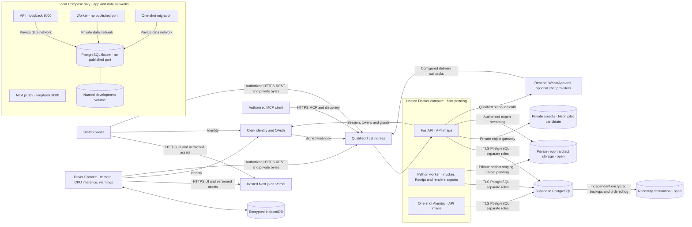

# Docker Containerization & Deployment Guide

## 1. Overview

The issue #5 [local fixture runbook](LOCAL_FIXTURE.md) documents the executable Compose startup, pinned inputs, health probes and acceptance checks.

RAFIQ runs driver monitoring in Chrome on the laptop and hosts private session history, clips, statistical results, reports, and administration. Docker packages the hosted FastAPI application and its Python/R worker as two coordinated images. A local Compose stack adds Next.js and a PostgreSQL fixture. Hosted Next.js stays on Vercel, and Supabase PostgreSQL remains the authoritative structured store.

**Status as of 21 November 2026.** The checkout at `633f129` contains planning documents and planning tools. There are no application sources, application manifests or lockfiles, migrations, `.env` examples, Docker files, executable deployment scripts, or GitHub Actions workflows. The tracked `.gitignore` is empty. The live GitHub Actions inventory and effective branch-rules endpoint returned no workflows or active rules for `master` at review time. The handbook describes the intended controls. Every file layout, container name, port, health probe, and runtime variable introduced below is a **proposal** unless attributed to an existing contract. The examples require the scaffold in §19.

The 15 December 2026 milestone is an attended stationary campus demonstration with a warning, camera pause, summary, and an evidence packet. Public operation needs qualified always-on API and worker compute, private storage and recovery, production identity, and zero project cost. Ali Sameh owns release approval. The public product, optional providers, and operating modes have their own acceptance gates. [PRD §§2, 6–8](PRD.md) · [TRD §§7–8](TRD.md)

## 2. Architecture Analysis

FastAPI owns REST, MCP, provider callbacks, private media, authorization and the admin API. The Python worker runs leased jobs from the same server source. It invokes pinned `Rscript` with versioned JSON for every published statistic and renders PDF and DOCX from validated report snapshots. An authorized MCP agent authors the draft. M01–M10 define code ownership. Shared PostgreSQL transactions coordinate durable sync receipts, job fencing, revocation and data lifecycle. Admission to emergency send stays in the live confirmation path with a fresh per-attempt authorization, deadline and unique claim. Lease recovery and backup replay must preserve claimed attempt state and suppress historical sends. [Architecture §§2–4, 7–9](ARCHITECTURE.md) · [TRD §§2, 5–6](TRD.md) · [API §§7, 9](API.md)

| Decision | Reason | Alternatives and trade-offs | Impact |
| --- | --- | --- | --- |
| Build `api` and `worker` targets from one server Dockerfile and source revision. Use a one-shot migration process from the API image. | API requests and leased work have different lifetimes, health and CPU/memory profiles. R and render libraries belong in the worker. | One combined process image would increase shared failure and restart scope. Per-module images would add network contracts and releases around shared transactions. A separate migration image would add packaging and version coordination for the same Alembic revisions. | Separate restarts and privileges. Release as a compatible pair. Keep worker-only native imports out of API startup and migration paths. |
| Keep Vercel for hosted web. Use a dev-only Next.js image in Compose. | The TRD selects Vercel. Keeping the web on its selected host avoids running Node on the API/worker VM for production. | Host Node locally for easier debugger integration, or containerize web in production if a later approved host change requires it. The local image adds one build and fixes runtime drift. | Web and API browser origins and cached-asset compatibility are explicit release checks. Vercel has its own staged deployment ID. |
| Use a disposable or persistent-local PostgreSQL fixture in Compose. Use Supabase in hosted environments. | The runtime needs transactions, RLS, owner-aware keys and durable job leases. | Full local Supabase adds services beyond the approved application boundary. A fake DB misses transaction and RLS behavior. Local PostgreSQL needs parity tests for managed extensions, roles, TLS and pooler behavior. | Separate API, worker and migration roles. Keep hosted persistence and backup independent of compute. |
| Use browser CPU inference, private managed objects and leased jobs. | CPU vision and warnings must work in the active tab during the 30-minute offline window. Database jobs already have the required consistency boundary. | Hosted inference adds transport and privacy dependencies. A separate broker or cache adds another state and failure boundary. An R service would add an API for a bounded subprocess contract. | No GPU, camera, Redis, broker, R listener or dedicated admin service in Docker. Validate browser asset versions, R results and job recovery independently. |
| Use local Compose and a host-specific deployment adapter after qualification. | The application has two hosted processes and the production compute target is open. | A single Linux VM can run both images with a TLS edge, with shared-host failure and maintenance. A suitable managed platform could reduce operator work if it qualifies continuous workers, networking, limits and zero spend. | Start with attended release. Qualify recovery and resource fit before enabling protected Actions deployment. |

## 3. Docker Architecture



| Service | Responsibility | Runtime | Internal port | Exposed port | Storage | Dependencies |
| --- | --- | --- | --- | --- | --- | --- |
| `api` · Docker | REST and private byte gateway, MCP, callbacks, staff authorization | CPython 3.14.10, FastAPI/Uvicorn | `8000` proposed | Dev `127.0.0.1:8000`. Hosted TCP 443 at TLS ingress. | Ephemeral scratch, no durable local data | PostgreSQL, Clerk, private objects, qualified provider adapters |
| `worker` · Docker | Durable jobs, R statistics, report rendering, lifecycle jobs | CPython 3.14.10, R 4.6.2, renv, WeasyPrint, python-docx | None | None | Ephemeral scratch, validated results in DB, artifacts in approved private storage | PostgreSQL, versioned R methods, artifact/lifecycle access as granted |
| `migrate` · Docker one-shot | Apply reviewed Alembic revisions including constraints and RLS | API image with migration role | None | None | Schema in PostgreSQL | Ready DB, expected starting revision and exclusive release slot in hosted deployments |
| `web` · Docker dev only | Local Next.js dev server and browser assets | Node 24.22.3, npm 11.19.1 | `3000` proposed | Dev `127.0.0.1:3000` | Source binds, disposable build cache | Browser-visible API URL, isolated Clerk config or synthetic fixture |
| `db` · Docker dev/CI only | PostgreSQL fixture | Official PostgreSQL image matching qualified Supabase major and required extension behavior | `5432` for the proposed fixture | None | Local named volume, disposable per CI run | Synthetic role and extension bootstrap |
| Vercel · managed | Hosted Next.js, driver and staff UI and public assets | Node 24.x per TRD, record observed patch | Provider managed | HTTPS | Deployments and public assets | Isolated Clerk and API origin per environment |
| Supabase · managed | Authoritative structured data, jobs, scope, receipt, lifecycle and result records | Managed PostgreSQL | Provider endpoint | No RAFIQ public DB endpoint | Managed data, separate qualified recovery | Scoped credentials and verified TLS |
| Private objects and recovery · external | Clip bytes, private report artifacts, backups and ordered recovery log | Neon S3-compatible pilot candidate, other targets pending | Provider endpoint | No user-facing public objects | Managed private stores, independent recovery | API/worker or backup identities by operation, configured lifecycle and key recovery |
| Identity and provider APIs · external | Identity/OAuth, delivery and optional chat | Clerk, Resend, WhatsApp Cloud API via PyWa, qualified chat providers | Provider endpoints | HTTPS on configured provider/RAFIQ routes | Provider-specific, per qualification | Isolated credentials, verified callback and consent policy |
| Browser · device | Camera, readiness, live warnings, encrypted offline queue and optional bounded recording | Current and previous patched Chrome on Windows 11 x64 for release qualification | N/A | N/A | Encrypted IndexedDB, usable keys in memory | Versioned model/WASM assets and same-driver online eligibility for setup/recovery |

Use Compose DNS for private service discovery. A driver reaches the web and API through host addresses. The worker discovers jobs in PostgreSQL. Cleanup and operational scheduling use the same worker and platform contracts or a narrowly scoped attended runner once approved. A backup command or timer needs independent failure detection and credentials, even if invoked from the same operations environment. [Architecture §§12–16](ARCHITECTURE.md) · [Docker Compose networking](https://docs.docker.com/compose/how-tos/networking/)

## 4. Docker Project Structure

Use Architecture §16 paths. The following additions are proposed alongside the application scaffold.

```text
compose.yaml                       Local and synthetic CI orchestration
.env.example                       Reviewed nonsecret Docker build pins
web/
  Dockerfile                       Next.js development target
  .dockerignore
  package.json
  package-lock.json
  public/                          Qualified assets or synthetic test assets
server/
  Dockerfile                       api and worker build targets
  .dockerignore
  pyproject.toml
  uv.lock
  renv.lock
  alembic.ini
  migrations/
  rafiq/
  r/
ops/
  dev/postgres-init/               Synthetic first-boot roles and extensions
  env/{db,api,worker,migrate,web}.env.example
  ci/prepare-container-fixtures.sh
  ci/smoke-containers.sh
  ci/scan-container.sh             Pinned scanner bootstrap and invocation
  ci/publish-container-candidate.sh  Optional GHCR candidate job adapter
  release.sh                       Handbook's future host-specific release adapter
.github/workflows/ci.yml           Add jobs to the handbook workflow once executable
```

Set separate build contexts `web/` and `server/`. Both `.dockerignore` files should exclude `.git`, `.env`, `.env.*`, provider credentials, keys, local data dumps and media, and editor/OS temporary files. Server also excludes `.venv`, `__pycache__`, `.pytest_cache`, render output, local R libraries and caches, and private datasets. Web also excludes `node_modules`, `.next`, Playwright output and browser state. Use narrow `COPY` of server sources, migrations and public fixtures. Record model/ONNX/WASM hashes and fail preparation on mismatches. Include only reviewed, license-compatible public assets or sanitized fixtures needed for the build. Before scaffolding, add Git ignore rules for `.env`, `ops/env/*.env`, generated state and secrets, keep `.env.example` and role-specific examples tracked, and verify with `git check-ignore`. `.dockerignore` controls the context sent to the builder and Git ignore controls source tracking.

### Pretrained vision assets

Prepare the selected vision bundle as a frontend build input. Use the pinned upstream revisions and artifact locations to retrieve the MediaPipe Face and Hand Landmarker task files, the NanoDet ONNX file, and the matching MediaPipe and ONNX Runtime Web JavaScript and WebAssembly assets. Verify each artifact's SHA-256 against the versioned manifest and package the reviewed licenses and notices. Build and CI preparation fail on a missing artifact or hash mismatch. [Selected components and sources](VISION-REUSE.md#selected-components)

Use the same verified, versioned files for native frontend development, the web container, and Vercel. Serve them from the RAFIQ frontend at bundle-specific paths so a deployment cannot replace assets used by an active tab. The browser checks integrity and initializes the CPU runtimes before declaring readiness. Inference runs on the reference browser device. Container fixtures exercise packaging and failure handling, and the Windows laptop run establishes runtime qualification.

Qualify and rehearse rollback with the exact frontend revision and its matching vision bundle ID. Retain the applicable approved bundle and record the model and WASM hashes in release evidence. Check that supported active tabs and queued records remain compatible with server validation across deployment and rollback. [TRD vision contract](TRD.md#21-pretrained-browser-vision) · [Git release records](GIT_WORKFLOW.md#13-release-management-and-versioning)

## 5. Dockerfile Design

**Proposed build pins.** Use a digest-locked Docker Official Python slim Debian Trixie image at CPython 3.14.10, the digest-locked Astral uv binary at 0.13.9, and an official Debian-based Node image at 24.22.3. Debian/glibc fits the Linux wheels and native rendering stack and simplifies use of one ABI across the server stages. Alpine/musl would require separate wheel and native build proof without solving a measured size problem. Choose exact per-platform manifest digests or a reviewed index digest that covers the chosen platform. Commit refreshed pins through review with a clean build and scan. A lock includes transitive packages and hashes. The TRD's direct versions govern `uv.lock`, `renv.lock`, and `package-lock.json`.

Build R 4.6.2 in a discarded stage using the same Python base OS and a verified CRAN source archive. An exact vendor R image would reduce compilation but require qualifying its platform, distribution and matching CPython integration. The example uses dated Debian and Debian security snapshots for native packages. Verify both snapshots, use the distribution signing keyring, choose a snapshot compatible with the exact base digest, and record the resulting package inventory. Snapshot expiry checking is disabled only on the two timestamped source entries. Preserve the reviewed CRAN package source checksums, including jsonlite, in the build evidence and use a checksum-verified package source or mirror during renv restore. Verify package linkage and report font output on each target architecture. [uv Docker guidance](https://docs.astral.sh/uv/guides/integration/docker/) · [Debian snapshots](https://snapshot.debian.org/) · [R installation](https://cran.r-project.org/doc/manuals/r-release/R-admin.html) · [renv restore](https://pkgs.rstudio.com/renv/reference/restore.html) · [WeasyPrint dependencies](https://doc.courtbouillon.org/weasyprint/stable/first_steps.html)

**Proposed `server/Dockerfile`.** `rafiq.api.main:app` and `python -m rafiq.worker` are proposed entry points under Architecture §16. The former exports the ASGI application. The latter implements signal handling, lease draining and `--check-health` (§6). The dependency example assumes one flat Python project, with code importable from `/app` and a default dev group in the lock. Keep Python-to-R analysis and rendering imports in the worker path. Supply real build pins through §7 before building.

```dockerfile
# syntax=docker/dockerfile:1
ARG PYTHON_BASE
ARG UV_BASE
FROM ${UV_BASE} AS uv
FROM ${PYTHON_BASE} AS python-base
WORKDIR /app
ENV PATH="/opt/venv/bin:${PATH}" \
    PYTHONUNBUFFERED=1 PYTHONDONTWRITEBYTECODE=1 \
    HOME=/tmp

FROM python-base AS python-deps
ENV UV_PROJECT_ENVIRONMENT=/opt/venv UV_PYTHON_DOWNLOADS=never UV_LINK_MODE=copy
COPY pyproject.toml uv.lock ./
RUN --mount=from=uv,source=/uv,target=/usr/local/bin/uv \
    --mount=type=cache,target=/root/.cache/uv \
    uv sync --locked --python /usr/local/bin/python --no-default-groups --no-install-project

FROM python-base AS native-base
ARG DEBIAN_SNAPSHOT
RUN test -n "$DEBIAN_SNAPSHOT" \
    && rm -f /etc/apt/sources.list /etc/apt/sources.list.d/debian.sources \
    && printf '%s\n' \
      "deb [check-valid-until=no signed-by=/usr/share/keyrings/debian-archive-keyring.gpg] https://snapshot.debian.org/archive/debian/${DEBIAN_SNAPSHOT}/ trixie main" \
      "deb [check-valid-until=no signed-by=/usr/share/keyrings/debian-archive-keyring.gpg] https://snapshot.debian.org/archive/debian-security/${DEBIAN_SNAPSHOT}/ trixie-security main" \
      > /etc/apt/sources.list.d/rafiq-snapshot.list

FROM native-base AS r-build
RUN apt-get update && apt-get install -y --no-install-recommends \
      build-essential gfortran curl perl ca-certificates \
      libbz2-dev libcurl4-openssl-dev liblzma-dev libpcre2-dev \
      libreadline-dev zlib1g-dev \
    && rm -rf /var/lib/apt/lists/*
ARG R_SHA256
ARG RENV_SHA256
ENV PATH="/opt/R/bin:${PATH}" R_LIBS_SITE=/opt/rlib RENV_CONFIG_CACHE_ENABLED=false
RUN curl -fsSL https://cran.r-project.org/src/base/R-4/R-4.6.2.tar.gz -o /tmp/R.tar.gz \
    && printf '%s  %s\n' "$R_SHA256" /tmp/R.tar.gz | sha256sum -c - \
    && mkdir /tmp/r-source /opt/rlib \
    && tar -xzf /tmp/R.tar.gz --strip-components=1 -C /tmp/r-source \
    && cd /tmp/r-source \
    && ./configure --prefix=/opt/R --without-x --without-recommended-packages \
      --without-blas --without-lapack \
    && make -j2 && make install
COPY renv.lock ./
RUN (curl -fsSL https://cran.r-project.org/src/contrib/renv_1.3.1.tar.gz -o /tmp/renv.tar.gz \
      || curl -fsSL https://cran.r-project.org/src/contrib/Archive/renv/renv_1.3.1.tar.gz -o /tmp/renv.tar.gz) \
    && printf '%s  %s\n' "$RENV_SHA256" /tmp/renv.tar.gz | sha256sum -c - \
    && R CMD INSTALL --library=/opt/rlib /tmp/renv.tar.gz \
    && Rscript --vanilla -e 'renv::restore(project="/app", library="/opt/rlib", packages=c("renv", "jsonlite"), prompt=FALSE)'

FROM python-base AS api
ARG SOURCE_REVISION=unknown
LABEL org.opencontainers.image.source="https://github.com/alisameh05/RAFIQ" \
      org.opencontainers.image.revision="${SOURCE_REVISION}"
COPY --from=python-deps /opt/venv /opt/venv
COPY rafiq/ ./rafiq/
COPY alembic.ini ./
COPY migrations/ ./migrations/
USER 10001:10001
EXPOSE 8000
CMD ["python", "-m", "uvicorn", "rafiq.api.main:app", "--host", "0.0.0.0", "--port", "8000", "--no-access-log"]

FROM native-base AS worker
ARG SOURCE_REVISION=unknown
LABEL org.opencontainers.image.source="https://github.com/alisameh05/RAFIQ" \
      org.opencontainers.image.revision="${SOURCE_REVISION}"
RUN apt-get update && apt-get install -y --no-install-recommends \
      ca-certificates tzdata libbz2-1.0 libcurl4t64 libgfortran5 libgomp1 \
      liblzma5 libpcre2-8-0 libreadline8t64 zlib1g \
      libpango-1.0-0 libpangoft2-1.0-0 libharfbuzz0b libharfbuzz-subset0 fonts-dejavu-core \
    && rm -rf /var/lib/apt/lists/*
ENV PATH="/opt/venv/bin:/opt/R/bin:${PATH}" R_LIBS_SITE=/opt/rlib
COPY --from=python-deps /opt/venv /opt/venv
COPY --from=r-build /opt/R /opt/R
COPY --from=r-build /opt/rlib /opt/rlib
COPY rafiq/ ./rafiq/
COPY r/ ./r/
USER 10001:10001
RUN Rscript --vanilla -e 'stopifnot(getRversion() == "4.6.2", packageVersion("jsonlite") == "2.0.0")' \
    && python -c 'import docx, weasyprint'
CMD ["python", "-m", "rafiq.worker"]
```

The renv bootstrap accepts the current or archived location of the same verified source bytes. Keep worker R runtime dependencies explicit and check all used shared libraries in a clean image. Approve the production font and PDF/DOCX fixture set. The example's DejaVu font package establishes a baseline for synthetic rendering. Pin the Dockerfile frontend by digest when adopting the release build. Cache uv downloads and invariant layers in BuildKit. Use locked npm and renv installs and isolate caches by trusted scope, platform, runtime and lock revision. Never bake test credentials or provider settings into a build context or layer. [CRAN renv](https://cran.r-project.org/web/packages/renv/index.html) · [Docker build attestations](https://docs.docker.com/build/metadata/attestations/) · [Docker build secrets](https://docs.docker.com/build/building/secrets/)

**Proposed `web/Dockerfile`.** This target supports local development and browser smoke. The Vercel production build runs `npm ci` and the framework's build with the documented Node baseline. Qualify the npm tool tarball or select a pinned official image carrying the exact npm patch. Package manifests and scripts must be present before use.

```dockerfile
# syntax=docker/dockerfile:1
ARG NODE_BASE
FROM ${NODE_BASE} AS dev
WORKDIR /app
RUN npm install --global --no-audit --no-fund npm@11.19.1 && chown node:node /app
USER node
COPY --chown=node:node package.json package-lock.json ./
RUN --mount=type=cache,target=/home/node/.npm,uid=1000,gid=1000 npm ci
COPY --chown=node:node . .
EXPOSE 3000
CMD ["npm", "run", "dev", "--", "--hostname", "0.0.0.0", "--port", "3000"]
```

## 6. Docker Compose Configuration

Use one root `compose.yaml` for local development and CI. CI supplies a unique project name and disposable fixture data. Production supplies reviewed image digests and host configuration through the selected deployment mechanism. A local file with source mounts and synthetic role bootstrap is unsuitable for production.

**Proposed `compose.yaml`.** The health timings and shutdown grace below are initial development values. Measure production values against the request, drain and lease contracts. The official image uses `/var/lib/postgresql` as the volume target starting with PostgreSQL 18. For PostgreSQL 17 and earlier the default target is `/var/lib/postgresql/data`. Select the parity-tested image first and verify the mount contains the live cluster across recreation. The init directory bootstraps synthetic extension and role parity on a fresh database. Give the migration role schema privileges and make the API and worker roles subject to scoped permissions and RLS. [Official PostgreSQL image](https://hub.docker.com/_/postgres)

```yaml
x-server-build: &server-build
  context: ./server
  args:
    PYTHON_BASE: ${PYTHON_BASE:?set a pinned Python image}
    UV_BASE: ${UV_BASE:?set a pinned uv image}
    DEBIAN_SNAPSHOT: ${DEBIAN_SNAPSHOT:?set the reviewed snapshot timestamp}
    R_SHA256: ${R_SHA256:?set the R source hash}
    RENV_SHA256: ${RENV_SHA256:?set the renv source hash}
    SOURCE_REVISION: ${SOURCE_REVISION:-unknown}

x-server-runtime: &server-runtime
  init: true
  read_only: true
  tmpfs: [/tmp]
  cap_drop: [ALL]
  security_opt: [no-new-privileges:true]
  stop_grace_period: 30s

services:
  db:
    image: ${POSTGRES_IMAGE:?set a parity-tested PostgreSQL image}
    env_file: ./ops/env/db.env
    volumes:
      - pgdata:${POSTGRES_VOLUME_PATH:?set the volume mount for the selected image}
      - ./ops/dev/postgres-init:/docker-entrypoint-initdb.d:ro
    networks: [data]
    healthcheck:
      test: [CMD-SHELL, 'pg_isready -h 127.0.0.1 -U "$$POSTGRES_USER" -d "$$POSTGRES_DB"']
      interval: 5s
      timeout: 3s
      retries: 20

  migrate:
    <<: *server-runtime
    image: ${API_IMAGE:-rafiq/api:local}
    pull_policy: never
    env_file: ./ops/env/migrate.env
    command: [alembic, upgrade, head]
    depends_on:
      db:
        condition: service_healthy
    networks: [data]
    restart: 'no'

  api:
    <<: *server-runtime
    image: ${API_IMAGE:-rafiq/api:local}
    build:
      <<: *server-build
      target: api
    env_file: ./ops/env/api.env
    ports: ['127.0.0.1:8000:8000']
    networks: [app, data]
    depends_on:
      migrate:
        condition: service_completed_successfully
    healthcheck:
      test: [CMD, python, -c, 'import urllib.request as u; u.urlopen("http://127.0.0.1:8000/internal/readyz", timeout=2).close()']
      interval: 5s
      timeout: 3s
      start_period: 15s
      retries: 12

  worker:
    <<: *server-runtime
    image: ${WORKER_IMAGE:-rafiq/worker:local}
    build:
      <<: *server-build
      target: worker
    env_file: ./ops/env/worker.env
    networks: [app, data]
    depends_on:
      migrate:
        condition: service_completed_successfully
    healthcheck:
      test: [CMD, python, -m, rafiq.worker, --check-health]
      interval: 10s
      timeout: 3s
      start_period: 20s
      retries: 6

  web:
    init: true
    build:
      context: ./web
      target: dev
      args:
        NODE_BASE: ${NODE_BASE:?set a pinned Node image}
    env_file: ./ops/env/web.env
    volumes:
      - ./web/src:/app/src:ro
      - ./web/public:/app/public:ro
    ports: ['127.0.0.1:3000:3000']
    networks: [app]
    depends_on:
      api:
        condition: service_healthy
    healthcheck:
      test: [CMD, node, -e, 'fetch("http://127.0.0.1:3000/healthz").then(r => process.exit(r.ok ? 0 : 1)).catch(() => process.exit(1))']
      interval: 10s
      timeout: 5s
      start_period: 30s
      retries: 12

networks:
  app: {}
  data:
    internal: true

volumes:
  pgdata: {}
```

`pg_isready` means PostgreSQL is accepting connections. Successful migration means the expected schema and grants have been applied. API readiness additionally checks a bounded connection under the API role and supported schema state. `GET /internal/livez` would check process responsiveness without relying on PostgreSQL. `GET /internal/readyz` would return a minimal `200` or `503` and be queried directly or through private host probes. The Next.js dev probe `/healthz` should be a public, non-personal, local app response that bypasses Clerk redirects. Worker `--check-health` should read a bounded-age heartbeat updated by the claim loop only when it can carry out its work, and exit nonzero for an absent or stale heartbeat. Keep heartbeat configuration free of job payloads. Use a separate synthetic job to prove claims, R and publication. These operational probes are proposed. The product `/api/v1/admin/health` requires staff authority and serves a different purpose.

Compose ordering and health conditions apply at startup. Runtime dependency failures still require connection timeouts and bounded backoff with jitter. On DB loss, readiness becomes unavailable and the worker stops claiming until it can resume. Failed readiness is a traffic signal, while process exit or a host supervisor handles restart. In development leave automatic restart off so startup and exit errors remain visible. In CI use startup timeouts and fail on unhealthy dependencies. [Docker Compose startup and health](https://docs.docker.com/compose/how-tos/startup-order/)

## 7. Environment Management

| Environment | Configuration and data |
| --- | --- |
| Development | Compose with separate role-specific files and a synthetic DB. Use approved local fixtures or isolated Clerk development keys. Real provider effects are disabled by default. |
| CI | Disposable project and DB per run, synthetic keys and test identities, mock or synthetic provider responses, and no production credentials or live recipients. Ensure fixture identity and provider adapters are rejected under production configuration. |
| Preview and validation | Maintainer initiates a reviewed build in isolated Vercel, API, worker, Clerk and data environments. Use independent keys, origins, object namespaces, callback endpoints and synthetic or approved validation data. |
| Production | Runtime values from the qualified host/provider secret store, isolated identities and DB roles, reviewed feature gates, and explicit TLS origins. Keep signing, wrapping and recovery key lifecycles independent of image tags. |

The current project defines required configuration roles and capabilities. The application scaffold must implement and validate runtime names. `POSTGRES_*` below belong to the official fixture image. The Clerk variable names follow the Next.js SDK convention. The handbook's proposed release variables remain scoped to its protected deploy step.

| Variable | Purpose | Required | Development | Production | Sensitive |
| --- | --- | --- | --- | --- | --- |
| `PYTHON_BASE`, `UV_BASE`, `NODE_BASE`, `POSTGRES_IMAGE` · proposed build/Compose | Exact upstream image pins | For relevant local targets | Reviewed registry references with digests in `.env.example` | Server build uses Python and uv pins. Web on Vercel and DB on Supabase have their own baseline. | No |
| `DEBIAN_SNAPSHOT`, `R_SHA256`, `RENV_SHA256` · proposed build | Dated system packages and verified source archives | Worker build | Reviewed UTC snapshot timestamp and SHA-256 hashes | Same reviewed build inputs | No |
| `POSTGRES_VOLUME_PATH`, `API_IMAGE`, `WORKER_IMAGE`, `SOURCE_REVISION` · proposed tooling | DB mount, local or pulled images, OCI revision | Volume path required locally. Image and revision overrides as needed. | Local tags by default. CI sets the tested SHA. | Release record specifies image digests and source SHA. No Compose fixture volume. | No |
| `POSTGRES_USER`, `POSTGRES_PASSWORD`, `POSTGRES_DB` · fixture image | Bootstrap local DB and synthetic roles | Local/CI fixture | `postgres`, synthetic password, `rafiq`. Role init grants separate synthetic credentials. | Managed DB provisioning outside image | Password |
| `RAFIQ_DATABASE_URL` · proposed runtime, role-specific | Connect under current process privilege | API, worker and migration | Set separately in `ops/env/api.env`, `worker.env`, `migrate.env`, using service host `db:5432` and role-specific credentials. | Separate secret per process, TLS verification and approved target | Yes |
| `NEXT_PUBLIC_RAFIQ_API_ORIGIN`, `RAFIQ_ALLOWED_ORIGINS`, `RAFIQ_PUBLIC_API_ORIGIN` · proposed | Browser API URL, API CORS policy and externally advertised resource URL | For applicable runtimes | Browser/API origin `http://localhost:8000`, allowed web origin `http://localhost:3000` | Exact approved HTTPS origins by environment. Advertise the public API origin used for OAuth/MCP. | No |
| `NEXT_PUBLIC_CLERK_PUBLISHABLE_KEY`, `CLERK_SECRET_KEY` · SDK | UI identity setup and server-side Clerk verification/integration where applicable | When Clerk enabled | Isolated development values. CI uses approved synthetic identity config. | Separate approved production instance. Secret only in runtimes that need it. | Secret key only |
| `VERCEL_ORG_ID`, `VERCEL_PROJECT_ID`, `VERCEL_TOKEN`, `RAFIQ_DEPLOY_CREDENTIAL`, `RAFIQ_MIGRATION_DATABASE_URL` · handbook proposals | Protected release adapter inputs | Only as needed after host qualification | Omit from PR/local CI | Per handbook §12. Map migration input to only the one-shot invocation. Prefer scoped federation where verified. | Token, compute credential, migration URL |

**Proposed root `.env.example` format.** Replace bracketed placeholders with qualified values before copying this file for use. The upstream Python and Node tags are listed in the Docker Official Images metadata. Verify digest and platform before committing the pins. [Official Python image metadata](https://raw.githubusercontent.com/docker-library/official-images/master/library/python) · [Official Node image metadata](https://raw.githubusercontent.com/docker-library/official-images/master/library/node)

```dotenv
PYTHON_BASE=python:3.14.10-slim-trixie@sha256:<python-digest>
UV_BASE=ghcr.io/astral-sh/uv:0.13.9@sha256:<uv-digest>
NODE_BASE=node:24.22.3-trixie-slim@sha256:<node-digest>
POSTGRES_IMAGE=postgres:<parity-tested-tag>@sha256:<postgres-digest>
POSTGRES_VOLUME_PATH=<mount-target-for-the-selected-postgres-image>
DEBIAN_SNAPSHOT=<reviewed-UTC-timestamp-in-YYYYMMDDThhmmssZ-form>
R_SHA256=<verified-R-source-sha256>
RENV_SHA256=<verified-renv-source-sha256>
```

Record eventual names for DB trust roots, device-key wrapping, staff TOTP encryption, provider credential encryption, private object and backup access, webhook verification and chat/delivery credentials when their adapters land. Keep each credential and key scoped by environment and consumer. API needs only its own PostgreSQL and enabled adapter permissions. Worker uses its own role and approved artifact/lifecycle credentials. Backups and verification use distinct credentials. Set keys only where the feature is enabled. Validate required values, schema compatibility, allowed origins, signing material and flag combinations at the relevant startup boundary. Emit the names of failing settings without values.

Next.js embeds `NEXT_PUBLIC_` configuration into `next build`. Stage Vercel with the intended browser API origin and Clerk publishable key before testing the deployment ID. Server secrets stay in server-only runtime config. Compose `.env` supplies interpolation for build pins and tags, while role `env_file` supplies container configuration. Treat even role files as sensitive, restrict access, and keep placeholders in tracked examples. On the qualified production host use runtime secret injection or restricted owner-readable files provisioned outside Git. Docker administrators can access container environment values. Build arguments and image layers must never carry secrets. If a private dependency needs build authentication, scope a short-lived BuildKit secret mount to the necessary instruction. In Actions inject environment secrets only into the approved release step, disable shell tracing, and avoid logging connection URLs, rendered env config and auth headers. [Next.js environment variables](https://nextjs.org/docs/app/guides/self-hosting#environment-variables) · [Docker build secrets](https://docs.docker.com/build/building/secrets/) · [Git workflow §12](../git_workflow.md#12-environments-secrets-and-security)

## 8. Networking and Data Persistence

**Local traffic.** Use `http://localhost:3000` in the browser and configure `http://localhost:8000` as the browser API origin. Loopback is the local camera-development path. Non-loopback testing needs trusted HTTPS and independently approved origins. Container processes can resolve `api:8000` and `db:5432` on their respective networks. Browsers need host-resolvable URLs. If Next.js implements server-side API calls in development, use an explicitly server-only internal URL and keep API authorization intact. Keep the database on the isolated `data` network, only attached to the server roles. Keep the worker and migration process free of host-published ports. [Browser camera secure contexts](https://developer.mozilla.org/en-US/docs/Web/API/MediaDevices/getUserMedia) · [Docker Compose networking](https://docs.docker.com/compose/how-tos/networking/)

**Hosted traffic.** Use Vercel HTTPS for the frontend and the qualified HTTPS ingress for the API. Route `/api/v1`, `/webhooks/...`, `/mcp`, and `/.well-known/oauth-protected-resource/mcp` without path rewriting. Preserve `Authorization`, raw callback bytes and signature headers, `Origin`, `Range`, allowed MCP headers, and response headers including `WWW-Authenticate`, `Content-Range`, `Retry-After` and `X-Request-Id`. Apply direct trusted proxy boundaries and trust forwarded headers only from that edge. Restrict operational probes to health clients. The admin API uses the same ingress and still requires current staff grants and MFA. The worker, local DB and internal admin/host tools have no public listener. Configure explicit trusted frontend origins and narrow CORS methods, request headers and browser-exposed headers based on the actual route catalog. Authentication checks, OAuth audience and MCP origin validation are independent of browser CORS.

Test raw `PUT` clip bodies up to the 20 MB contract cap, authenticated `206` and `416` responses, and private PDF/DOCX streaming with attachment disposition. Avoid proxy/CDN caching private responses and preserve `Cache-Control: private, no-store`. Qualify per-route body limits, bounded buffering and timeouts for uploads at 5 Mbps, the MCP Streamable HTTP profile, and signed callbacks. Disable edge retries for emergency send confirmations and other non-idempotent routes unless the operation's contract proves a specific retry safe. Keep job progress polling and respect the API's `Retry-After`. Use the API §18 qualification to close proposed upload, interactive and provider deadlines. [API §§2–7, 9–13, 18](API.md)

**Hosted PostgreSQL.** Use a verified TLS endpoint and trusted certificate, with host-name verification. Check network IPv4/IPv6 support, endpoint identity, pool budgets and connection lifetimes on the actual host. Prefer a direct endpoint for migrations where reachable. Qualify session pooling if a direct migration path is unavailable. Runtime transaction pooling, if chosen, must be tested for psycopg prepared statements, transaction-local RLS, and DB job claim semantics. Keep tenant context transaction-local and scrub connections when returned to the pool. The runtime role must remain subject to RLS. [Supabase database connectivity](https://supabase.com/docs/guides/database/connecting-to-postgres) · [TRD §§3–4, 7](TRD.md)

| State | Persistence and lifecycle |
| --- | --- |
| Local PostgreSQL | Compose `pgdata` survives normal `down`. The bootstrap runs on fresh data directories. Apply migrations separately for existing local data. Use a disposable project/volume for CI. |
| Hosted PostgreSQL | Supabase owns durable records, receipts, jobs, lifecycle and statistical results. Never replace it with a host-local production volume in this design. |
| Private clip and file bytes | Durable approved object storage only. FastAPI remains the authorization gateway. Reconcile orphaned or partial uploads and reports. Revocation, deletion and expiry take precedence over finalization. Render scratch belongs on bounded temporary storage, with independent cleanup on failure. |
| Browser | Store encrypted pending records and clips in IndexedDB. Keep the usable key only in memory. Sign-out or close locks pending data. A same-driver eligible online session can recover committed ciphertext. Never mount a browser queue into containers. |
| Backups and ordered changes | An independent, encrypted recovery destination with approved keys and lifecycle. Include deletion and revocation records. Keep unauthorizable retained copies inaccessible, and meet the 30-day retained-copy purge requirement including backups and log segments. |

Back up and restore as described in §14. Treat `docker compose down -v` as destructive to the named DB volume and reserve it for explicitly disposable synthetic data. A database volume is not an independent backup.

## 9. Local Development Guide

1. Install Docker Desktop with Linux containers and the WSL 2 backend on Windows, or Docker Engine and Compose/Buildx on supported Linux. Docker Desktop on macOS can run the scaffold once its CPU architecture is supported by the selected image pins. Verify `docker version`, `docker compose version`, and `docker buildx version`. Docker build hosts and the supported product browser device are separate qualifications. Allocate disk for images, R build cache and the fixture volume. Determine CPU and memory headroom with a cold build and browser tests (§13).
2. Clone and work on a task branch per the handbook. Use the committed application and container scaffold when it lands. The PowerShell commands below assume that scaffold has been reviewed into the checkout.

   ```powershell
   git clone https://github.com/alisameh05/RAFIQ.git
   Set-Location RAFIQ
   Copy-Item .env.example .env
   foreach ($role in 'db','api','worker','migrate','web') {
       Copy-Item "ops/env/$role.env.example" "ops/env/$role.env"
   }
   ```

3. Confirm `.env` has qualified Docker pins. Check the synthetic role URLs and initial fixture names in the role files. Use `postgresql+psycopg://<role>:<fixture-password>@db:5432/rafiq` as the proposed SQLAlchemy form. Supply the isolated Clerk or explicitly enabled local test fixture configuration and the browser origins from §7. Create `web/public/` with the approved fixture or versioned assets before launching. Follow the scaffold's trusted init and asset preparation scripts. The PostgreSQL bootstrap must finish before the migration service runs.
4. On a previously initialized local volume advancing to `0006_private_access`, provision the callback role before starting the migration. The PostgreSQL image runs initialization SQL only for a fresh volume.

   ```powershell
   docker compose up -d --wait db
   docker compose cp ops/postgres/002-callback-role.sql db:/tmp/rafiq-callback-role.sql
   docker compose exec -T db psql -X -v ON_ERROR_STOP=1 -U postgres -d rafiq -f /tmp/rafiq-callback-role.sql
   ```

   From the root, validate config without printing resolved secrets, build and start.

   ```powershell
   docker compose config --quiet
   docker compose up --build
   ```

   Use `docker compose up -d --build --wait --wait-timeout 240` for a detached, bounded readiness wait after images are built. In a second shell check `docker compose ps -a`, successful `migrate` exit, and `Invoke-WebRequest http://localhost:8000/internal/readyz`. Open `http://localhost:3000` and verify readiness, authorized session flow and a synthetic worker-backed summary. After implementing the fixture, requests to `/api/v1/account` require the current permitted identity. Validate authorization with the smoke fixture.
5. `web/src` and `web/public` mounts let Next.js reload source and assets. A lockfile, config outside these mounts, or Dockerfile change requires rebuilding the relevant image. On Windows check Docker file sharing and WSL file watcher performance before enabling polling. Keep source paths and case compatible with Linux. Rebuild the server when Python, R, migrations or dependencies change. For debugging, use local logs, role-restricted `exec`, or the handbook's native runtime workflow. Use mock providers by default and a synthetic browser camera fixture for repeatable tests. Run full CI fixture preparation in a disposable checkout to avoid replacing local configuration files.
6. Stop with `docker compose down`. This removes containers and networks and preserves the local volume. The next startup checks the database and migration again. Never reset a fixture volume merely to clear an ordinary startup error.

## 10. CI/CD Integration

Follow the [Git workflow §§8–14](../git_workflow.md). Use `master`, reviewed task branches and squash merge. Extend the handbook's proposed `ci.yml` under its existing `pull_request` and `push` triggers for `master`. Keep `RAFIQ CI gate` as the single required status. Bootstrap the source gate first, then add each executable application suite and its gate assertion. Add the container build and smoke job once the application and Docker scaffold exist. Make it required after proving both normal and deliberate-failure runs. Source and contract checks, web lint/types/build/tests, Python/R unit and integration tests, migration parity, dependency review where applicable, image build, synthetic smoke and image scanning must all pass through the required gate. A canceled, failed or unexpectedly skipped container job fails the gate. Browser/device, real-provider, load, backup and recovery qualification remain release evidence.

**Proposed additions to `ci.yml`.** Put `containers` under the existing `jobs` key and add the shown result to the existing gate without removing its other dependencies or checks. The checkout pin is inherited from the handbook. The fixture preparation script writes only local, nonproduction settings and model fixtures, then exits. The smoke script waits for the expected schema and a synthetic worker job, exercises account authorization and durable sync/retry, and checks that private ranges and exports use the gateway. Extend it as features land. Supply the selected scanner and its integrity-checked bootstrap in `scan-container.sh`. Use a pinned Trivy binary, current vulnerability DB with recorded snapshot time, and a failing exit for applicable high/critical results or scanner errors. Keep time-bounded exceptions linked to an owner, reason and expiry. No live provider credentials or Actions write permissions enter this job.

```yaml
# Add to jobs in the handbook's ci.yml.
containers:
  name: RAFIQ container build and smoke
  runs-on: ubuntu-24.04
  timeout-minutes: 40
  permissions:
    contents: read
  env:
    COMPOSE_PROJECT_NAME: rafiq-ci-${{ github.run_id }}-${{ github.run_attempt }}
    SOURCE_REVISION: ${{ github.sha }}
  steps:
    - uses: actions/checkout@3d3c42e5aac5ba805825da76410c181273ba90b1 # v7.0.1 per handbook
      with:
        persist-credentials: false
    - name: Build and scan the local images
      run: |
        bash ops/ci/prepare-container-fixtures.sh
        docker compose config --quiet
        docker compose build
        bash ops/ci/scan-container.sh rafiq/api:local rafiq/worker:local
    - name: Run the isolated stack and smoke
      run: |
        docker compose up -d --no-build --wait --wait-timeout 240
        bash ops/ci/smoke-containers.sh
    - name: Tear down synthetic data
      if: ${{ always() }}
      run: |
        if [[ -f .env && -f ops/env/web.env ]]; then
          docker compose ps -a
          docker compose down -v --remove-orphans
        fi
```

```yaml
# Merge these keys and steps into the existing gate job.
needs: [source, web, server, dependency_review, containers]
# Keep if: ${{ always() }} and permissions: {} from the handbook.
steps:
  # Keep the existing outcome checks and add this step.
  - env:
      CONTAINERS: ${{ needs.containers.result }}
    run: test "$CONTAINERS" = success
```

Use standard Linux x86-64 runners for the first local container suite. If an approved host is ARM64, build and run the release tests for `linux/arm64` on a qualified runner. Include both only for a real deployment requirement. Record the platform and resolved manifest digest along with the image index digest where applicable. BuildKit should cache by component, platform, reviewed tool versions and lockfiles. Keep caches from untrusted PRs outside trusted release builds. Begin with local layers and cached dependency downloads. Add trusted-branch Buildx `type=gha` or scoped registry caching after measuring cold and warm builds and cost. A release scan covers both OS and detected application packages. Track renv, fonts, model/WASM and packages outside scanner coverage separately. [GitHub Actions secure use](https://docs.github.com/en/actions/reference/security/secure-use) · [Trivy image scan action](https://github.com/aquasecurity/trivy-action)

### Registry and candidate publishing

Recommend **GHCR**, subject to approval and plan checks. It shares repository identity with GitHub Actions and can store OCI images and attestations. Public packages are practical for sanitized public-source images after review of their complete image contents and provenance. Private packages need scoped pull credentials, quotas and a zero-spend check. Docker Hub adds external publisher credentials and pull policy to qualify. A host-native registry makes sense only if the selected host's identity, retention or network requirements justify it. [GHCR authentication and visibility](https://docs.github.com/en/packages/working-with-a-github-packages-registry/working-with-the-container-registry) · [GitHub Packages billing](https://docs.github.com/en/billing/concepts/product-billing/github-packages)

Proposed names are `ghcr.io/alisameh05/rafiq-api` and `ghcr.io/alisameh05/rafiq-worker`. Tag each candidate `sha-<full-sha>-<run-id>-<attempt>` and store the actual `image@sha256:...` references in a durable release record. Keep the candidate tags unique and non-reused. Use the handbook's annotated `v0.x.y` or demo prerelease tag on the successful deployed Git SHA. Optionally add a matching registry alias to the same digests after release verification. Production always pulls by digest. Omit `latest` and mutable environment tags from deployment inputs. Preserve the active and prior compatible rollback digests during retention cleanup.

**Proposed publishing job shape.** Add this optional job to the existing CI workflow only after registry adoption. It publishes a candidate from the trusted push to `master` after the gate. It has no production credentials or deployment side effects. The workflow must fail if candidate building, digest checks, vulnerability policy, test or release-record evidence fails. Keep production dispatch disabled for an incomplete run. If registry publication is attended initially, run the same commands from the verified SHA and record the passing CI run and immutable references before validation.

```yaml
# Add under jobs after adopting GHCR and the candidate publisher.
publish_images:
  if: ${{ github.event_name == 'push' && github.ref == 'refs/heads/master' }}
  needs: [gate]
  runs-on: ubuntu-24.04
  timeout-minutes: 45
  permissions:
    contents: read
    packages: write
  steps:
    - uses: actions/checkout@3d3c42e5aac5ba805825da76410c181273ba90b1 # v7.0.1 per handbook
      with:
        persist-credentials: false
    - name: Publish candidate by source revision and run
      env:
        GHCR_TOKEN: ${{ github.token }}
      run: |
        printf '%s' "$GHCR_TOKEN" | docker login ghcr.io -u "$GITHUB_ACTOR" --password-stdin
        unset GHCR_TOKEN
        trap 'docker logout ghcr.io' EXIT
        bash ops/ci/publish-container-candidate.sh
```

Implement the proposed publisher in `ops/ci/` when enabling this job. It reads reviewed nonsecret pins and provisions an isolated Buildx builder. Run the following build for each `target=api` and `target=worker`. The example target platform is provisional for the initial x86-64 candidate. The publisher must use the qualified host platform for release and verify retained local and registry disk usage. Shell variables below are set by the publisher from the reviewed pins and standard Actions context. Avoid shell tracing and metadata that contains private settings.

```bash
repo="ghcr.io/alisameh05/rafiq-${target}"
tag="sha-${GITHUB_SHA}-${GITHUB_RUN_ID}-${GITHUB_RUN_ATTEMPT}"
docker buildx build --platform linux/amd64 --target "$target" \
  --build-arg "PYTHON_BASE=$PYTHON_BASE" --build-arg "UV_BASE=$UV_BASE" \
  --build-arg "DEBIAN_SNAPSHOT=$DEBIAN_SNAPSHOT" \
  --build-arg "R_SHA256=$R_SHA256" --build-arg "RENV_SHA256=$RENV_SHA256" \
  --build-arg "SOURCE_REVISION=$GITHUB_SHA" \
  --provenance=mode=min --sbom=true --metadata-file "$target-metadata.json" \
  --tag "$repo:$tag" --push ./server
```

Record the `containerimage.digest` from Buildx and verify the registry manifest, source/revision labels, attached SBOM and provenance. Pull both digests. Set `API_IMAGE` and `WORKER_IMAGE` to those references for Compose, build only `web`, run `up --no-build --wait` and run the synthetic smoke and image scans against those pulls. As in the PR job, prepare synthetic fixture files first and tear them down on exit. Build and inspect qualification evidence without releasing the candidate to production. An attached BuildKit attestation is metadata. If trusted publisher authentication is required, add a verified signing or GitHub artifact attestation policy after confirming current plan and verifier support. Use full commit SHAs for Actions and scope any attestation permissions to the trusted job. [Docker SBOM and provenance](https://docs.docker.com/build/metadata/attestations/)

### Promotion and permissions

Promote the same verified server digests from isolated validation to production. Vercel public build-time settings can require distinct web builds. Stage the exact production-config web deployment without assigning the public alias, then test and promote that deployment ID. Use attended releases first. The handbook's future `deploy-production.yml` remains the production entry point. Extend its existing `workflow_dispatch` preflight and `ops/release.sh` evidence validation to require the candidate's immutable and qualified API/worker references, passing `master` CI run, provenance/source identity, compatible schema and typed health evidence. Preserve its `production` environment, selected `master` branch, independent reviewer, no self-approval, exact-SHA recheck after approval and shared release lock. The `packages: write` publisher is independent of the environment approval. Grant the deploy job only the read and short-lived deployment privileges its implementation needs. Use `id-token: write` only where provider OIDC or an attestation job actually requires it. A tag or ordinary push never starts production deployment.

## 11. Production Deployment

Use Vercel Hobby for the Phase 0 browser, Render Free for the FastAPI web service, and an operator's computer for the Python/R worker. Both server processes connect to the isolated Supabase Free database using separate roles. The worker needs database connectivity and has no inbound listener. Rehearse this deployment on the actual demo laptop before using it at the campus demo. Keep the full local fixture as the fallback and verify local origins, CORS and identity during rehearsal. Never enable a tunnel or publicly expose local provider credentials to work around a failed rehearsal. The public compute host, private media and export storage at public scale, and independent recovery still require qualification. [Phase 0 hosting runbook](PHASE_0_HOSTING.md)

| Compute path | Cost and operations | Qualification and disposition |
| --- | --- | --- |
| Attended Linux Docker environment or laptop Docker Desktop | Uses existing hardware, with operator, network and process lifetime coupled to the demo. | Local walkthrough and demo fallback. Rehearse workstation connectivity, camera pause, summary, offline behavior and job recovery. |
| Render Free web API and local Python/R worker | Keep the Render workspace cardless and use its provider HTTPS URL. Schedule an operator to run and drain the worker image. The API sleeps on idle, and hosted validation depends on available free quota. | Selected for Phase 0 HTTPS validation. Capture readiness, cold-start and worker heartbeat evidence. Reuse for the campus demo after rehearsal. [Render Free](https://render.com/docs/free) |
| OCI Always Free Linux VM with API and worker containers | Candidate uses a VM, TLS edge and host restart, patch, disk and firewall ownership. A1 qualification may require ARM64 images. A VM concentrates failure and quota risks, including idle-instance reclamation. | Evaluate first for public compute because it can host both long-lived processes if the actual account and workload qualify. Check home-region capacity, reclamation, security and runtime resources, outbound network, quotas, hard spend behavior and recovery. [Oracle Always Free](https://docs.oracle.com/en-us/iaas/Content/FreeTier/freetier_topic-Always_Free_Resources.htm) |

Vercel Hobby usage, production Clerk domain, and verified Resend sender domain each need plan and domain evidence. The default Vercel address can support the Clerk development demo, while production identity and live email need controlled DNS. Distinguish the demo host from production qualification. If no zero-charge accountable setup meets the original requirements, hold public rollout or the affected capability under the PRD/TRD. [Vercel Hobby](https://vercel.com/docs/plans/hobby) · [TRD §7](TRD.md#7-infrastructure-deployment-and-recovery)

### Release procedure

1. Under the shared release lock, verify the approved evidence ID, exact Git SHA and CI run, API and worker image digests/platform, staged web deployment ID, schema heads, expected target account, scoped credentials, current backup lag and recovery objective, enabled capabilities, and the prior compatible release. Use anonymous public GHCR pulls or a scoped read-only registry identity for a private package. Verify digests after pulling. Pin the tool and actions versions used in the run.
2. Rehearse fresh and previous-release upgrades with retained data. Record compatibility across current and prior API/worker and cached browser assets and queued items. Run migrations once using the pinned API image and a dedicated role. Use the approved target Alembic revision, a bounded lock wait and transactional DDL where supported. On partial failure record observed revision and side effects and repair forward or recover in isolation. Split incompatible drops into later releases after the supported clients, queued data and rollback window have cleared.
3. Stop new claims on the old worker and drain or return leases safely. Verify reclaims after interruption. Deploy the API and worker from the matched digests. Keep the previous compatible set and any supported leases recoverable until qualification passes. Bind API behind the qualified TLS edge and apply firewall and scoped egress. Use service supervision and consistent readiness probing. Keep migrations and workers without inbound ports.
4. With an approved test identity, run staged web, API and worker probes and a synthetic job through completion. Exercise authorization denial, durable sync, eligible private media and the applicable browser journey. Test provider effects using fixtures or approved sandbox plans. Verify real DNS, TLS, RLS role isolation, callback configuration and cold startup. Promote the staged Vercel deployment and recheck live routing and health. Observe latency, API errors, job lag, quota, upload, backup and purge before marking release successful. Publish only the approved capabilities.
5. Record the last completed state and detailed evidence as required by the handbook. Stop on an unexpected state and reconcile the host, DB revision, running leases and activated web alias before retry. An interrupted run uses the same lock and evidence procedure as an ordinary failure.

**Conditional single-VM example.** After the compute and networking path qualify, the adapter can run the following on the target Linux host for a first install or after the old process names have been deliberately retired. Define `API_REF` and `WORKER_REF` as approved full image references with digests, `SCHEMA_REVISION` as the approved Alembic target, and `RAFIQ_ENV_DIR` as the local protected directory of approved runtime files provided by the operator or secret store. Use a private TCP ingress from a trusted host TLS proxy on the same machine. The default bridge network below provides egress. Qualify exact proxy trust config, firewall, resource bounds, shutdown grace and probes in the adapter before using this example in production.

```bash
docker pull "$API_REF"
docker pull "$WORKER_REF"
# Create once before first use. Choose a host network name with no collisions.
docker network create rafiq-runtime

docker run --rm --init --read-only --tmpfs /tmp --cap-drop ALL \
  --security-opt no-new-privileges --network rafiq-runtime \
  --env-file "$RAFIQ_ENV_DIR/migrate.env" "$API_REF" alembic upgrade "$SCHEMA_REVISION"

docker run -d --name rafiq-api --init --restart unless-stopped --read-only \
  --tmpfs /tmp --cap-drop ALL --security-opt no-new-privileges \
  --network rafiq-runtime -p 127.0.0.1:8000:8000 \
  --env-file "$RAFIQ_ENV_DIR/api.env" "$API_REF"

docker run -d --name rafiq-worker --init --restart unless-stopped --read-only \
  --tmpfs /tmp --cap-drop ALL --security-opt no-new-privileges \
  --network rafiq-runtime --env-file "$RAFIQ_ENV_DIR/worker.env" "$WORKER_REF"

curl --fail --silent --show-error http://127.0.0.1:8000/internal/readyz
docker exec rafiq-worker python -m rafiq.worker --check-health
```

Within the adapter use strict error handling and explicit time-bounded readiness retries before external routing, not a single immediate check. Set measured stop timeout, scratch limits, log rotation, CPU/memory and PID budgets in host config. If the proxy runs remotely or inside Docker, use a qualified private network path and proxy trust policy instead of the host loopback mapping. Verify current CORS origins and production domain, and ensure no untrusted forwarded fields are honored. Hosted ingress or an external probe removes unready API instances from service where supported. A simple one-host install incurs interruption when swapping its bound API port.

### Rollback and recovery

On a failed smoke, stop promotion or restore the previous Vercel deployment and matched API/worker digest pair if compatible with the current schema, pending records and jobs. Keep the additive schema where compatible. Stop new claims on the failed worker, let leases expire or release them under generation fencing, and retest. Repoint routes only after healthy probes and the synthetic journey pass. Never remove the last compatible digests before qualification. Reconcile delivery outcomes without resending claimed attempts. Container rollback changes executable versions. A schema or state recovery is a separate operator action. Never auto-downgrade Alembic or attempt a blind rerun after partial mutation. If compatible rollback is unavailable, stop affected traffic and follow §14. [Git workflow §14](../git_workflow.md#14-cicd-failure-handling-and-rollback) · [TRD §7](TRD.md#7-infrastructure-deployment-and-recovery)

## 12. Security Best Practices

| Boundary | Implementation requirement |
| --- | --- |
| Image sources | Verify official or maintained upstream images, target platform, full digest, package hashes and base origin in review. Pin the build frontend, tool downloads and system packages. Scan fresh dependency and final images with a current vulnerability database. Track end-of-support dates, renovate pins through reviewed changes, and rebuild and redeploy when fixing an issue. |
| Image content and provenance | Produce a per-image SBOM and provenance. Verify expected source and platform against the candidate digest. Inspect image history and exported layers for sensitive content before public registry publishing. Record uncovered packages, browser assets and native libraries independently. |
| Process | Run API and worker as unprivileged UID/GID `10001:10001`, root-owned image files, dropped capabilities, `no-new-privileges` and default kernel protections. Keep the root filesystem read-only and give each role bounded temporary scratch. No privileged containers, host devices, host networking, or Docker socket mounts. Restrict host operator and registry access. |
| Request and data authority | Keep all private bytes behind the authorized FastAPI gateway. Enforce DB role/RLS, transaction-local context, webhook authenticity, current grant and lifecycle checks, and trusted TLS and CORS origins. Protect internal probes and prevent public exposure of DB/admin tooling. Staff access uses the existing scoped MFA boundary. |
| Credentials | Keep API, worker, migration, object storage, delivery and recovery identities independent. Rotate server-only credentials at their consumer. Grant controlled use of device-key and encryption material and rehearse rotation and recovery before revoking old keys needed by retained data. |
| Build and CI | Exclude credentials from Docker contexts and build args, use read-only PR tokens and pinned upstream actions, validate lockfile changes and retain review and scan evidence. Keep untrusted PR code away from privileged runners, credentials and release caches. |

Use an exec-form command with an init process to forward signals and reap descendants. API shutdown stops accepting new traffic, finishes or safely aborts in-flight responses, and closes pools. The worker stops claiming, terminates an over-deadline R or render subprocess, and only publishes while its lease generation and eligibility still hold. A crashed process must leave retriable state and no unsafe provider replay. Retry dependency connections with bounded backoff and timeouts. Do not use liveness failures for database outages when the process can recover. Verify clean stop, deadline expiry, forced termination, duplicate callback, and reclaim tests before setting production timeouts.

## 13. Performance and Scalability

Measure cold/warm build time, compressed image sizes, boot to live/ready, worker R/PDF peaks, CPU throttling, resident memory, temporary bytes, network throughput, p95 latency and DB connections. Use the selected target architecture and hosted network. The proposal shares Python layers while only the worker adds R and renderer libraries. Bound upload concurrency and body admission, cap scratch and R inputs, and test spills or interrupted writes. Size limits from measurements and expected concurrency. The developer laptop needs capacity for concurrent builds and the browser. The project has no measured service-level CPU or memory limits yet.

Start with one API process and one worker process. Tune worker concurrency separately and account for resident R/render child processes. Cap aggregate DB connections across API/worker processes and migrate/backup headroom. Record pool wait, role-safe connection reuse, connection churn and query plans under load. Adding a replica requires a qualified load balancer or supervisor, schema and cached-browser compatibility, shared durable state, healthy routing and capacity under failure. Additional workers require safe lease acquisition, fencing and publication tests. Co-located processes on one VM share host failure. Availability and interruption objectives need the observed host and recovery procedure.

| Gate from the approved documents | Container and host evidence |
| --- | --- |
| Initial/public 20/100 concurrent users and dashboard p95 ≤3 s/≤2 s | Measure authorized end-to-end queries and cache-independent response under concurrent jobs. |
| 5/20 concurrent uploads and ≥95% of supported ≤20 MB uploads finish within 60 s on 5 Mbps | Measure proxy behavior, object latency, route timeout, scratch, egress and media authorization. |
| Initial/public 250/500 MB per driver | Pilot envelope can reach 3 GB for 12 drivers. A 100-driver sizing case could reach 50 GB before overhead. Qualify quota, transfer and expiry with actual accounts and retained observation/index size. |
| ≥99% hosted availability over seven days, usable restart within 15 minutes, ≤5 minutes hosted data loss in the disaster drill | Measure independently on the qualified host, DB and recovery arrangement. Validate reclaim, purge and role access after restore. |
| 30 minutes offline, zero missing or duplicate eligible durable records on replay, and supported device CPU-only inference | Use qualified asset hashes and the exact patched Chrome/Windows test device. Container CI covers fixture invariants and release review covers the real device. |

See [PRD §§6–8](PRD.md) and [TRD §8](TRD.md#8-measurable-acceptance-and-release-gates). If a capacity gate fails, measure the dominant path and qualify a remedy without weakening product targets or raising the project budget.

## 14. Monitoring and Maintenance

Send privacy-filtered structured events to stdout/stderr. Keep route templates and safe status, duration, counts, opaque request/job correlation and coarse failure classes. Avoid recording query strings and private path values in proxy or default Uvicorn logs. Exclude JWTs, auth stacks with credentials, video, raw measurements, contact or location details, prompt and report contents. Keep the restricted 90-day admin audit trail independent from container logs. On a VM use size-capped log rotation such as Docker's `local` driver and qualify retention and disk headroom. On a managed host verify plan retention and restore sufficient sanitized release evidence separately. [Architecture §15](ARCHITECTURE.md#15-testing-and-observability-architecture) · [Docker local logging driver](https://docs.docker.com/engine/logging/drivers/local/)

The release operator monitors frontend and API availability, readiness and latency, worker heartbeat and oldest queued job, failed claims, sync receipt and upload outcomes, object quota and transfer, backup and log lag, purge deadlines and applicable channel delivery outcomes. Correlate accepted and delivered separately. The staff health dashboard distinguishes fresh zero, stale or unknown, outage and pending qualification according to FR-22. A simple host probe, provider gauges and protected application metrics suffice until evidence shows a need for more infrastructure. Alert on stuck queues, unavailable core services, late backups and purge, and resource exhaustion before affecting private data. Approve operational thresholds and monitor evidence with the host.

**Maintenance.** Review base and dependency pins on vendor releases and advisories. Rebuild and scan after any pin change, run native import, R and export smokes, and deploy through the same candidate and rollback steps. For credential rotation, provision the new scope, restart the affected services in a coordinated order, verify health and authority, then revoke obsolete access. Check running and retained digests and disk usage before cleanup, remove only identified unused candidates or stale build cache, and preserve active and rollback images. Use provider lifecycle controls for private objects and verify that expiry and authorized purge operate across failed uploads, artifacts and recovery copies.

**Backups and restore.** Choose an independent encrypted destination and verify both durable backup and ordered change logging outside the primary failure domain. Use an isolated identity and authorized key recovery procedure. On failure, pause affected access and writers, restore into an isolated target, replay to the chosen verified position, reconcile objects, unfinished leases, receipts and validated exports, and enforce deletion, expiry, account restriction and grant revocation before allowing reads. Suppress past emergency sends. Verify retained and purged records, compatible schema, authorization, missing-object handling and output consistency. Compare observed time to usable service and newest recovered commit age with the TRD gates. A periodic dump alone does not establish the five-minute recovery point. [TRD §§7–8](TRD.md) · [Supabase backup guidance](https://supabase.com/docs/guides/platform/backups)

## 15. Docker Command Reference

Run local commands from the root once the proposed scaffold lands. The sole application Compose project should be the intended local project. CI sets an isolated project name before creating and removing fixture data. Commands marked as tests require the documented Bash test runner (Git Bash/WSL or Linux) and a fixture stack. `pgdata` and network names are prefixed by the current Compose project. Use Compose labels to resolve them.

| Task | Command and purpose |
| --- | --- |
| Preflight and first boot | `docker compose config --quiet`, then `docker compose up --build` |
| Start and wait | `docker compose up -d --wait --wait-timeout 240` |
| Stop and preserve state | `docker compose down` |
| Rebuild after server changes | `docker compose up -d --build --wait --wait-timeout 240 api worker` and verify the migration result for the revised API image |
| Rebuild after web dependency changes | `docker compose up -d --build web` |
| Inspect activity | `docker compose ps -a` and `docker compose logs --tail 100 api worker migrate db web` |
| Shell as the API user | `docker compose exec api sh` |
| Prove R runtime | `docker compose exec worker Rscript --vanilla -e 'print(packageVersion("jsonlite"))'` |
| Inspect DB with the local fixture administrator | `docker compose exec db psql -U postgres -d rafiq`. Use role-specific tests for access evidence. |
| Explicit local DB migration | `docker compose up -d --wait db`, then `docker compose run --rm --no-deps migrate`. Stop API/worker first when applying an incompatible local change. |
| Check health | `Invoke-WebRequest http://localhost:8000/internal/readyz` in PowerShell and `docker compose exec worker python -m rafiq.worker --check-health` |
| Restart worker and observe reclaim | `docker compose restart worker`, then worker health and a synthetic job |
| Test the images | After preparing synthetic fixture settings with `bash ops/ci/prepare-container-fixtures.sh` on an isolated test project and starting it, run `bash ops/ci/smoke-containers.sh`. Use the handbook's `web/` and `server/` commands for unit, Playwright, R and migration suites. |
| Inspect networks and volumes | `docker network ls`, `docker volume ls`, then `docker network inspect <name>` or `docker volume inspect <name>` for the intended project. |
| Check engine disk usage | `docker system df`. Remove only identified unused cache or images. |
| Inspect a release image | `docker buildx imagetools inspect <registry-image>@sha256:<digest>` and `docker image inspect <registry-image>@sha256:<digest>` after pulling it. |
| Start a qualified deployment | Use the attended procedure in §11 or the handbook `deploy-production.yml` after production automation is adopted. |

## 16. Common Problems and Troubleshooting

| Problem | Possible cause | Diagnostic command | Recommended fix |
| --- | --- | --- | --- |
| Cannot connect to Docker | Docker Desktop/Linux engine stopped or wrong context | `docker version`, `docker context show` | Start the authorized Linux engine and select its context. Verify client and server reachability. |
| Loopback port occupied | Existing RAFIQ or another app uses 3000 or 8000 | `docker compose ps`, `Get-NetTCPConnection -LocalPort 3000,8000` on Windows | Stop the intended conflicting service or change the proposed mapping and all matching browser origins and allowed-origin settings. |
| Build fails on lock, digest, package or shell | Stale lock, upstream pin missing, wrong arch or host line endings | `docker compose build api`, `docker compose build worker` or `docker compose build web` | Check first failing layer, manifest/platform, reviewed hashes, Linux line endings and native package parity. Review pin changes and rerun cold. |
| Missing vars or failed startup | Missing fixture env file, invalid origin or application runtime value | `docker compose config --quiet`, `docker compose logs --tail 100 api` | Prepare all role files, populate reviewed settings, and recreate the affected service. Check logs for names rather than printing values. |
| DB connection refused or migration fails | PostgreSQL unhealthy, wrong service host, fixture roles mismatched or invalid schema | `docker compose ps -a`, `docker compose logs db migrate` | Check DB health and initialization, use `db:5432` inside Compose, and inspect the current schema and expected grants. For hosted connectivity check target, CA, DNS, IP family and endpoint type. |
| API live but unready or worker unhealthy | DB/schema mismatch, stale loop heartbeat or slow cold startup | `docker compose exec worker python -m rafiq.worker --check-health`, `Invoke-WebRequest http://localhost:8000/internal/readyz` | Check pool, credentials, expected alembic head, R import and job loop. Keep traffic held until ready. Fix the dependency or revise measured startup grace. |
| Container exits or stops processing | Process error, missing native library, memory pressure or stale lease | `docker compose logs worker`, `docker stats --no-stream`, `docker inspect --format '{{json .State}}' <container>` | Confirm R and render imports, OOM and quota evidence. Drain/restart or recover through the supported lease path. Adjust limits only after profiling. |
| Build cache or source writes fail | Bind mount is read-only or mounted over installed dependencies, permissions differ on Windows | `docker compose exec web sh -c 'id && ls -ld /app /app/src'` | Edit source on the host. Keep dependencies and `.next` in image/working storage and validate selected mount permissions. |
| Browser API, camera or OAuth fails | Compose service name in browser config, mixed origin, wrong CORS or callback domain, insecure camera context | Browser Console and Network panel, `Invoke-WebRequest http://localhost:8000/internal/readyz` | Use the actual browser origin, localhost for local camera development or trusted HTTPS for remote. Adjust allowlist/Clerk settings and rebuild Next.js when a public setting is embedded. |
| Clip or export unavailable after replacement | Temp file mistaken for durable storage, private namespace mismatch or expected lifecycle denial | `docker compose logs api worker`, synthetic authorize/upload/replay fixture | Verify object presence, scoped credentials, grant and DB lifecycle. Reconcile eligible orphan artifacts and keep revoked/deleted bytes inaccessible. |
| DNS, TLS or provider connectivity fails | Wrong network, restricted egress or trust roots | `docker network inspect <name>`, host and container DNS/TLS checks against the configured provider | Restore the approved DNS, egress, certificates and proxy settings. Keep the affected capability gated pending successful validation. |

## 17. Architecture Decision Summary

| Source | Consistency finding and implementation implication |
| --- | --- |
| PRD | The on-device warning loop, public eligibility, capacity and lifecycle remain the release boundary. Container health does not satisfy browser, provider or disaster evidence. Public hosting is held until zero-cost operation meets the targets. |
| TRD | The guide uses the exact planning runtime and lock baselines. Record actual digests, native packages and model/WASM hashes. Vercel and Supabase remain selected. Neon addresses pilot qualification only. The hosted worker runs pinned R, and durable PostgreSQL claims sustain retries. |
| Architecture | Logical modules share the modular monolith. `api`, `worker` and the ephemeral migration task use the proposed `server/` layout. Compose's fixture and developer web processes are environment-specific. |
| Experience | J1–J8 drive local/hosted readiness, private queues, authorized clips, pending results, separate MCP and chat, and restricted admin coverage. Keep camera and queue in the device and preserve sign-out and consent transitions across rebuilds and reconnect. |
| API | Retain versioned REST, authenticated binary transfer, callbacks, bounded polling, and independently scoped MCP on public HTTPS. The operational probe paths and deployment parameters are proposed additions requiring scaffold agreement. The proposed MCP profile and emergency handshake require their own evidence. |
| Git workflow | `master`, squash merge, one required gate, exact-SHA release approval and manual promotion are preserved. The repository has planning examples and no active Actions workflows or effective branch rules returned from the live checks. Bootstrap the handbook before enforcing image checks. |
| Repository vs planning | Planning files define intended runtimes and paths. There is no executable runtime to compare against yet. The empty ignore file leaves local configuration unprotected until the scaffold adds and verifies ignore rules. The plan supplies explicit proposals for missing entry points, probes and fixture scripts instead of assigning them implemented status. |

Keep Docker for reproducible local/test execution and portable server packaging. Keep durable state in approved data services. Evaluate an attended demo first and an OCI VM only as a public-host candidate. More deployment components require measured need and a reviewed architecture decision. See the trade-offs in §2 and the hosting comparison in §11.

**Verification of this guide.** Docker Compose v5.6.0 accepted the extracted example with synthetic interpolation values. The rendered service model was checked for build targets, readiness ordering, image reuse, isolated DB networking and loopback-only publication. The Actions fragments were combined and checked against the handbook's application workflow. The operational paths were checked against the embedded OpenAPI, and the local links and shell syntax were checked. The application scaffold and Linux Docker engine were unavailable for image builds, container startup and end-to-end smoke. §19 lists the remaining executable checks and qualification.

## 18. Open Decisions and Future Improvements

| Decision | Closure evidence and impact |
| --- | --- |
| Public compute and ingress | Approve concrete provider, region, architecture, TLS/callback domain, supervision, restart, cost ceiling, limits and independent recovery. OCI eligibility or an attended demo is insufficient for public operation. |
| Production identity and frontend plan | Confirm zero-cost Vercel eligibility, controlled domain for Clerk, accepted browser/API origins, deploy isolation and alias rollback. Independently qualify sender DNS and each social, delivery and chat capability. |
| PostgreSQL compatibility | Choose exact Supabase server version and extensions, local parity image and mount path, role bootstrap, connection options and migration locking. Run fresh and upgrade tests with application roles. |
| Runtime artifacts and entry points | Verify runtime image and archive digests, exact npm tooling, uv/R/env locks, native library and font matrix, readiness and worker commands and reproducible browser assets. Land and exercise the fixture and release scripts. |
| Public media, artifacts and recovery | Approve public object and report artifact storage, independent encrypted backup/log destination and key handling. Record transfer, lifecycle, compatible restore, 30-day purge and recovery measurements under zero cost. |
| Registry and automation | Approve GHCR visibility and spend controls, retention, candidate provenance policy and digest verification. Bootstrap required PR check, ensure independent human approval and prove the protected release path. |
| Contract limits and device/provider qualification | Close API §18, measure upload limits and deadlines, restart/drain and lease behavior, verify local model assets and browser permission path, and qualify MCP, delivery and optional providers independently. |

Future improvements depend on evidence. Consider ARM64 only if the qualified compute target needs it, targeted build caches once build cost is measured, and separate worker/replica capacity once throughput or recovery needs justify it. Reassess private registry and stronger signing if the trust or distribution model changes.

## 19. Implementation Checklist

- [ ] Scaffold the web and server paths, source and test entry points, lockfiles, asset hashes and migrations. Approve operational probe paths and config names.
- [ ] Add reviewed image and build pins, Dockerfiles, `.dockerignore`, Git secret ignore rules, Compose and role-specific env examples. Verify all source mounts and run from a clean checkout.
- [ ] Provision a disposable PostgreSQL parity fixture. Prove normal Compose bring-up, one-shot migrations, role isolation/RLS, persistent local volume after restart, web readiness and real worker job completion.
- [ ] Verify pinned R, WeasyPrint, fonts, PDF/DOCX parity, graceful drains, logical-job fencing, duplicate sync protection, authorization, signed callback behavior and deletion-safe lifecycle.
- [ ] Boot a synthetic stack on a clean CI runner, lint and test both server images, run the scanner and assert the job through `RAFIQ CI gate` per the handbook. Prove fork isolation and failing gate behavior.
- [ ] Approve candidate image registry and verify digest, labels, build provenance and SBOM. Run smoke and scans on the exact deployment-platform digests.
- [ ] Rehearse the campus demo, downtime/restart, browser offline, and approved fallback. Record outcomes and Ali Sameh's sign-off.
- [ ] Qualify public compute, TLS, identity, quotas, private media and artifact storage, and independent recovery under the measured public workloads and zero-cost requirement. Close applicable PRD, TRD and API gates.
- [ ] Rehearse locked, attended deployment and rollback, including migration failure, lease recovery and deletion-safe restore. Record exact runtime and prior rollback identities.
- [ ] Enable the handbook's protected workflow only after review, provider credentials and operator/reviewer coverage qualify.

## 20. Documentation References

- [PRD](PRD.md) · Scope, milestone, operating conditions, workload and release approval.
- [TRD](TRD.md) · Runtime baselines, role and storage contracts, infrastructure and release evidence.
- [Architecture](ARCHITECTURE.md) · Modules, deployment boundaries, proposed paths and decision records.
- [Experience](EXPERIENCE.md) · User journeys J1–J8, offline continuity, provider and admin states.
- [API](API.md) · Public routes, media gateway, callbacks, job and R contracts, MCP and open qualification items.
- [Git workflow](../git_workflow.md) · `master`, PR gates, workflow examples, guarded deployment and rollback.
