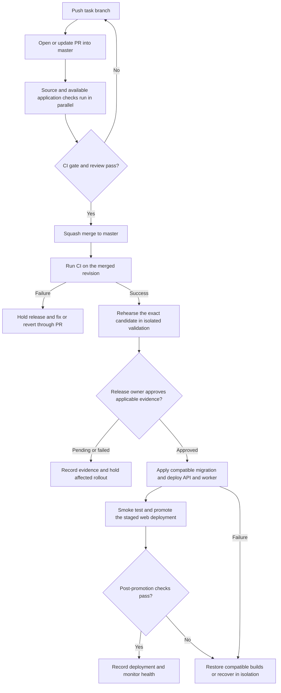

# RAFIQ Git workflow and CI/CD handbook

**Baseline reviewed 21 November 2026 · Repository `alisameh05/RAFIQ` · Default branch `master` · Product release owner Ali Sameh**

## 1. Overview and objectives

Keep `master` reviewable and safe to release. Deliver one coherent change per pull request, run repeatable checks on GitHub, and release a verified revision only after the applicable RAFIQ product gates pass. Start with source checks and add executable fixture suites to the single gate as they land.

The daily loop, branch quick reference, and repository health rules follow the structure of the supplied Pravaha handbook. RAFIQ's merge and release decisions follow its own architecture and qualification needs. [Pravaha workflow reference](https://github.com/Monolithic-Dev/Pravaha/blob/main/docs/GIT_WORKFLOW.md)

## 2. Project context and assumptions

| Area | Verified baseline |
| --- | --- |
| Repository | GitHub reports a public, user-owned repository. `master` is the only remote branch and points to `39d530f`, matching the inspected checkout. The initial history is primarily documentation and planning setup. [Repository](https://github.com/alisameh05/RAFIQ) |
| GitHub configuration | `master` is unprotected and has no active branch rules. All three merge methods are enabled and automatic head-branch deletion is off. GitHub lists zero workflows and deployment environments. Actions is enabled with a read-only default token, PR approval by Actions disabled, all actions allowed, and mandatory SHA pinning off. Secret scanning and push protection are enabled. Dependabot security updates are disabled. Dependabot alerts, the collaborator roster and vendor account settings remain unverified. |
| Working tree | Product, technical, architecture, API, experience, and design documents are present under `docs/`. The repository has BMAD and agent tooling and a skills lock, but no application entry points, application manifests or lockfiles, app test or build configuration, environment example, Docker or IaC configuration, PR template, CODEOWNERS, or implementation plan. |
| Proposed topology | Architecture §16 proposes `web/` for Next.js, TypeScript and browser monitoring, `server/` for FastAPI, Python worker, R and Alembic, and `ops/` for deployment and recovery. FastAPI owns private application access, Supabase PostgreSQL is authoritative, the worker runs R for all published statistics, and the browser handles live camera monitoring and offline warnings. [Architecture](docs/ARCHITECTURE.md) · [TRD](docs/TRD.md) |
| Hosting and integrations | Phase 0 validation uses Vercel Hobby for Next.js, Render Free for FastAPI, a local attended Python/R worker, Supabase Free for PostgreSQL, and Clerk development for test sign-in. Public always-on compute, private media and report storage, and independent recovery require qualification. Oracle Always Free and Neon pilot clip storage are candidates in the technical design. Resend, WhatsApp, MCP clients and optional chat have independent qualification gates. [Phase 0 hosting runbook](PHASE_0_HOSTING.md) |
| Milestone and release | The **15 December 2026** campus demo uses a stationary session with warning, camera pause, summary, benchmark and gate evidence. Public signup follows separate release approval and requires independent operational evidence. Workflow checks also protect the contracts for private data, offline sync, controlled use and admin access. [PRD §§6–8](docs/PRD.md) · [API §15](docs/API.md#15-api-testing-and-contract-validation) · [Experience](docs/EXPERIENCE.md) · [Design](docs/DESIGN.md) |

The workflow assumes a small team sharing one repository and working toward the same product release. Confirm the contributor roster, Git experience and reviewer coverage at adoption. Treat release cadence as evidence-driven while the team validates the demo and first public release. The settings, scripts and workflow files below are proposals.

## 3. Selected Git branching strategy

| Strategy | Team, contributors and parallel work | Architecture, environments and release cadence | CI and maintenance |
| --- | --- | --- | --- |
| **GitHub Flow** | Familiar branch-and-PR loop for mixed experience. Several short branches can proceed together with visible owners and review. | A single default branch fits the proposed monorepo and its shared API, database and worker contracts. Merge frequently and promote selected revisions to isolated environments as evidence becomes available. | One PR gate and one post-merge run. A small team can maintain the ruleset and release process. |
| **GitFlow** | Dedicated development, release and hotfix branches coordinate parallel supported release lines. Contributors have more branch types and must synchronize fixes across them. | Useful with independently maintained versions or long stabilization cycles. RAFIQ currently has one product line and uses environment isolation and qualification gates to control rollout. | Repeated integration and CI on multiple long-lived branches add maintenance and delay feedback. |
| **Trunk-Based Development** | Very small integrations and rapid reviews maximize throughput once test automation, reversible changes and shared trunk discipline are mature. | Fits frequent integration and independent release controls. A strict sub-day cadence puts pressure on contributors while the API, browser, database and R test baselines are being built. | Strong fast automation and feature-gate discipline pay off as the code grows. Use small branches and frequent integration from the start. |

**Decision.** Use GitHub Flow on the existing `master` branch, with short-lived branches and squash merges. Parallelize browser and server work through reviewed contracts and split larger features into compatible increments. Deployments and capability activation are separate from merge, which lets the team integrate work while a provider, supported device or release gate is still under qualification.

## 4. Branch naming and management

| Branch | Purpose | Example |
| --- | --- | --- |
| `master` | Default integration branch. Protect it through a ruleset after bootstrapping CI. | `master` |
| `feature/<slug>` | Product capability or independently verifiable slice. | `feature/offline-sync-receipts` |
| `fix/<slug>` | Ordinary defect correction. | `fix/duplicate-clip-receipt` |
| `hotfix/<slug>` | Incident correction eligible for expedited review and an approved release. | `hotfix/revoke-expired-media-access` |
| `docs/<slug>` | Documentation, contract clarification or evidence instructions. | `docs/git-workflow` |
| `refactor/<slug>` | Behavior-preserving code change. | `refactor/worker-lease-handler` |
| `chore/<slug>` | Maintenance, dependencies, tooling or CI. | `chore/bootstrap-ci` |

Use lowercase kebab-case after the prefix. Record the issue or requirement in the PR. Permit dependency bots to use their generated branch names. Start from current `master` and keep each branch open only while a related change is active. Use draft PRs to expose work in progress. Coordinate contract changes early. If dependent work must start before the contract PR merges, base it on a reviewed additive change when possible and retarget to `master` before final review and CI.

Update a shared task branch by merging `origin/master` into it. Resolve conflict markers in context, regenerate lockfiles with their owning tools when needed, run relevant checks again and request a fresh approval. Rebase a private task branch only when its owner confirms nobody else depends on it. If the branch has been pushed and history rewrite is authorized, use `git push --force-with-lease` on that task branch. Coordinate salvage or close an abandoned PR before deleting its branch.

Use release tags for the demo and public release. Routine release branches add upkeep without serving a current release line. Revisit a protected `release/<major>.<minor>` maintenance branch if the team approves multiple supported versions. A hotfix starts from `master`; when unreleased work cannot ship safely with it, restore the previous compatible deployment or contain the capability, then agree on a temporary maintenance path and integrate the fix back to `master`.

## 5. Daily development workflow

Commands use PowerShell and a clone where `origin` is the canonical repository and the contributor can push task branches. Inspect status before switching branches. Preserve unrelated changes in their branch or another worktree. A fork contributor pushes to their fork and opens a PR targeting `alisameh05/RAFIQ:master`.

```powershell
git status --short --branch
git branch --show-current
git fetch --prune origin
git switch master
git merge --ff-only origin/master
git switch -c docs/git-workflow

# Edit the document and verify its references and examples.
git add -- git_workflow.md
git diff --cached --check
git diff --cached
git commit -m "docs(ci): document the RAFIQ Git and release workflow"
git push -u origin HEAD
gh pr create --base master --title "docs(ci): document the RAFIQ Git and release workflow"
```

Run the relevant local commands from §11 once those tools exist. Read the PR diff, fill the description and request a reviewer. Mark a draft ready with `gh pr ready` when ready for merge review. A task branch push without an open PR publishes the branch. Opening or updating the PR triggers CI. Use `gh pr checks --watch`, fix failures on the task branch and resolve conversations with the reviewer. Squash merge after the branch is up to date, the current checks pass and reviews are complete.

```powershell
$prHead = gh pr view --json headRefOid --jq '.headRefOid'
gh pr checks --watch
# After confirming approvals, resolved conversations, and passing checks for $prHead:
gh pr merge --squash --match-head-commit $prHead
git switch master
git pull --ff-only origin master
git fetch --prune origin
git branch -d docs/git-workflow
```

GitHub deletes the remote head branch automatically after that setting is enabled, subject to permissions and other open PRs using it as base. A local squash-merged branch may fail `git branch -d` because the original commits are outside the resulting ancestry. Verify the PR is merged and its final head matches the local tip, then explicitly delete that local branch with `git branch -D docs/git-workflow`. If local `master` cannot fast-forward, inspect its divergent commits and preserve any local work on a task branch before repair.

## 6. Conventional Commit standards

Use `type(scope): imperative summary` for commits and PR titles. Keep each commit coherent, use a body for motivation and contract or migration effects, and include issue or requirement references where available. Examples reflect architecture modules rather than temporary folder names.

| Type | Example |
| --- | --- |
| `feat` | `feat(monitoring): surface camera pause in the session controls` |
| `fix` | `fix(sync): reuse durable receipts on retry` |
| `docs` | `docs(api): describe per-item sync outcomes` |
| `refactor` | `refactor(worker): isolate job lease renewal` |
| `test` | `test(admin): cover complementary disclosure suppression` |
| `chore` | `chore(web): refresh the browser test lockfile` |
| `ci` | `ci(db): validate Alembic upgrades against fixture data` |
| `perf` | `perf(analytics): reuse validated R results` |
| `build`, `revert` | `build(worker): pin report rendering dependencies`, `revert(web): restore the previous session bootstrap` |

Prefer specific scopes such as `accounts`, `monitoring`, `sync`, `clips`, `emergency`, `analytics`, `reports`, `mcp`, `chat`, `admin`, `worker`, `db`, `web`, `api`, `ci` and `ops`. Use `!` and a `BREAKING CHANGE:` footer for a genuine incompatible change. Include affected consumers, migration steps and compatibility window. For versioned HTTP, MCP or queued data, follow API §13 and document support for existing clients and persisted records before merging.

Avoid vague messages, unrelated cleanup in a functional commit, credentials, private data, dirty generated artifacts and skip-CI directives. Keep application commits buildable at reviewable boundaries. Use draft PRs or local fixups for intermediate work. [Conventional Commits specification](https://www.conventionalcommits.org/en/v1.0.0/)

## 7. Pull requests and code review

Prefer one issue or independently reviewable outcome per PR. Split by compatible behavior or contract, such as an additive database change followed by application adoption. Keep related migration, code, fixtures and documentation together when splitting would leave an unusable state. Size follows reviewability. Drafts are appropriate for early contract review or incomplete implementation and still run CI.

Request one independent reviewer with an understanding of the affected boundary. For authentication, private data, database migrations, emergency dispatch, MCP permissions, or release workflow changes, choose a reviewer who can verify the associated failure modes. The author shows local verification and identifies what needs provider, device or human evidence. Reviewers inspect the diff and applicable PRD, TRD, architecture, API and experience requirements. After a change, review the current diff and reapprove as required.

Use this structure for the proposed `.github/pull_request_template.md`.

```markdown
## Change
Summarize the behavior, scope, and linked issue or requirement.

## Verification
- [ ] Relevant local checks and CI ran. List commands and results.
- [ ] Applicable failure, authorization, and compatibility cases are covered.
- [ ] Browser changes include affected journeys and accessibility evidence.

## Contracts and operations
- [ ] Applicable API, data, UX, or operational documentation was updated.
- [ ] Applicable migrations include fresh and upgrade evidence and recovery steps.
- [ ] Applicable secrets, permissions, provider effects, and logs were reviewed.
- [ ] Rollout gates, deployment dependencies, and held capabilities are recorded.

Use N/A with a reason for checks outside this change. Use synthetic or
sanitized evidence in this public repository.
```

## 8. Merge strategy and branch protection

Choose **squash merge** so `master` records one reviewed change per PR with a conventional subject and a convenient revert unit. Merge commits preserve branch-level commit history but increase integration noise. Rebase merge keeps each individual task commit on `master` and requires every intermediate commit to carry durable history. Keep the PR as the source for granular review and verification.

- Set GitHub to allow squash only, use the PR title and description for the squash message, and enable head-branch deletion. Read the final squash message for breaking-change details and private references before merging.
- Apply an active branch ruleset to `master`. Require a PR, one independent approval, dismissal of stale approvals when the diff changes, conversation resolution, linear history, and the uniquely named `RAFIQ CI gate` from GitHub Actions. Require the branch to be current before merging. Block force pushes and deletion. Keep routine bypass access empty.
- Run the CI bootstrap before adding the required check so GitHub can discover it. Confirm an eligible reviewer can approve before activating the approval rule. If coverage is missing, assign a second authorized contributor before starting routine merges under the policy. During initial setup, record the approval or check evidence used for the bootstrap PR.
- Require suite results on the PR revision and rerun CI on the resulting `master` commit. A failed default-branch run blocks new release dispatches for that revision. Fix forward or send a revert PR through the same gate. Keep merge queue and CODEOWNERS optional until merge contention or established ownership warrants them. A future merge queue needs the `merge_group` CI event before activation.

The current public repository is eligible for free branch rulesets and GitHub environments with required reviewers and branch restrictions. Its user ownership means organization-team reviewer rules do not apply. Recheck eligibility after any ownership, visibility or plan change. Private Free repositories lack these free controls, and private Pro or Team environments have different reviewer availability. If equivalent independent review and release controls are unavailable, keep approval and credentials with named operators and hold releases that cannot satisfy the policy. [Ruleset availability](https://docs.github.com/en/repositories/configuring-branches-and-merges-in-your-repository/managing-rulesets/available-rules-for-rulesets) · [Environment availability](https://docs.github.com/en/actions/how-tos/deploy/configure-and-manage-deployments/manage-environments)

## 9. GitHub Actions CI design

Use standard GitHub-hosted `ubuntu-24.04` runners. They isolate jobs and offer free runner compute for the current public repository. Use timeouts, cache dependencies by lockfile and runtime, and use short retention for any future test artifacts. Keep provider calls, held-out benchmarks, public load, device qualification and disaster drills outside the merge pipeline. The release record carries their results. [Hosted runner reference](https://docs.github.com/en/actions/reference/runners/github-hosted-runners)

| Job and trigger | Setup, execution and environment | Output, failure and merge effect |
| --- | --- | --- |
| **Source** · PR into `master` and push to `master` | Git, Bash and pinned checkout. Find the tested diff, check whitespace, and check the core documents exist. Add executable OpenAPI/JSON Schema and link checks when the contract validator lands. `contents: read`, no secrets or external runtime configuration. | Logs identify failing paths, fixtures or contract validation. Required through the gate on every event. |
| **Local fixture smoke** · same events | Pinned Node and npm, lockfile-based npm cache, Playwright Chromium and a disposable Compose stack from `.env.fixture.example`. The web checks lint, typecheck, build and run the browser suite. The stack checks API readiness, PostgreSQL fresh and populated migrations, runtime grants, Python and R fixtures, recovery, PDF/Word parity and high or critical vulnerabilities in the built API and worker images. `contents: read`, no hosted credentials. | Failed setup, build, migration or tests block the gate. |
| **Dedicated web** · same events, as expanded checks land | Node and npm from TRD, `package-lock.json`, Playwright Chromium and local fixtures. Install, lint, type-check, build and run browser tests. Supply only synthetic configuration via the checked-in fixture bootstrap. `contents: read`, no secrets. | Build and test summaries. Missing scripts, stale lock, build error or test failure fails the gate. Optional sanitized failure traces later, with short retention. |
| **Dedicated server, database and R** · same events, as expanded checks land | CPython, uv, pinned R and renv, Linux report libraries/fonts and disposable PostgreSQL matching qualified Supabase behavior. Restore locks, run pytest and R fixtures. Local migration and runtime-role connection settings come from the fixture script. `contents: read`, no hosted credentials. | API/worker, migration, authorization, R and export fixture results. Setup, lock, migration or test failures fail the gate. |
| **Dependency review** · PR only after manifests land | GitHub dependency graph and pinned dependency-review action with `contents: read`. No comment-write permission or token beyond the job token. | New recognized high/critical vulnerabilities or scan failure block through the PR gate. Existing advisories and uncovered ecosystems require separate triage. |
| **RAFIQ CI gate** · all configured CI events | Lightweight job with `permissions: {}`. Explicitly checks upstream results, including which job may skip on push. | The one required merge check. Missing, failed, canceled or unexpectedly skipped upstream jobs fail it. A canceled workflow or conflicted PR still needs a fresh valid run. |

Source, the local fixture suite and PR dependency review run in parallel. The gate waits for them. Run every active application suite even for ordinary documentation changes initially. This keeps cross-component changes and required check behavior predictable. Use in-workflow change detection only if measured run times justify it. A later detector must treat unidentified changes, shared contracts, lockfiles and workflow edits conservatively and supply explicit expected job outcomes to the gate. Keep workflow event path filters out of required CI. [Required-check troubleshooting](https://docs.github.com/en/pull-requests/how-tos/merge-and-close-pull-requests/troubleshooting-required-status-checks)

The initial web suite uses a short synthetic camera/offline and privacy path, representative roles and accessible states from J1–J8 as each journey lands. The server suite checks migrations on empty and previously released schemas, preservation of retained rows, RLS under the actual runtime role, signed callback fixtures, durable receipts, worker lease races, publication and revocation, R reproducibility, and export parity as applicable. Include Python-to-R fixture execution in pytest as well as R method tests. Keep real identity, emergency delivery, MCP compatibility with a deployed reference client, supported Windows/Chrome evidence, and load/recovery measurements in isolated qualification. [API §15](docs/API.md#15-api-testing-and-contract-validation) · [Architecture §15](docs/ARCHITECTURE.md#15-testing-and-observability-architecture) · [TRD §8](docs/TRD.md#8-measurable-acceptance-and-release-gates)

Use built-in alerting and Dependabot for GitHub Actions and npm once their files land. GitHub lists uv support at v0.11 while the TRD pins v0.13.9. Test an update PR against the actual lockfile before relying on the bot for Python dependencies. Review uncovered Python dependencies, `renv.lock`, embedded model assets, WebAssembly and pinned system dependencies in maintenance PRs. Defer scheduled scans, a numeric coverage threshold and image-build checks until there are measurable gaps, application tests, or an image to validate. A qualification build must record the actual image digest when applicable, as required by the TRD. [Dependency review availability](https://docs.github.com/en/code-security/concepts/supply-chain-security/dependency-review) · [Dependabot ecosystems](https://docs.github.com/en/code-security/reference/supply-chain-security/supported-ecosystems-and-repositories)

## 10. Continuous deployment strategy

| Environment | Trigger, target, approval and isolation | Verification and recovery |
| --- | --- | --- |
| Local and CI | Developer command or CI event. Local Next.js, FastAPI, worker, R and disposable PostgreSQL as scaffolds land. Use checked-in fixtures and local-only settings. | Verify camera fixtures, REST/MCP boundaries, migrations and R outputs. Reset disposable data and rebuild from the lockfiles. |
| Optional PR preview | Maintainer opts in after CI for a reviewed revision. Use a separate Vercel preview project or independently isolated preview configuration, with synthetic data and a validation API or mocks. Credentials for the deployed app belong to that environment. Keep automatic builds of unreviewed branches and forks disabled for any credential-bearing target. | Verify affected UI and API journeys and browser origin restrictions with a synthetic account. Remove or expire abandoned previews and recycle the test data. If provider limits or access controls prevent safe hosting, use a local walkthrough, screenshots or a shared validation slot. |
| Shared validation and campus demo | The maintainer manually deploys the reviewed passing `master` candidate to the isolated Vercel Hobby and Render Free services. The operator starts the matching worker image locally against the validation database. Use Clerk development identities and approved synthetic records. Ali Sameh approves demo readiness. | Rehearse browser connectivity, Render cold start, stationary warning and camera pause, summary, offline recovery and worker restart. Record the matching component revisions and smoke results. Restore the last rehearsed build or use the approved local fixture. [Phase 0 hosting runbook](PHASE_0_HOSTING.md) |
| Public production | Ali Sameh approves the exact candidate against the applicable gates. Begin with an attended, logged release. Enable the guarded workflow in §11 after host, credentials, recovery and operator/reviewer coverage qualify. Vercel frontend, approved always-on FastAPI/worker compute, Supabase and the approved private storage and providers. Keep environment data, grants, webhooks, secrets and object namespace isolated. | Apply compatible migrations, deploy coordinated runtime revisions, run pre- and post-promotion smokes, then observe health. Restore compatible components or perform isolated recovery per §14. Hold signup or specific capabilities until the applicable qualifications pass. |

Use **continuous integration with manual production promotion**. An automatic push-to-production path would couple merges to readiness decisions for operating conditions, identity, emergency delivery, and recovery. Disable provider auto-promotion and machine deployments that bypass the documented release flow. If Vercel Git integration cannot provide the needed isolation or approval on the qualified plan, use a maintainer-controlled CLI deployment workflow. Verify Hobby project ownership and use eligibility, account controls, immutable build behavior and any protection features on the actual plan. A Vercel preview URL must be safe if reachable by anyone. [Vercel Hobby](https://vercel.com/docs/plans/hobby) · [Vercel Git integration](https://vercel.com/docs/git/vercel-for-github) · [Promotion behavior](https://vercel.com/docs/deployments/promoting-a-deployment)

Deploy the web separately only when browser/session compatibility is proven against the active API, including cached assets and queued records. Treat the Python API and worker/R as one release unit with separate process health. Coordinate migration and release ordering even when providers can technically deploy components independently. Keep the browser warning path local. A public release requires a passing supported-device and benchmark protocol, unassisted journey, applicable feature tests, accessibility, privacy/lifecycle, public capacity and recovery, client-neutral MCP and reports, and both FR-22 acceptance areas. Qualify social sign-in, live email and WhatsApp, and each optional chat provider separately. Maintain zero project cost by checking actual quota, eligibility, exhaustion and recovery evidence. [PRD §§7–8](docs/PRD.md) · [TRD §§7–8](docs/TRD.md) · [Architecture §13](docs/ARCHITECTURE.md#13-deployment-and-infrastructure-architecture)



## 11. Workflow files and YAML examples

| File | When to adopt | Events and execution |
| --- | --- | --- |
| `.github/workflows/ci.yml` | Bootstrap with source and the executable local fixture suite. Add each new job and its gate assertion together. | PRs targeting `master` and pushes to `master`. Uses read-only checkout and a stable required check. No provider environment or secrets. |
| `.github/workflows/deploy-production.yml` | After the attended public release path is rehearsed and the prerequisites below are complete. | Manual dispatch from `master`. Preflight → protected `production` job → orchestrated migration, release, smoke and evidence. Failure stops promotion or starts qualified recovery according to deployment state. |

Keep preview and demo deploys operator-driven initially. GitHub's built-in Dependabot and secret scanning cover the initial scheduled security needs. A tag records a successful release. It does not deploy. Add workflow linting with a pinned tool when workflow maintenance warrants it.

### Bootstrap `ci.yml`

[RAFIQ CI](../.github/workflows/ci.yml) runs for PRs into `master` and pushes to `master`. On a PR, checkout tests GitHub's synthetic merge commit and the source job checks its diff against the first parent. On a push it checks the full change since the previous tip and uses the empty tree when that tip is unavailable. Source also checks that the core documents are present and nonempty.

The workflow calls the [local fixture suite](../.github/workflows/local-fixture.yml) on both events. It uses `.env.fixture.example` for disposable browser, API, database, worker, R, recovery and render checks. Source and fixture have read-only repository contents access and checkout clears credentials. The PR-only dependency review uses read-only repository contents access and fails for newly introduced high or critical advisories recognized by the GitHub dependency graph. The gate runs without repository permissions and requires Source and the fixture to succeed on both events. It requires dependency review to succeed on PRs and to skip on pushes. Add the expected result for any new prerequisite in the same PR that adds the job.

#### Bootstrap and enforcement evidence

1. Request an independent review of the bootstrap PR. Record its head SHA, the tested merge SHA from the source log, the reviewer's approval and the check run. Squash merge the exact reviewed candidate and record the resulting `master` SHA and gate run before requiring the check.
2. After the PR and push checks pass, the authorized repository operator adopts the settings in [Merge strategy and branch protection](#8-merge-strategy-and-branch-protection). Require the exact `RAFIQ CI gate` check from GitHub Actions and enable strict up-to-date checks. Record the active ruleset and squash settings.
3. Open two disposable PRs from the protected baseline and leave them unmerged. In one, add trailing whitespace to a changed line to fail Source. In the other, set the Source job to `if: ${{ false }}`. Record the prerequisite and gate conclusions and the merge block reported by GitHub for each. Close both proof PRs after recording the results.
4. For a fork PR, record the candidate SHA and workflow run. Inspect the job setup for read-only token permissions, check that the fixture used `.env.fixture.example` and verify that the workflow grants no deployment permissions and uses no hosted credentials. Record any GitHub approval needed to start the run.

Link bootstrap evidence from [issue #10](https://github.com/alisameh05/RAFIQ/issues/10) and the expanded-gate and deployment evidence from [issue #11](https://github.com/alisameh05/RAFIQ/issues/11). Use the [implementation guide's evidence fields](IMPLEMENTATION_GUIDE.md#5-traceability-and-release-evidence).

### Application `ci.yml`

The following paths and entry points are **implementation prerequisites**. Keep their actual locations aligned with Architecture §16 and adjust the workflow in the same PR if the scaffold adopts different names.

- Under `web/`, add the npm manifest and lock, `lint` (ESLint), `typecheck` (TypeScript), `build` (Next.js), and `test:e2e` (Playwright), with a local, synthetic test server configuration. Add a checked-in fixture bootstrap for public build settings or test-mode identity if required. Use `ops/ci/prepare-web.sh` to export nonsecret configuration via `GITHUB_ENV` and prepare model/WASM test assets from reviewed hashes. Keep the fixture path disabled in production.
- Under `server/`, add `pyproject.toml`, `uv.lock`, pytest discovery, Alembic configuration, `renv.lock`, renv 1.3.1 activation, and `r/tests/testthat/`. Include documented dev/test dependencies in the default `uv sync` groups. Add `ops/ci/prepare-server.sh` to provision pinned native render dependencies and a versioned, disposable PostgreSQL fixture, with its chosen image digest or package versions committed. Use a migration role and a separate least-privilege runtime role with test-only URLs exported via `GITHUB_ENV`. Wait for readiness. Fixtures must simulate needed extensions and roles and verify fresh and upgrade paths against actual Alembic revisions.
- Add `ops/ci/check-contracts.sh` and its reproducibly installed validator to validate the embedded and exported OpenAPI and JSON Schema, references, examples and operation metadata from API §15. Keep approved contract changes and generated projections together. Confirm GitHub dependency graph and dependency-review support on test PRs, including a fork, before requiring the expanded gate.
- Verify exact runtime patches are obtainable on the selected runner. The literals below come from TRD §1.1. Confirm matching Node/npm, CPython, R, PostgreSQL and R packages on real cold-cache runs. Adjust a baseline through a reviewed TRD/lock update. Pin subsequent provider tools and helper dependencies to reviewed versions.

```yaml
name: RAFIQ CI
'on':
  pull_request:
    branches: [master]
  push:
    branches: [master]
permissions:
  contents: read
concurrency:
  group: rafiq-ci-${{ github.ref }}
  cancel-in-progress: true
jobs:
  source:
    name: RAFIQ source
    runs-on: ubuntu-24.04
    timeout-minutes: 5
    steps:
      - uses: actions/checkout@3d3c42e5aac5ba805825da76410c181273ba90b1 # v7.0.1
        with:
          fetch-depth: 0
          persist-credentials: false
      - name: Check the tested diff and core documents
        env:
          BEFORE: ${{ github.event.before }}
        run: |
          if [[ "$GITHUB_EVENT_NAME" == pull_request ]]; then
            base=$(git rev-parse HEAD^1)
          elif [[ -n "$BEFORE" ]] && git cat-file -e "$BEFORE^{commit}" 2>/dev/null; then
            base=$BEFORE
          else
            base=$(git hash-object -w -t tree /dev/null)
          fi
          git diff --check "$base" HEAD --
          for doc in PRD TRD ARCHITECTURE API EXPERIENCE DESIGN; do
            test -s "docs/$doc.md"
          done
      - run: bash ops/ci/check-contracts.sh
  web:
    name: RAFIQ web
    runs-on: ubuntu-24.04
    timeout-minutes: 20
    defaults:
      run:
        working-directory: web
    steps:
      - uses: actions/checkout@3d3c42e5aac5ba805825da76410c181273ba90b1 # v7.0.1
        with:
          persist-credentials: false
      - uses: actions/setup-node@949feb2413d6458794dcd2491c4babbbce0c15c1 # v7
        with:
          node-version: '24.22.3'
          cache: npm
          cache-dependency-path: web/package-lock.json
      - run: bash ops/ci/prepare-web.sh
        working-directory: .
      - run: npm install --global npm@11.19.1
      - run: npm ci
      - run: npm run lint
      - run: npm run typecheck
      - run: npm run build
      - run: npm exec -- playwright install --with-deps chromium
      - run: npm run test:e2e
  server:
    name: RAFIQ server, database and R
    runs-on: ubuntu-24.04
    timeout-minutes: 25
    defaults:
      run:
        working-directory: server
    steps:
      - uses: actions/checkout@3d3c42e5aac5ba805825da76410c181273ba90b1 # v7.0.1
        with:
          persist-credentials: false
      - uses: actions/setup-python@6d4fd22b20465ccc0f7354476588e8df7c9ca0e0 # v7
        with:
          python-version: '3.14.10'
      - uses: r-lib/actions/setup-r@f9a764fea8d5c63df6ef9a5c7795bf7deb5d7e05 # v2
        with:
          r-version: '4.6.2'
          working-directory: server
      - run: bash ops/ci/prepare-server.sh
        working-directory: .
      - run: python -m pip install 'uv==0.13.9'
      - run: uv sync --locked
      - run: Rscript -e 'renv::restore(lockfile = "renv.lock", prompt = FALSE)'
      - run: uv run --no-sync python -m pytest
      - run: Rscript -e 'testthat::test_dir("r/tests/testthat", stop_on_failure = TRUE)'
  dependency_review:
    name: RAFIQ dependency review
    if: ${{ github.event_name == 'pull_request' }}
    runs-on: ubuntu-24.04
    timeout-minutes: 5
    steps:
      - uses: actions/dependency-review-action@bbc44d14a204704ccc493733616cd1e93a0321ec # v5.0.1
        with:
          fail-on-severity: high
          fail-on-scopes: runtime, development, unknown
  gate:
    name: RAFIQ CI gate
    if: ${{ always() }}
    needs: [source, web, server, dependency_review]
    permissions: {}
    runs-on: ubuntu-24.04
    timeout-minutes: 5
    steps:
      - env:
          SOURCE: ${{ needs.source.result }}
          WEB: ${{ needs.web.result }}
          SERVER: ${{ needs.server.result }}
          DEPENDENCIES: ${{ needs.dependency_review.result }}
        run: |
          test "$SOURCE" = success
          test "$WEB" = success
          test "$SERVER" = success
          if [[ "$GITHUB_EVENT_NAME" == pull_request ]]; then
            test "$DEPENDENCIES" = success
          else
            test "$DEPENDENCIES" = skipped
          fi
```

Reuse npm download cache. Measure before introducing additional caching. For uv or renv, cache dependency downloads by OS, architecture, tool/runtime versions and lockfile hash, and still verify locked installation on every run. Keep build outputs, credentials and fixture data out of caches used by deployment jobs. A failed analyzer, unavailable registry or missing package gets investigated before rerunning.

### Guarded `deploy-production.yml`

**Prerequisites.** Protect `master` with the expanded CI gate. Create the `production` environment with selected deployment branch `master`, an eligible required reviewer and prevention of self-review. The operator dispatches, and Ali Sameh signs off on the evidence. Assign an eligible independent approver for the environment. That approver checks the release owner's sign-off against the exact SHA and reviewed evidence record shown by the run. The repository owner should disable environment bypass where supported. If a second qualified operator is unavailable, keep deployment attended and explicit under Ali Sameh's control, and keep production credentials out of Actions until this approval design is available.

Implement the proposed `ops/release.sh --environment production --sha <sha> --evidence <id>` on `master` after choosing the compute deployment mechanism. Its interface below is the boundary for host-specific implementation. The script must:

1. Resolve the evidence ID in an approved release record store, verify its immutable revision and Ali Sameh's sign-off, and match its SHA, target, validated migrations, artifact/build identities and applicable gate results. Fail before mutation if any field, approval, credential, target or artifact is missing or mismatched. Record the prior compatible deployment IDs and current schema.
2. Acquire the same production release lock used by attended operations. Use prebuilt verified artifacts where the platform supports them. Build or resolve staged Vercel production-config output from the named SHA, use pinned deployment tooling and verify the resulting deployment ID. Establish its production-equivalent configuration and test the staged deployment without assigning the public alias. Only promote that tested deployment.
3. Execute the migration and coordinated application steps in §14, verify service health, switch the web alias and run the synthetic smoke. Record component IDs and outcomes under the evidence record. Return nonzero on failure and record the last completed state. Retry only after reconciling host state. Release procedure and lock recovery must cover an interrupted runner as well as an ordinary error.

The example uses proposed environment-scoped values listed in §12. The preflight uses GitHub read permissions only. The approved job rechecks `master` and checks out the dispatch SHA. Its deployment credential set is exposed only to the release step. Qualify the pinned CLI, artifact transfer, provider limits, lock mechanism, test identity and safe smoke before installing the workflow. GitHub concurrency prevents overlapping runs in this group. A newer pending request can replace an older pending one under the default configuration, so dispatch one requested release at a time. A running release is allowed to finish. Use the production lock to cover provider-side and manual operations too. [Workflow-run API](https://docs.github.com/en/rest/actions/workflow-runs) · [GitHub concurrency](https://docs.github.com/en/actions/how-tos/manage-workflow-runs/control-workflow-concurrency) · [Vercel CLI promotion workflow](https://vercel.com/kb/guide/using-vercel-cli-for-custom-workflows)

```yaml
name: RAFIQ production release
run-name: Production candidate at ${{ github.sha }}
'on':
  workflow_dispatch:
    inputs:
      ci_run_id:
        description: Passing RAFIQ CI push run ID for this master SHA
        required: true
        type: string
      evidence_id:
        description: Public identifier for approved immutable release evidence
        required: true
        type: string
permissions: {}
concurrency:
  group: rafiq-production
  cancel-in-progress: false
jobs:
  preflight:
    name: Verify production candidate
    runs-on: ubuntu-24.04
    timeout-minutes: 5
    permissions:
      actions: read
      contents: read
    steps:
      - name: Verify master and the exact post-merge CI run
        env:
          GH_TOKEN: ${{ github.token }}
          CI_RUN_ID: ${{ inputs.ci_run_id }}
          EVIDENCE_ID: ${{ inputs.evidence_id }}
        run: |
          test "$GITHUB_REF" = refs/heads/master
          [[ "$CI_RUN_ID" =~ ^[1-9][0-9]*$ ]]
          [[ "$EVIDENCE_ID" =~ ^[A-Za-z0-9][A-Za-z0-9._-]{0,79}$ ]]
          root="repos/$GITHUB_REPOSITORY"
          master_sha=$(gh api "$root/branches/master" --jq .commit.sha)
          test "$master_sha" = "$GITHUB_SHA"
          ci_workflow=$(gh api "$root/actions/workflows/ci.yml" --jq .id)
          gh api "$root/actions/runs/$CI_RUN_ID" |
            jq -e --arg sha "$GITHUB_SHA" --argjson workflow "$ci_workflow" '
              .workflow_id == $workflow and .event == "push" and
              .head_branch == "master" and .head_sha == $sha and
              .status == "completed" and .conclusion == "success"
            '
          printf 'Candidate `%s`, CI run `%s`, evidence `%s`\n' \
            "$GITHUB_SHA" "$CI_RUN_ID" "$EVIDENCE_ID" >> "$GITHUB_STEP_SUMMARY"
  deploy:
    name: Deploy approved production candidate
    needs: [preflight]
    runs-on: ubuntu-24.04
    timeout-minutes: 45
    environment: production
    permissions:
      contents: read
    steps:
      - name: Recheck master after the approval wait
        env:
          GH_TOKEN: ${{ github.token }}
        run: |
          master_sha=$(gh api "repos/$GITHUB_REPOSITORY/branches/master" --jq .commit.sha)
          test "$master_sha" = "$GITHUB_SHA"
      - uses: actions/checkout@3d3c42e5aac5ba805825da76410c181273ba90b1 # v7.0.1
        with:
          ref: ${{ github.sha }}
          persist-credentials: false
      - name: Release the approved revision
        env:
          EVIDENCE_ID: ${{ inputs.evidence_id }}
          VERCEL_ORG_ID: ${{ vars.VERCEL_ORG_ID }}
          VERCEL_PROJECT_ID: ${{ vars.VERCEL_PROJECT_ID }}
          VERCEL_TOKEN: ${{ secrets.VERCEL_TOKEN }}
          RAFIQ_DEPLOY_CREDENTIAL: ${{ secrets.RAFIQ_DEPLOY_CREDENTIAL }}
          RAFIQ_MIGRATION_DATABASE_URL: ${{ secrets.RAFIQ_MIGRATION_DATABASE_URL }}
        run: bash ops/release.sh --environment production --sha "$GITHUB_SHA" --evidence "$EVIDENCE_ID"
```

If `master` advances during review, qualify and dispatch the new exact head. If it advances after the approved deployment has started, finish or recover the already selected SHA. The deployment never follows a moving commit ref after checkout. When release CI sees a GitHub API error or missing verified CI run, stop before approval and recheck metadata and the candidate.

## 12. Environments, secrets, and security

| Location | Configuration and access |
| --- | --- |
| Repository and developer prerequisites | Commit redacted environment examples with descriptions and synthetic defaults where safe. Add ignore rules for local overrides, generated state, provider config files and credential stores before onboarding. Keep runtime versions and reproducibility metadata public. Audit ignore rules and staged changes before every commit involving configuration. |
| PR CI | Read-only token, standard GitHub-hosted runner, `persist-credentials: false`, synthetic settings and disposable databases. No environment credentials, OAuth clients, live recipients, cloud write keys or private data. Set GitHub's default token to restricted permissions and disable Actions creating or approving PRs. |
| Preview and validation | Separate Clerk instance or approved dev configuration, PostgreSQL, worker identity, object namespace, signing keys, webhook endpoints and allowed origins. Use synthetic or approved validation data. Confine developer/provider access to the environment and keep production destinations and credentials out of preview builds. Never publish private records, browser auth state, sensitive traces or customer-like fixtures in artifacts. |
| Production runtime | Configure server-only connection, storage, signing, encryption and provider credentials at the relevant runtime. Separate API, worker, migration and backup privileges. Next.js public variables contain only deliberate browser-visible configuration. Clerk supplies identity. Supabase is used as hosted PostgreSQL through FastAPI, with no browser database credentials or dependency on Supabase Auth. Review grants, Data API exposure and RLS at every schema change. |
| Proposed Actions `production` environment | Store nonsecret `VERCEL_ORG_ID` and `VERCEL_PROJECT_ID` as environment variables. Store a least-scope `VERCEL_TOKEN`, qualified compute credential `RAFIQ_DEPLOY_CREDENTIAL` and privileged migration connection `RAFIQ_MIGRATION_DATABASE_URL` as environment secrets only if needed by the approved script. Use the selected provider's secret store for runtime configuration. Replace the generic compute input with scoped federation or the actual credentials and adjust the example together when the host is chosen. |

- Give write access only to maintainers and contributors who need it. Review access when roles change, enroll maintainers in MFA and assign a recovery operator for vendor administration. Use repo secrets only for narrowly scoped trusted tasks that genuinely span environments. Use org secrets only if RAFIQ moves to an organization and restrict them to selected repositories. Keep production credentials environment-scoped or in the provider.
- On fork PRs approve runner execution under the repository's fork policy after inspecting the workflow and affected scripts. Treat all PR code, metadata and artifacts as untrusted. Use `pull_request` for CI with no privileged token grants. Do not use `pull_request_target` to check out or run PR code, or `workflow_run` to consume untrusted artifacts or caches with release credentials. Pass event data through environment variables and quote and validate it at the shell boundary.
- Pin actions to full upstream commit SHAs and record the corresponding release or major tag. Review special permissions, nested action calls, dependency downloads and updates. For known workflows, enforce allowed actions and full-length pinning at repository level if the settings support it. Verify that Dependabot updates keep both the SHA and its annotation accurate. For providers that support GitHub OIDC, scope trust to this repository and the approved workflow and environment using supported claims. Grant `id-token: write` only in the authenticated deploy job. Verify federation with the actual provider before choosing it. If unavailable, use short-lived or narrowly scoped credentials and document rotation and revocation. [GitHub secure use](https://docs.github.com/en/actions/reference/security/secure-use) · [GitHub OIDC](https://docs.github.com/en/actions/concepts/security/openid-connect)
- Enable and verify the dependency graph, Dependabot alerts, secret scanning and repository push protection as available on the current public repository. Triage existing advisories, runtime/package coverage gaps and any suspected exposure. Revoke or rotate exposed credentials immediately and coordinate any incident history cleanup explicitly. Record reviewed, time-bounded exceptions for dependency advisories with an owner and remediation date. Enable code scanning later where it adds actionable coverage, with availability and cost reassessed if visibility changes. [GitHub security features](https://docs.github.com/en/code-security/getting-started/github-security-features)

Use a TLS connection to Supabase with verified target and certificate controls. Prefer the direct database endpoint for migrations from a qualified network. If IPv4 or network access requires a pooler, qualify session mode and migration/locking behavior before use. Keep the migration role distinct from application and recovery roles. [Supabase connection guidance](https://supabase.com/docs/guides/database/connecting-to-postgres)

## 13. Release management and versioning

Use annotated SemVer tags for shipped application revisions, starting with `v0.x.y` while public contracts stabilize. The campus rehearsal can use a prerelease tag such as `v0.1.0-demo.1` on its verified SHA. Choose the actual version from the released scope and contract commitments. Keep REST versioning, MCP revisions, database revisions, model/asset versions and R methods visible independently of the Git tag.

The release record captures the Git SHA, CI run, change notes, accepted requirement and evidence IDs, approved reviewer and time, web deployment ID, API/worker builds, migrations, tested browser/device, vision bundle ID and manifest, R version and methods, provider qualification, recovery evidence, rollout flags and rollback targets. Share sanitized evidence in the public repository and retain any approved restricted evidence in access-controlled storage. Use the deployed SHA to tag the successful release. Publish a concise change summary with compatibility, known limitations and separately qualified capabilities. Never move a published tag to represent a later release.

For a vision bundle change, review the manifest's upstream revisions, artifact locations, runtime versions, licenses, notices, and per-file SHA-256 hashes. Verify the packaged files in frontend CI and attach the applicable stationary or simulator benchmark and CPU-only offline qualification to the exact candidate bundle. Record the approved prior frontend revision and its matching vision bundle ID as a rollback pair. [Vision packaging](DOCKER.md#pretrained-vision-assets) · [Qualification gates](TRD.md#8-measurable-acceptance-and-release-gates)

## 14. CI/CD failure handling and rollback

### CI diagnosis

1. Check base, head and workflow event. Use the PR Checks tab or the CLI in §17 to identify the first failed step. A pending required check may reflect a conflicting PR, unapproved fork workflow, a canceled run, or a missing/misnamed job.
2. Reproduce the command with the same versions, lockfiles, runtime roles and synthetic fixtures. Fix the root cause on the task branch. Treat failures on repeat as defects to investigate. Rerun a known infrastructure interruption on the same SHA and explain that rerun in the PR.
3. Push corrections, read the new PR run and request approval on the current diff. If default-branch CI fails, hold releases and fix or revert through a reviewed PR. For a failure in the gate itself, repair the gate in a reviewed change and verify the replacement before requiring it. Preserve the failure and approval record.

### Deployment and migration sequence

1. Validate the exact candidate in isolation with anonymized or synthetic representative data. Exercise fresh and previous-release upgrade paths, expected schema heads, role isolation, retained data, lease reclaim, cached browser compatibility and the documented recovery procedure. Confirm retention windows, independent backups/log replay, database connectivity and prior compatible builds before mutation.
2. Reserve the release slot and verify target project, current revision and approved record. Apply an additive Alembic migration once through the migration runner. Record previous and new revisions. Check lock duration, timeout and schema results. Use transactional DDL where supported and document staged backfills or nontransactional steps. Use a resumable backfill when required. Put a later destructive contraction in its own release after supported previous readers, writers and queued clients are out of scope. Compatibility must cover browser tabs with cached assets and pending uploads or records.
3. Deploy matching API and worker builds with compatible handoff. Drain or let workers safely relinquish leases and verify reclaim after restart. Check API readiness, schema compatibility, worker heartbeat and a synthetic job from claim through completion. Verify private denial, durable sync and safe storage behavior. Establish operational health probes with sanitized responses as part of scaffolding.
4. Smoke test the staged production-config Vercel deployment, then promote that deployment. Verify routed frontend and API version, sign-in with an approved test identity, the applicable end-to-end synthetic journey and health indicators. Test messaging via sandbox or fixture controls, with no live emergency contact smoke traffic. Observe availability, latency, API errors, worker backlog, sync and uploads, quota, backup lag and purge health. Enable only approved capabilities.
5. On migration failure, halt application rollout, keep the prior compatible deployment, and inspect schema and revision state before further changes. Repair forward where possible. On application or smoke failure, stop promotion or route back to the last compatible web deployment and restore matching API/worker builds. Confirm their compatibility with the applied schema and in-flight jobs. Keep additive schema during a compatible app rollback. Reconcile retries against the release record and provider state.
6. When the schema, data or lifecycle state requires recovery, isolate the target and suspend affected writes and reads per the recovery procedure. Restore independently encrypted backups, replay to the required position, reconcile objects, jobs and verified acknowledgments, and reapply deletion, suspension and revocation before reopening reads. Suppress historical emergency attempts. Re-run smoke and record observed recovery time and data loss against the TRD gates. Use no automatic down migration or blind rerun after a partial deployment.

Verify Vercel promotion and rollback under the project's qualified plan, including what happens to domain assignment after rollback. The same owner-approved workflow or attended procedure applies to hotfixes. [Vercel rollback](https://vercel.com/docs/deployments/instant-rollback) · [Supabase backups](https://supabase.com/docs/guides/platform/backups) · [TRD §§7–8](docs/TRD.md)

## 15. Human and AI contributor rules

- Inspect current branch, dirty files and instructions before editing. Use the branch convention, keep unrelated work outside your task and flag contract changes early.
- Use PRs on protected branches. Never commit directly to, force-push or delete a protected branch. Do not silently rewrite shared history, bypass required CI or merge failing pull requests.
- Keep credentials, personal data and restricted evidence out of Git, Actions logs and PR comments. Review staged files and test data. Run applicable local checks before asking for review.
- An AI coding agent needs **explicit user authorization** before committing, pushing, merging or deploying. Check authorization for those actions against the requested scope. Obtain authorization before opening a PR or posting externally on the user's behalf. Report what ran, what passed and what remains unverified. An agent does not act as the independent human approver or release owner.
- If CI fails, diagnose against the failed SHA, fix in scope and retain a trace of the rerun. Document a reproducible environment or provider blocker when it prevents verification.

## 16. Definition of Done

A feature is ready to merge when all applicable items are true:

- The PR maps to a requirement or issue, has a conventional title, is independently approved and has resolved conversations.
- Relevant local checks and CI on the current PR revision pass. New behavior, failure paths and private-data boundaries have appropriate fixtures. Contract, migration, UX and operational documents agree with the change.
- Data and migration tests cover retained state and compatible rollout, including relevant roles, replay, revocation and recovery. Documentation-only changes have checked references, examples and source alignment.
- Any required capability flag, qualification, operational dependency and rollout owner are recorded. A capability awaiting evidence stays gated.

The feature is integrated once the squash merge is complete, the resulting `master` revision passes CI, obsolete branches are removed when safe, and the issue or PR includes the verification result. A release is done when its owner approves all applicable gates, smoke and observation complete, the release and rollback IDs are recorded, and the published state matches the approval.

## 17. Git and GitHub CLI reference

Use these on the task branch unless a step names a different ref. Replace the example IDs with the actual PR, run or evidence IDs. On the RAFIQ Windows automation host, invoke one direct `gh` command per call with outside-sandbox permissions according to the local GitHub CLI instruction. The examples do not require printing or transferring the configured CLI credentials.

| Task | Command |
| --- | --- |
| Inspect current branch and changes | `git status --short --branch` |
| Inspect staged changes | `git diff --cached` |
| Inspect task diff | `git diff origin/master...HEAD` |
| Update task branch without rewriting shared history | `git fetch origin`, then `git merge origin/master` |
| Abandon an in-progress merge before committing | `git merge --abort` |
| Create an early PR | `gh pr create --draft --base master` |
| Mark ready, request reviewer | `gh pr ready`, then `gh pr edit --add-reviewer REVIEWER_LOGIN` |
| Inspect PR state | `gh pr view --json state,headRefOid,reviewDecision,mergeStateStatus` |
| Watch CI and read failure | `gh pr checks --watch`, then `gh run view 123456789 --log-failed` |
| Locate the post-merge run for a commit | `gh run list --workflow ci.yml --branch master --event push --commit FULL_SHA` |
| Rerun the same run after a verified transient outage | `gh run rerun 123456789 --failed` |
| Start the future approved release workflow | `gh workflow run deploy-production.yml --ref master -f ci_run_id=123456789 -f evidence_id=public-0.2.0` |
| Tag the released SHA and push only that tag | `git tag -a v0.2.0 FULL_SHA -m "Release v0.2.0"`, then `git push origin refs/tags/v0.2.0` |

Examples after scaffolding, from the repository root. Prepare the synthetic configuration, matching runtime and PostgreSQL fixture first. The CI scripts in §11 use GitHub-specific environment exports. Expose equivalent local fixture setup in the scaffold so developers can use the commands from PowerShell or the documented shell.

```powershell
Push-Location web
npm ci
npm run lint
npm run typecheck
npm run build
npm run test:e2e
Pop-Location

Push-Location server
uv sync --locked
Rscript -e 'renv::restore(prompt = FALSE)'
uv run --no-sync python -m pytest
Pop-Location
```

## 18. Repository configuration checklist

- [ ] Verify `master`, named owner and reviewer coverage. Check write access and action settings.
- [ ] Open the bootstrap PR with the proposed PR template and `ci.yml`. Observe the named check on a PR and `master` push. Deliberately fail an upstream job on a disposable PR and confirm that the gate fails.
- [ ] Enable squash-only merging and branch cleanup. Activate the ruleset and test current-branch, approval, required-check and conversation enforcement.
- [ ] Restrict action permissions, verify fork isolation, approve action publishing sources, and enforce SHA pinning when available. Check native security toggles.
- [ ] Add application lockfiles, documented local prerequisites and fixture runners. Verify the expanded workflow on ordinary, documentation, dependency, migration, and workflow changes. Include a fork PR and a cold-cache run.
- [ ] Validate independent preview and demo services, zero-cost usage, trusted-origin settings and provider auto-deploy restrictions.
- [ ] Rehearse safe production recovery and create the protected production environment after qualification. Verify missing CI, wrong branch, stale SHA, mismatched approval, timeout and partial-failure behavior without live rollout.

## 19. Recommended implementation order

1. Confirm owner and independent reviewer coverage. Run the bootstrap with source checks and the existing synthetic fixture suite, then activate the merge rules after verifying both the PR and resulting `master` check.
2. Expand the web and server checks as their executable prerequisites pass on hosted runners. Add each job and the corresponding gate assertion together.
3. Rehearse the attended validation and demo release with approved data, including fallback and reproducible evidence. Keep public signup and live provider capabilities gated by their respective criteria.
4. Qualify public hosts, data lifecycle, recovery and required external integrations under the zero-budget constraint. Rehearse promotion and rollback through the same release sequence.
5. Automate the proven operator sequence with the guarded release workflow. Revisit faster affected-path checks, risk-based additional reviewers and more deployment automation only if usage and evidence justify the maintenance.

## 20. Open decisions and future improvements

| Decision | Recommended default and closure evidence |
| --- | --- |
| Contributor access, approver availability and account settings | Keep `master`, confirm a second independent contributor and named release operator. Recheck rule and security toggles immediately before adoption. Keep unattended secret-bearing jobs disabled until independent approval is available. |
| Scaffold paths, exact tools and test entry points | Follow Architecture §16 and TRD §1.1, verify hosted patch availability and cold installs, and record actual script names with the first relevant scaffolds. Choose local PostgreSQL version, required extensions and native render dependencies from qualified production parity. |
| Vercel eligibility and identity or sender domains | Verify project ownership and actual use on Hobby. Use Clerk dev configuration for the demo. Require a controlled domain for standard Clerk production and a verified sending domain for live Resend. Qualify Google, Apple and each delivery channel separately. |
| Public API and worker host | Treat the attended demo as validation of the demo setup. Qualify always-on zero-cost compute, restart and lease behavior, networking, public capacity, runtime deployment and safe rollback. Evaluate Oracle Always Free under the actual account. Hold public rollout if no candidate passes. |
| Data, media and recovery | Qualify Supabase quota and runtime behavior, pilot and public private media separately, approved report artifact storage, and independent encrypted recovery/log storage. Prove restore preserves deletion and revocation before exposing data. |
| Device, contract and provider decisions | Close the API §18 items and verify the selected vision bundle and asset hashes, exact Chrome/device qualification, MCP compatibility, alert and optional chat availability. Keep each applicable capability gated while evidence is pending. |
| Scale and additional enforcement | Review CI duration, flakes, coverage gaps, security alerts and deployment effort after the first application release. Consider dependency/download cache additions, signed release tags, code owners, image scanning, or a merge queue where measured need and plan support justify them. |
